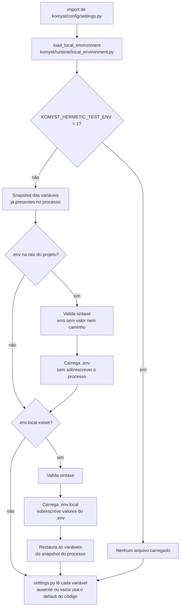

# Configuração

Esta referência descreve as opções reais do `.env.example` e as poucas variáveis adicionais consumidas diretamente pelo código atual.

> **Atualização de status (2026-11-12):** LANG-01 e GLOSSARY-01 já estão integrados em `dev`. A nota de revisão de 2026-11-02 abaixo é anterior a essa integração; confira os defaults no `.env.example` e no código.
>
> [Voltar ao README](../README.md)

## Como a configuração é carregada

`komyst/runtime/local_environment.py` carrega exclusivamente o `.env` localizado na raiz real
do projeto, sem procurar arquivos em diretórios pais, e depois o `.env.local` opcional (também
não versionado), que pode sobrescrever valores do `.env`. Variáveis já presentes no ambiente
do processo antes do carregamento sempre têm precedência; valores ausentes ou vazios usam o
default do código (`komyst/config/settings.py`, que chama esse helper ao ser importado). Em
testes herméticos (`KOMYST_HERMETIC_TEST_ENV=1`) nenhum arquivo é carregado.



Valores booleanos verdadeiros aceitos: `1`, `true`, `yes` e `on`, sem distinção de caixa. Qualquer outro valor não vazio é interpretado como falso.

## Neste guia

- [Tradução](#tradução)
- [OCR e classificação](#ocr-e-classificação)
- [Downloader e Selenium](#downloader-e-selenium)
- [Máscara, texto e reconstrução](#máscara-texto-e-reconstrução)
- [Validação visual](#validação-visual)
- [Cache e resume](#cache-e-resume)
- [Paralelismo e recursos](#paralelismo-e-recursos)
- [Precheck, observabilidade e debug](#precheck-observabilidade-e-debug)
- [Páginas lógicas e PDF](#páginas-lógicas-e-pdf)
- [Contexto e UI](#contexto-e-ui)
- [Auth, licença, raízes e navegador](#auth-licença-raízes-e-navegador)

Comece sempre pelo template:

```powershell
Copy-Item .env.example .env
```

Não versione o `.env` e nunca use uma chave real em exemplos, issues ou logs.

## Tradução

Todo job com tradução habilitada usa o provider interno `komyst_backend`
(`komyst/translation/providers/komyst_backend_provider.py`), autenticado pelo JWT do usuário, que
chama o motor remoto **DeepL** no servidor (Edge Function
`supabase/functions/translation-execute`). O cliente nunca chama a DeepL diretamente e
`--translation-provider`/`DEFAULT_TRANSLATION_PROVIDER = "deepl"` (`komyst/ui/ui_helpers.py`)
são apenas metadado/guard: pedir `riva` ou `nemotron` num job habilitado falha fechado
(`provider_mismatch`). A base do backend é `KOMYST_BACKEND_URL` ou, sem ela, `SUPABASE_URL`
(`KOMYST_BACKEND_URL` não está no template). Com `KOMYST_ENV=local`/`test` e `KOMYST_TEST_BACKEND`
vazio/`mock`, um backend mock é usado.

As variáveis abaixo existem no template e em `komyst/config/settings.py`, mas as de DeepL/NVIDIA
só são lidas por caminhos legados/experimentais do cliente; `DEEPL_API_KEY` é, na prática,
segredo do servidor (Edge Function).

| Variável | Default do template | Obrigatória? | Finalidade |
| --- | --- | --- | --- |
| `DEEPL_API_KEY` | `sua_chave_aqui` | Não no cliente | Segredo do servidor de tradução; não necessário para jobs habilitados do cliente |
| `DEEPL_API_BASE_URL` | `https://api-free.deepl.com` | Não | Endpoint DeepL do caminho legado local |
| `DEEPL_MODEL_TYPE` | `quality_optimized` | Não | Tipo de modelo DeepL do caminho legado local |
| `NVIDIA_API_KEY` | `sua_chave_aqui` | Não | Credencial NVIDIA para caminhos legados (Riva/Nemotron) e OCR NVIDIA opcional |
| `NVIDIA_BASE_URL` | `https://integrate.api.nvidia.com/v1` | Não | Endpoint compatível com OpenAI |
| `NVIDIA_TRANSLATION_MODEL` | `nvidia/nemotron-3-super-120b-a12b` | Não | Modelo usado nas requisições |
| `NVIDIA_TRANSLATION_BATCH_SIZE` | `20` | Não | Quantidade máxima de grupos por lote |
| `NVIDIA_MAX_REQUESTS_PER_MINUTE` | `20` | Não | Limite global aplicado pelo cliente |
| `TRANSLATION_MODE` | `nvidia` | Não | Eixo legado de família de tradução (factory `get_translator`); não seleciona o provider de um job habilitado |
| `TRANSLATE_SFX` | `False` | Não | Controla o lettering do PDF/página traduzida. A preferência “Traduzir SFX” é persistida por usuário e copiada como booleano no job; o runner aplica esse snapshot. Desligada: SFX original no PDF. Ligada: tradução por glossário/provider quando aplicável. A pasta de páginas limpas tenta remover SFX em ambos os casos, sob os gates de OCR, propriedade da máscara e reconstrução. Jobs antigos sem snapshot continuam herdando o ambiente. |

O seletor de provider da UI (`#translationProviderField`) está oculto; o único fluxo de produto é o backend autenticado com DeepL. Os modos Google/NLLB/NVIDIA permanecem como compatibilidade legada, sem o contrato de validação end-to-end auditado.

**Glossário de nomes (integrado):** a variável abaixo é definida pelo runner a partir do glossário informado pelo usuário na UI; não deve ser definida manualmente no `.env`.

| Variável | Default | Finalidade |
| --- | --- | --- |
| `KOMYST_NAME_GLOSSARY` | vazio | JSON array de pares `[["Src","Tgt"],…]` serializado pelo `job_runner.py` a partir do campo `name_glossary` do job config. O pipeline (`benchmark_pipeline.py`) lê e chama `translator.set_name_overrides()`. Máximo de 50 pares; fonte e destino não podem ser vazios. |

## OCR e classificação

| Variável | Default | Finalidade |
| --- | --- | --- |
| `OCR_ENGINE` | `paddle` (código: `rapidocr`) | Valor cru do módulo; `_configure_mode` (`komyst/commands/run_webtoon.py`) o substitui por `effective_ocr_engine()` — RapidOCR nos dois modos — então definir esta variável não muda a engine de um job |
| `KOMYST_OCR_ENGINE_OVERRIDE` | vazio (fora do template) | Override por ambiente lido por `effective_ocr_engine()`; no Beta só `rapidocr` é aceito (`BETA_OCR_ENGINES`), qualquer outro valor é ignorado. O guard falha fechado se o engine não estiver instalado |
| `OCR_FALLBACK_ENGINE` | `paddle` (código: vazio) | Forçado para vazio pela CLI: fallback entre engines não faz parte do contrato Beta |
| `OCR_HYBRID_FALLBACK` | `True` (código: `False`) | Forçado para `False` pela CLI |
| `RAPIDOCR_ENABLED` | `False` (código: `True`) | Forçado para `True` pela CLI quando o engine é RapidOCR (sempre, no Beta) |
| `OCR_LEGACY_PADDLE_FALLBACK` | fora do template (código: `False`) | Opt-in de compatibilidade legacy do Paddle; não instalado no perfil Beta |
| `RAPIDOCR_MIN_CONFIDENCE` | `0.55` | Confidence mínima usada nos sinais de suspeita |
| `RAPIDOCR_SUSPICIOUS_TEXT_FALLBACK` | `True` | Aciona fallback diante de texto estruturalmente suspeito |
| `RAPIDOCR_PAGE_FALLBACK` | `True` | Recuperação de página no modo `quality`; a CLI a desliga no modo `fast` |
| `FAST_OCR_HEAVY_FALLBACK` | `False` | Opt-in para fallbacks nativos pesados no modo `fast`; o padrão preserva previsibilidade |
| `FAST_OCR_PAGE_TIMEOUT_SECONDS` | `45` | Limite de uma tentativa pesada por página no modo `fast` |
| `FAST_OCR_REGION_TIMEOUT_SECONDS` | `12` | Limite de uma tentativa pesada por região no modo `fast` |
| `FAST_OCR_FULL_FALLBACK_MAX_PAGES` | `0` | Máximo de páginas que podem usar Paddle completo no modo `fast` |
| `FAST_OCR_FULL_FALLBACK_MAX_REGIONS` | `4` | Máximo de regiões que podem usar Paddle completo no modo `fast` |
| `FAST_OCR_TOTAL_FALLBACK_BUDGET_SECONDS` | `60` | Orçamento total de fallback pesado por execução `fast` |
| `OCR_TEXT_REPAIR` | `True` | Habilita reparos conservadores de OCR |
| `OCR_TEXT_REPAIR_MODE` | `conservative` | Modo implementado para os reparos; outros valores desativam esse caminho |
| `OCR_QUALITY_CONTROL` | `True` | Calcula score e motivos de qualidade dos grupos |
| `OCR_REGION_SELECTIVE_FALLBACK` | `True` | Reprocessa apenas regiões suspeitas quando possível |
| `OCR_GROUP_FALLBACK_MAX_GROUPS` | `8` | Máximo de grupos regionais por página |
| `OCR_GROUP_FALLBACK_PADDING` | `34` | Padding, em pixels, ao redor do crop de fallback |
| `OCR_GROUP_MIN_QUALITY_SCORE` | `0.62` | Limiar base para seleção regional |
| `PRIORITIZE_ENCLOSED_TEXT` | `True` | Dá prioridade a evidências de texto em containers |

O fallback não substitui palavras por regras fixas. Ele pede novas leituras e compara candidatos. Ajustar thresholds pode aumentar custo, falsos positivos ou risco visual; mantenha os defaults até ter uma regressão reproduzível.

**Cache opcional de modelos OCR por idioma:** o catálogo e o helper de cache existem, mas o pipeline ainda não carrega um modelo de reconhecimento diferente por idioma. Definir esta variável, por si só, não altera o OCR usado:

| Variável | Default | Finalidade |
| --- | --- | --- |
| `KOMYST_OCR_MODELS_DIR` | `~/.komyst/ocr_models` | Diretório de cache dos modelos PaddleOCR de reconhecimento para idiomas não-ingleses (japonês, coreano, chinês simplificado, cirílico, latino). Gerenciado por `komyst/ocr/ocr_models.py`. |

O modelo inglês é embutido no `rapidocr_onnxruntime` e não requer download. Embora exista um
helper para modelos adicionais, o pipeline de produção ainda não o chama. Além disso, os hashes
do catálogo não estão preenchidos; não conte com download ou validação desses modelos até que
essa integração seja concluída.

## Downloader e Selenium

| Variável | Default | Finalidade |
| --- | --- | --- |
| `SELENIUM_QUIT_TIMEOUT_SECONDS` | `20` | Limite para o encerramento normal do driver, restrito internamente a 1–300 s |
| `SELENIUM_CLEANUP_TIMEOUT_SECONDS` | `3` | Janela do cleanup seletivo, restrita a 0,25–30 s |

`CHROMEDRIVER_PATH` é suportada pelo código, mas não aparece no template. Se estiver vazia,
o código procura `chromedriver`/`chromedriver.exe` já presentes no `PATH` e, quando nenhum
driver local existe, deixa o Selenium Manager oficial resolver um driver compatível de
forma cacheada. Em testes herméticos (`KOMYST_HERMETIC_TEST_ENV=1`) essa resolução
permanece desligada por padrão; defina `KOMYST_ALLOW_DRIVER_DOWNLOAD=1` apenas quando
quiser permitir explicitamente a resolução no ambiente de teste.

## Máscara, texto e reconstrução

| Variável | Default | Finalidade |
| --- | --- | --- |
| `TEXT_MASK_PADDING` | `3` | Expansão inicial da máscara do texto |
| `MAX_MASK_EXPANSION` | `8` | Limite de expansão durante tentativas visuais |
| `STRICT_MASK_BOUNDS` | `True` | Restringe a máscara à região segura |
| `MASK_COMPONENT_BASED` | `True` | Constrói máscaras a partir de componentes conectados |
| `WHITE_BALLOON_FLAT_FILL` | `True` | Permite preenchimento uniforme em balões brancos compatíveis |
| `ALLOW_LARGE_RECTANGLE_MASK` | `False` | Bloqueia por padrão retângulos amplos de limpeza |
| `TEXT_SAFE_PADDING` | `12` | Margem interna reservada para o texto traduzido |
| `MIN_FONT_SIZE` | `12` | Menor fonte permitida, com piso interno de 6 |
| `MAX_FONT_SIZE` | `42` | Maior fonte permitida |
| `MAX_TEXT_OVERFLOW_RATIO` | `0.01` | Overflow máximo antes de reprovação |
| `AUTO_LINE_WRAP` | `True` | Habilita quebra automática de linha |
| `AUTO_FONT_SHRINK` | `True` | Reduz a fonte quando necessário para caber |
| `TEXTURED_CAPTION_OVERLAY` | `True` | Usa overlay controlado em captions texturizadas |
| `CAPTION_OVERLAY_OPACITY` | `0.94` | Opacidade do overlay, limitada internamente a 0,35–0,95 |

Duas flags de tipografia existem só no código (fora do template, como os demais ajustes
finos de CLEAN/render), ambas com default `True`: `RENDER_FIT_BALLOON_SHAPE` quebra a tradução
seguindo o formato do balão fechado quando isso permite uma fonte maior, e
`RENDER_MATCH_SOURCE_SLANT` inclina o texto como o lettering original quando a fonte escolhida
é reta. Também só no código: `CLEAN_SURFACE_FILL` (default `True`) acrescenta o preenchimento
de degradê suave como candidato da limpeza (ver Documentação Técnica §16).

`PIPELINE_PAGE_WORKERS` (só no código, default `auto`): quantas páginas são analisadas,
pré-renderizadas e renderizadas ao mesmo tempo. `auto` usa um terço dos núcleos lógicos e uma
página por ~3 GB de memória livre, no máximo 4; valores explícitos de `1` a `4` são aceitos.

Nesta instalação, `PIPELINE_PAGE_WORKERS=2` foi aplicado em 08/11/2026 após replay
de 65 páginas: 31,95% menos tempo em preflight/render/escrita, com as 130 imagens
idênticas. O default distribuído continua `auto`; não foi homologado usar 4.
Inferências DirectML mantêm o lock compartilhado e os workers recebem a
proveniência isolada da própria página. O replay histórico não é uma medição atual
de capítulo completo nem define o default distribuído.

Guarda de memória (lida do ambiente por `komyst/config/settings.py`; ver Documentação Técnica §22):
`LAMA_MIN_FREE_RAM_MB` (padrão `1500`) e `FLUX_MIN_FREE_RAM_MB` (padrão `6000`) são os pisos de RAM
livre abaixo dos quais LaMa e FLUX se declaram indisponíveis; `LAMA_MAX_CROP_PIXELS` (padrão
`4000000`) limita a área do recorte do LaMa. Sem `psutil` a guarda não bloqueia.

Entrega enxuta: `KEEP_WORK_FILES` (padrão `False`, `komyst/config/settings.py`) controla se, ao concluir
com sucesso (status `finished`), o job apaga os arquivos de trabalho que o modo escolhido não entrega.
`True` guarda tudo. A caixa **Manter arquivos de trabalho** da tela (por job) também guarda tudo; qualquer
um dos dois basta. Ver Documentação Técnica §26.6.

FLUX (só com `GENERATIVE_INPAINT_ENABLED=1`): `GENERATIVE_INPAINT_TIMEOUT_SECONDS` (padrão `120`) é o teto de
cada chamada do `sd-cli` e `GENERATIVE_INPAINT_MAX_CALLS_PER_JOB` (padrão `12`) o máximo de lançamentos por
job; as regiões seguintes seguem a escada sem FLUX e vão para revisão. O FLUX continua usando o
`DIRECTML_LOCK` compartilhado (um lock próprio fez LaMa/OCR competirem pela memória da GPU).

Varredura residual do Paddle: `OCR_RESIDUAL_SWEEP_MODE` (`always`, padrão, ou `off`; `OCR_RESIDUAL_SWEEP=0`
também desliga). Não existe modo `evidence`: um filtro barato sem modelo não separa páginas com resíduo das
demais sem perder detecções (medido em dois capítulos de referência). Se o Paddle não inicia, o relatório de
qualidade registra `residual_sweep_status: unavailable` com o motivo, e a página não conta como varrida.

Perfil de hardware: `HARDWARE_PROFILE=auto|leve|equilibrado|qualidade` (padrão `auto`). O perfil só fornece
**padrões**: variável de ambiente (ou `.env.local`) já definida sempre vence. Valores aplicados: Leve —
`PIPELINE_PAGE_WORKERS=1`, `OCR_RESIDUAL_SWEEP_MODE=off`, `CLEAN_COMPARE_FILLS=0`, `ADVANCED_ART_INPAINTING=1`;
Equilibrado — workers `2`, varredura `always`, `CLEAN_COMPARE_FILLS=1`; Qualidade — workers no `auto` existente,
varredura `always`, `CLEAN_COMPARE_FILLS=1`. `GENERATIVE_INPAINT_ENABLED` nunca é ligado por perfil. Escolha
automática (RAM total / VRAM dedicada): Qualidade ≥ 24 GB e ≥ 8 GB; Equilibrado ≥ 12 GB e ≥ 4 GB; senão Leve. RAM ou
GPU não medidas (sem `psutil`, sem GPU dedicada) resultam em Leve. A VRAM vem de `nvidia-smi` e, na falta dele, de
`detect_gpu_basic` (o `AdapterRAM` do Windows satura em 4 GB: placas AMD grandes podem cair em Equilibrado; force
`HARDWARE_PROFILE=qualidade` se for o caso). O perfil e o motivo vão para o log do job (`HARDWARE_PROFILE ...`) e
para `timing_report.json` (chave `hardware_profile`). Detalhes: [`HARDWARE_PROFILE.md`](HARDWARE_PROFILE.md).

`FONT_PATH` também é suportada fora do template. Quando vazia, o código usa a resolução de fonte existente; quando definida, deve apontar para um arquivo local válido.

## Validação visual

| Variável | Default | Finalidade |
| --- | --- | --- |
| `VISUAL_DIFF_VALIDATION` | `True` | Compara página original e reconstruída |
| `VISUAL_QA_STRICT` | `True` | Aplica o contrato visual estrito |
| `MAX_OUTSIDE_CHANGE_RATIO` | `0.002` | Mudança máxima fora da região permitida |
| `MAX_OUTSIDE_COMPONENT_AREA` | `120` | Área máxima de um componente externo novo |
| `MAX_MASK_TO_TEXT_AREA_RATIO` | `3.0` | Relação máxima entre máscara e texto original |
| `REJECT_BALLOON_BORDER_DAMAGE` | `True` | Rejeita dano detectado na borda do container |
| `REJECT_TEXT_OVERFLOW` | `True` | Rejeita texto fora da safe area |
| `WHITE_BACKGROUND_MIN_BRIGHTNESS` | `205` | Brilho mínimo para fundo branco |
| `WHITE_BACKGROUND_MAX_STD` | `38` | Desvio-padrão máximo para fundo branco |
| `WHITE_BACKGROUND_MAX_SATURATION` | `42` | Saturação máxima para fundo branco |
| `WHITE_BACKGROUND_MIN_RATIO` | `0.70` | Proporção mínima de pixels compatíveis |
| `WHITE_BACKGROUND_MAX_TEXTURE` | `10` | Textura máxima aceita como fundo plano |
| `WHITE_BACKGROUND_MAX_EDGE_DENSITY` | `0.12` | Densidade máxima de bordas |
| `WHITE_BACKGROUND_MAX_DIAGONAL_LINES` | `2` | Máximo de linhas diagonais detectadas |
| `WHITE_ENCLOSURE_MIN_BRIGHTNESS` | `195` | Brilho mínimo de enclosure branco comum |
| `WHITE_ENCLOSURE_MIN_RATIO` | `0.70` | Proporção branca mínima do enclosure |
| `WHITE_ENCLOSURE_MAX_DARK_RATIO` | `0.20` | Proporção escura máxima |
| `WHITE_ENCLOSURE_MAX_SATURATION` | `28` | Saturação máxima |
| `WHITE_STYLIZED_ENCLOSURE_MIN_BRIGHTNESS` | `130` | Brilho mínimo para enclosure estilizado |
| `WHITE_STYLIZED_ENCLOSURE_MIN_RATIO` | `0.28` | Proporção clara mínima no modo estilizado |
| `WHITE_STYLIZED_ENCLOSURE_MAX_DARK_RATIO` | `0.45` | Proporção escura máxima no modo estilizado |
| `WHITE_STYLIZED_ENCLOSURE_MAX_SATURATION` | `8` | Saturação máxima no modo estilizado |
| `MAX_TEXTURED_MASK_GROUP_RATIO` | `0.18` | Fração máxima mascarada em grupo texturizado |
| `MAX_TEXTURED_MASK_COMPONENT_RATIO` | `0.10` | Fração máxima por componente texturizado |
| `REJECT_WHITE_PATCH_OUTSIDE_BALLOON` | `True` | Rejeita manchas brancas fora de balões |
| `REJECT_DARK_BLOTCH_ON_TEXTURED_ART` | `True` | Rejeita manchas escuras novas sobre arte |
| `MAX_NEW_DARK_COMPONENT_AREA` | `120` | Área máxima de componente escuro novo |
| `MAX_NEW_DARK_PIXEL_RATIO` | `0.04` | Proporção máxima de pixels escuros novos |
| `MAX_FLAT_FILL_RING_SPREAD` | `30.0` (fora do template, como as demais linhas desta tabela a partir daqui) | Spread de luminância (p5–p95) do anel limpo em volta da máscara acima do qual o fundo **não** é considerado plano; sem essa prova, preenchimento de cor única e máscara de quadrilátero OCR ficam proibidos. Balões reais medem até ~24, fumaça/tecido/ilustração a partir de ~43 |
| `FLAT_FILL_RING_RADIUS` | `12` | Raio do anel de contexto usado nessa medição |
| `MIN_FLAT_FILL_RING_PIXELS` | `64` | Pixels mínimos de anel para a medição valer |
| `REJECT_FLAT_PATCH_ON_TEXTURED_ART` | `True` | Rejeita reconstrução que virou bloco chapado sobre arte texturizada |
| `MAX_FLAT_PATCH_TEXTURE_RATIO` | `0.25` | Fração da textura do anel abaixo da qual o interior reconstruído é suspeito |
| `MAX_FLAT_PATCH_ABSOLUTE_TEXTURE` | `1.0` | Energia Laplaciana interna absoluta abaixo da qual a reconstrução é chapada de fato. Exigido **junto** com a razão: inpainting sempre suaviza, então só a razão condenaria reconstrução legítima de arte granulada (~2,8–3,8) |
| `MIN_FLAT_PATCH_COMPONENT_AREA` | `400` | Área mínima de componente sólido para o patch chapado ser condenado |
| `DETECT_RECONSTRUCTION_SEAMS` | `True` | Liga o detector de costura (`ART-SEAM-DETECTOR-001`): reprova reconstrução que criou uma borda visível onde a arte não tinha nenhuma |
| `SEAM_BAND_RADIUS` | `4` | Largura, em pixels, das bandas interna/externa comparadas em volta da borda da máscara |
| `MIN_SEAM_BAND_PIXELS` | `48` | Pixels mínimos por banda para a medição de costura valer |
| `MAX_SEAM_LUMINANCE_STEP` | `12.0` | Quanto a luminância pode saltar através da borda **além** do que ela já se move na mesma distância na arte intocada ao lado. Gradiente reconstruído suavemente marca ~0; bloco chapado no mesmo gradiente ~23 |
| `MIN_SEAM_TEXTURE_RATIO` | `0.35` | Energia de textura logo dentro da borda como fração do contexto intocado; abaixo disso a textura parou no limite da máscara. Suprimido quando o contexto é comprovadamente plano, para não condenar balões |
| `MAX_SEAM_BOUNDARY_HALO_DELTA` | `18.0` | Desvio de luminância de um anel que acompanha o contorno e diverge dos **dois** lados — halo de inpaint. Um contorno de origem diverge de apenas um lado |
| `SEAM_HIGH_CONFIDENCE_SCORE` | `1.0` | Um sinal isolado só retém a reconstrução ao atingir o dobro do próprio limite; abaixo disso é preciso um segundo sinal corroborando. Existe porque #81 provou que uma razão de textura ingênua gera falsos positivos |

`POST_RENDER_OCR_VALIDATION=False` no template, mas `_configure_mode` o liga automaticamente sempre que o engine é RapidOCR — ou seja, nos dois modos — para procurar texto-fonte que ainda permaneça visível depois do redraw.

## Cache e resume

| Variável | Default | Finalidade |
| --- | --- | --- |
| `FULL_FAST_MODE` | `True` | Flag de compatibilidade carregada pelo config; não controla diretamente uma etapa no fluxo atual |
| `ENABLE_OCR_CACHE` | `True` | Reutiliza leituras de OCR compatíveis |
| `ENABLE_TRANSLATION_CACHE` | `True` | Reutiliza traduções por texto e configuração |
| `ENABLE_IMAGE_PROCESS_CACHE` | `True` | Reutiliza páginas renderizadas compatíveis |
| `ENABLE_DOWNLOAD_CACHE` | `True` | Reutiliza o manifest e imagens de download válidos |

O diretório padrão é `%LOCALAPPDATA%\Komyst\cache` (`komyst/runtime/runtime_paths.py`), configurável por `CACHE_ROOT` (presente no template, vazio por padrão). As chaves incluem hashes e versões internas. Não edite manifests nem apague todo o cache como primeira tentativa de diagnóstico; prefira `--force` quando precisar de reprocessamento controlado.

## Paralelismo e recursos

| Variável | Default | Finalidade |
| --- | --- | --- |
| `OCR_PARALLEL` | `True` | Permite OCR com workers |
| `OCR_WORKERS` | `2` | Quantidade inicial de workers, sempre pelo menos 1 |
| `ADAPTIVE_PARALLELISM` | `False` | Permite ao scheduler ajustar concorrência |
| `RESOURCE_MONITORING` | `True` | Grava amostras de RAM, swap e CPU no relatório de tempo e em JSON/CSV |
| `OUTPUT_KEEP_RUNS_PER_CHAPTER` | `3` | Mantém as execuções mais recentes por capítulo; `0` desativa a remoção automática |
| `RESOURCE_MONITOR_INTERVAL_SECONDS` | `1.0` | Intervalo entre amostras; aumente se a medição física mostrar custo relevante |
| `MIN_OCR_WORKERS` | `1` | Piso do scheduler adaptativo |
| `MAX_OCR_WORKERS` | `2` | Teto do scheduler adaptativo |
| `OCR_WORKER_INITIAL_PEAK_MB` | `1800` | Estimativa inicial de pico por worker |
| `MEMORY_SAFETY_MARGIN_PERCENT` | `20` | Margem aplicada ao cálculo de capacidade |
| `MIN_SYSTEM_RESERVE_GB` | `4` | RAM reservada ao sistema |
| `PIPELINE_MEMORY_RESERVE_GB` | `1` | Reserva adicional do pipeline |
| `MEMORY_PRESSURE_ELEVATED_PERCENT` | `72` | Limiar de pressão elevada |
| `MEMORY_PRESSURE_HIGH_PERCENT` | `82` | Limiar de pressão alta |
| `MEMORY_PRESSURE_CRITICAL_PERCENT` | `90` | Limiar de pressão crítica |
| `CPU_PRESSURE_HIGH_PERCENT` | `92` | Limiar de CPU alta |
| `WORKER_SCALE_UP_COOLDOWN_SECONDS` | `20` | Cooldown para aumentar workers |
| `WORKER_SCALE_DOWN_COOLDOWN_SECONDS` | `8` | Cooldown para reduzir workers |
| `OCR_QUEUE_MULTIPLIER` | `10` | Multiplicador do limite da fila |
| `TRANSLATION_PARALLEL` | `True` | Permite lotes de tradução concorrentes |
| `TRANSLATION_WORKERS` | `2` | Quantidade máxima de workers de tradução |

`TRANSLATION_LABEL_FALLBACK` (só no código, default `True`): quando reconstruir a arte sob uma
região traduzida não é seguro, a tradução entra sem tocar na arte — legenda ao lado do efeito
sonoro original, ou caixa opaca sobre a fala/narração. `False` mantém o texto original em inglês
para revisão. `OCR_RECOVER_ADJACENT_ROWS` (default `True`) relê linhas curtas que o detector
pulou logo acima/abaixo de uma linha lida.

`GPU_INFERENCE` (só no código, default `auto`): roda o RapidOCR e o LaMa na GPU via DirectML
(qualquer placa DirectX 12 no Windows: AMD, Intel ou NVIDIA) quando o `onnxruntime-directml`
expõe `DmlExecutionProvider`. `off` mantém tudo na CPU. O LaMa é exportado uma vez do `.pt`
verificado para `anime_manga_lama_large.dml.onnx`, ao lado dele, com um `.json` que registra o
SHA-256 da origem e o da exportação; qualquer falha volta ao PyTorch na CPU. Os testes forçam
`off`.

`KOMYST_LAMA_PREWARM` (variável de ambiente, default `1`): cria a sessão DirectML do LaMa em segundo
plano logo após o OCR das páginas, em vez de no meio da renderização (~7 s a menos por capítulo).
`0` volta a criar sob demanda. Não é iniciada durante o download: lá ela atrasava o leitor do
Comix em ~32 s.

Em máquinas com pouca memória, reduza primeiro `OCR_WORKERS` e `TRANSLATION_WORKERS`. Não diminua reservas do sistema apenas para forçar uma execução.

## Precheck, observabilidade e debug

| Variável | Default | Finalidade |
| --- | --- | --- |
| `SKIP_NO_TEXT_IMAGES` | `True` | Evita OCR completo em páginas sem sinais de texto |
| `NO_TEXT_SKIP_CONSERVATIVE` | `True` | Mantém o precheck deliberadamente conservador |
| `CLASSIFICATION_PROFILING` | `False` | Produz perfil JSON/CSV/HTML da classificação |
| `DEBUG_VISUAL` | `False` | Ativa visualizações de diagnóstico |
| `SAVE_FULL_DEBUG` | `False` | Persiste debug completo por página |
| `SAVE_COMPARE_SAMPLES` | `True` | Gera amostras comparativas |
| `SAVE_DEBUG_ONLY_ERRORS` | `True` | Limita debug detalhado a erros |
| `POST_RENDER_OCR_VALIDATION` | `False` | Valida texto residual depois do redraw |

Ativar debug completo aumenta uso de disco e tempo. Os arquivos gerados podem conter páginas processadas e não devem ser publicados automaticamente.

## Páginas lógicas e PDF

| Variável | Default | Finalidade |
| --- | --- | --- |
| `SMART_WEBTOON_PDF_SPLIT` | `True` | Reconstrói fatias do viewer em páginas lógicas |
| `SMART_PDF_TARGET_HEIGHT` | `1800` | Altura-alvo da página lógica |
| `SMART_PDF_MIN_HEIGHT` | `1050` | Altura mínima |
| `SMART_PDF_MAX_HEIGHT` | `2400` | Altura máxima |

O código aplica pisos internos aos três tamanhos e garante que o máximo seja maior que o mínimo.

## Contexto e UI

O contexto do capítulo é controlado por flags da CLI, não por variáveis do template:

- padrão: mantém `session_context.json`;
- `--no-context`: não usa contexto;
- `--delete-context-after`: remove o contexto somente depois que o PDF existe;
- `--keep-context`: explicita o comportamento padrão.

A porta da UI pode ser alterada com uma variável lida por `komyst/ui/app.py` (e pelo shell desktop `komyst/desktop/app.py`):

```dotenv
KOMYST_UI_PORT=8080
```

## Variáveis avançadas fora do template

Estas opções existem no código, mas foram omitidas do `.env.example` para manter o caminho principal menor:

| Variável | Default | Uso |
| --- | --- | --- |
| `CHROMEDRIVER_PATH` | vazio | Driver explícito quando a descoberta automática falha |
| `TESSERACT_CMD` | caminho convencional do Windows | Executável opcional de Tesseract; não é necessário no fluxo principal |
| `FONT_PATH` | vazio | Fonte local opcional para redraw |
| `MAX_RETRIES_DOWNLOAD` | `5` | Tentativas por download |
| `OCR_CONF_THRESHOLD` | `15` | Threshold legado usado por caminhos compatíveis |
| `TRANSLATION_VALIDATION` | `True` | Habilita o validator textual |
| `TRANSLATION_RETRY_ON_MIXED_LANGUAGE` | `True` | Solicita retry quando há mistura detectada |
| `TRANSLATION_MAX_RETRIES` | `2` | Máximo de retries de validação |
| `VISUAL_DIFF_THRESHOLD` | `26` | Threshold de diferença visual |
| `KOMYST_UI_PORT` | `8080` | Porta do servidor local |

Evite configurar opções legadas ou avançadas sem uma razão reproduzível. Mudanças em thresholds alteram o contrato do cache e podem dificultar comparações.

## Auth, licença, raízes e navegador

Seções do template não detalhadas acima (consumidores em `komyst/`):

| Variável | Default do template | Finalidade |
| --- | --- | --- |
| `COMMUNITY_AUTH_PROVIDER` | `local` (código: `supabase`) | `local` (sessão loopback de desenvolvimento) ou `supabase` (JWT verificado por JWKS) |
| `SUPABASE_URL`, `SUPABASE_PUBLISHABLE_KEY` | vazio | Configuração **pública** do projeto Supabase; usada pelo login, licença e backend de tradução |
| `SUPABASE_SECRET_KEY` | vazio | Somente scripts administrativos locais; **nunca** no cliente distribuído, no frontend ou no Git |
| `SUPABASE_JWKS_URL`, `SUPABASE_EXPECTED_ISSUER`, `SUPABASE_EXPECTED_AUDIENCE` | vazio / `authenticated` | Verificação do JWT; derivadas de `SUPABASE_URL` quando vazias |
| `SUPABASE_SITE_URL`, `SUPABASE_REDIRECT_URL` | `http://127.0.0.1:8080`, `…/auth/callback` | URLs de retorno do fluxo de e-mail |
| `BETA_LICENSE_PROVIDER` | `local_development` | `local_development` (dev) ou `supabase` (Beta). Num runtime empacotado/desktop sem provider remoto o gate falha fechado; nunca faz downgrade silencioso |
| `KOMYST_UI_HOST`, `KOMYST_ALLOW_EXTERNAL_BIND` | `127.0.0.1`, `0` | Servidor permanece em loopback salvo opt-in explícito |
| `COMMUNITY_STORAGE_PROVIDER` | `filesystem` | `filesystem` ou `google_drive` para PDFs publicados |
| `KOMYST_USER_DATA_ROOT`, `KOMYST_RUNTIME_ROOT`, `KOMYST_OUTPUT_ROOT` | vazio | Overrides das raízes mutáveis; vazio = `%LOCALAPPDATA%\Komyst\{runtime,output}` |
| `SOURCE_BROWSER_ENGINE`, `SOURCE_BROWSER_EXECUTABLE`, `SOURCE_BROWSER_HEADLESS`, … | vazio / `1` | Navegador isolado usado somente na análise segura da fonte |
| `KOMYST_UPDATE_MANIFEST_URL` | fora do template | Override da URL do manifest do updater (`komyst/runtime/update_bootstrap.py`, `komyst/ui/app.py`); ausente usa `DEFAULT_MANIFEST_URL`, definida vazia desliga a verificação (`not_configured`) |

## Exemplo mínimo recomendado

```dotenv
SUPABASE_URL=<url-do-projeto>
SUPABASE_PUBLISHABLE_KEY=<chave-publishable>
COMMUNITY_AUTH_PROVIDER=supabase
BETA_LICENSE_PROVIDER=supabase

OCR_QUALITY_CONTROL=True
OCR_REGION_SELECTIVE_FALLBACK=True
TRANSLATE_SFX=False

ENABLE_OCR_CACHE=True
ENABLE_TRANSLATION_CACHE=True
ENABLE_IMAGE_PROCESS_CACHE=True
ENABLE_DOWNLOAD_CACHE=True
```

### Reconstrução local de legendas com brilho

`GENERATIVE_CAPTION_REPAIR_ENABLED=False` habilita, quando `True`, uma tentativa
FLUX.2 klein somente para legendas grandes cuja tinta, geometria dos glifos,
brilho cromático e proveniência foram medidos. Não ativa o FLUX geral nem muda
`TRANSLATE_SFX` ou a máscara cirúrgica SFX v4. A instalação local aprovada em
08/11 usa `True`; o padrão distribuído permanece `False`.

São necessários `sd-cli.exe`, `flux-2-klein-4b-Q4_0.gguf`,
`flux2-vae.safetensors` e `qwen3-4b-q4_k_m.gguf` em
`GENERATIVE_INPAINT_MODEL_DIR` (vazio: `%LOCALAPPDATA%/komyst/models/flux`).
Não há download automático. Referência limitada a 1.048.576 pixels, quatro
passos, seed 42, timeout de 240 s, inferência serializada e composição externa
restrita à máscara. A chamada nativa não combina `-r` e `--mask`.
O processo Vulkan usa o mesmo `DIRECTML_LOCK` de LaMA/RapidOCR;
`gpu_queue_seconds` distingue a espera pelo dispositivo. Falhas registram o
código de saída e uma categoria sanitizada, sem copiar o stderr do processo.

Cor espacial, contornos protegidos, emendas, manchas, remoção do texto e
mudanças externas continuam sendo verificados. Uma tentativa recusada segue
os métodos locais existentes. Tempo de fila/cache/modelo aparece em
`generative_telemetry` das tentativas; `commit_accepted_clean` mede a cópia do
candidato aceito para CLEAN, sem nova inferência. O recorte real da página 23
levou aproximadamente 20 s de modelo; isso não estabelece o tempo do capítulo.

Para problemas de inicialização ou recursos, consulte [Troubleshooting](TROUBLESHOOTING.md).
