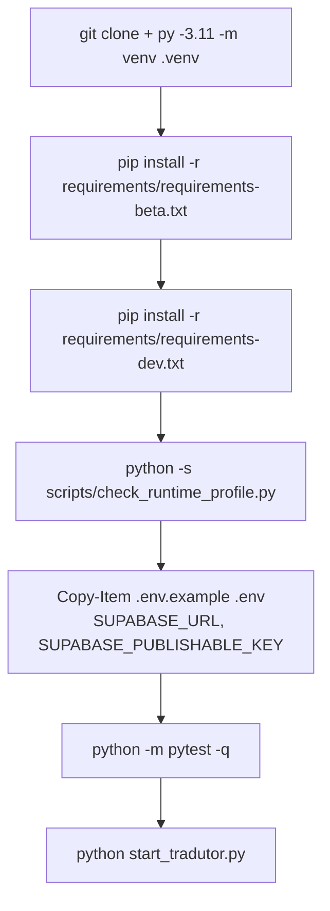

# Desenvolvimento

> **Base verificada:** `5f482ce1` (branch `main`) · **Revisado em:** 2026-10-24
>
> [Voltar ao índice](README.md)

Este documento é o ponto de entrada de quem vai **rodar e testar** o repositório. A visão
geral do produto está no [README](../README.md); o desenho interno está em
[Arquitetura](ARCHITECTURE.md); os gates de qualidade estão em
[Qualidade e validação](QUALITY_AND_VALIDATION.md).

## Neste guia

- [Pré-requisitos](#pré-requisitos)
- [Instalação](#instalação)
- [Variáveis de ambiente](#variáveis-de-ambiente)
- [Executar](#executar)
- [Testes](#testes)
- [Estrutura de diretórios](#estrutura-de-diretórios)
- [Dados de runtime e saída do usuário](#dados-de-runtime-e-saída-do-usuário)
- [OpenCV: contrato e inconsistência conhecida](#opencv-contrato-e-inconsistência-conhecida)
- [Dependências externas](#dependências-externas)
- [Empacotamento e distribuição](#empacotamento-e-distribuição)
- [Riscos conhecidos](#riscos-conhecidos)
- [Windows venv launcher e identidade de processo](#windows-venv-launcher-e-identidade-de-processo)

---

## Pré-requisitos

| Item | Versão auditada | Tipo |
| --- | --- | --- |
| Windows 64 bits | 10/11 | ambiente auditado |
| Python | 3.11 | **DEV + RUNTIME** |
| Node.js | 24 (`node-version: "24"` na CI) | **DEV** — só para as suítes JS e o serviço Better Auth |
| Google Chrome + chromedriver | — | **OPCIONAL/FALLBACK** — só quando a descoberta HTTP não se aplica |
| Tesseract | — | **OPCIONAL** — caminho de OCR alternativo, não usado no padrão Beta |
| Runtime MSVC | — | implícito nas wheels; não é instalação manual |

Outros sistemas operacionais não fazem parte do contrato validado atual.

## Instalação

```powershell
git clone https://github.com/HenriquePvAr/Tradutor.Ia.git
cd Tradutor.Ia

py -3.11 -m venv .venv
.\.venv\Scripts\Activate.ps1
python -m pip install --upgrade pip setuptools wheel

# `-s` desabilita o site-packages do usuário, que já mascarou o cv2 carregado.
python -s -m pip install -r requirements/requirements-beta.txt
python -s -m pip install -r requirements/requirements-dev.txt   # somente para rodar os testes

python -s scripts/check_runtime_profile.py         # prova o perfil antes de confiar nele
```

Sequência de preparo do ambiente de desenvolvimento:



Os manifests são a fonte de verdade das dependências. Não replique a lista aqui:

| Manifest | Conteúdo |
| --- | --- |
| `requirements/requirements-beta.txt` | **perfil de runtime da Beta**; compõe os requisitos base/OCR e declara Scrapling (Comix) + psd-tools, usados pelo spec de packaging |
| `requirements.txt` | stack principal, incluindo os pins de imagem/CV (`numpy`, `Pillow`, `opencv-python`) e `nicegui`. **Não** contém PaddleOCR |
| `requirements/requirements-rapidocr.txt` | RapidOCR + onnxruntime (engine de OCR primário, obrigatório) |
| `requirements/requirements-paddle.txt` | **opcional, fora da Beta** — PaddleOCR/PaddlePaddle. Instalar isto quebra o contrato de OpenCV (ver abaixo) |
| `requirements/requirements-ui.txt` | pin de NiceGUI espelhado, para as duas listas não divergirem |
| `requirements/requirements-dev.txt` | pytest e o cliente ASGI offline usado pela bateria de segurança |
| `requirements/requirements-optional.txt` | transportes opcionais, importados de forma preguiçosa e desligados por padrão |
| `apps/auth-service/package.json` | serviço Better Auth (Node/TypeScript) |

Nenhum arquivo de requisitos consegue dizer "este pacote não pode estar instalado". Quem
impõe essa parte do contrato é `scripts/check_runtime_profile.py`, que falha quando existe
mais de uma distribuição de OpenCV, quando qualquer distribuição Paddle está presente, ou
quando o `cv2` realmente importado não é o declarado.

## Variáveis de ambiente

- **Fonte de verdade dos nomes:** `.env.example`.
- **Fonte de verdade dos defaults:** `yomu/config/settings.py` (e `yomu/ui/ui_helpers.py`
  para o rótulo de provider de tradução).
- **Referência comentada:** [Configuração](CONFIGURATION.md).

Regras:

```powershell
Copy-Item .env.example .env
```

- `.env` e `.env.local` **não** são versionados e nunca devem ser lidos por inteiro em log,
  captura de tela ou commit.
- `.env.example` contém apenas placeholders e **nunca é carregado pela aplicação** — é
  documentação executável, não configuração ativa.
- Chaves de API vivem apenas no processo servidor. O frontend nunca recebe segredo.

Mínimo para uma execução completa: as variáveis públicas do Supabase (`SUPABASE_URL`,
`SUPABASE_PUBLISHABLE_KEY`) exigidas pelo login e um usuário com licença Beta. Todo job com
tradução habilitada passa pelo provider interno `yomu_backend` (motor remoto DeepL na Edge
Function `supabase/functions/translation-execute`); o cliente não chama a DeepL diretamente e
`DEEPL_API_KEY` é segredo do servidor. Com `YOMU_ENV=local`/`test` e `YOMU_TEST_BACKEND`
vazio ou `mock`, o pipeline usa um backend mock (`MockBackendClient`) — útil para
desenvolvimento offline. As demais variáveis têm defaults conservadores.

Detalhes de fronteira de confiança em [Segurança](SECURITY.md).

## Executar

```powershell
python start_tradutor.py            # canônico: worker supervisionado + UI
python start_tradutor.py status     # saúde do worker e da fila
python start_tradutor.py stop       # parada graciosa do worker
```

A aplicação escuta em `http://127.0.0.1:8080` por padrão (`TRADUTOR_UI_PORT`, lido em
`yomu/ui/app.py`; `app_ui.py` é shim de compatibilidade). No Windows há também `start_tradutor.bat`.

`python app_ui.py` sobe **apenas** a interface. Sem worker, os capítulos ficam `queued`.

CLI:

```powershell
python run_webtoon.py "<URL_DO_CAPITULO>" --mode quality --no-context
python run_webtoon.py --help
```

## Testes

Os testes padrão são **offline**: um guard de processo bloqueia socket antes de qualquer
request. Smokes de rede vivem em `scripts/`, exigem opt-in explícito e estão documentados em
[Testes](TESTING.md).

### Python

```powershell
python -m pytest                    # suíte hermética (marcadores network/manual excluídos)
python -m pytest --collect-only -q  # o que a CI coleta
python -m unittest discover         # mesma base, runner unittest
```

`pytest.ini` exclui `network` e `manual` por padrão e mantém a coleta fora de `output`,
`.cache`, `.venv`, `tmp` e `node_modules`.

Para um teste isolado:

```powershell
python -m pytest tests/test_<nome>.py -q
```

### JavaScript

As 18 suítes `.mjs` em `tests/` cobrem o frontend (leitor, sessão, comunidade, health).

```powershell
node --experimental-vm-modules tests/test_chapter_reader.mjs
```

> **A flag `--experimental-vm-modules` é obrigatória.** Sete das 18 suítes montam os
> módulos do frontend com `vm.SourceTextModule`, que só existe sob essa flag. Sem ela o Node
> não falha na importação — cada teste falha individualmente com
> `vm.SourceTextModule is not a constructor`, o que parece defeito de produto e não é.
> As duas suítes que documentam `// Run: node <arquivo>.mjs` no cabeçalho (`tests/test_chapter_reader.mjs`,
> `tests/test_service_health.mjs`) rodam sem a flag; usar a flag em todas é o caminho uniforme.

Rodar todas:

```powershell
Get-ChildItem tests/test_*.mjs | ForEach-Object { node --experimental-vm-modules $_.FullName }
```

Verificação de sintaxe (o que a CI faz):

```powershell
node --check static/tradutor_ui.js
```

### Serviço Better Auth

```powershell
cd apps/auth-service
npm ci
npm run typecheck
npm test
npm run build
```

### CI

O workflow `Hermetic Tests` (`.github/workflows/tests.yml`) roda em `windows-latest` com
Python 3.11 e Node 24, instala `requirements/requirements-beta.txt` +
`requirements/requirements-dev.txt`, roda `scripts/check_runtime_profile.py`, confirma que
nenhum opt-in de smoke de rede está autorizado, roda `pytest` (timeout de 50 min; JUnit
publicado como artifact), `node --check` dos scripts de `static/` (incluindo `static/i18n/`),
o serviço Better Auth e `python -m compileall` de `yomu/`, `test_support/` e dos entrypoints da
raiz. Localmente, `python -m pytest -q` passa ~6160 testes com 0 falhas (~10 min) no snapshot
`5f482ce1`. **A CI não executa as suítes `.mjs`** —
elas são responsabilidade local.

## Estrutura de diretórios

O runtime Python canônico vive no pacote `yomu/`; a raiz mantém apenas entrypoints de
compatibilidade (`app_ui.py`, `desktop_app.py`, `run_webtoon.py`, `start_tradutor.py`,
`worker_service.py`, `down.py`, `main.py`, `run_local_folder.py`) e o bootstrap de teste. A
política completa está em [Estrutura do projeto](architecture/REPOSITORY_STRUCTURE.md).

```text
<repo>/
├── yomu/                    # runtime canônico (commands, runtime, ui, pipeline, ocr, clean, translation, export, ...)
├── *.py                     # shims/entrypoints de compatibilidade
├── requirements.txt         # stack base; perfis em requirements/
├── requirements/            # perfis beta, rapidocr, ui, dev, paddle, optional, gemini-vps
├── tests/                   # suíte hermética Python (test_*.py) e frontend (test_*.mjs)
├── test_support/            # helpers compartilhados de teste
├── test_fixtures/           # artefatos fixos usados por testes
├── packaging/               # specs PyInstaller e script Inno Setup
├── tools/                   # release, admin, dev, harnesses e auditorias
├── scripts/                 # smokes manuais com opt-in, assinatura de release, migração de auth
├── static/                  # JS/CSS do frontend, i18n, assets da UI
├── ui/                      # shell HTML da interface
├── apps/auth-service/       # serviço Better Auth (Node/TypeScript)
├── supabase/                # migrations SQL e testes de banco
├── docs/                    # esta documentação
└── .github/workflows/       # CI
```

## Dados de runtime e saída do usuário

Quatro categorias distintas, todas fora do controle de versão exceto a primeira:

| Categoria | Onde | Versionado |
| --- | --- | --- |
| **Código-fonte** | raiz do repositório | sim |
| **Cache** | `%LOCALAPPDATA%\TradutorIA\cache` (override `CACHE_ROOT`) | não |
| **Runtime** | `%LOCALAPPDATA%\TradutorIA\runtime` (banco de jobs `jobs.sqlite3`, logs, `ui_history.json`, `auth/`; override `TRADUTOR_RUNTIME_ROOT`) | não |
| **Saída do usuário** | `%LOCALAPPDATA%\TradutorIA\output\<slug>\...` (override `TRADUTOR_OUTPUT_ROOT`) | não |

As raízes não ficam dentro do repositório: são resolvidas em
`yomu/runtime/runtime_paths.py` a partir de `TRADUTOR_USER_DATA_ROOT` ou, sem ele, de
`%LOCALAPPDATA%\TradutorIA` (`yomu/ui/ui_helpers.py` expõe `OUTPUT_ROOT` e `HISTORY_PATH`).
Em testes herméticos, tudo é redirecionado para `TRADUTOR_TEST_RUNTIME_ROOT`. Modelos locais de reconstrução de arte ficam fora do
repositório, sob `%LOCALAPPDATA%\TradutorIA\models` por padrão
(`ADVANCED_ART_INPAINT_MODEL_PATH`).

O modelo de instalação previsto pelo updater (`yomu/runtime/update_installer.py`) mantém `data/` fora de
`versions/` justamente para que ativação e rollback nunca alcancem dados do usuário.

## OpenCV: contrato e inconsistência conhecida

### Contrato declarado

`requirements.txt` fixa **`opencv-python==5.0.0.93`** e declara explicitamente que
`opencv-contrib-python` e `opencv-python-headless` **não** fazem parte do contrato. O pin é
parte do contrato de qualidade, não preferência de versão: a decisão
`open_light_art_caption` compara razões de pixel contra limiares literais calibrados contra
a saída de `cv2` no ambiente congelado.

### Causa raiz (apurada em #84F53 / #84F53R)

A explicação anterior — instalação manual acidental de variantes, resolvida por ordem de
`sys.path` entre site-packages do usuário e do sistema — estava **incorreta**. A colisão é
determinística e vem de uma aresta de dependência declarada:

```text
paddleocr  ->  paddlex 3.7.2  ->  opencv-contrib-python==4.10.0.84   (extras cv/ocr/base/...)
requirements.txt (antes)  ->  opencv-python==5.0.0.93
```

`opencv-python` e `opencv-contrib-python` são distribuições diferentes que instalam o
**mesmo** diretório de topo `cv2/`. pip não trata isso como conflito: `pip check` fica limpo,
`pip list` mostra as duas com suas versões declaradas, e quem escreve os arquivos por último
vence. Nada é reportado ao usuário.

Efeito medido no venv de desenvolvimento que produziu a baseline do freeze:

| Fonte | O que diz |
| --- | --- |
| `pip list` | `opencv-python 5.0.0.93` **e** `opencv-contrib-python 4.10.0.84` |
| `pip check` | sem conflitos |
| `import cv2; cv2.__version__` | **`4.10.0`** |

Ou seja: a baseline de qualidade congelada foi produzida sobre **cv2 4.10.0**, enquanto o
manifest declarava 5.0.0.93. Isso também explica, sem coincidência, por que `afe0e03`
precisou de um shim de compatibilidade para as semânticas de traço do `putText` do OpenCV 5.

Consequências:

- a suíte verde não é evidência de que o contrato de OpenCV está sendo respeitado em runtime;
- "reinstalar `opencv-python` por último" **não** é solução: é uma ordem de instalação frágil,
  não um contrato;
- a correção arquitetural é remover a aresta, não reordenar a instalação — PaddleOCR sai do
  perfil de runtime (`requirements/requirements-paddle.txt`, opcional) e um preflight de build recusa
  ambiente ambíguo (`scripts/check_runtime_profile.py`).

Registrado como `OPENCV-VARIANT-SHADOWING-001` em [Riscos conhecidos](#riscos-conhecidos).

## Dependências externas

Diferencie o tipo antes de agir sobre qualquer item:

| Dependência | Tipo | Observação |
| --- | --- | --- |
| Python 3.11 | DEV + RUNTIME | versão auditada |
| Node 24 | DEV | suítes `.mjs` e serviço Better Auth; o pipeline não precisa dele |
| Chrome + chromedriver | OPCIONAL/FALLBACK | usado só quando a descoberta HTTP não se aplica à fonte |
| Tesseract | OPCIONAL | caminho de OCR alternativo, fora do padrão Beta |
| Modelo local de reconstrução de arte | OPCIONAL/RUNTIME | asset externo verificado por SHA256; ausência vira revisão, não render forçado |
| Fontes do Windows | PACKAGING CONCERN | `yomu/clean/ownership/font_fidelity.py` `ROLE_FONT_FILES` resolve cadeias de fontes **locais** do sistema (Trebuchet, Comic Sans, Segoe Print, Calibri e similares). Nada é baixado. A disponibilidade dessas fontes numa instalação Windows limpa não foi provada — `NEEDS_VERIFICATION` |
| Runtime MSVC | PACKAGING CONCERN | implícito nas wheels |

Nada nesta tabela é uma instrução de instalação para usuário final. O objetivo declarado do
empacotamento é justamente empacotar ou eliminar essas dependências.

### Candidatos a limpeza de dependência

Declarados em `requirements.txt` e sem nenhum `import` no repositório:

- `webdriver-manager`
- `tqdm`
- `accelerate`
- `sentencepiece`

**Não remova durante o Quality Freeze.** São candidatos a reconciliação na fase de
empacotamento; remover um pacote muda o ambiente resolvido e invalida a baseline.

## Empacotamento e distribuição

### `BETA1_OCR_RUNTIME_CONTRACT`

Perfil de runtime que a Beta 1 empacota. Declarado em `requirements/requirements-beta.txt`, imposto por
`scripts/check_runtime_profile.py`.

| Componente | Contrato | Onde |
| --- | --- | --- |
| Python | 3.11 | runtime relocável/embutido no pacote; venv apenas em desenvolvimento |
| OCR primário | **RapidOCR obrigatório** (`rapidocr-onnxruntime` + `onnxruntime`), modelos dentro da wheel | `requirements/requirements-rapidocr.txt` |
| OpenCV | **exatamente uma** distribuição: `opencv-python==5.0.0.93` | `requirements.txt` |
| PaddleOCR / PaddlePaddle / PaddleX | **não empacotados** — capacidade opcional, código preservado | `requirements/requirements-paddle.txt` |
| `opencv-contrib-python`, `opencv-python-headless` e variantes | **proibidos** — mesmo diretório `cv2/` | recusado pelo preflight |
| Fallback de navegador (Selenium/Chrome) | separado/opcional; a descoberta HTTP não depende dele | `requirements.txt` + Chrome do sistema |

Não empacotar Paddle **não** remove o suporte: `yomu/ocr/ocr_engine.py` importa `paddleocr` de forma
preguiçosa, a disponibilidade é sondada por `importlib.util.find_spec` e
`_configure_mode` (`yomu/commands/run_webtoon.py`) trata a escalação Paddle como recuperação opcional nos dois
modos. Sem a biblioteca, a escalação é pulada e a leitura do RapidOCR é mantida; quando o
próprio gate do RapidOCR recusa a página, a falha é fechada e contabilizada
(`paddle_error:ModuleNotFoundError`), nunca silenciosa.

> **Snapshot de distribuição anterior à Beta 17.** Os estados/planos abaixo não foram
> revalidados pela M18 e não devem ser usados como situação atual de release. A M18 não fez
> clean-install, build ou auditoria do canal; confirme cada item no checklist próprio.

| Item | Estado histórico |
| --- | --- |
| Baseline de empacotamento | **PRONTA** — pipeline congelado, manifests pinados, evidência de E2E registrada |
| Perfil de runtime Beta | **DEFINIDO E PROVADO EM AMBIENTE LIMPO** — `requirements/requirements-beta.txt`, uma única distribuição de OpenCV, `pip check` limpo, preflight verde, E2E real executado (job `902b149e`: 35/35 páginas, PDF válido, zero Paddle carregado) |
| Baseline de qualidade sob o runtime Beta | **NÃO PRESERVADA** — o E2E não reproduziu P28/P31/P32; ver [Quality Freeze](QUALITY_FREEZE.md) |
| Instalação limpa em Windows | **NÃO PROVADA** — não existe validação em máquina limpa |
| Instalador para usuário final | *(superado)* hoje: **PARCIAL** — `packaging/tradutor_ia.spec` (PyInstaller), `packaging/TradutorIA.iss` (Inno Setup, gera `YomuSekai-<versão>-Setup-x64.exe`) e `tools/build_installer.py` existem; nenhum `Setup.exe` versionado; instalação limpa não provada |
| Modelo de atualização | **Implementação no código** — `yomu/runtime/update_installer.py`/`update_manifest.py`/`update_transport.py`/`installer_update.py`, mais a aba **Atualizações** da UI (ver [Update e signing](UPDATE_AND_SIGNING.md)); estado de distribuição e canal deve ser revalidado no checklist de release (o owner confirmou uso do updater para Beta 17) |
| Distribuição Beta | **EM PREPARAÇÃO** |

Pendente (2026-10-24): build e instalador finais validados, teste em Windows limpo,
publicação do manifest assinado no canal e distribuição Beta controlada. Perfil Beta com
OpenCV único, specs de packaging, script do instalador e updater já existem no código.

## Riscos conhecidos

| ID | Risco | Estado |
| --- | --- | --- |
| `OPENCV-THRESHOLD-SENSITIVITY-001` | Limiares literais de pixel calibrados contra o `cv2` congelado; outra versão pode virar a classificação em regiões de fronteira. Trocar versão **ou variante** exige reexecutar o E2E de qualidade, não só a suíte. | **aberto** — detalhe em [Qualidade e validação](QUALITY_AND_VALIDATION.md) |
| `OPENCV-VARIANT-SHADOWING-001` | `paddleocr` → `paddlex` fixa `opencv-contrib-python==4.10.0.84`, que sobrescreve o mesmo diretório `cv2/` do `opencv-python==5.0.0.93` sem que o pip reporte conflito. A baseline do freeze foi produzida sobre **cv2 4.10.0**, não sobre o pin declarado. | **causa raiz identificada; corrigida no perfil Beta** — o perfil sem Paddle carrega cv2 5.0.0; a troca de versão ainda exige novo E2E por `OPENCV-THRESHOLD-SENSITIVITY-001`. Ver [seção acima](#opencv-contrato-e-inconsistência-conhecida) |
| `CLEAN-INSTALL-NOT-YET-PROVEN` | Nenhuma instalação limpa em Windows foi validada a partir dos manifests. | **aberto** — o perfil de runtime já instala e roda limpo (`requirements/requirements-beta.txt`); falta a máquina limpa |
| `WINDOWS-VENV-LAUNCHER-PID-001` | Em venv de Windows, `Scripts\python.exe` é o *venvlauncher*: ele executa o interpretador base como **processo filho**. `Popen(sys.executable).pid` devolve o PID do stub, enquanto o processo Python real tem outro PID. Isso quebra qualquer contabilidade por PID (lease de worker, supervisão, identidade de runtime na UI). | **ambiente de desenvolvimento apenas** — ver [abaixo](#windows-venv-launcher-e-identidade-de-processo) |
| Chrome/Selenium × TPM | Em máquinas afetadas por problemas de Microsoft Platform Crypto Provider / TPM, o Chrome pode falhar ao iniciar, inutilizando o fallback de navegador. A descoberta HTTP evita essa dependência para as fontes que a suportam. | **aberto, ambiente de desenvolvimento** — não altere TPM/BIOS/Windows Hello por causa disto |
| Reconstrução de arte em textura | Regiões texturizadas/open-art podem render sob revisão de fidelidade. | **aberto** |
| Naturalidade semântica PT-BR | Tradução gramatical mas semanticamente errada não é detectada por gate automático. | **aberto** |
| Dependências declaradas e não usadas | Ver [candidatos a limpeza](#candidatos-a-limpeza-de-dependência). | **aberto, adiado para empacotamento** |

## Windows venv launcher e identidade de processo

Num venv de Windows, `Scripts\python.exe` não é o interpretador: é o `venvlauncher`
(274 KB contra 103 KB do `python.exe` base), que **executa o interpretador base como
processo filho**. Consequência medida:

| Interpretador | `Popen(sys.executable).pid` vs `os.getpid()` do filho |
| --- | --- |
| `.venv\Scripts\python.exe` | divergem |
| `.venv-beta\Scripts\python.exe` | divergem |
| `python.exe` base (sem stub) | iguais |

Qualquer contabilidade por PID — o lease do worker em `yomu/runtime/job_store.py`, a supervisão em
`yomu/runtime/worker_supervisor.py`, a identidade de runtime exposta na UI — registra o PID do processo
Python real e compara com o PID devolvido pelo `Popen`. Sob o stub, os dois nunca batem.

Isso reprova cinco testes (`test_worker_process_loss`, `test_worker_supervision`,
`test_runtime_forensics_contract`) em **qualquer** venv desta máquina, incluindo o `.venv`
anterior a esta mudança. Executados por um interpretador sem stub, os mesmos cinco passam
sem nenhuma alteração de código.

**Isto não afeta o runtime da Beta.** O empacotamento previsto usa Python relocável/embutido,
onde `sys.executable` é o interpretador de verdade e não existe stub — exatamente a linha
"sem stub" da tabela. Copiar o `python.exe` base sobre `Scripts\python.exe` foi um
instrumento de investigação em #84F53/#84F53R e **não** é requisito de packaging nem de
desenvolvimento: não faça disso um passo de instalação.

## Troubleshooting

Diagnóstico de execução, artefatos e erros comuns: [Troubleshooting](TROUBLESHOOTING.md).

Pontos rápidos:

- capítulo fica `queued`: não há worker: use `python start_tradutor.py`, não `python app_ui.py`;
- suíte `.mjs` falha com `vm.SourceTextModule is not a constructor`: falta a flag
  `--experimental-vm-modules`;
- `review_required` não é falha: veja [Filosofia de qualidade](../README.md#filosofia-de-qualidade).
## Estrutura durante a closed beta

> **Histórico.** Este parágrafo previa adiar a migração para um pacote; ela já ocorreu: o
> runtime canônico está em `yomu/` e a raiz mantém shims de compatibilidade (ver
> [Estrutura de diretórios](#estrutura-de-diretórios)). Não há plano ativo para `src/yomu_sekai/`.

Os tools internos estão separados em `tools/release/`, `tools/admin/`, `tools/dev/` e
`tools/harnesses/`. Mudanças de layout continuam exigindo atualização controlada de imports,
testes e especificações de packaging.
