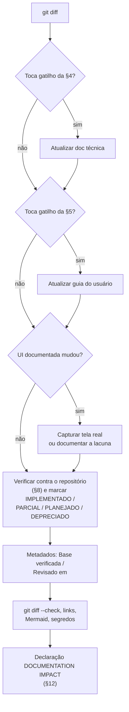

# Política de Manutenção da Documentação

> **Base verificada:** commit `5f482ce1` · **Revisado em:** 2026-10-24 (versão original: `c81c798`, 2026-08-19)
> Esta política é obrigatória para qualquer mudança no projeto — humana ou automatizada.

---

## 1. Princípio

**Documentação viaja junto com o comportamento.**

Código implementado hoje e documentação corrigida semanas depois é uma falha de processo,
não um detalhe. Sempre que for prático, a mudança de comportamento e a atualização de
documentação exigida por ela devem viver **no mesmo commit**.

## 2. Fonte de verdade

A ordem de autoridade é sempre esta:

1. Código atual
2. Testes atuais
3. Configuração atual (`.env.example`, `pytest.ini`, CI)
4. UI atual (`ui/`, `static/`)
5. Contratos de banco/migração (`supabase/migrations/`, `SCHEMA_VERSION` em `yomu/runtime/job_store.py`)
6. Arquitetura de runtime local observada

**Documentação histórica não é automaticamente autoritativa.** Quando um documento existente
conflita com a implementação atual, **a implementação verificada vence** e o documento é
corrigido. Não se preserva silenciosamente uma afirmação obsoleta.

## 3. Propriedade

| Documento | Papel | Quem atualiza |
| --- | --- | --- |
| [`docs/technical/DOCUMENTACAO_TECNICA.md`](technical/DOCUMENTACAO_TECNICA.md) | Documento técnico principal | Quem muda arquitetura, runtime, segurança, testes, configuração ou integração |
| [`docs/user/GUIA_DO_USUARIO.md`](user/GUIA_DO_USUARIO.md) | Guia do usuário final | Quem muda instalação, UI, fluxo, recursos, erros ou textos visíveis |
| [`docs/README.md`](README.md) | Índice da documentação | Quem cria, move ou remove um documento |
| `docs/*.md` (temas específicos) | Aprofundamento por assunto | Quem mexe naquele subsistema |
| [`docs/architecture/clean_strategy.md`](architecture/clean_strategy.md) | Fluxo atual de limpeza, reconstrução e diagramação | Quem muda máscara, preenchimento, portões de reconstrução ou render |
| [`docs/consolidation/YOMU_CURRENT_PRODUCT_STATE.md`](consolidation/YOMU_CURRENT_PRODUCT_STATE.md) | Snapshot do estado do produto e da evidência | Quem fecha integração ou muda nível de evidência |
| [`docs/DOCUMENTATION_AUDIT.md`](DOCUMENTATION_AUDIT.md) | Registro de auditoria (histórico) | Quem executa uma auditoria de documentação |
| Registros de missão/auditoria (`M16_*`, `M20_*`, `PSD_*`, `beta_quality_revalidation.md` etc.) | Registro histórico datado | Ninguém reescreve; só se corrige o que induziria erro sobre o presente (§16) |
| `README.md` (raiz) | Visão geral curta + links | Quem muda o posicionamento do projeto |
| `CLAUDE.md` | Contrato permanente para agentes | Somente por decisão explícita |

O `README.md` da raiz **não é** o manual técnico completo. Papel dele: visão geral curta,
estado atual, início rápido de desenvolvedor e links para a documentação completa.

## 4. Quando a documentação técnica DEVE mudar

Se a mudança toca qualquer um destes, avalie impacto na documentação técnica:

- arquitetura ou fronteiras entre componentes;
- schema do banco ou `SCHEMA_VERSION`;
- estados de job ou transições permitidas;
- ciclo de vida do worker, do runner ou do launcher;
- supervisão de processos, reconciliação ou recuperação;
- configuração de runtime ou variáveis de ambiente;
- integração com provider de tradução, OCR ou armazenamento;
- segurança, autenticação, autorização ou tratamento de segredos;
- cache, invalidação ou chaves de cache;
- arquitetura de testes, guards herméticos ou CI;
- empacotamento, updater ou distribuição;
- superfície de API HTTP;
- comandos de execução ou dependências.

## 5. Quando o Guia do Usuário DEVE mudar

Se a mudança toca qualquer um destes, avalie impacto no guia do usuário:

- texto de botão, rótulo, nome de tela ou de aba;
- fluxo de uso ou ordem dos passos;
- instalação ou primeira execução;
- login, cadastro ou sessão;
- mensagens de erro ou de status visíveis;
- comportamento de cancelamento, recuperação ou retomada;
- local, nome ou formato dos arquivos de saída;
- comportamento do PDF;
- fluxo de atualização do programa;
- comportamento de licença;
- disponibilidade ou indisponibilidade de um recurso para o usuário.

## 6. Quando as capturas de tela DEVEM mudar

Sempre que a **aparência visível** de uma tela documentada mudar de forma que a imagem
existente passe a induzir erro: novo layout, botão renomeado, campo movido, aba nova ou
removida.

Regras para capturas:

- Capturar **somente a UI atual**;
- Recorte sensato e texto legível;
- **Zero** senha, chave de API, token, cookie, identificador privado ou e-mail pessoal;
- Nada de caminhos locais de desenvolvedor sem sanitização;
- Legenda descritiva sempre;
- Arquivos em `docs/assets/user/`, com nomes estáveis;
- **Nunca fabricar** uma captura. Se não for possível capturar com segurança, documentar a
  lacuna explicitamente. Uma lacuna honesta de captura não bloqueia a correção do texto.

## 7. Como representar recursos planejados

| Marcador | Uso |
| --- | --- |
| **IMPLEMENTADO** | Existe no código do commit e é alcançável em execução normal |
| **PARCIAL** | Existe no núcleo, mas incompleto ou não exposto ao usuário |
| **PLANEJADO** | Não existe. **Jamais** descrito como disponível |
| **DEPRECIADO** | Existe por compatibilidade; não é o caminho recomendado |

Para evidência, use também os níveis do `CLAUDE.md`: `IMPLEMENTED`, `INTEGRATED`,
`TESTED_OFFLINE`, `TESTED_FROZEN`, `PHYSICALLY_VERIFIED`, `EXTERNAL_GATE` e `DEFERRED`.
Código ou mocks não autorizam status físico; medição por harness de desenvolvedor não é E2E
de produto.

Regras invioláveis:

1. Nunca documentar um recurso como disponível porque foi planejado, existiu no passado,
   aparece num TODO, aparece num roadmap ou existiu em outro branch.
2. Documentação de usuário **nunca** instrui o uso de recurso inexistente.
3. Roadmap ≠ documentação de comportamento atual. Manter as duas coisas visualmente
   separadas.

## 8. Verificação obrigatória antes de escrever

| Item documentado | Como verificar |
| --- | --- |
| Comando | Executá-lo (ou pelo menos `--help`) contra o repositório |
| Caminho de módulo/arquivo | Confirmar que existe no índice do Git |
| Estado ou transição | Ler `yomu/runtime/job_store.py` |
| Variável de ambiente | Confirmar em `.env.example` e no consumidor |
| Rótulo de UI | Ler `ui/ui_shell.html` ou `static/*.js` |
| Mensagem de erro | Ler o mapa de mensagens no frontend/backend |
| Fluxo | Rastrear implementação **e** teste |

Um comando que o repositório não suporta mais **não pode** aparecer na documentação.

## 9. Segurança e redação

Proibido em qualquer documento, commit, imagem ou exemplo:

- chave de API real (DeepL, NVIDIA, Gemini, qualquer outra);
- token, cookie, header de autorização;
- senha;
- service-role / secret key;
- conteúdo ou caminho absoluto de token do Google Drive;
- credencial pessoal;
- e-mail pessoal não intencionalmente público;
- caminho local com nome real de pessoa (`C:\Users\<pessoa>\...`).

Formato obrigatório para exemplos:

```dotenv
DEEPL_API_KEY=<sua-chave>
```

Use placeholders (`<repo>`, `<pasta-permitida>`, `<URL_DO_CAPITULO>`) em vez de caminhos
reais.

## 10. Metadados de verificação

Cada documento primário carrega, no topo:

```markdown
> **Base verificada:** commit `<sha-curto>`
> **Revisado em:** AAAA-MM-DD
```

Isso é metadado **de documentação**, não versão de produto. Não fixe uma versão de
aplicação enquanto não existir uma fonte autoritativa única de versão.

Use sempre a **SHA de base auditada** (o HEAD no início do trabalho), nunca tente embutir a
SHA do próprio commit de documentação — isso é auto-referencial e leva a `--amend`
repetidos. Reporte a SHA do commit de documentação separadamente, no relatório final.

## 11. Portão de revisão antes do commit

Antes de qualquer commit que mude comportamento:



1. Inspecionar `git diff`;
2. Determinar o impacto em documentação;
3. Atualizar a documentação técnica quando aplicável (§4);
4. Atualizar o guia do usuário quando aplicável (§5);
5. Atualizar capturas quando aplicável (§6);
6. Verificar que nenhum recurso planejado foi descrito como implementado;
7. Atualizar os metadados de verificação dos documentos tocados;
8. Rodar as verificações leves: `git diff --check`, links relativos válidos, assets
   existentes, varredura de segredos;
9. Declarar explicitamente o impacto (§12).

## 12. Declaração obrigatória de impacto

**Toda** tarefa que muda o projeto termina com este bloco:

```text
DOCUMENTATION IMPACT

TECHNICAL DOC:   UPDATED / NOT REQUIRED
USER GUIDE:      UPDATED / NOT REQUIRED
SCREENSHOTS:     UPDATED / NOT REQUIRED
WHY:             <uma linha justificando cada decisão>
```

Quando nada muda, a declaração ainda é obrigatória:

```text
DOC IMPACT: NONE
WHY: refatoração interna sem mudança de comportamento, API, configuração ou UI.
```

Ausência da declaração é resultado incompleto.

## 13. Teste de compreensão da política

Exemplos resolvidos, para calibrar o julgamento.

| Mudança hipotética | Doc técnica | Guia do usuário | Capturas |
| --- | --- | --- | --- |
| Alterar o backoff de reinício do worker de 2/5/15s para 1/3/9s | **SIM** — §5 documenta os valores | **SIM** se o comportamento de recuperação visível ao usuário mudar | NÃO |
| Renomear uma variável interna, sem mudança de comportamento | Provavelmente NÃO | **NÃO** | NÃO |
| Adicionar um estado novo de job | **SIM** — máquina de estados e diagrama | **SIM** se aparecer na tela | Talvez |
| Trocar o texto do botão "Iniciar tradução" | Talvez não | **SIM** | **SIM** |
| Adicionar `Setup.exe` | **SIM** — empacotamento | **SIM** — instalação inteira reescrita, instruções temporárias removidas | **SIM** |
| Corrigir um teste flaky | **SIM** se estava listado como dívida | NÃO | NÃO |
| Trocar o provider padrão de tradução | **SIM** | **SIM** — o guia nomeia o padrão | Talvez |
| Adicionar índice numa tabela SQLite, sem mudança de contrato | Talvez | NÃO | NÃO |

## 14. Contratos de atualização futura

> Estado em `5f482ce1`: o núcleo do updater (`yomu/runtime/update_manifest.py`,
> `update_transport.py`, `update_installer.py`, `update_bootstrap.py`) e a licença Beta
> (`yomu/auth/beta_license.py`) já existem; specs de build (`packaging/`) e
> `tools/build_installer.py` também. Os contratos abaixo valem a partir de cada superfície
> visível ao usuário (Setup, UI de atualização, tela de licença). O estado de cada um está na
> [Documentação Técnica §30](technical/DOCUMENTACAO_TECNICA.md#30-empacotamento-updater-e-prontidão-para-beta).

### Quando o instalador (`Setup.exe`) existir

Na **mesma** mudança que o implementa, o guia do usuário ganha: download, instalação,
primeira execução, avisos do Windows quando aplicável, atalhos, desinstalação, reparo e
comportamento de atualização. As instruções temporárias de instalação por repositório são
**removidas** do guia do usuário (elas permanecem apenas na documentação técnica, como
caminho de desenvolvedor).

### Quando o updater assinado existir

Documentação técnica ganha: formato do manifest, verificação de assinatura, verificação de
SHA, tratamento de versão, versão mínima, substituição atômica, rollback e estados de
falha.

Guia do usuário ganha **apenas**: como a atualização aparece, o que o usuário deve fazer e
o que acontece se a atualização falhar. Nenhum detalhe interno desnecessário.

### Quando o licenciamento de tester existir

Documentação técnica ganha: arquitetura, fronteira de confiança servidor/cliente,
expiração, revogação e comportamento por dispositivo.

Guia do usuário ganha: como entrar, status da licença, expiração, mensagem de
renovação/revogação e comportamento por dispositivo.

**Nenhum segredo administrativo** em qualquer dos dois.

## 15. Consistência de nomes e termos

Terminologia canônica, usada de forma consistente:

| Termo | Uso na doc técnica | Uso no guia do usuário |
| --- | --- | --- |
| Tradutor IA | Nome do produto | Nome do produto |
| Job / Trabalho | "job" | "capítulo" ou "tradução" |
| Worker | "worker" | "serviço de processamento" (explicando o termo na primeira vez) |
| Runner | "runner" | não usar |
| `review_required` | nome do estado | "revisão necessária" |
| `awaiting_source_review` | nome do estado | "revisão das páginas" |
| Histórico | "histórico"/`UIHistoryStore` | "Capítulos traduzidos" / "biblioteca" |

Palavras a **evitar** no guia do usuário, salvo quando são conceitos reais da interface:
SQLite, ONNX Runtime, PID, Popen, lease, identidade canônica, transação, subprocesso,
heartbeat, fail-closed.

## 16. Nomes de arquivo

Usar caminhos canônicos e estáveis. Nunca criar variações como
`guia_final_v2_novo_agora.md`. Atualizar o arquivo existente; se for necessário arquivar,
mover deliberadamente e registrar em [`DOCUMENTATION_AUDIT.md`](DOCUMENTATION_AUDIT.md).

Documentação histórica com valor **não é apagada sem justificativa registrada**.

### Registros históricos

Relatórios de missão, auditoria ou E2E descrevem uma data e um commit. Eles não são
reescritos. Quando um deles puder ser lido como estado atual, ganha no topo um banner curto:

```markdown
> **Registro histórico de <data>.** O estado atual está em <link>.
```

Corrige-se no corpo apenas o que induziria erro sobre o presente (caminho de módulo movido,
default que mudou), sempre marcado como nota datada. Documentos vivos carregam os
metadados da §10 e são verificados por inteiro.

## 17. Verificações leves

Mudanças somente de documentação não exigem regressão completa da aplicação. Rodar:

```powershell
git diff --check
```

e conferir manualmente: links relativos válidos, imagens existentes, âncoras coerentes,
zero segredos. Diagramas Mermaid novos ou alterados devem renderizar; uma forma de checar
sem adicionar dependência ao repositório é extrair o bloco para um arquivo temporário e rodar
`npx --yes @mermaid-js/mermaid-cli@11.4.2 -i <arquivo.mmd> -o <saida.svg>`. Rótulos com
caracteres especiais vão entre aspas. Não adicionar dependências novas só para validar documentação.

O Markdown é a fonte de verdade. Exportar PDF/HTML é opcional e só se já existir um
mecanismo limpo no repositório.

---

Ver também: [Documentação Técnica](technical/DOCUMENTACAO_TECNICA.md) ·
[Guia do Usuário](user/GUIA_DO_USUARIO.md) · [Índice](README.md) ·
[Auditoria](DOCUMENTATION_AUDIT.md)
