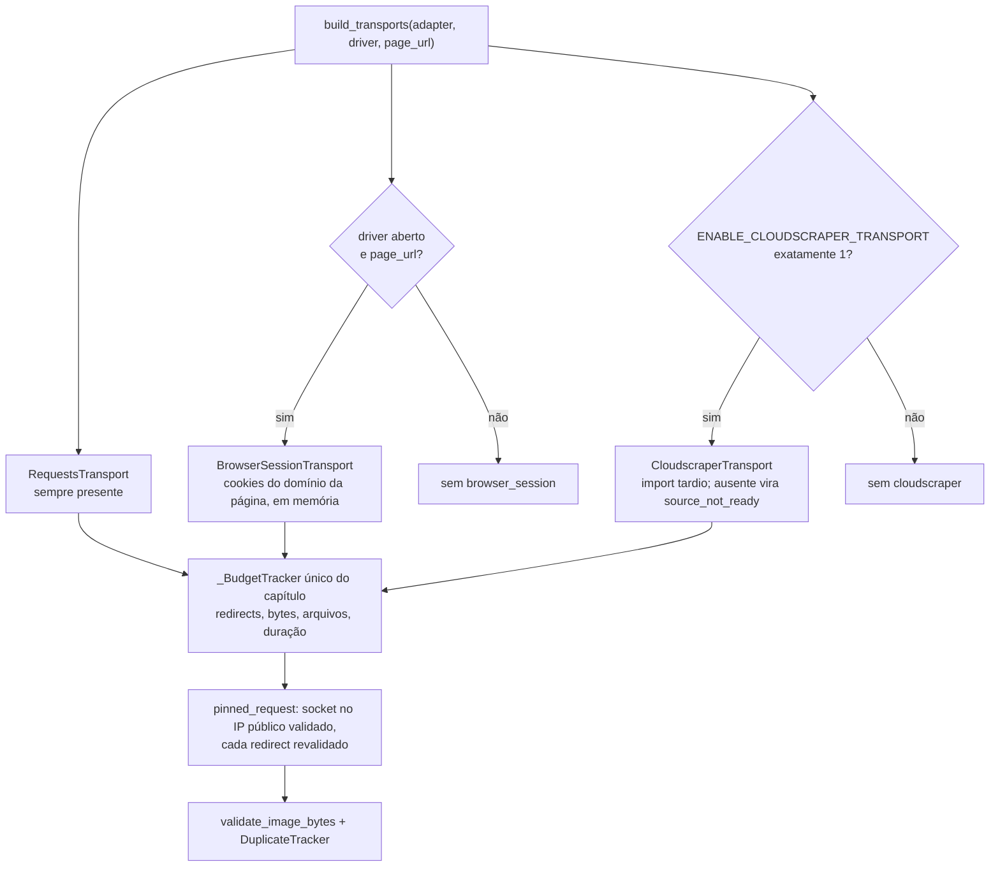

# Transportes de download e validação de páginas

> **Base verificada:** `5f482ce1` (branch `main`) · **Revisado em:** 2026-10-24
>
> Código: `yomu/download/download_transport.py` (transportes, `DownloadLimits`,
> `build_transports`), `yomu/download/pinned_requests.py` (pinning de destino),
> `yomu/download/image_validation.py` (validação por bytes, `DuplicateTracker`) e
> `yomu/download/comix_session.py` (clearance Comix). Este documento nasceu como registro do
> fechamento de duas lacunas (abstração de transporte e validação por bytes); a seção abaixo é
> o histórico do problema.

## O buraco que existia (histórico)

O downloader fazia:

```python
response = requests.get(url, timeout=20, headers=headers)
```

Sem teto de tamanho, sem checagem de `Content-Type` e — o mais sério — **seguindo redirects
silenciosamente**. Toda a validação de SSRF feita na URL submetida era contornável por um
302: bastava o servidor responder `Location: http://127.0.0.1:8080/...` e o fetch ia para
dentro da rede. Validar a URL inicial não vale nada se um hop posterior não é revalidado.

## Transportes

| Transporte | Uso | Padrão |
| --- | --- | --- |
| `RequestsTransport` | HTTP direto, cada hop revalidado | sim |
| `BrowserSessionTransport` | leitores que só servem imagem para a sessão que abriu a página | quando há driver |
| `CloudscraperTransport` | transporte requests-compatível opcional, com a mesma validação e o mesmo orçamento | somente com `ENABLE_CLOUDSCRAPER_TRANSPORT=1` |

`build_transports()` devolve na ordem `requests` → `browser_session` → `cloudscraper`
quando este último foi autorizado. Todos compartilham o mesmo orçamento: um transporte não
zera o limite do outro.



Os três herdam de `RequestsTransport`, então todos instalam o pinning de destino
(`install_pinned_requests`): cada conexão TCP vai para o endereço público validado daquele
host/porta, `Host`, certificado e SNI continuam usando o hostname, e uma rota por proxy é
recusada. A sessão também ignora proxy/netrc do ambiente (`trust_env = False`).

### Cloudscraper opcional

`CloudscraperTransport` é desativado por padrão. Ele só é criado se a variável de ambiente
tiver exatamente este valor:

```text
ENABLE_CLOUDSCRAPER_TRANSPORT=1
```

Valor ausente, `true`, `yes`, `0` ou qualquer outro texto mantém a ordem normal e não
importa o pacote opcional. O import é tardio: a suíte padrão e a execução normal não requerem
nem inicializam `cloudscraper`. Se a flag for autorizada mas o pacote não estiver disponível,
o resultado é `source_not_ready` com motivo sanitizado; o sistema não instala dependência em
tempo de execução.

O transporte opcional herda redirects manuais, revalidação de URL/DNS, timeout, limites de
bytes, orçamento compartilhado, validação por bytes e limpeza de sessão. Ele não habilita proxy
rotation, stealth, fingerprint rotation, CAPTCHA solver, Turnstile solver ou serviços de
terceiros. Desafio interativo continua como `challenge_required` e encerra o job.

Antes de habilitar o pacote em uma distribuição, a dependência deve ser instalada por meio
controlado e versionado pelo operador. A flag não transforma o transporte em mecanismo para
contornar proteção interativa.

### Cookies do navegador

Quando o `BrowserSessionTransport` é usado, os cookies do Selenium são copiados:

- **só** os do domínio da própria página (cookie de domínio de anúncio é descartado);
- apenas em memória, nunca no banco e nunca em log;
- limpos no `close()`.

Exceção específica do Comix: para o adapter `comix`, `RequestsTransport` carrega o
`cf_clearance` e o User-Agent que o **dono** obteve ao concluir uma verificação legítima, lidos
de `%LOCALAPPDATA%\YomuSekai\comix_cf_cookie.json` (`yomu.download.comix_session`), e os aplica
só ao domínio `.comix.to`. O valor nunca é registrado. Veja
[Comix: fluxo com challenge](operations/comix_source_challenge.md).

Teste verifica que o valor do cookie não aparece nem no `repr` do transporte.

## Limites

Valores de `DownloadLimits`:

| Limite | Padrão |
| --- | --- |
| connect / read timeout | 10s / 30s |
| redirects | 3 |
| bytes por arquivo | 32 MiB |
| bytes por capítulo | 1 GiB |
| arquivos por capítulo | 400 |
| duração da coleta | 900s |

O teto por arquivo é verificado no `Content-Length` **e** durante o streaming, porque um
servidor pode omitir ou mentir no header.

## Validação por bytes

Extensão e `Content-Type` são afirmações do servidor; nenhuma é confiável sozinha. Um
arquivo só é aceito quando os bytes de fato decodificam como imagem:

1. não vazio, acima do mínimo, abaixo do máximo;
2. não começa como markup (`<!doctype`, `<html`, `<?xml`, `<svg`, `{`, `[`);
3. assinatura real reconhecida (JPEG, PNG, GIF, WebP, AVIF, BMP);
4. `verify()` estrutural + `load()` completo no Pillow (pega truncamento);
5. dimensões mínimas;
6. `sha256` para deduplicação por conteúdo.

O caso que isso pega na prática: página de erro ou de desafio servida com
`Content-Type: image/jpeg`, que sem essa checagem chegaria ao pipeline como "página" e
terminaria dentro do PDF.

`DuplicateTracker` deduplica por hash preservando a ordem de primeira aparição.

## Códigos de falha

`SourceError` carrega só código e um detalhe curto — nunca a mensagem original, que poderia
levar URL, cookie ou header. Códigos: `source_access_denied` (401/403),
`source_rate_limited` (429/503), `challenge_required`, `invalid_image_response`
(content-type, markup, assinatura, decode, dimensões, limites).

Erro de rede é reduzido ao nome da classe da exceção.

## Limitações

- `RequestsTransport`, `BrowserSessionTransport` e o `CloudscraperTransport` opt-in
  compartilham as barreiras do caminho de download (inclusive o pinning de DNS), mas não
  substituem política de egress do navegador para URLs arbitrárias não confiáveis.
- A validação por bytes é usada no caminho de download; a integração com o relatório de QA
  ainda não expõe os motivos de rejeição na UI.
- Na tarefa que criou estes módulos, nenhum deles foi exercitado contra um site real: a
  cobertura é hermética, com sessões falsas e DNS stubado. Esta revisão documental também não
  executou downloads reais.
