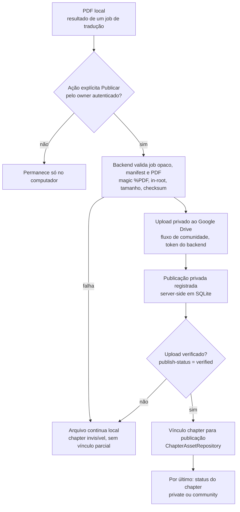

# Publicação explícita de PDFs sociais + leitor autenticado

> **Revisado em:** 2026-10-25 · **Base verificada:** `fb8875e` (diagrama de fluxo convertido para Mermaid; demais seções sobre `5f482ce1`).
> **Estado:** backend IMPLEMENTADO (`yomu/community/social_pdf_http.py`,
> `social_pdf_publishing.py`, `chapter_asset_repository.py`, `social_content.py`), coberto por
> testes offline. A UI social que expõe esses controles está **desligada** no cliente
> (`COMMUNITY_ENABLED = false` em `static/social_community.js`). Smoke real no Google Drive
> não foi executado.

Todo conteúdo do tradutor (imagens, OCR, traduções, PDFs) permanece **somente local por
padrão**. Nada é publicado ao concluir tradução, exportar, salvar ou reiniciar. O único
caminho para um arquivo sair da máquina é a ação **explícita e autenticada** "Publicar na
comunidade".

## Fluxo

Se o usuário cancelar ou qualquer etapa falhar: o arquivo continua local, o chapter
permanece invisível para terceiros, nenhum vínculo parcial persiste, nenhum link público é
criado. Uma **idempotency intent** impede que duplo clique/retry crie dois uploads.

## Identificador opaco do PDF local

O frontend **nunca** envia caminho. O identificador é o **`source_job_id`** (id de 32 hex
de um job de tradução registrado pelo app). O backend resolve `job_id → registro → PDF em
raiz autorizada` com o mesmo saneamento já existente (`yomu/community/community_api.py::_resolve_translation_job`:
job finished/exit0, manifest coincidente, PDF dentro de `output/`, magic bytes). Sem
`file://`, sem caminho absoluto/relativo, sem symlink/UNC, sem varredura de diretório.
`GET /local-pdf-results` lista apenas jobs registrados e concluídos do owner (DTO:
`source_job_id`, título, data, estado) — **nunca** caminho, Drive id ou credencial.

## Decisão: SQLite server-side, não `private.chapter_assets` remoto

Escrever no `private.chapter_assets` remoto exigiria **`service_role` ou a senha do banco**
(anon/authenticated não acessam o schema privado por design) — bypass de RLS. Optou-se por
**`ChapterAssetRepository` em SQLite server-side**: liga `chapter_id → publication_id +
owner_id` e resolve o Drive file id server-side pela publicação existente. **Zero credencial
nova**; `private.chapter_assets` remoto **não foi alterado**. Migração futura (via role
dedicada de menor privilégio ou Edge Function) fica documentada; nenhum dado antigo é
apagado.

## `ChapterAssetRepository`

`link`/`replace`/`unlink`/`get_readable_file`/`get_asset_status`. Owner derivado do
principal; o cliente nunca fornece `storage_file_id`/`owner_id`/`provider`/`path`. Replace é
atômico e preserva o vínculo antigo em falha. Unlink é idempotente e **não** apaga o PDF
local nem do Drive; apenas bloqueia a leitura. O Drive file id nunca é armazenado aqui nem
retornado.

## `SocialPdfPublishingService`

Orquestra a publicação transacional reutilizando `CommunityApi.publish` (`yomu/community/community_api.py`) (upload assíncrono
via worker). `publish-status` conclui o vínculo + status **só** quando a publicação está
`verified`; falha mantém o chapter invisível. Prova a propriedade do chapter pela obra
(owner via RLS do usuário) antes de qualquer coisa.

## Endpoints (`/api/community/social`)

- `GET /local-pdf-results` — resultados locais publicáveis do owner (sem path/Drive).
- `POST /chapters/{id}/publish-pdf` — body `{source_job_id, target_status: private|community,
  publish_consent, idempotency_key}` (`publish_consent` precisa ser `true`; demais campos são
  descartados).
- `GET /chapters/{id}/publish-status` — `pending|published|failed`.
- `GET /chapters/{id}/asset` — owner: `{linked, available, updated_at, mime_type}`; leitor:
  `{linked, available}`. **Nunca** `storage_file_id`/publication_id/checksum/byte_size/path/URL.
- `POST /chapters/{id}/asset/replace` — body `{source_job_id, publish_consent, idempotency_key}`, troca atômica.
- `DELETE /chapters/{id}/asset` — desvincula (idempotente, não apaga arquivo).
- `HEAD|GET /chapters/{id}/content` — leitura protegida.
- Retenção/restauração (`GET /retained-assets`, `GET /chapters/{id}/asset/retention`,
  `POST /chapters/{id}/asset/restore`) — ver
  [SOCIAL_ASSET_RETENTION_RECONCILIATION.md](SOCIAL_ASSET_RETENTION_RECONCILIATION.md).

Todos rejeitam `path`/`owner_id`/`storage_file_id`/`role`/`status` etc. no body (422).

## Autorização antes do storage (leitor)

Ordem: autenticar JWT → `RequestPrincipal` → visibilidade do chapter pela **RLS do usuário**
(`social_repo.get_chapter` com o token) → resolver o asset vinculado → **só então** abrir o
Drive. Um **spy do Drive** prova zero chamadas em negação (anônimo→401, other em private→404,
chapter inexistente/deleted→404, asset não vinculado→404). Suporta HEAD/GET/Range
(`bytes=0-99`, `bytes=100-`, `bytes=-100`), `Content-Range`, `Content-Length`,
`Content-Type: application/pdf`, `Content-Disposition: inline`, `Accept-Ranges: bytes`, 416
para Range inválido, 503 para storage indisponível. **Nunca** retorna Drive id, URL,
caminho, checksum ou nome interno.

## Leitor no frontend

`fetchChapterPdfUrl` faz `fetch` autenticado (Bearer no **header**, nunca na URL) →
`Blob` → `URL.createObjectURL` → `<object type="application/pdf">`. Sem link do Drive, sem
iframe apontando ao Drive, sem JWT na URL. Ao fechar: `AbortController.abort()`,
`URL.revokeObjectURL` (libera memória e o blob sem token). Owner sem asset vê "Arquivo ainda
não vinculado" + "Publicar PDF"; com asset vê "Ler"/"Substituir"/"Desvincular"; terceiro vê
"Ler" só quando obra+chapter community e asset disponível.

## Histórico

O `<object>` embutido não expõe página atual/total de forma confiável entre navegadores,
então **não há atualização automática de progresso** nesta fase (não se inventa progresso).
O histórico manual/registrado continua disponível ("Continuar lendo"). Quando um leitor com
posição confiável (ex.: PDF.js paginado) for adotado, o formato seguro será
`{page, total_pages}` com debounce de 10–20s, salvando na troca de página e ao fechar —
documentado como próxima fase.

## Idempotência, compensação e cleanup

Intent por chapter impede upload duplicado. Falha antes do upload: nada remoto muda. Falha
durante/após o upload: o chapter não vira community, o parcial é tratado pelo
cleanup/reconcile já existente do fluxo de comunidade; o arquivo local nunca é apagado.

## Testes

- `tests/test_social_content.py` — repositório + streaming autorizado (spy prova zero Drive em
  negação).
- `tests/test_social_pdf_publishing.py` — orquestração (local-only, idempotência, vínculo só após
  verified, falha mantém invisível, replace/unlink) + endpoints (401/422/HEAD/GET/Range,
  zero vazamento de Drive/path).
- `tests/test_social_pdf_ui.py` — contrato do frontend (sem path/Drive/JWT-na-URL, Blob revogada,
  confirmação, controles do owner).

## Limitações

- Progresso automático de leitura pendente (sem posição confiável no viewer atual).
- Vínculo em SQLite server-side; migração para `private.chapter_assets` documentada, não
  executada (evita `service_role`/senha do banco).
- O **smoke real do Google Drive** (upload/HEAD/GET/Range/replace/unlink/cleanup com PDF
  sintético) requer autorização explícita e ainda não foi executado nesta fase.
