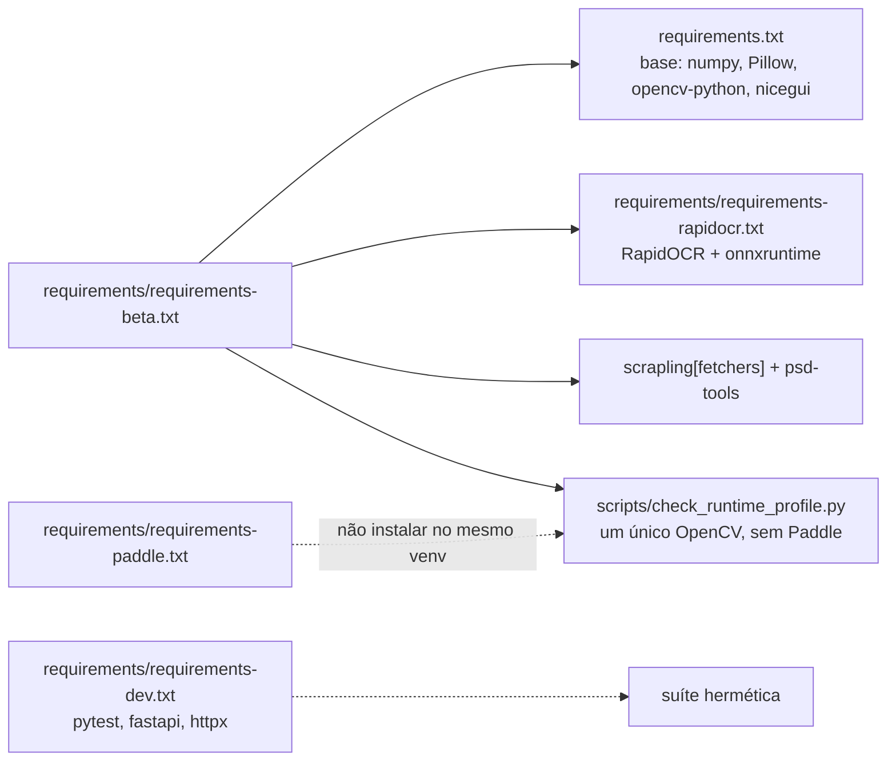

# Instalação

Este guia prepara o ambiente local do Tradutor.IA no cenário atualmente auditado: Windows 64 bits e Python 3.11.

> **Base verificada:** `5f482ce1` (branch `main`) · **Revisado em:** 2026-10-24
>
> [Voltar ao README](../README.md) · [Desenvolvimento](DEVELOPMENT.md)
>
> Para setup de desenvolvimento, comandos de teste, dependências externas por tipo e riscos
> conhecidos, use [Desenvolvimento](DEVELOPMENT.md). Este guia cobre a instalação em si.

## Pré-requisitos

| Componente | Requisito | Observação |
| --- | --- | --- |
| Sistema operacional | Windows 11, 64 bits | É a plataforma validada pelo projeto |
| Python | 3.11, 64 bits | O ambiente atual foi auditado com Python 3.11.9 |
| Git | Versão recente | Usado para clonar e atualizar o repositório |
| Google Chrome | Versão recente | **Opcional/fallback.** A descoberta de fonte é HTTP-first; o Chrome só é iniciado quando esse caminho não se aplica à fonte |
| Node.js | 24 | **Somente desenvolvimento**: suítes de frontend `.mjs` e serviço Better Auth. O pipeline não precisa dele |
| Memória | 16 GB recomendados | Modelos de OCR e reconstrução podem elevar bastante o uso de RAM e memória virtual |
| Disco | Espaço para modelos, caches e outputs | Capítulos completos podem gerar muitos arquivos intermediários |
| Conta Yomu Sekai | login Supabase + licença Beta | Jobs com tradução passam sempre pelo backend autenticado (`yomu_backend`); a chave DeepL é segredo do servidor, não do cliente |

O suporte end-to-end de Linux e macOS ainda não foi validado. O launcher possui um caminho POSIX para grupos de processos, mas isso não equivale a suporte integral do pipeline nessas plataformas.

## 1. Clonar o repositório

```powershell
git clone https://github.com/HenriquePvAr/Tradutor.Ia.git
cd Tradutor.Ia
```

## 2. Criar o ambiente virtual

```powershell
py -3.11 -m venv .venv
.\.venv\Scripts\Activate.ps1
python -m pip install --upgrade pip
```

Se a política do PowerShell impedir a ativação, não é necessário alterar a configuração global do Windows. Use diretamente o executável do ambiente:

```powershell
.\.venv\Scripts\python.exe --version
```

Nos comandos seguintes, substitua `python` por `.\.venv\Scripts\python.exe` e `pip` por `.\.venv\Scripts\python.exe -m pip`.

## 3. Instalar as dependências

`requirements/requirements-beta.txt` é o perfil de runtime da Beta. Ele compõe os manifests existentes
e declara também os recursos Comix (Scrapling) e PSD incluídos pelo spec de packaging,
então instalar por ele é o caminho suportado:

```powershell
# -s desabilita o site-packages do usuário, que já mascarou o cv2 carregado.
python -s -m pip install -r requirements/requirements-beta.txt
python -s -m pip install -r requirements/requirements-dev.txt
python -s scripts/check_runtime_profile.py
```

Os arquivos têm responsabilidades diferentes:

- `requirements/requirements-beta.txt`: perfil de runtime da Beta (`requirements.txt` + `requirements/requirements-rapidocr.txt` + Scrapling/PSD usados no pacote);
- `requirements.txt`: processamento de imagem, Selenium, tradução e monitoramento;
- `requirements/requirements-rapidocr.txt`: RapidOCR e ONNX Runtime usados como OCR primário do fluxo Beta
  nos modos `fast` e `quality`;
- `requirements/requirements-paddle.txt`: PaddleOCR **opcional**, fora da Beta — ver o aviso de OpenCV abaixo;
- `requirements/requirements-ui.txt`: NiceGUI para a interface local (o pin já vem em `requirements.txt`);
- `requirements/requirements-dev.txt`: pytest e dependências da suíte hermética;
- `requirements/requirements-optional.txt`: transportes opcionais (importados de forma preguiçosa, desligados por padrão);
- `requirements/requirements-gemini-vps.txt`: dependências do serviço VPS experimental — fora da Beta; **não** instale no venv do cliente (traz `opencv-python-headless`, que quebra o contrato de OpenCV).

Composição dos perfis (linhas tracejadas: fora do perfil Beta):



`scripts/check_runtime_profile.py` é o portão: nenhum arquivo de requisitos consegue proibir
um pacote, então o script falha quando existe mais de uma distribuição de OpenCV, quando
qualquer distribuição Paddle está instalada, ou quando o `cv2` realmente importado não é o
declarado.

**OpenCV — instale exatamente uma variante.** O projeto requer `opencv-python`, fixado em
`requirements.txt` na versão auditada. Nenhum módulo `contrib` é usado, então
`opencv-contrib-python`, `opencv-python-headless` e `opencv-contrib-python-headless` não
acrescentam nada e, instalados no mesmo ambiente, apenas criam um segundo `cv2` no
`sys.path` cuja versão depende da ordem dos diretórios. Se `python -m pip list | findstr
opencv` mostrar mais de uma linha, desinstale as variantes extras antes de confiar em
qualquer resultado de qualidade. Ver `OPENCV-THRESHOLD-SENSITIVITY-001` em
[Qualidade e validação](QUALITY_AND_VALIDATION.md).

> **Não instale `requirements/requirements-paddle.txt` no mesmo ambiente.** `paddleocr` depende de
> `paddlex`, que fixa `opencv-contrib-python==4.10.0.84`. As duas distribuições instalam o
> mesmo diretório `cv2/`: pip não reporta conflito, `pip check` fica limpo, e quem escreve por
> último vence — o `cv2` efetivamente importado vira 4.10.0 sem nenhum aviso. Foi exatamente
> isso que aconteceu no venv de desenvolvimento. Registrado como
> `OPENCV-VARIANT-SHADOWING-001` em [Desenvolvimento](DEVELOPMENT.md#riscos-conhecidos).
> Verifique com:
>
> ```powershell
> python -s scripts/check_runtime_profile.py
> ```

Se pretende usar somente a CLI, NiceGUI é opcional. PaddleOCR **não** é requisito para o modo
`quality`: RapidOCR é o engine primário nos dois modos e a escalação Paddle é apenas uma
recuperação opcional, que é simplesmente pulada quando a biblioteca não está instalada.

## 4. Criar a configuração local

```powershell
Copy-Item .env.example .env
```

Abra `.env` e preencha a configuração pública do Supabase usada pelo login e pelo backend de
tradução:

```dotenv
SUPABASE_URL=<url-do-projeto>
SUPABASE_PUBLISHABLE_KEY=<chave-publishable>
```

Todo job com tradução habilitada usa o provider interno `yomu_backend`, que chama o motor
remoto DeepL no servidor (Edge Function `supabase/functions/translation-execute`). Por isso
`DEEPL_API_KEY` **não** é necessária no cliente para jobs habilitados — ela é segredo do
servidor. `NVIDIA_API_KEY` só é lida por caminhos legados/experimentais (por exemplo, o OCR
NVIDIA opcional); Riva/Nemotron não são providers efetivos de um job habilitado.
`SUPABASE_SECRET_KEY` nunca pertence ao cliente.

Não versione `.env`, não cole a chave em comandos e não a inclua em relatórios. Os demais defaults são documentados em [Configuração](CONFIGURATION.md).

## 5. Modelos de OCR

O perfil Beta instala apenas RapidOCR. Seus modelos ONNX vêm dentro da própria wheel
`rapidocr-onnxruntime`, então não há download na primeira execução do OCR. O código usa:

- RapidOCR/ONNX Runtime como OCR primário dos modos `fast` e `quality`;
- recuperação regional limitada, também com RapidOCR, para regiões duvidosas;
- PaddleOCR apenas como compatibilidade legacy, opt-in por `OCR_LEGACY_PADDLE_FALLBACK`
  (desligado por padrão) e **não instalado na Beta** — quando a biblioteca está ausente a
  escalação é pulada e a leitura do RapidOCR é mantida;

O projeto não exige que modelos sejam copiados manualmente para uma pasta interna do
repositório.

Tesseract está presente apenas como caminho opcional de compatibilidade. Ele não é o OCR principal e não precisa ser instalado para os modos documentados no README.
Planeje a primeira execução com conexão disponível e espaço em disco.

## 6. Chrome e ChromeDriver

O Chrome é o **caminho de fallback**, não o principal. Para fontes cujo adapter suporta
descoberta por HTTP, o pipeline resolve as páginas com um GET limitado e sem cookies e não
inicia navegador nenhum. Consulte
[Arquitetura § Descoberta de fonte](ARCHITECTURE.md#descoberta-de-fonte).

> Problema conhecido em máquina de desenvolvimento: em sistemas afetados por problemas de
> Microsoft Platform Crypto Provider / TPM, o Chrome pode falhar ao iniciar e inutilizar o
> fallback. A descoberta HTTP evita essa dependência para as fontes que a suportam.

Quando o fallback é usado, o downloader inicia o Chrome em modo headless. A resolução do
driver segue esta ordem:

1. `CHROMEDRIVER_PATH`, quando configurado e válido;
2. `chromedriver` ou `chromedriver.exe` já disponível no `PATH`;
3. Selenium Manager oficial, cacheado pelo Selenium, quando nenhum driver local existe.

Essa terceira etapa evita que uma instalação Windows limpa dependa de download manual de
ChromeDriver. Em testes herméticos, a resolução automática fica desligada por padrão; use
`TRADUTOR_ALLOW_DRIVER_DOWNLOAD=1` somente quando quiser permitir esse resolvedor no teste.
Se a resolução automática falhar, defina um caminho genérico no `.env`:

```dotenv
CHROMEDRIVER_PATH=C:\ferramentas\chromedriver.exe
```


## 7. Verificar a instalação

Os testes abaixo são locais e não baixam capítulos:

```powershell
python -m py_compile run_webtoon.py app_ui.py yomu/runtime/process_launcher.py
python tests/test_run_webtoon.py
python tests/test_process_launcher.py
python tests/test_ocr_quality_regressions.py
```

Para uma verificação rápida das bibliotecas:

```powershell
python -s scripts/check_runtime_profile.py
python -c "from rapidocr_onnxruntime import RapidOCR; print('RapidOCR: OK')"
python -c "import nicegui; print('NiceGUI: OK')"
```

Esses comandos confirmam importação e testes offline; não validam a chave de tradução nem o acesso ao site de origem.

## 8. Primeira inicialização

### Interface local

```powershell
python desktop_app.py
```

O shell desktop cria a janela nativa e hospeda a UI local em WebView2. Para executar somente o
servidor de UI durante desenvolvimento, use o procedimento em [Desenvolvimento](DEVELOPMENT.md);
o endereço loopback não substitui a janela do aplicativo no uso desktop. Abra sempre **`http://127.0.0.1:8080`**, não `http://localhost:8080`: a origem permitida no projeto Supabase Auth (`SUPABASE_SITE_URL`/`SUPABASE_REDIRECT_URL`) é `127.0.0.1`, e o login pode falhar em outra origem. O servidor da UI não abre navegador nem imprime a URL (`ui.run(show=False)` em `yomu/ui/app.py`); o shell desktop (`python desktop_app.py`) já abre a janela em `http://127.0.0.1:<porta>/`.

 A tradução exige
login: o backend autenticado executa o DeepL no servidor.

### Linha de comando

```powershell
python run_webtoon.py "<URL_DO_CAPITULO>" --mode quality --no-context
```

RapidOCR é o engine primário nos dois modos e a validação de OCR pós-render fica ligada
em ambos. O modo `fast` (somente CLI) mantém os fallbacks pesados desativados; o modo
`quality` habilita os caminhos de recuperação mais caros. Consulte `python run_webtoon.py --help`
para as flags reais.

Use somente conteúdo que você tenha autorização para processar. Para uma primeira experiência, acompanhe o consumo de memória e os relatórios de saída.

## 9. Launcher supervisionado

Para execuções longas iniciadas fora da UI, o repositório inclui `yomu/runtime/process_launcher.py` (`python -m yomu.runtime.process_launcher --help`). Ele mantém stdout e stderr separados, persiste o exit code e controla a árvore de processos no Windows. Um exemplo completo está em [Arquitetura](ARCHITECTURE.md#launcher-supervisionado).

O launcher PowerShell inline usado em experimentos antigos não faz parte do fluxo documentado e não deve ser usado para capturar o exit code.

## Próximos passos

- revise as opções em [Configuração](CONFIGURATION.md);
- entenda os estados em [Qualidade e validação](QUALITY_AND_VALIDATION.md);
- consulte [Troubleshooting](TROUBLESHOOTING.md) se algum componente não carregar.
