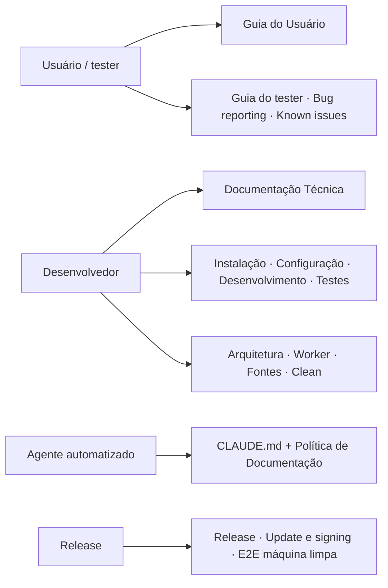

# Documentação do Komyst

> O estado vigente está nos documentos primários abaixo e no [board por domínio](status/board/index.html).

> Estados de evidência: `IMPLEMENTED` descreve código; `INTEGRATED` descreve composição no snapshot; `TESTED_OFFLINE` e `TESTED_FROZEN` identificam o tipo exato de validação; `PHYSICALLY_VERIFIED` exige artefato/operação física correlacionada; `EXTERNAL_GATE` depende de serviço, identidade ou autorização externa; `DEFERRED` não está habilitado como produto.

Esta é a página inicial da documentação. Comece pelo documento certo para o seu papel.

O nome do produto e a logo atuais estão descritos em [Marca do Komyst](BRANDING.md).

---

## Comece por aqui

| Se você é… | Leia |
| --- | --- |
| 🧑‍🎨 **Scan, tradutor, editor ou testador da Beta** | [**Guia do Usuário**](user/GUIA_DO_USUARIO.md) |
| 🛠️ **Desenvolvedor, mantenedor ou suporte técnico** | [**Documentação Técnica**](technical/DOCUMENTACAO_TECNICA.md) |
| 🤖 **Agente automatizado (Claude/Codex) trabalhando no repositório** | [`CLAUDE.md`](../CLAUDE.md) + [Política de Documentação](DOCUMENTATION_POLICY.md) |
| 📋 **Auditando a documentação** | [Auditoria de Documentação](DOCUMENTATION_AUDIT.md) |

---

## Documentos primários

O [perfil de hardware medido](HARDWARE_PROFILE.md) separa consumo observado de
RAM/VRAM, tempo do capítulo e limites ainda não homologados de requisitos mínimos.

| Documento | Conteúdo |
| --- | --- |
| [Guia do Usuário](user/GUIA_DO_USUARIO.md) | Instalar, entrar, traduzir, acompanhar, revisar, resolver erros. Linguagem simples. |
| [Saídas e artefatos](OUTPUT_ARTIFACTS.md) | Perfis Automático/QC Profissional, paths, manifests e distinção entre job, run e artifact. |
| [Documentação Técnica](technical/DOCUMENTACAO_TECNICA.md) | Arquitetura, processos, estados, pipeline, segurança, testes, comandos, dívida técnica. |
| [Política de Documentação](DOCUMENTATION_POLICY.md) | Quando e como a documentação deve ser atualizada junto com o código. |
| [Auditoria de Documentação](DOCUMENTATION_AUDIT.md) | O que foi verificado, o que estava desatualizado e o que continua em aberto. |
| [README do projeto](../README.md) | Visão geral curta e início rápido. |
| [Estado do produto no board](status/board/index.html) | Estado operacional por evidência; um estado local não significa publicação. |

---

## Referência por assunto

### Instalação e configuração

- [Instalação](INSTALLATION.md) — ambiente, dependências, modelos e primeiro teste
- [Configuração](CONFIGURATION.md) — variáveis do `.env.example`, defaults e ajustes
- [Internacionalização](I18N.md) — idiomas da interface

### Arquitetura e execução

- [Arquitetura](ARCHITECTURE.md) — processos, pacote `komyst/`, tradução via backend e caminhos de runtime
- [Desenvolvimento](DEVELOPMENT.md) — setup, execução, testes, dependências externas, empacotamento e riscos conhecidos
- [Estrutura do projeto](architecture/REPOSITORY_STRUCTURE.md) — localização do código, contratos da raiz, testes, ferramentas e pesquisa
- [Fluxo de desenvolvimento](DEVELOPMENT_WORKFLOW.md) — comandos de validação após mudanças
- [Política de artefatos](ARTIFACT_POLICY.md) — conteúdo versionado e outputs externos
- [Fila de worker persistente](WORKER_QUEUE.md) — processos, estados, cancelamento e recuperação
- [Estratégia de limpeza (Clean)](architecture/clean_strategy.md) — máscaras, preenchimento, LaMa, gates e fallback
- [Modos de saída](product/output_modes.md) — o que cada perfil entrega
- [Operação](operations/comix_source_challenge.md) — desafio Cloudflare do Comix; demais notas em [`operations/`](operations/)

### Fontes de capítulo

- [Adapters de fonte de capítulo](SOURCE_ADAPTERS.md) — como uma URL é analisada
- [Adaptador universal de capítulos](UNIVERSAL_CHAPTER_ADAPTER.md) — fallback controlado, limites e restrições
- [Entrada por pasta local](LOCAL_FOLDER_INPUT.md) — processar imagens já presentes no computador
- [Transportes de download](DOWNLOAD_TRANSPORTS.md) — abstração de transporte e validação por bytes

### PSD e saídas profissionais

- [M15 — matriz de compatibilidade PSD](PSD_COMPATIBILITY_MATRIX.md) — evidência física Photoshop/Photopea; cross-editor round-trip ainda não executado
- [M17 — performance e tamanho PSD](PSD_PERFORMANCE_REPORT.md) — medições do job existente e estimativas separadas

### Qualidade

- [Qualidade e validação](QUALITY_AND_VALIDATION.md) — gates, fallbacks, retries, estados terminais e riscos abertos
- [M18.5 — hardening de qualidade de tradução](TRANSLATION_QUALITY_HARDENING.md) — guards determinísticos, retry/re-score e limitação semântica conhecida
- [M16 — replay offline de qualidade](M16_TRANSLATION_QUALITY_REPLAY.md) — cobertura e limitações do replay read-only
- [M20 — cobertura de tradução e integridade CLEAN](M20_RC_BLOCKER_HOTFIX.md) — ordem de reservation/retry, falhas sistêmicas e remoção independente do texto-fonte
- [Quality Freeze](QUALITY_FREEZE.md) — o que está congelado, a evidência e como sair do freeze
- [Taxonomia semântica e auditoria linguística](architecture/SEMANTIC_CLASSIFICATION_AUDIT.md)
- Pesquisa (fora do produto): [Gemini safe fallback v2](research/GEMINI_SAFE_FALLBACK_V2.md), [metadados de Clean seguro](research/SAFE_CLEAN_QUALITY_METADATA_V1.md), [contrato de candidatos de treino](research/TRAINING_CANDIDATE_CONTRACT_V1.md)

### Comunidade, autenticação e armazenamento

> A UI da Comunidade está desligada no cliente (**EM BREVE**); o backend existe. O login Supabase
> só funciona com a UI aberta em `http://127.0.0.1:8080` — origem liberada no projeto de auth.

- [Autenticação Supabase](SUPABASE_AUTH.md)
- [Autorização da comunidade](COMMUNITY_AUTHORIZATION.md)
- [Backend social Supabase](SUPABASE_SOCIAL_BACKEND.md)
- [Schema do banco social](SUPABASE_SOCIAL_SCHEMA.md)
- [Interface da comunidade](SOCIAL_COMMUNITY_UI.md)
- [Publicação explícita de PDFs](EXPLICIT_SOCIAL_PDF_PUBLISHING.md)
- [Retenção e reconciliação de assets sociais](SOCIAL_ASSET_RETENTION_RECONCILIATION.md)
- [Armazenamento privado no Google Drive](COMMUNITY_STORAGE.md)
- [Preparação do Better Auth](BETTER_AUTH_MIGRATION.md)

### Segurança, testes e diagnóstico

- [Segurança e limites de confiança](SECURITY.md)
- [Contrato de segredos de produção](operations/PRODUCTION_SECRETS_REQUIRED.md) — nomes/configuração exigidos; nunca contém valores privilegiados
- [Testes herméticos e smokes manuais](TESTING.md)
- [Troubleshooting](TROUBLESHOOTING.md)

### Release e closed beta

- [Release](RELEASE.md)
- [Checklist de release](RELEASE_CHECKLIST.md)
- [Update e signing](UPDATE_AND_SIGNING.md)
- [E2E em máquina limpa](CLEAN_VM_E2E.md)
- [Guia do tester](CLOSED_BETA_TESTER_GUIDE.md)
- [Bug reporting](BUG_REPORTING.md)
- [Known issues](KNOWN_ISSUES.md)
- [Privacidade e dados](PRIVACY_AND_DATA.md)
- [Third-party notices](THIRD_PARTY_NOTICES.md)

### Auditorias históricas

Documentos de auditoria pontual, preservados como registro. Descrevem o estado no momento
em que foram escritos e **não** substituem os documentos primários:

- [Auditoria funcional — fontes e submissão](FULL_FUNCTIONAL_AUDIT.md)
- [Taxonomia semântica e auditoria linguística](architecture/SEMANTIC_CLASSIFICATION_AUDIT.md)
- [Plano de rollback da migração de auth](../scripts/auth-migration/rollback-plan.md)

---

## Estado resumido do produto

| Área | Estado |
| --- | --- |
| Pipeline ponta a ponta | **IMPLEMENTADO** — coleta, OCR, tradução autorizada, reconstrução, PDF e revisão de qualidade; ver [Arquitetura](ARCHITECTURE.md) e [Saídas](OUTPUT_ARTIFACTS.md) |
| OCR | **IMPLEMENTADO** — RapidOCR é o mecanismo primário; Paddle é uma recuperação opcional quando instalado |
| Tradução | **IMPLEMENTADO** — o cliente chama o backend autenticado; o provider DeepL executa no servidor (`supabase/functions/translation-execute`) |
| Efeitos sonoros | Preservados no original por padrão; a opção **Traduzir SFX** habilita sua tradução |
| Fila, worker e supervisão | **IMPLEMENTADOS** — fila local persistente, worker separado e recuperação supervisionada |
| Retomada de job | **IMPLEMENTADA** — a interface permite retomar jobs elegíveis (`can_resume`) |
| Leitor, PDF e histórico | **IMPLEMENTADOS** — páginas e artefatos locais podem ser consultados no aplicativo |
| Licença Beta | **IMPLEMENTADA** — autorização fail-closed no início/retomada; **validado por beta tester, informado pelo dono** na versão `v0.9.1-beta.18`; data não informada |
| Instalador Windows | **IMPLEMENTADO** — PyInstaller e Inno Setup geram `Komyst-<versão>-Setup-x64.exe`; instalação da `v0.9.1-beta.18` **validada por beta tester, informado pelo dono**; data não informada |
| Instalação limpa Windows | **VALIDADA** na `v0.9.1-beta.18` por beta tester, informado pelo dono; data não informada |
| Atualizador | **IMPLEMENTADO** no cliente, com verificação de assinatura e hash; disponibilidade do manifesto depende do canal Beta |
| Comunidade | **EM DESENVOLVIMENTO** — a interface informa indisponibilidade nesta versão |
| Scan Studio | **EM DESENVOLVIMENTO** — a aba exibe aviso de indisponibilidade |

Detalhamento em [Documentação Técnica §2](technical/DOCUMENTACAO_TECNICA.md#2-escopo-atual-do-produto)
e [§29 Dívida técnica](technical/DOCUMENTACAO_TECNICA.md#29-dívida-técnica-conhecida).

---

Para proveniência e limites de cada capacidade, consulte os documentos técnicos e o [board operacional](status/board/index.html). A validação Beta acima foi informada pelo dono; não é uma medição executada nesta integração.
