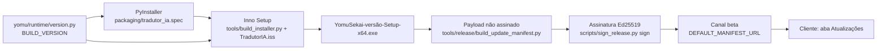

# Release

> **Base verificada:** `5f482ce1` (branch `main`) · **Revisado em:** 2026-10-24

Este é o documento autoritativo para preparar uma release do Yomu Sekai.

- `PRODUCT_VERSION` e `BUILD_VERSION` são definidos em `yomu/runtime/version.py` (o antigo
  `app_version.py` da raiz não existe mais); não mantenha uma cópia manual de versões neste
  documento. Em `5f482ce1` os valores-fonte continuam `0.9.0` e `0.9.1-beta.18`.

Peças existentes no repositório (estado: código presente; build, assinatura e publicação são
gates externos não executados aqui):

| Etapa | Onde |
| --- | --- |
| Bundle PyInstaller | `packaging/tradutor_ia.spec` (validação: `packaging/tradutor_ia_validation.spec`) |
| Instalador Inno Setup | `packaging/TradutorIA.iss`, invocado por `tools/build_installer.py` com `/DProductVersion=<BUILD_VERSION>`; saída `YomuSekai-<versão>-Setup-x64.exe` |
| Manifest | `tools/release/build_update_manifest.py` monta o payload **não assinado**; `scripts/sign_release.py sign` (chave Ed25519 privada externa, nunca no repositório) produz o manifest assinado; `scripts/sign_release.py pubkey` imprime a chave pública para `TRUSTED_PUBLIC_KEYS` |
| Consumo no cliente | `yomu/runtime/update_manifest.py`, `update_transport.py`, `installer_update.py`, aba **Atualizações** — ver [Update e signing](UPDATE_AND_SIGNING.md) |

O owner já confirmou a distribuição da Beta 17 pelo updater. Isso não constitui nesta missão
uma nova validação de signing, instalação limpa ou readiness da Beta 18. Status de bloqueadores
copiados de avaliações anteriores devem ser tratados como históricos até serem revalidados pelo
processo próprio. Consulte [RELEASE_CHECKLIST.md](RELEASE_CHECKLIST.md) para o checklist; a M18
não executa gate de release.

Para a primeira closed beta, o cliente usa a configuração pública do Supabase e a autoridade
de licença/ tradução configurada no backend. A chave `service_role` nunca pertence ao cliente.
Cloudflare permanece opcional nesta etapa; qualquer proteção de borda futura deve ser configurada
sem alterar o contrato do cliente.
