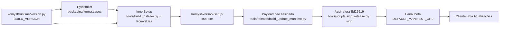

# Release

O fluxo abaixo descreve os componentes de release. A versão Beta reportada como validada é
`v0.9.1-beta.18` (**validado por beta tester, informado pelo dono**; data não informada).
Este documento não autoriza criar ou publicar outra versão.

- `PRODUCT_VERSION` e `BUILD_VERSION` são definidos em `komyst/runtime/version.py`; não mantenha
  uma cópia manual de versões neste documento. O `BUILD_VERSION` atual é `0.9.1-beta.18`.

Peças existentes no repositório (estado: código presente; build, assinatura e publicação são
gates externos não executados aqui):

| Etapa | Onde |
| --- | --- |
| Bundle PyInstaller | `packaging/komyst.spec` (validação: `packaging/komyst_validation.spec`) |
| Instalador Inno Setup | `packaging/Komyst.iss`, invocado por `tools/build_installer.py` com `/DProductVersion=<BUILD_VERSION>`; saída `Komyst-<versão>-Setup-x64.exe` |
| Manifest | `tools/release/build_update_manifest.py` monta o payload **não assinado**; `tools/scripts/sign_release.py sign` (chave Ed25519 privada externa, nunca no repositório) produz o manifest assinado; `tools/scripts/sign_release.py pubkey` imprime a chave pública para `TRUSTED_PUBLIC_KEYS` |
| Consumo no cliente | `komyst/runtime/update_manifest.py`, `update_transport.py`, `installer_update.py`, aba **Atualizações** — ver [Update e signing](UPDATE_AND_SIGNING.md) |

O instalador, a licença e a instalação limpa da `v0.9.1-beta.18` foram reportados pelo dono como
validados por beta tester. Isso não comprova assinatura Authenticode, publicação de manifesto
novo, nem o E2E completo do updater. Consulte [RELEASE_CHECKLIST.md](RELEASE_CHECKLIST.md) para os
gates separados.

Para a primeira closed beta, o cliente usa a configuração pública do Supabase e a autoridade
de licença/ tradução configurada no backend. A chave `service_role` nunca pertence ao cliente.
Cloudflare permanece opcional nesta etapa; qualquer proteção de borda futura deve ser configurada
sem alterar o contrato do cliente.
