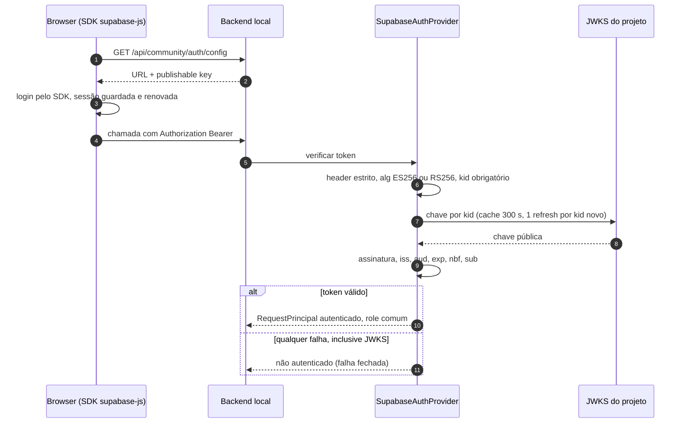

# Autenticação Supabase (community)

> **Estado:** IMPLEMENTADO (provedor padrão). **Revisado em:** 2026-10-25 · **Base verificada:** `fb8875e`.

## Backend ativo após o cutover local (2026-09-29)

O runtime local do Yomu Sekai usa o projeto **Yomu Sekai** (`<projeto-supabase-ativo>`)
em `https://<projeto-supabase-ativo>.supabase.co`, com publishable key pública. O projeto
**Tradutor IA Community** (`<projeto-supabase-legado>`) permanece intacto como rollback
temporário até sua aposentadoria formal; não é o destino de novas sessões. Signup,
confirmação de e-mail, login, logout e recuperação/alteração de senha foram validados
fisicamente no projeto novo.

O novo projeto não possui a Edge Function `profile-media`. Profile Media também foi
removida do runtime local e seu source órfão não permanece neste repositório. O backend
legado continua preservado como rollback; nenhuma remoção foi feita nele.

Os provedores de autenticação são selecionados por `AUTH_PROVIDER` (tem precedência; lido
pelo código, não listado em `.env.example`) ou `COMMUNITY_AUTH_PROVIDER`, resolvidos em
`yomu/community/community_auth.py::build_auth_provider` (sem valor → `supabase`):

- `supabase` — **padrão**; JWT de usuário verificado criptograficamente por JWKS;
- `local` — sessão de operador em loopback, sem dependência de rede;
- `better_auth` — opcional, PARCIAL/não ativado; serviço em `apps/auth-service/`, atrás de
  proxy same-origin (ver [BETTER_AUTH_MIGRATION.md](BETTER_AUTH_MIGRATION.md));
- `local_test` — provedor exclusivo de teste.

Configuração incompleta **falha fechada**: nunca há queda silenciosa para o provedor local.

A troca de provedor não altera nenhuma regra de autorização: o
[boundary de autorização](COMMUNITY_AUTHORIZATION.md) continua decidindo acesso a partir
de um `RequestPrincipal`. O provedor Supabase apenas transforma um access token válido em
`RequestPrincipal`.

## Configuração no painel do Supabase (manual)

Você precisa ter feito no painel (não é automatizado por este projeto):

- **Authentication → URL Configuration**
  - Site URL: `http://127.0.0.1:8080`
  - Redirect URLs: `http://127.0.0.1:8080/auth/callback`
- E-mail/senha habilitado como método de login.

## Variáveis de ambiente (`.env` local, fora do Git)

    COMMUNITY_AUTH_PROVIDER=supabase
    SUPABASE_URL=<url do projeto>
    SUPABASE_PUBLISHABLE_KEY=<chave publishable>
    SUPABASE_SECRET_KEY=<secret; só para scripts administrativos locais>
    SUPABASE_JWKS_URL=<derivada da URL quando vazia>
    SUPABASE_EXPECTED_ISSUER=<derivado da URL quando vazio>
    SUPABASE_EXPECTED_AUDIENCE=authenticated
    SUPABASE_SITE_URL=http://127.0.0.1:8080
    SUPABASE_REDIRECT_URL=http://127.0.0.1:8080/auth/callback

- No runtime desktop/empacotado, `yomu/desktop/app.py` lê `config/public-runtime.json`
  (apenas `supabase_url` e `publishable_key`) e injeta `SUPABASE_URL`,
  `SUPABASE_PUBLISHABLE_KEY`, `SUPABASE_EXPECTED_AUDIENCE=authenticated` e
  `BETA_LICENSE_PROVIDER=supabase` no ambiente do processo filho da UI, sem sobrescrever
  valores já definidos. Nenhum segredo de servidor é lido desse arquivo.
- A **URL** e a **publishable key** são públicas por design — o backend as expõe em
  `GET /api/community/auth/config` só para o browser criar o cliente do SDK.
- A **secret key nunca** chega ao frontend, nunca é retornada por endpoint, nunca
  autoriza um PDF e nunca fabrica um `RequestPrincipal`. Ela só serve a operações
  administrativas server-side (por exemplo criar/apagar usuários de teste). Enquanto não
  houver endpoint administrativo, **recomenda-se removê-la do `.env`** após o uso — o
  runtime normal de login e validação de JWT não precisa dela.

## Verificação do token (server-side)

`SupabaseAuthProvider` recebe `Authorization: Bearer <access token>` e:

Implementação: `yomu/auth/supabase_auth.py` (`SupabaseAuthConfig`, `SupabaseAuthProvider`).

1. faz o parsing estrito do header (um único Bearer, formato JWS compacto, tamanho
   limitado);
2. lê o header do JWT e exige `alg` na allow-list (`ES256`/`RS256`) e um `kid`;
3. seleciona a chave pública **apenas** por `kid` no JWKS do projeto — `jku`/`x5u` do
   token são ignorados;
4. valida assinatura, `iss`, `aud`, `exp` e `nbf` (com pequena tolerância de relógio) e
   exige `sub`;
5. só então cria `RequestPrincipal(authenticated=True, auth_source="supabase")` com
   `user_id = sub` e **role comum** (nunca admin/moderator vindos de metadata editável).

O JWKS é buscado sob demanda (nunca no import), com timeout, cache com TTL (300 s), limite de
tamanho e no máximo um refresh por rotação de `kid` (sem loop de refresh). Qualquer falha
de JWKS **falha fechado**: a requisição fica não autenticada, nunca aceita.

## Fluxo do frontend

1. o browser busca `/api/community/auth/config` e cria o cliente oficial do SDK
   (`@supabase/supabase-js` 2.58.0, empacotado localmente em `static/vendor/`, sem CDN)
   com URL + publishable key (`static/supabase_auth.js`, carregado por
   `static/auth_provider.js`);
2. login/cadastro/recuperação pela tela de autenticação em página cheia
   (`#authSurface` em `ui/ui_shell.html`, lógica em `static/auth_ui.js`); o cabeçalho
   mostra estado e botões `Entrar`/`Sair`;
3. o SDK guarda e renova a sessão; o token corrente é anexado como `Bearer` nas chamadas
   ao backend (nunca persistido manualmente, nunca logado);
4. Cadastro usa confirmação de endereço como etapa separada: o redirect de signup marca
   `email_confirmation=signup`; após o Supabase concluir `/verify`, a página informa a
   confirmação e orienta o usuário a voltar ao Yomu e entrar com a senha. Esse caminho não
   cria sessão nem tenta trocar um código PKCE, pois o link pode abrir em outro perfil de
   navegador sem o verifier local.
   O callback configurado é `http://127.0.0.1:8080/auth/callback`: o link deve ser aberto no
   mesmo computador em que o Yomu está rodando. Em outro dispositivo, `127.0.0.1` aponta para
   esse dispositivo; a confirmação de e-mail pode concluir, mas a página local de retorno não
   estará disponível nele. Depois da confirmação, o usuário volta ao Yomu e entra com senha.
5. Outros callbacks PKCE, como recuperação, só trocam um `code` não vazio quando o
   verifier local do projeto está presente. A sessão só é tratada como concluída depois
   de o SDK confirmar a sessão persistida. Destinos de retorno continuam fixos — sem open
   redirect.

## Bind de rede

`SupabaseAuthProvider` declara `supports_external_bind = True`. Ainda assim, bind externo
continua exigindo o opt-in explícito `TRADUTOR_ALLOW_EXTERNAL_BIND=1`; o provedor local
nunca satisfaz esse requisito e permanece restrito a loopback.
