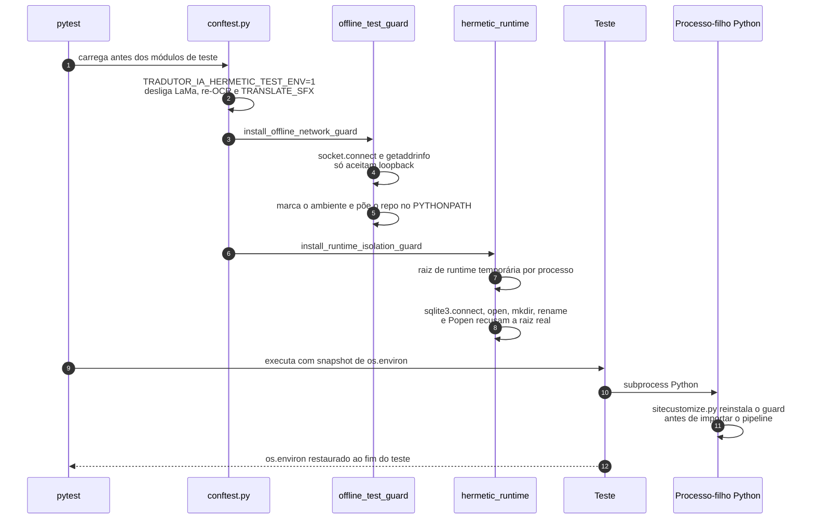

# Testes herméticos e smokes manuais

> **Base verificada:** `fb8875e` (branch `main`) · **Revisado em:** 2026-10-25
>
> `tests/test_cleanup_fixed_mask_reconstruction_red.py` era um `KNOWN_INTENTIONAL_RED`. Desde
> `5f482ce1` ele passa (2/2) e continua como contrato de reconstrução com máscara fixa; uma
> falha nele agora é regressão real. No mesmo snapshot, `python -m pytest -q` termina com
> ~6160 testes aprovados e 0 falhas em cerca de 10 minutos.

## Padrão: offline

Os arquivos `test_*.py` são testes unitários ou integrações offline. A proteção
central bloqueia conexões de socket antes de qualquer request; use fakes e
mocks locais para exercitar clientes externos.

Instale a dependência de desenvolvimento antes de usar pytest:

```powershell
python -m pip install -r requirements/requirements-dev.txt
```

A suíte roda sobre o perfil de runtime da Beta (`requirements/requirements-beta.txt`): RapidOCR presente,
PaddleOCR ausente. Os testes que exercitam o caminho Paddle injetam um módulo falso com
`patch.dict(sys.modules, ...)` ou fazem patch de `_get_paddle`, então nenhum deles depende da
biblioteca estar instalada e nenhum passa a pular fora do perfil Beta.

O comando padrão garantido para a suíte hermética é:

```powershell
python -m pytest
```



Cada módulo descoberto por `unittest` importa o bootstrap offline como primeiro passo de
execução. Processos Python descendentes herdam um marcador e o `PYTHONPATH` necessários para
que `sitecustomize.py` reinstale a mesma barreira antes de carregar o pipeline. A CI e a
documentação usam `pytest` para collection, marcadores e a garantia central antes da
importação dos módulos.

Workers usados por testes com banco temporário escrevem logs ao lado desse banco, nunca em
`.cache/runtime/logs` da execução de produção. Processos-filho desses testes herdam o guard
offline; conexões externas falham antes de qualquer request.

O guard é uma proteção Python em nível de processo, não um firewall do sistema operacional.
Um teste novo não pode iniciar navegador, `curl` ou outro binário de rede sem uma revisão
explícita; a suíte atual usa somente filhos Python/fakes. A execução externa real continua
reservada aos smokes manuais com opt-in.

Os testes do adapter universal, da política de redirects, dos limites de transporte e da
revisão de páginas usam drivers, sessões e respostas falsas. Eles não submetem uma URL de
capítulo, não abrem Chrome nem fazem a análise real de fonte. Qualquer teste novo desse
fluxo deve injetar essas dependências locais; a análise real só ocorre após uma submissão
explícita do usuário na UI/CLI e não pertence à suíte padrão.

No GitHub Actions, o workflow **Hermetic Tests** roda em `windows-latest` a
cada push para `main` e pull request destinado a `main`. Ele instala somente
as dependências declaradas, mantém a rede de smokes desautorizada e não
executa scripts manuais nem usa segredo NVIDIA.

O equivalente local da CI é:

```powershell
python -m pip install -r requirements/requirements-beta.txt
python -m pip install -r requirements/requirements-dev.txt
python scripts/check_runtime_profile.py
python -m pytest --collect-only -q
python -m pytest -q
node --check static/tradutor_ui.js   # a CI verifica também os demais scripts de static/ e static/i18n/
python -m compileall -q yomu test_support
```

O `pytest.ini` descobre testes em `tests/` e `experiments/` (`testpaths`).

O `pytest.ini` exclui os marcadores `network` e `manual` por padrão. Os
marcadores disponíveis são `unit`, `integration`, `network`, `manual` e
`slow`.

A mesma base também roda pelo runner do `unittest`:

```powershell
python -m unittest discover
```

## Testes que dependem de artefatos locais não versionados

Alguns testes medem uma execução real persistida em vez de uma fixture. Eles leem
`.cache/processed`, `output/<capítulo>/…/smart_input_pages/*.png` ou modelos locais — nada
disso está no Git, e nada disso deve entrar: são dados de runtime do usuário.

A maioria se protege com `skipTest` quando o artefato falta, e por isso a contagem de
`skipped` varia de checkout para checkout sem que nada tenha regredido. A exceção é
`test_84f15_word_sense_disambiguation.NoFalsePositiveExplosion`: ele pula quando o corpus
está **ausente**, mas quando o corpus existe e não contém mais a evidência esperada
(p046 `BALAO_1`) ele **falha**. O resultado depende do que a última execução real daquela
máquina deixou no cache — não do código.

Correção recomendada (fora do escopo de packaging, não implementada): substituir a leitura
do cache por uma fixture mínima determinística e versionável com as poucas regiões que a
asserção realmente examina, mantendo a varredura do corpus como um teste `integration`
separado e opt-in. Não copie `.cache/processed` para o Git para deixar a suíte verde.

## Suítes de frontend (`.mjs`)

As 18 suítes `test_*.mjs` em `tests/` cobrem o frontend: leitor de capítulo, ciclo de vida de
sessão, comunidade, health e caminhos de publicação. Elas não usam DOM real, timers nem rede.

```powershell
node --experimental-vm-modules tests/test_chapter_reader.mjs
```

Rodar todas:

```powershell
Get-ChildItem tests/test_*.mjs | ForEach-Object { node --experimental-vm-modules $_.FullName }
```

> **A flag `--experimental-vm-modules` é obrigatória.** Sete das 18 suítes montam os
> módulos do frontend com `vm.SourceTextModule`, que só existe sob essa flag. Sem ela o Node
> não falha na importação: cada teste falha individualmente com
> `vm.SourceTextModule is not a constructor`, o que parece defeito de produto e é apenas erro
> de invocação. `tests/test_chapter_reader.mjs` e `tests/test_service_health.mjs` rodam sem a flag
> (documentam `// Run: node <arquivo>.mjs` no cabeçalho); usar a flag em todas é o caminho
> uniforme.

A versão de Node auditada é a **24**, a mesma da CI.

**A CI não executa as suítes `.mjs`** — ela roda apenas `node --check` de sintaxe sobre os
arquivos de `static/`. As suítes de frontend são responsabilidade da execução local. Fora do
padrão `test_*.mjs` também existem `tests/wallet_normalization_test.mjs` e
`tests/integration/control_plane_http_e2e.mjs`; o glob acima não os executa.

## Serviço Better Auth

```powershell
cd apps/auth-service
npm ci
npm run typecheck
npm test
npm run build
```

## Smokes de rede: somente manual e opt-in

Os smokes não usam prefixo `test_` e não participam de discovery, CI, IDE ou
execução padrão. Nunca os execute em paralelo com E2E.

Para NVIDIA, as duas variáveis devem ter exatamente o valor `1`. O smoke usa
`enable_cache=False`, portanto não lê nem grava o cache de tradução normal.

```powershell
$env:ALLOW_NETWORK_TESTS = "1"
$env:ALLOW_NVIDIA_SMOKE = "1"
python -m scripts.manual_nvidia_smoke --short
```

Para Webtoon, também são exigidas duas autorizações. A URL deve ser fornecida
explicitamente e a saída deve ser uma pasta nova chamada `smoke_*` dentro do
diretório temporário. O script recusa sobrescrever e não faz cleanup
automático. Cache, imagens de entrada e renderização ficam dentro dessa mesma
pasta, nunca nas raízes normais do projeto.

```powershell
$env:ALLOW_NETWORK_TESTS = "1"
$env:ALLOW_WEBTOON_SMOKE = "1"
python -m scripts.manual_webtoon_smoke `
  --url "<URL_AUTORIZADA>" `
  --output-dir "$env:TEMP\smoke_webtoon_manual"
```

Sem ambas as variáveis específicas, cada script encerra com código não zero
antes de importar cliente NVIDIA, Selenium, downloader ou configuração do
pipeline.

Os smokes manuais de rede não são um atalho para validar o fallback universal. Caso uma
análise real de fonte seja autorizada fora da suíte hermética, ela deve respeitar o contrato
de segurança, limites e revisão descrito em
[Adaptador universal de capítulos](UNIVERSAL_CHAPTER_ADAPTER.md), e nunca deve ser usada
como descoberta automática de testes.
