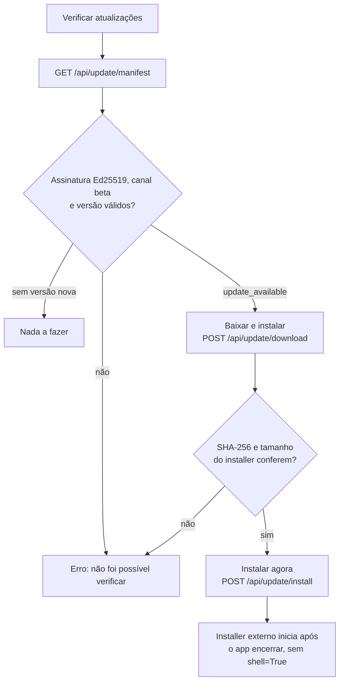

# Update e signing

> **Base verificada:** `5f482ce1` (branch `main`) · **Revisado em:** 2026-10-24

> **Nota de histórico (M18, 2026-09-29):** este documento contém um plano/estado anterior à
> Beta 17. O owner confirmou que a Beta 17 foi distribuída pelo updater. A referência a endpoint
> placeholder e à sequência `0.9.0-beta.35` → `0.9.0-beta.36` não é instrução nem status atual.
> A M18 não certificou o canal atual, signing ou readiness de release; consulte os valores-fonte
> de build em `yomu/runtime/version.py` e reexecute os gates antes de uma publicação.

**Estado (2026-10-24): IMPLEMENTADO no código e na UI; publicação do canal = gate externo.**

O updater verifica manifest HTTPS, assinatura Ed25519, SHA-256, canal e versão mínima
(`yomu/runtime/update_manifest.py`, `update_transport.py`). A chave privada permanece fora do
repositório e dos logs. O trust root público está configurado em
`update_manifest.TRUSTED_PUBLIC_KEYS` com o id `beta-2026-10`, e o cliente aceita somente
manifests do canal `beta` (`CLIENT_UPDATE_CHANNEL`). A URL padrão do manifest é
`update_bootstrap.DEFAULT_MANIFEST_URL` (repositório GitHub de releases, `updates/beta/latest.json`);
`TRADUTOR_IA_UPDATE_MANIFEST_URL` a substitui e, definida vazia, desliga a verificação.

Na UI, a aba **Atualizações** tem **Verificar atualizações** (`GET /api/update/manifest`) e,
quando há versão nova, **Baixar e instalar** → **Instalar agora** (`POST /api/update/download`,
`GET /api/update/download/status`, `POST /api/update/install`); o cabeçalho mostra o selo
**↑ Atualizar** quando uma versão está disponível.

Para a distribuição Windows, o artefato principal é o installer Inno Setup
`YomuSekai-<versão>-Setup-x64.exe`. O fluxo da aba Atualizações baixa o installer para staging,
confere assinatura, SHA-256 e tamanho, e só então inicia o processo externo sem `shell=True`.
O caminho ZIP permanece compatível apenas para manifests legados e não é o caminho principal da UI.

O installer recebe `ProductVersion` (= `BUILD_VERSION`) por define do `tools/build_installer.py`;
nenhum installer é gerado nesta revisão documental.

*(Histórico, M18:)* o canal da closed beta ainda não estava publicado e o endpoint era
placeholder. Hoje a URL está configurada no código; se o manifest assinado está publicado e
válido no canal não foi verificado aqui.
A primeira atualização segura em campo será `0.9.0-beta.35` → `0.9.0-beta.36`, pois a beta.34
precede a inclusão do trust root e do parser SemVer. Manifesto, canal ausente ou incorreto,
hash, assinatura inválida e downgrade falham fechado antes de qualquer instalação.
