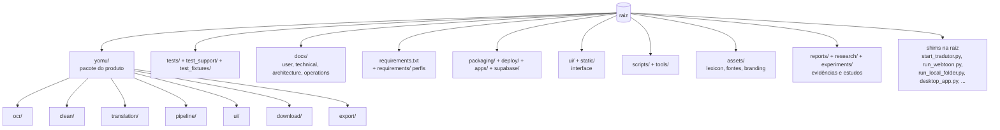

# Estrutura do repositório Yomu

Este documento descreve a organização atual do código e dos dados versionados. A auditoria
linha a linha da raiz e o mapa de consumidores estão em [ROOT_STRUCTURE_AUDIT.md](ROOT_STRUCTURE_AUDIT.md)
e [ROOT_DEPENDENCY_MAP.md](ROOT_DEPENDENCY_MAP.md). `main` é a linha de integração, não uma
release: antes de iniciar trabalho, confirme a branch e o estado local com Git e consulte o
Kanban. Não use um checkout antigo nem mova arquivos só para reduzir contagens.


## Mapa (2026-10-24)



## Árvore versionada

```text
.
├── .github/          CI e automações do repositório
├── apps/             serviços de aplicação, incluindo Better Auth
├── assets/           recursos de interface e marca versionados
├── config/           configurações e políticas do produto/repositório
├── deploy/           manifests e configuração de implantação
├── docs/             documentação do produto, arquitetura, operação e auditorias
├── experiments/      experimentos e fixtures de integração isolados
├── packaging/        specs e insumos de empacotamento Windows
├── reports/          evidência pequena e sanitizada escolhida para versionamento
├── research/         pesquisa não-runtime; não é automaticamente parte do produto
├── scripts/          comandos operacionais, de build e validação
├── static/           assets estáticos servidos pela UI
├── supabase/         migrations, funções e configuração Supabase versionadas
├── test_fixtures/    fixtures estáticas de teste
├── test_support/     guards herméticos e utilitários exclusivos de teste
├── tests/            testes Python, frontend, integração e contrato
├── tools/            auditorias, validações e ferramentas de desenvolvimento
├── ui/               fontes/integrações de UI mantidas fora do pacote runtime Python
└── yomu/             implementação canônica do runtime Python
```

`__pycache__/`, `.pytest_cache/`, `.runtime/`, `.vscode/`, `out/` e os diretórios locais
`.agents/`, `.basinfy/`, `.codex/` são caches, ambientes, outputs ou contexto de ferramentas.
Não são parte da árvore versionada e não devem ser movidos, limpos ou adicionados em lote.
O `.mcp.json` local também permanece fora do Git.

## Arquivos que permanecem na raiz

Os 22 arquivos rastreados diretamente na raiz têm contratos convencionais, de configuração,
bootstrap, instalação ou compatibilidade. A lista completa, consumidores e riscos está na
[auditoria](ROOT_STRUCTURE_AUDIT.md). Em particular:

- `README.md`, `CHANGELOG.md`, `CONTRIBUTING.md`, `AGENTS.md`, `CLAUDE.md`, `.gitignore`,
  `.gitattributes`, `.env.example` e `THIRD_PARTY_NOTICES.txt` são entradas/documentação ou
  convenções de ferramenta/distribuição.
- `app_ui.py`, `desktop_app.py`, `down.py`, `main.py`, `run_local_folder.py`, `run_webtoon.py`,
  `start_tradutor.py` e `worker_service.py` são shims/entrypoints públicos históricos. Mantêm
  nomes, caminhos e identidade de módulo para CLI, subprocessos, testes e PyInstaller; a lógica
  canônica correspondente vive em `yomu/`.
- `conftest.py`, `sitecustomize.py` e `pytest.ini` instalam descoberta, isolamento de runtime e
  guard de rede offline antes de importar testes. Não mova esses hooks sem uma validação
  equivalente de inicialização precoce.
- `requirements.txt` (conjunto base) fica na raiz, onde ferramentas o procuram por convenção;
  os perfis (`requirements-beta.txt`, `-dev`, `-rapidocr`, `-ui`, `-optional`, `-paddle`,
  `-gemini-vps`) ficam em `requirements/` desde 2026-10-24. `requirements/requirements-beta.txt`
  inclui a base por `-r ../requirements.txt` (pip resolve `-r` relativo ao arquivo). Os perfis
  continuam separados; não os combinar.
- `start_tradutor.bat` é o launcher de Windows documentado e encaminha ao shim Python.
- Os conteúdos de `PRODUCTION_SECRETS_REQUIRED.md` e `SEMANTIC_CLASSIFICATION_AUDIT.md` vivem em
  `docs/operations/` e `docs/architecture/`; os ponteiros que ficavam na raiz foram removidos
  em 2026-10-24 (os links internos já apontavam para os caminhos canônicos).

## Entry points e contratos

| Uso | Caminho preservado | Implementação |
|---|---|---|
| UI web local | `python app_ui.py` | `yomu.ui.app` |
| Desktop/PyInstaller | `desktop_app.py` | `yomu.desktop.app` |
| CLI do capítulo | `python run_webtoon.py` | `yomu.commands.run_webtoon` |
| Entrada por pasta local | `run_local_folder.py` | `yomu.commands.run_local_folder` |
| Launcher/worker supervisionado | `start_tradutor.py` / `start_tradutor.bat` | `yomu.commands.start_tradutor` |
| Worker persistente | `worker_service.py` | `yomu.runtime.worker_service` |
| Downloader histórico | `down.py` | `yomu.download.down` |
| GUI histórica | `main.py` | `yomu.commands.legacy_gui` |

As razões e verificações de identidade de módulo constam na [matriz de dependências](ROOT_DEPENDENCY_MAP.md).

## Testes, dependências e build

- Pytest carrega `pytest.ini`, `conftest.py` e, nos filhos elegíveis, `sitecustomize.py` da raiz.
  Os guards em `test_support/` protegem contra rede real e runtime de usuário.
- `requirements.txt` é o conjunto base; `requirements/requirements-beta.txt` compõe o runtime de Beta;
  `requirements/requirements-dev.txt` é somente validação; OCR/UI e opções ficam em manifests separados;
  `requirements/requirements-paddle.txt` é opcional e não deve ser instalado no mesmo ambiente do contrato
  OpenCV da Beta; `requirements/requirements-gemini-vps.txt` pertence ao worker remoto.
- O build desktop usa `packaging/tradutor_ia.spec`, que espera `desktop_app.py` na raiz e inclui
  recursos públicos/configuração especificados no spec. Não altere caminhos do spec sem smoke
  frozen offline.
- Para comandos suportados, dependências e validações, veja [DEVELOPMENT_WORKFLOW.md](../DEVELOPMENT_WORKFLOW.md)
  e [INSTALLATION.md](../INSTALLATION.md).

## Política para novas alterações

- Implementações Python de produto vão no pacote já existente dentro de `yomu/`; serviços
  adicionais seguem a arquitetura `apps/`; testes vão em `tests/` e seus helpers em
  `test_support/`.
- Novas dependências devem ser adicionadas ao manifest do perfil que realmente as usa e a
  todos os validadores/consumidores do perfil — sem duplicar pins ou atualizar versões fora de
  escopo.
- Documentação canônica vai em `docs/` na categoria existente. Auditorias históricas devem ser
  rotuladas como tal; stubs antigos só são mantidos quando necessário para compatibilidade.
- Pesquisa e evidência temporária não viram runtime nem arquivo versionado por padrão. Não
  adicionar dados pessoais, secrets, caches, ambientes ou snapshots ao Git.
- A política mecânica de arquivos Python na raiz está em
  [`config/repository_root_allowlist.json`](../../config/repository_root_allowlist.json) e é
  verificada por `python tools/repository/check_root_policy.py`.
