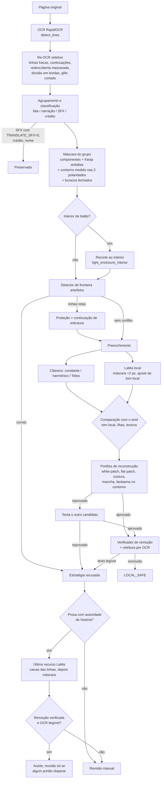
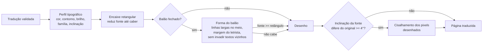

# Clean strategy

## Fluxo atual (2026-10-24)

Tradução e diagramação:

`OutputPlan` declares whether `clean` is requested; it never names a provider. The internal `yomu.clean.orchestrator` runs the local strategy first. Only `LOCAL_RECONSTRUCTION_HARD` with an authorized mask and sufficient confidence may invoke a remote adapter. SFX, invalid sources, system errors, uncertain masks, timeouts, alignment failures, seam failures, and safety violations fail closed to review.

Accepted remote output is never final by itself: it is aligned, composited over the original only inside the authorized mask, and validated with `OUTSIDE_MASK_CHANGED_PIXELS=0` and the frozen seam threshold `0.80`.

## Local verification and advanced inpainting

The local `LOCAL_SAFE` boundary measures the produced page against the original using the accumulated page-coordinate cleanup mask. A missing or incompatible image or mask leaves the metric unavailable and requires review. Each translated region becomes `LOCAL_SAFE` only after measured source removal and a clean art reconstruction verdict; `PENDING_LOCAL` cannot certify a page.

The advanced utilities are compatible as a shadow-mode proposal, not as a production replacement. The smallest hook is after `_remove_text_for_group` returns its candidate and authorized mask, before that candidate is accepted or composed. Keep the current mask as the authorization ceiling; use `segment_text_layers` / `build_text_masks` for layer evidence, `derive_source_glyph_visual_envelope` for a protected-art-aware envelope, then `build_contamination_contract` and `build_verified_donor_pool` before `multiscale_patch_synthesis.synthesize_multiscale`. Score only the shadow candidate with the existing candidate and residual guards. Record mask hashes, status and reason codes; never substitute the shadow image into CLEAN in this phase. Empty donors, shape mismatch, protected-art conflict, residuals or inconclusive scores remain review outcomes. No runtime flag or production routing is enabled by this recommendation.

## Current behaviour (2026-10-23, supersedes the Sprint 03C/03D notes below)

> Verified against HEAD `c994426f` plus the uncommitted working tree, OpenCV 5.0.0.

- **Constant-fill spatial gate — IMPLEMENTED, on by default.** `CLEAN_HARMONIC_FILL` now defaults to `True` (`CLEAN_HARMONIC_FILL=0` restores the old behaviour). For a `solid_*` region, `_apply_cleanup_mask` keeps the ring-median fill only when the spatial class is `PROVEN_UNIFORM` or `INSUFFICIENT_EVIDENCE`. On `SMOOTH_NONUNIFORM` it calls `harmonic_boundary_fill` on the original image and composites the candidate only inside the authorized mask when the solver accepts it (`cleanup_fill_source = harmonic_boundary_fill`); otherwise, and always on `STRUCTURED_OR_TEXTURED`, the region stays in review. Reason: a constant fill over a non-uniform backdrop paints letter silhouettes. On 154 real visible backgrounds (11 V5 pages, production path, known ground truth) 12 constant fills occurred; 9 had visible silhouettes (edge contrast 5.9–29 levels) and now go to review, 1 became harmonic (MAE 7.49 → 0.78), 2 uniform ones are unchanged, no other decision changed and no case got worse.
- **Hough output shape — FIXED.** OpenCV 5 returns `HoughLinesP` as `(N, 4)`; `detect_linear_boundary_conflict` and `harmonic_boundary_fill` indexed `(N, 1, 4)` and raised `IndexError`, failing the whole page whenever a line was detected. Both now use `glyph_art_boundary_review.hough_segments`.
- **Lettering footprint — FIXED.** Opposite-polarity pixels (white near dark text, or the reverse) join `source_lettering_footprint` only when ≥80 % of the component lies within an outline ring around the glyph core. Bright artwork next to dark text is no longer erased (page 03: added pixels outside M2 3,353 → 674, bright ones 2,851 → 218); a real white outline is still fully covered.
- **Mid-tone masks and verification — FIXED.** The black/top-hat kernel scales with line height and only the lettering polarity's hat is used, so bold mid-tone lettering gets a solid mask. The removal verifier measures mid-tone lines with the same rule instead of forcing `NOT_VERIFIED`; punctuation-sized lines use a size-relative minimum.
- **Reconstruction fallbacks — FIXED.** `_estimated_white_region_fill_color` no longer forces (245,245,245) on a non-white surround; `_restore_lost_local_texture` adds grain only when the ring median |Laplacian| exceeds 1.0 (real grain), not because a few edges raise the mean.
- **In-mask residual — SHADOW MODE.** Each CLEAN attempt records `in_mask_residual` (polarity residual pixels, contour echo, `boundary_step_excess`). `decision_impact` is always `none`. `boundary_step_excess` detects flat-fill silhouettes but is not a general quality score (it is ≤0 on blurred dense art with large true error); calibrate on human labels before using it in a gate.

### Mask, boundary and validation fixes (second pass, 2026-10-23)

Measured on the same 154 real visible backgrounds with synthetic `WORD` (plain anti-aliased and white-outlined), full `_clean_source_for_clean_artifact` path. Start of this pass → end: plain accepted 8 → 30 (22 of them carry `art_fidelity_uncertain`, i.e. review; 8 clean), outlined accepted 0 → 7 (all 7 carry `art_fidelity_uncertain`); boundary detector review on glyph-only masks 126 → 50.

- **Lettering fringe/outline — IMPLEMENTED (`CLEAN_FRINGE_EVIDENCE`, default on).** `_antialias_fringe_mask` adds partial-ink pixels (`alpha = (bg - I)/(bg - ink)` in 0.12–1.2) within `max(2, min(4, 0.08 h))` px of the mask, measured against a band 3–6 px further out, plus opposite-polarity outline pixels (one extra pixel of reach) when they ring at least half of the glyph edge. Candidate runs that continue beyond the radius are art and are dropped. Growth is capped at 0.5× the line mask (1.2× with a validated outline); lines whose background is too textured are skipped (`antialias_fringe_skipped_textured_lines`).
- **Telea boundary — IMPLEMENTED.** `_telea_source_without_fringe` gives Telea a copy in which outliers of the 2-px ring around the mask (> max(16, 3σ) from the 3–6 px band) are replaced by that band's median, except outlier runs that continue into the band (art crossing the mask, which Telea must carry through). Only mask pixels are written; nothing outside the mask changes.
- **Polarity from the band outside the box — FIXED.** `_line_polarity_level`: when bold lettering owns most of a tight OCR box the box median is the ink, so dark text on white was read as light text and the white background became "source text". Mask and verifier now take the polarity from the band outside the box when the two disagree.
- **Glyph components — FIXED.** The size filter in `_component_text_mask` drops a large/box-spanning component only when it is background-shaped (`_component_is_background_shaped`: ≥70 % of its bbox unless it is a narrow vertical stroke such as the bar of "!", a ring-like frame, or a sparse stroke < 12 % of its bbox). Bold words with touching letters and "!"/"?!" lines keep their glyphs.
- **Textured over-mask gate — FIXED.** `_textured_overmask_evidence` measures the mask against glyph evidence (`mask/text_component_pixels` > 1.8, or a solid rectangular patch with ratio > 1.5) instead of against the box area; the legacy box ratios apply only without glyph evidence. When the local ring is `PROVEN_UNIFORM` and `solid_*`, `primary`/`conservative` no longer inherit textured restrictions (the dedicated textured fallbacks keep their scope).
- **Boundary detector — FIXED.** Hough segments must be a thin ridge (darker/lighter than both sides 4 px away) where they leave the dilated mask (`_outside_ridge_fraction` ≥ 0.6), so the top/bottom of a row of letters merged with a dark region by Otsu is no longer art. A segment contained in the box counts only if it is ≥ 1.5× the line height (a single glyph stroke never is). Segments with one end inside the box (corner diagonals, hair tips) are now considered. Curved components ignore the glyph's own Canny contour (2-px band round the mask) and a component with more than 5 edge pixels per unit of span outside the mask is a halftone/hatching network, not a crossing curve.
- **Verifier — FIXED.** `_uncovered_source_text_evidence` excludes foreground components with ≥ 30 % of their pixels outside the OCR box (art, panel lines, neighbouring lettering), seen in a window padded by one line height.
- **Seam detector on thin masks — FIXED.** Stroke-width masks (no eroded core) are judged with the whole mask as the inner band (`seam_evidence_mode = "thin_mask"`); only the halo test, which needs an interior, is skipped. Previously every glyph-shaped mask returned `mask_too_thin_for_seam_evidence` without a verdict.
- **Textured fill level — IMPLEMENTED (gate).** `_textured_fill_shift_metrics`: on non-solid profiles (textured and gradient) the median inside the mask must stay within max(12, σ/2) of the 2–8 px ring; otherwise the attempt fails with `textured_fill_level_mismatch` (an art-review reason and a hard CLEAN signal). It catches fills pulled lighter by a leftover outline or darker by ink.
- **CLEAN fidelity flag — FIXED.** An accepted CLEAN attempt with `art_fidelity_uncertain` keeps the flag in `clean_artifact_validation` and uses the disposition reason `owned_source_text_removed_art_fidelity_uncertain`.
- **Known limit — NOT SOLVED.** On dense hatching/halftone Telea still produces a smooth word-shaped patch. Those cases are accepted only with `art_fidelity_uncertain` (review), not as clean. Texture-aware reconstruction is still needed for them.

### Boundary-candidate pages (third pass, 2026-10-23)

Measured on the 11 `codex_boundary_candidates` pages through local RapidOCR → `apply_speech_container_reocr` → `analyze_image_array` → `_clean_source_for_clean_artifact`, with the pre-render `source_completeness.check_live_group` contract (no translation provider). Cleanable regions 23 → 24; cleaned 16 → 18; silent English left on the page (unread rows "BE...", "IT...") 2 → 0. The 6 remaining failures are all reviewed reconstruction cases (glow lettering over photo, dense hatching/halftone).

- **Smooth vs structured — FIXED.** `local_background_spatial_class` is `SMOOTH_NONUNIFORM` (harmonic fill) when the ring has no Canny edges at all (`edge_fraction <= 0.01`), whatever the plane residual: a translucent caption box over faint art varies only at low frequency. It used to be `STRUCTURED_OR_TEXTURED` with a residual of 3.4 vs the fixed 3.0 limit.
- **Prose over background — FIXED.** `weak_label_semantic_promotion_allowed` also accepts unpunctuated prose with a function word inside the phrase ("BY THE NIGHTMARE SPELL", not "THE TOWER"), and the one-word SFX rules (`compact_graphic`, `false_light_enclosure_effect`, styled one-word) defer to it. **Not solved:** a single word ("INCREDIBLE...") cannot be told from romanised SFX ("PAEHYEOK...") by shape alone; it stays SFX until a real English lexicon is available.
- **Lettering continuation re-OCR — IMPLEMENTED.** `_lettering_continuation_boxes`: each confident line (≥ 0.85, ≥ 2 useful chars) proposes the row just above/below it in its column when no confident line covers it and the row holds ink with the anchor's signature (polarity/ink level, 0.35–1.2 h glyph height, stroke width 0.5–1.8×). The crop is re-read by `apply_speech_container_reocr` (trigger `lettering_continuation_uncovered_text`) and only accepted by the existing recovery rule; it may replace a weak reading of the same row (`_is_weak_ocr_line`, e.g. "T" at 0.67 for "IT...").
- **Re-OCR crop margin — FIXED.** `_reocr_crop_candidates` pads each crop with a replicated border (`max(8, h/3)`) and shifts boxes back; a tight one-row crop read "VT." at 0.74, the padded one "IT.." at 0.96.
- **Protect straight art instead of refusing — IMPLEMENTED (`CLEAN_STRUCTURE_CONTINUATION`, default on).** When every boundary conflict is a straight segment (no curves), `_straight_structure_continuation` measures the line outside the mask on true line samples (both profile ends background), snaps to its real centre, protects band pixels that still have the line's colour (removed from the mask; excluded from the residual pass, the seam bands and the removal verifier) and redraws the line only between the first and last place it is seen (interpolation, never extension) over lettering of another colour. Hough duplicates are merged (`_distinct_segments`). A contained segment counts as art only if continuous (largest gap ≤ max(2, 0.25 h)); a letter row is broken by word spaces. Curved conflicts still go to review.

### Texture-aware reconstruction (item 5, 2026-10-23)

- **Learned texture fill — IMPLEMENTED (`CLEAN_LEARNED_TEXTURE_FILL`, default on; needs `ADVANCED_ART_INPAINTING` and the SHA-256-verified `ADVANCED_ART_INPAINT_MODEL_PATH` asset).** `_apply_cleanup_mask` reconstructs regions whose local profile is `textured_art` or whose spatial class is `STRUCTURED_OR_TEXTURED` with the local LaMa adapter (`advanced_art_inpainting`) instead of Telea/constant/harmonic fills, composited inside the mask only; every existing gate (fill level, flat patch, seam, blotches, removal verifier) still judges it. Unavailable/integrity failure falls back to the classic fill and is recorded in `group.learned_texture_fill`. Results are cached per mask+context (16 entries). On 269 real-background cases with known truth, same masks: texture ratio vs the true background 0.29 → 0.91 (plain) / 0.25 → 0.93 (outlined); lower error in 182 of 269. On the 11 candidate pages the 5 regions previously accepted only with `art_fidelity_uncertain` on hatching/halftone (p08, p09) are now accepted clean (accepted with the flag: 8 → 3 of 18). The cache stores only the reconstructed in-mask pixels, so a hit never rolls back pixels outside the mask that changed since (other groups cleaned). The test suite runs with `CLEAN_LEARNED_TEXTURE_FILL=0` (root `conftest.py`) so it never loads the developer's local model; the learned-fill tests inject a fake inpainter. Cost: ~1 s per textured region on CPU.
- **Letters fused with same-colour art — FIXED (`CLEAN_SPLIT_MERGED_GLYPHS`, default on).** `_component_text_mask` no longer drops a background-shaped component wholesale: `_glyph_strokes_in_network` keeps, inside it, pixels near the line's ink level that survive an opening of the glyph stroke size, grown back one pixel, glyph-height (0.3–1.3 h) and stroke-shaped. "WORD" over dark hatching: mask covered 378 → 1158 of 1221 ink pixels.
- **Residual lettering check — scoped.** `residual_source_lettering_metrics` counts only footprint pixels within `max(3, 0.15 h)` of the cleanup (fringe/outline/glow left at the edge); a glyph missed entirely remains the removal verifier's job.
- **Not solved.** Lettering fused with art of the same colour *and* stroke width (black text over a thick black SFX stroke) is not separable and stays in review; glow lettering over photographs (p05) and the boundary-conflict regions with curves (p07, p09) are still reviewed; the textured residual check still over-reports when the footprint includes adjacent hatching.

### Evidence instead of thresholds (fourth pass, 2026-10-23)

- **Residual confirmed by OCR — IMPLEMENTED (`CLEAN_RESIDUAL_OCR_CHECK`, default on).** When a pixel residual check refuses a cleanup (display-lettering footprint, conservative re-scan, LaMa gates), `_legible_source_residual` re-reads the cleaned crop with RapidOCR (padded crop, confidence ≥ 0.5) and lifts the refusal only when none of the group's meaningful source tokens is legible (token match incl. spacing repair). No engine/failed read → the refusal stands. Recorded as `residual_ocr_check` / `residual_overruled_by_ocr`. On the 269-case benchmark, residual refusals of LaMa results 105 → 1 (plain), 133 → 1 (outlined).
- **English lexicon — IMPLEMENTED.** `assets/lexicon/english_words.txt.gz` (369,351 words, 3–20 letters, from dwyl/english-words `words_alpha.txt`, Unlicense; bundled in `packaging/tradutor_ia.spec`, listed in `THIRD_PARTY_NOTICES.txt`). `region_taxonomy.is_english_word`; `weak_label_semantic_promotion_allowed` promotes a single dictionary word that trails off ("INCREDIBLE...", "HOPELESS,") — the trailing-off punctuation is required because many sounds are dictionary words ("SCREECH", "CRASH!"); romanised sounds ("PAEHYEOK...", "FWASHAA") are not in the lexicon.
- **Mid-tone polarity — FIXED.** `_line_polarity_level`: with a mid-tone surround (118–138) the polarity is the side the ink departs to (p95 vs p5 against the ring), not the box median; white text on a mauve surround was masked as "dark text" (the background between letters). Ink coverage in the traced case 911 → 1221/1221.
- **Balloon interior — FIXED (`CLEAN_CLIP_TO_ENCLOSURE`, default on).** Found on the real chapters in `%LOCALAPPDATA%/TradutorIA/output` (49-page sample, 5 series): ordinary white balloons were refused because text set tight reached the balloon border. `_light_enclosure_interior` takes the light connected region holding the lettering (holes = letters filled, eroded 1 px) when it closes within 3 line heights; the cleanup mask is clipped to it (border never masked, so it is no longer "crossing art") and new white inside it is not a "white patch". Used for `white_balloon`/`narration_box` and any group whose ring level is ≥ 200.
- **Masked-page rediscovery — IMPLEMENTED (`OCR_MASKED_REDISCOVERY`, default on; `0` in the root `conftest.py`).** The RapidOCR detector is context-dependent: a news ticker between two dense speech columns (real chapter page) was never detected on the page but read at 0.91 on the cleaned page, so it stayed in English with no warning. `apply_speech_container_reocr` now ends with `_masked_page_rediscovery`: every line already read is painted with the median colour of the band around its box and the detector runs once more; new lines are kept only if the recovery rule accepts them and they overlap neither a read line nor a painted box. Cost: one extra full-page detection (~1–3 s/page). Verified with an OCR audit of every cleaned page (legible English outside deliberately kept/refused regions).
- **Flat-patch gate on balloon rings — FIXED.** `_flat_patch_artifact_metrics` treats a ring whose 75th-percentile |Laplacian| is < 1 as flat: a mean raised only by the few border pixels the ring touches is not texture a flat fill failed to rebuild.
- **Gates judge a balloon by its interior — FIXED.** With a known enclosure, the flat-patch ring and the seam bands are restricted to the enclosure (the border and the art beyond it are not the reference); the seam "flat context" uses min(5–95 % spread, 2×IQR) so a thin border does not make a white balloon "textured"; the enclosure search window grows with the text block; the boundary detector receives a copy with everything outside the enclosure painted with the interior median (the frame and outside art cannot pose as crossing art; art inside the balloon still can).
- **Screentone routing — IMPLEMENTED (`CLEAN_SCREENTONE_DETECTION`, default on).** `_screentone_lattice` measures a periodic halftone by masked autocorrelation (primary peak ≥ 0.4, second non-collinear ≥ 0.25) outside the text block and the lettering's outline; `_screentone_around` routes such regions to the learned fill even when their tone statistics read `solid_light` (a flat fill erased the dots of light halftone balloons). A lattice-copy synthesis (pattern-stamp emulation) was tried and **rejected**: exact on pixel-aligned screens (MAE 0.1) but worse than LaMa on rotated ones (MAE 20–46 vs ~15), so only the detection is kept.
- **Not adopted — levels/denoise analysis copy.** Measured on the chapter sample: +5 % real words read by the OCR (273 → 286), mixed per chapter; not worth changing the input of every stage for now.
- **Dark blotch = island — FIXED.** `_dark_blotch_artifact_metrics` no longer counts dark reconstruction where light *lettering* was and that touches dark artwork outside the mask (the backdrop continuing); dark where light *art* was is still counted.

### Choosing the reconstruction and closing the ghosts (fifth pass, 2026-10-23)

Measured on the problem pages of the real chapter sample (translucent balloons over clothing, black lettering with white outline on art, white outline on a dark wall).

- **Classic vs learned fill compared — IMPLEMENTED (`CLEAN_COMPARE_FILLS`, default on; inert in the suite because `CLEAN_LEARNED_TEXTURE_FILL=0`).** Outside a true-white balloon, `_apply_cleanup_mask` builds both the classic fill and the LaMa fill and scores each with `_fill_consistency_parts` against the untouched ring 2–8 px around the mask: *tone* (each masked pixel against the ring averaged at the finest scale that reaches it — 31 px, doubling — so a gradient balloon is judged locally; medians, so thin art lines carried through do not count), *islands* (pixels beyond the ring's 5–95 % range ±8 that are **not connected** to such pixels just outside the mask — a continued speed line is not a blob) and *texture* (|Laplacian| energy ratio). The mask-edge *step* is reported but not scored: the outside band still holds the lettering's halo and rewarded copying it inward. LaMa is the stronger prior on textured art; the classic fill replaces it only when it scores < 0.8× the learned one. The terms are recorded in `group.fill_choice`.
- **Gates try the other candidate — IMPLEMENTED.** The reconstruction gates (fill level, white patch, flat patch, seam, dark blotch) now live in `_reconstruction_gate_failure`; when the chosen fill fails, the alternative (`group.fill_alternative`) is gated too and used if it passes (`fill_switched_by_gate`). Previously a strategy was refused although the other fill was acceptable. The spatial-gate refusal of the harmonic fill (`spatial_harmonic_gate_rejected`) is a verdict on the classic candidate only: it is cleared when the learned fill is used (three white balloons were refused for it although their learned reconstruction was clean).
- **LaMa mask grown by 2 px — IMPLEMENTED.** A mask that hugs each letter, with the faint halo just outside it, let the model redraw the letters' shapes as dotted ghosts (verified: the model ignores the pixels under the mask, so the ghost came from the mask *shape*). The learned fill is given and composites the mask dilated by a 5×5 ellipse, never into protected straight structure nor outside a known balloon interior; 4–6 px added nothing on the measured cases. The model also returns the filled area a few levels off its surroundings (≈3–5 darker on 5 of 6 measured cases; with the mask edge following the lettering this alone drew the letters' outline on soft smoke); one per-channel offset — median of the band just outside the mask minus median of the band just inside — is added to the in-mask result and recorded as `learned_texture_fill.tone_offset_bgr`. Rejected alternatives: Poisson blending (`seamlessClone`) redrew the letters from the boundary; a locally interpolated edge step picked up neighbouring text and made blocks.
- **Enclosed glyph holes closed — IMPLEMENTED.** `_fill_enclosed_glyph_holes`: a hole fully enclosed by the text mask (≤ line height², 4-connectivity) is part of a glyph — the black core of a letter whose white outline was the part selected ("*ding*" on a dark wall: 11 holes, 192 px of pure black left as ghost letters) or a counter. Recorded as `enclosed_glyph_hole_pixels`.
- **Outline band measured by the room left — FIXED.** `_group_stroke_band` steps by half of the room between the backdrop and the far end of the range (no longer scaled by the backdrop's spread, which pushed the step past any real stroke on textured art) and also accepts a ring where half the pixels lie beyond the backdrop's 10th/90th percentile; widths of 1 px count. The measured width is the outline's typical width only: stroke pixels connected to that band are followed out to `max_width` (the stroke under a line is often wider and was left as a bright line along the mask edge), except what stroke-coloured art beyond `max_width` reaches within `max_width` steps (a white art area beside the text is not outline).
- **Art-of-the-letters'-colour check at the letter's own level — FIXED.** `_component_continues_beyond_line` follows the component at halfway between the background and its own 10th/90th-percentile ink; grey art lines touching white letters on a dark panel no longer turned the letters into "art" (four textured-speech fallback tests regressed on it).
- **OCR line repairs — IMPLEMENTED.** `OCR_SPLIT_AT_CROSSING_BORDERS`: a detected line that runs across a panel/balloon border (or two aligned columns) is split there and each part re-read by the recogniser. `OCR_EXTEND_CLIPPED_EDGE_GLYPHS`: a glyph the detector clipped at the start/end of a line ("I" of "I DO INDEED!") extends the line when it has the line's glyph height and the extended crop re-reads confidently and contains the old text.
- **Learned last resort — IMPLEMENTED (`CLEAN_LEARNED_LAST_RESORT`, default on; `0` in the root `conftest.py`).** After every strategy refused, speech/narration/thought prose (not credits/URLs; words via `region_taxonomy.segment_words`) is reconstructed by LaMa and accepted only when the removal verifier passes or the OCR can no longer read any source word; it is flagged `art_fidelity_uncertain` (review), never clean.
- **Measured on the five real chapters in full (546 pages, 677 regions) — fixes from that run:**
  - *OCR as an acceptance gate.* Every accepted strategy and the last resort re-read the cleaned crop (`_legible_source_residual`); a source word still legible refuses the result (`source_text_still_legible_after_cleanup`). The pixel verifier shares the mask's blind spots and had accepted "BODY IS THIS!?!?" and "DAU HTER" still on the page. The re-read uses two crops (margin ½ and 1 line height — a half-line margin missed "RURAL") and counts only readings over the group's own lines (a second "*flicker*" below was read as residue).
  - *Lines of one group touch.* `_component_continues_beyond_line` judges against the union of all the group's lines: outlines merging between rows had made 7 of 17 letters of a two-line caption "art running out of the line".
  - *Ghost gate.* `_lettering_contour_ghost_metrics` / reason `lettering_contour_ghost`: with the learned fill on the mask grown by 2 px, the seam gates compare model pixels with model pixels; this gate compares the step across the lettering contour with the natural step between two background bands further out (ghost when > natural + 3 grey levels and > 2× natural; measured ghost 4.7 vs 0.8, clean fills on stripes 4.7 vs 5.0). Protected art lines are excluded.
  - *Tone offset from local pairs.* The learned-fill offset is the median of local (15 px) differences across the mask edge, not of the whole outside vs inside: a mask spanning a white shirt and grey hatching had been shifted by −55.
  - *Continuation re-read with context.* A proposed row above/below a confident line that reads nothing alone is re-read in a crop that also holds its neighbour row (the detector read "HEY, YOU!" at 0.91 only with "DRIVE THIS" in view); only readings mostly inside the proposed row count, and readings on known lines are dropped as before.
  - *Last resort.* Shares `_learned_inpaint` (margin, tone, cache) with the texture fill; is offered to `unknown` prose that has story authority (on-art narration without a balloon); is also triggered when removal measured incomplete; tries the line boxes padded by ¼ line height first (letters fused with same-colour streaks or drips cannot survive outside an art-respecting mask) and the art-respecting mask second. Always `art_fidelity_uncertain`.
- **Not solved.** Large masks over complex art (a face behind a dense outlined block) are reconstructed plausibly but not faithfully; they stay reviewable through `art_fidelity_uncertain` when the gates flag them.

### Five follow-ups (sixth pass, 2026-10-23)

- **Fixed-mask structure contract — FIXED.** `_apply_cleanup_mask` measures crossing straight art lines itself (`_measure_structure_continuations`) when it is handed a ready-made mask that `_remove_text_for_group` never saw, and keeps them out of the fill; `test_fixed_mask_structured_reconstruction_must_not_erase_known_structure` passes (it had failed since before this work).
- **Speed.** Harmonic solver: OpenCV `filter2D` sweeps in float32, convergence checked every 4th sweep (same result within 1 level; 2.2 s → 0.5 s on a 4-line caption). `_detached_dark_text_components_mask` and `_light_enclosure_interior`: one `bincount` instead of a full-page comparison per label. OCR word repair: bounded edit distance and an LRU cache of word candidates. LaMa context margin capped at 256 px (mean change 0.7–1.2 levels inside large masks).
- **Fewer needless review flags.** The learned last resort is now judged by the same reconstruction gates as every strategy (`_reconstruction_gate_failure`); it is flagged `art_fidelity_uncertain` only when one of them fires. `_group_stroke_band` measures both a lighter and a darker outline (lettering has one; the side that forms a ring wins) — a black-lettering/white-outline caption on grey (mask p10 6 / p90 254) had width 0 and left a dotted outline.
- **In-art UI text.** `_holds_real_word`: a mostly-digit OCR line ("56,984 Won", "Account No. 111-…") is no longer dropped as `low_alpha_ratio` when it carries a dictionary word.
- **Translation fitted to the balloon — IMPLEMENTED (`RENDER_FIT_BALLOON_SHAPE`, default on).** Inside a closed balloon (`light_enclosure_interior`) `_draw_group_translation` wraps the translation into the balloon's shape (`_balloon_shape_layout`: each line as wide as the balloon is at its height, stacked round the source text's centre) instead of the source text's rectangle, never at a smaller size than the rectangle fit. The area is inset by the letterer's own margin (closest the source text came to the border, 3 px to 10 % of the balloon), limited to the source region grown by 25 %, and excludes every other text on the page (`neighbor_text_boxes`, two texts can share one white region); each line's real ink box must lie inside it. Measured on 6 balloons: same or larger font (19→23, 21→23, 22→30), no column-like lines.

### Review flags, sound effects and source style (seventh pass, 2026-10-24)

- **Review flags from typical texture.** Of 33 regions flagged `art_fidelity_uncertain` on the five chapters, ~25 were clean: the fidelity ratio compared mean |Laplacian| of a ring that started at the mask edge (lettering outline/glow remains) and crossed balloon borders. The ring now starts 3 px out, and the finding uses the *median* texture on both sides (`flat_patch_typical_ratio`, `None` when the surround is typically flat). The rejection gate keeps its mean-based rule. On the flagged pages: 11 → 4 flagged, the 4 with visible defects (white blob under drips, pink ghost, tone shift, a smoother-than-art fill).
- **Fill choice near art edges.** The tone term of `_fill_consistency_parts` is judged only where the ring around a pixel is uniform (local std ≤ max(8, ring median)); next to an art edge (white sleeve beside a grey coat) the ring average rewarded a fill that smeared the edge over one that continued it.
- **Sound effects translated — IMPLEMENTED (`TRANSLATE_SFX`, default now `True`; `0` in the root `conftest.py`).** `yomu/translation/sfx_glossary.py` renders known sounds and `*action*` labels from `assets/lexicon/sfx_en_pt.json` ("BANG" → "BAM", "BAAANG" → "BAAAM", "*bite*" → "*morde*"), keeping case, stretch and decoration. A sound the glossary does not know keeps its source text (it is never sent to the provider: DeepL read "PRESS" as a noun, "IMPRENSA", and an OCR misread of "BOOM", "hoog", as Dutch, "alto"); the provider echo rule then preserves the original lettering. `validate_translation_text` accepts a non-empty SFX rendering (onomatopoeia has no lexical overlap). Telemetry: `sfx_glossary_translations`.
- **Source slant matched — IMPLEMENTED (`RENDER_MATCH_SOURCE_SLANT`, default on).** `_match_source_slant` measures the drawn translation's slant with the same `_text_slant_degrees` used on the source glyphs; when they differ by ≥ 4° the drawn pixels (text, outline, glow) are sheared about their centre to the source slant, only if the result stays inside the safe area (`group.slant_match`).

### Real chapters with DeepL (eighth pass, 2026-10-24)

Measured on three downloaded chapters (Webtoon ep. 58/59, Vortex ch. 24; 283 logical pages) translated by DeepL through a developer harness (the shipped CLI routes enabled jobs through the authenticated Yomu backend).

- **Slant only for italic sources.** `_match_source_slant` leans the translation only when the glyph classifier calls the source `italic`, measures the drawn text per line (median; a block of centred lines read −24° on upright text) and extends `translation_box`/`effect_box` to the sheared ink (otherwise the page visual guard saw the sheared pixels as outside the allowed area and rolled back the group).
- **Echoes that are correct.** A provider echo is a silent preserve for a sound effect, and for short (≤ 3 words) text with no common English word ("A-AH...", "RYU KANG-MIN?"); a longer echo stays a review item.
- **Light art continued is not a white patch.** `_white_patch_artifact_metrics` ignores new white the local ring (3–12 px out) reaches (≤ mean + 1.5σ) and new white connected, through light reconstructed pixels, to bright art just outside the mask (a light ray crossing outlined lettering).
- **Sound effects get the learned last resort** when `TRANSLATE_SFX` is on and the sound is known (glossary or dictionary word), and are drawn as display lettering (size from the source, `shout` role before the glyph classifier, which reads brush lettering as serif italic).
- **Translation set on the CLEAN rescue.** When every render strategy is refused but the CLEAN pass (last resort included) removed the source, `_render_on_clean_rescue` draws the translation on that reconstruction under the same `_enforce_visual_bounds` and OCR legibility check, adds its area to the page's allowed mask, and ships it as `render_with_review` (`rendered_on_learned_clean_rescue`) instead of leaving the English page.
- **Measured outline width** from the cleanup (`lettering_stroke_width`) raises a thinner sampled outline (cap 15 % of the line height). Known gap: when the accepted path carries no stroke measurement the outline stays as sampled.

## Harmonic spatial-gate experiment (Sprint 03C) — historical

`CLEAN_HARMONIC_FILL` defaulted to `False` at the time. When enabled, a solid-fill candidate whose ring is not `PROVEN_UNIFORM` may still be generated by existing fallbacks for diagnosis, but the CLEAN-only removal check cannot promote that candidate to `LOCAL_SAFE`; the region stays in review. This includes the `caption_overlay` branch, which otherwise returns before the solid-fill selector. The existing harmonic solver remains isolated because the available page-separated real reference set is not an independently reserved smooth-gradient holdout. The flag does not expand masks, bypass protected-art checks, or authorize a candidate based on convergence alone.

## Harmonic boundary false-review evidence (Sprint 03D) — historical

The page 01 known-visible transfer case has 89 automatic polarity outliers in the immediate two-pixel ring (67 at distance 1 px and 22 at 2 px). The unmodified reference confirms these are dark background texture, not visible lettering; the detector reports outliers, not text labels. They are excluded from Dirichlet donors, but any remaining automatic suspect currently requires review. Five Canny pixels appear only in the diagnostic black-hole ablation; the unmodified page 01 reference has none in the gate band. Therefore that edge signal cannot be treated as proof of nearby art conflict.

The gate was not relaxed: synthetic connected fringe, crossing line art, screentone and unknown-context controls still require review, while the smooth-gradient control is accepted. Nearby parallel/column edges also require review despite known synthetic ground truth, showing that the Canny rule is broad. There is not enough independent real positive/negative labeling to distinguish a true glyph fringe from natural texture or infer whether hidden art continues beneath lettering. Keep the harmonic solver isolated and the feature flag off until that evidence exists. The Sprint 03D timing changes affect test fixtures only; production watchdog and OCR behavior are unchanged.
