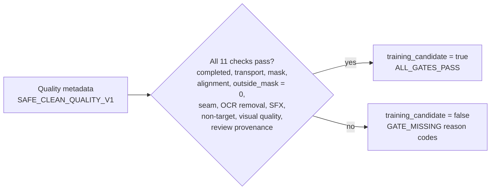

# Training Candidate Contract V1

> **Revisado em:** 2026-10-24 · **Base verificada:** `5f482ce1` · Status: **IMPLEMENTADO** in `evaluate_training_candidate()` (`yomu/clean/gemini_fallback/quality.py`).

A case becomes a training candidate only when the deterministic evaluator reports every required gate as passing: completed transport, valid mask and alignment, zero outside-mask changes, seam pass, OCR removal pass, SFX firewall pass or not applicable, non-target pass or not applicable, acceptable visual quality, and delegated technical-review provenance.

Missing or inconclusive metadata fails closed: an absent value never satisfies a gate. One nuance verified in code: an absent `status` is read as `COMPLETED`, so the completion check relies on the transport/mask/validation gates to fail closed. Binary artifacts remain external to the repository; this repository stores only small manifests and evidence.
