# Tradutor IA — Documentação Técnica

> **Base verificada:** `129e169` (branch `main`) em 2026-10-26 (passo 15 de §29); `d14edac` para os diagramas Mermaid de §15
> (validação/retries/liquidação), §16 (três candidatos de preenchimento, escolha e portões,
> tipografia) e §25 (paralelismo por página) conferidos contra `yomu/ocr/ocr_balloon.py`,
> `yomu/pipeline/benchmark_pipeline.py` e `yomu/clean/ownership/font_fidelity.py`. O restante do
> documento foi verificado sobre `5f482ce1` (2026-10-24); §16 e §25 antes sobre `c994426f`.
> Seções marcadas como *snapshot histórico* (§28.1, §29, parte da §30) não foram revalidadas.
> **Última revisão:** 2026-10-25
> **Público:** desenvolvedores, mantenedores, suporte técnico e agentes automatizados.

Documentos irmãos: [Guia do Usuário](../user/GUIA_DO_USUARIO.md) ·
[Política de Documentação](../DOCUMENTATION_POLICY.md) · [Índice da documentação](../README.md)

---

## Como ler este documento

Cada afirmação aqui foi conferida contra o código, os testes e a configuração do commit
base. Recursos que ainda não existem aparecem marcados explicitamente:

| Marcador | Significado |
| --- | --- |
| **IMPLEMENTADO** | Existe no código do commit base e é alcançável em execução normal. |
| **PARCIAL** | Existe no backend/núcleo, mas não está completo ou não está exposto ao usuário. |
| **PLANEJADO** | Não existe no repositório. Não documentar como disponível. |
| **DEPRECIADO** | Existe por compatibilidade, mas não é o caminho recomendado. |

---

## Sumário

1. [Visão geral do projeto](#1-visão-geral-do-projeto)
2. [Escopo atual do produto](#2-escopo-atual-do-produto)
3. [Arquitetura de repositório e mapa de componentes](#3-arquitetura-de-repositório-e-mapa-de-componentes)
4. [Arquitetura de execução](#4-arquitetura-de-execução)
5. [Ciclo de vida do launcher e supervisão do worker](#5-ciclo-de-vida-do-launcher-e-supervisão-do-worker)
6. [Ciclo de vida da UI](#6-ciclo-de-vida-da-ui)
7. [Ciclo de vida do worker e do runner](#7-ciclo-de-vida-do-worker-e-do-runner)
8. [Máquina de estados do job](#8-máquina-de-estados-do-job)
9. [Crash, reconciliação e recuperação](#9-crash-reconciliação-e-recuperação)
10. [Job store (SQLite) e sistema de arquivos de runtime](#10-job-store-sqlite-e-sistema-de-arquivos-de-runtime)
11. [Análise de fonte e descoberta de páginas](#11-análise-de-fonte-e-descoberta-de-páginas)
12. [Download de imagens](#12-download-de-imagens)
13. [Smart Split e páginas lógicas](#13-smart-split-e-páginas-lógicas)
14. [Pipeline de OCR](#14-pipeline-de-ocr)
15. [Tradução: abstração de provider](#15-tradução-abstração-de-provider)
16. [Limpeza, inpainting e renderização](#16-limpeza-inpainting-e-renderização)
17. [Qualidade, validação física e proveniência](#17-qualidade-validação-física-e-proveniência)
18. [PDF e histórico](#18-pdf-e-histórico)
19. [Autenticação e autorização](#19-autenticação-e-autorização)
20. [Comunidade e armazenamento](#20-comunidade-e-armazenamento)
21. [Caches](#21-caches)
22. [Configuração e variáveis de ambiente](#22-configuração-e-variáveis-de-ambiente)
23. [Modelo de segurança](#23-modelo-de-segurança)
24. [Arquitetura de testes](#24-arquitetura-de-testes)
25. [Performance](#25-performance)
26. [Logs, saúde e diagnóstico](#26-logs-saúde-e-diagnóstico)
27. [Ambiente de desenvolvimento e comandos](#27-ambiente-de-desenvolvimento-e-comandos)
28. [Troubleshooting técnico](#28-troubleshooting-técnico)
29. [Snapshot histórico de dívida técnica](#29-snapshot-histórico-de-dívida-técnica-não-revalidado-na-m18)
30. [Empacotamento, updater e prontidão para Beta](#30-empacotamento-updater-e-prontidão-para-beta)
31. [Economia de YK e anúncios](#31-economia-de-yk-e-anúncios--parcial)
32. [Glossário](#32-glossário)

---

## 1. Visão geral do projeto

O Tradutor IA é uma **aplicação local** que transforma um capítulo ilustrado
(webtoon/manhwa/mangá em inglês) numa versão traduzida para português do Brasil, com PDF
final e relatórios de qualidade.

Não é um serviço hospedado. Todo o pipeline — download, OCR, tradução, reconstrução
visual e geração de PDF — roda na máquina do usuário. As saídas de rede em operação normal
são: o site de origem do capítulo; o backend Yomu no Supabase (autenticação, licença Beta,
carteira YK e a Edge Function `translation-execute`, que chama a DeepL **do lado do
servidor** — a chave DeepL não fica no cliente, §15); o manifest/pacote do updater (§23); e,
quando o usuário publica explicitamente, o armazenamento da comunidade.

Ambiente auditado: **Windows 64 bits, Python 3.11**. Outros sistemas operacionais não
fazem parte do contrato validado.

## 2. Escopo atual do produto

O produto caminha para a **primeira beta externa com Scans**. Estado por área:

| Área | Estado |
| --- | --- |
| Pipeline ponta a ponta (URL → PDF) | **IMPLEMENTADO** |
| Entrada por pasta local | **IMPLEMENTADO** |
| Fila persistente + worker independente | **IMPLEMENTADO** |
| Detecção de crash duro do worker (TDD #52) | **IMPLEMENTADO** |
| Supervisão do worker pelo launcher (TDD #53) | **IMPLEMENTADO** |
| Isolamento hermético do runtime de testes | **IMPLEMENTADO** |
| Cobertura story-text / gates fail-closed | **IMPLEMENTADO** — **CLOSED** no TDD #76 para story-text Beta; reviews não-story/SFX/OCR ambíguo continuam fail-closed |
| Reconstrução visual de arte | **REVISÃO** — TDD #81 fechou os defeitos sistêmicos (preenchimento plano só com fundo comprovadamente plano, quadrilátero OCR nunca vira máscara sobre ilustração, footprint de glifo cobre corpo/contorno/halo, detector de patch plano). Arte muito estruturada agora cai em `REVIEW_REQUIRED_ART_RECONSTRUCTION` em vez de receber retângulo destrutivo |
| Qualidade semântica/natural PT-BR | **REVISÃO** — TDD #82 separou confiança na fonte OCR, fidelidade de significado e naturalidade PT-BR em três severidades (`blocked`/`verify`/`review`). Replay offline sobre 542 regiões reais persistidas: 531 limpas, 8 em revisão por fonte OCR suspeita, 3 bloqueadas por divergência semântica. Regiões sem candidato alternativo persistido dependem de um E2E real com provedor |
| Leitor PDF integrado | **IMPLEMENTADO** — TDD #83: **LER** é a ação primária do card do Histórico e abre o capítulo na aba **Leitor**, dentro do shell, com paginação, zoom, ajuste à largura/página, miniaturas preguiçosas, teclado e tela cheia. Sem dependência nova: as páginas são os JPEGs já contidos no PDF da execução. Abrir externamente permanece como ação secundária |
| Comunidade social (Supabase + Drive) | **PARCIAL** — rotas de backend existem (fail-closed se não configurado), mas a UI está desligada no cliente (`COMMUNITY_ENABLED = false` em `static/social_community.js`; a aba aparece como "EM BREVE"/"EM DESENVOLVIMENTO") |
| Tradução no cliente | **IMPLEMENTADO** — todo job com tradução habilitada usa o provider interno autenticado `yomu_backend` (Edge Function `translation-execute`); providers locais DeepL/NVIDIA/NLLB só no pipeline legado (§15) |
| Licenciamento / expiração de tester | **SCHEMA/RPC REMOTOS IMPLEMENTADOS** — TDD #78 aplica Supabase schema/RLS/RPC atômica, nega usuário sem entitlement e mantém primeiro grant real pendente |
| Retomada de job interrompido | **IMPLEMENTADO** — TDD #56: `POST /api/ui/resume` mais o painel `#interruptedJobsPanel` e o botão `Retomar`, renderizado apenas para os jobs que o backend marca `can_resume` (`static/tradutor_ui.js`, `tests/test_interrupted_job_resume_ui.py`/`.mjs`) |
| Instalador para usuário final (Setup) | **PARCIAL** — plumbing de build existe (`packaging/tradutor_ia.spec` → `YomuSekai.exe` a partir de `desktop_app.py`, `packaging/TradutorIA.iss`, `tools/build_installer.py`); nenhum instalador validado/publicado para usuário final consta do repositório |
| Atualizador automático assinado | **PARCIAL** — núcleo de confiança, transporte, chave pública `beta-2026-10` e URL de manifest padrão configurados; a aba **Atualizações** e as rotas `/api/update/*` existem; fluxo ponta a ponta não foi verificado nesta revisão (§23) |
| Validação em VM Windows limpa | **PLANEJADO** (não provada) |

> **Aviso.** Nada em `PLANEJADO` deve ser descrito como disponível em nenhum documento,
> release note ou mensagem de UI.

## 3. Arquitetura de repositório e mapa de componentes

O código vive no pacote **`yomu/`** (≈220 módulos em subpacotes por domínio). Os `*.py`
da raiz são **shims de compatibilidade** de poucas linhas: cada um importa o módulo real e
se substitui em `sys.modules` (por exemplo `app_ui.py` → `yomu.ui.app`, `start_tradutor.py`
→ `yomu.commands.start_tradutor`). Não há pacote instalável; os entrypoints são executados
a partir da raiz. Testes ficam em `tests/` (419 arquivos `test_*.py` versionados) e os
helpers de teste em `test_support/`.

```text
<repo>/
├── start_tradutor.py   → yomu.commands.start_tradutor   # launcher canônico (worker + UI + supervisão)
├── start_tradutor.bat                                   # atalho Windows para o launcher
├── desktop_app.py      → yomu.desktop.app               # shell WebView2 (entry do build YomuSekai.exe)
├── app_ui.py           → yomu.ui.app                    # servidor NiceGUI/FastAPI + rotas HTTP
├── worker_service.py   → yomu.runtime.worker_service    # worker independente que drena a fila
├── run_webtoon.py      → yomu.commands.run_webtoon      # CLI de capítulo
├── run_local_folder.py → yomu.commands.run_local_folder # CLI de snapshot local
├── main.py             → yomu.commands.legacy_gui       # GUI/pipeline legado
├── down.py             → yomu.download.down             # shim de import do downloader
├── conftest.py, sitecustomize.py                        # bootstrap hermético de testes
├── yomu/               # código de produção (ver mapa abaixo)
├── ui/                 # ui_shell.html, auth_callback.html
├── static/             # JS/CSS do frontend + catálogos i18n
├── tests/  test_support/
├── requirements.txt  requirements/   # núcleo + perfis (beta, dev, rapidocr, ui, optional, paddle, gemini-vps)
├── packaging/          # spec PyInstaller, perfis de runtime, scripts Inno Setup
├── tools/              # build_installer.py, admin/, harnesses/
├── scripts/            # sign_release.py, smokes manuais, migração de auth
├── supabase/           # migrations SQL, Edge Functions, testes de banco
├── apps/auth-service/  # serviço Better Auth (TypeScript, nunca ativado em produção)
└── docs/
```

### Mapa de componentes por domínio

| Domínio | Módulos principais (caminho a partir de `yomu/`) |
| --- | --- |
| Launcher / processos | `commands/start_tradutor.py`, `runtime/worker_supervisor.py`, `runtime/process_launcher.py`, `runtime/process_tree.py`, `runtime/process_options.py`, `desktop/app.py` |
| UI | `ui/app.py`, `ui/ui_bridge.py`, `ui/ui_helpers.py`, `ui/ui_history.py`, `ui/progress.py`, `ui/local_media_registry.py` + `ui/`, `static/` na raiz |
| Fila e jobs | `runtime/job_store.py`, `runtime/worker_service.py`, `runtime/job_runner.py`, `runtime/runner_start_gate.py`, `runtime/job_failure_diagnostic.py`, `runtime/job_completion.py`, `runtime/runtime_paths.py` |
| Fonte de capítulo | `download/sources/chapter_source.py`, `download/sources/universal_chapter_adapter.py`, `download/sources/source_profile.py`, `download/sources/canonical_source_identity.py`, `review/source_analysis_phase.py`, `review/source_readiness.py`, `review/source_support_report.py`, `download/webtoons_reader_bridge.py`, `download/lazy_slot_resolver.py`, `download/readers/*`, `download/local/*` |
| Download | `download/down.py`, `download/download_transport.py`, `download/browser_runtime.py`, `download/image_validation.py`, `download/comix_session.py`, `download/pinned_requests.py` |
| OCR | `ocr/ocr_engine.py`, `ocr/ocr_balloon.py`, `ocr/ocr_parallel.py`, `ocr/ocr_memory_policy.py`, `ocr/fast_ocr_policy.py`, `ocr/ocr_line_provenance.py`, `ocr/source_completeness.py`, `ocr/splitting/smart_split_incremental.py` |
| Tradução | `translation/providers/yomu_backend_provider.py`, `translation/providers/translator_deepl.py`, `translation/providers/translator_nvidia.py`, `translation/providers/translator_nllb.py`, `translation/providers/provider_execution.py`, `translation/providers/provider_transport.py`, `pipeline/session_context.py`, `translation/natural_ptbr_refinement.py`, `translation/sfx_glossary.py` |
| Limpeza / reconstrução | `clean/orchestrator.py`, `clean/inpainting/*`, `clean/reconstruction/*`, `clean/ownership/*` (inclui `font_fidelity.py`, `source_glyph_envelope.py`), `clean/gemini_fallback/*` |
| Qualidade / revisão | `review/chapter_quality_revision.py`, `review/preview_gates.py`, `review/region_taxonomy.py`, `review/review_item.py`, `review/review_manifest.py`, `review/workflows/*`, `translation/semantic_fidelity.py`, `translation/linguistic_audit.py` |
| Saída | `export/pdf.py`, `export/pdf_naming.py`, `export/pdf_reader.py`, `export/output_manifest.py`, `export/editable_psd_writer.py`, `export/professional_psd.py`, `runtime/artifact_contract.py` |
| Pipeline | `pipeline/benchmark_pipeline.py`, `pipeline/pipeline_cache.py`, `pipeline/pipeline_streaming.py`, `pipeline/pipeline_telemetry.py` |
| Comunidade | `community/community_*.py`, `community/social_*.py`, `community/supabase_social.py`, `community/publish_authorization.py`, `community/storage/*` (Google Drive), `community/legacy/*` |
| Auth / licença | `community/community_auth.py` (seleção do provider), `auth/supabase_auth.py`, `auth/beta_license.py`, `auth/secure_auth_context.py`, `auth/desktop_identity.py`, `auth/device_control.py`; `test_support/local_test_auth.py` (só testes) |
| Updater assinado | `runtime/version.py`, `runtime/update_manifest.py`, `runtime/update_installer.py`, `runtime/update_transport.py`, `runtime/update_bootstrap.py`, `runtime/installer_update.py`, `scripts/sign_release.py` (raiz) |
| Configuração | `config/settings.py` (importado como `config`), `runtime/local_environment.py` |
| Infra de testes | `test_support/hermetic_runtime.py`, `test_support/offline_test_guard.py`, `test_support/_test_bootstrap.py`, `conftest.py`, `sitecustomize.py` |

## 4. Arquitetura de execução

Três processos independentes, mais um subprocesso por job. Em execução por código-fonte o
launcher é `start_tradutor.py`; no build congelado (`YomuSekai.exe`, entry `desktop_app.py`) os
mesmos papéis rodam como `YomuSekai.exe --internal-child <papel>`
(`worker`, `ui`, `job-runner`, `community-publish-runner`, `review-rerun-runner`,
`review-reexport-runner`, `dynamic-resolver`, `comix-cf-capture`).

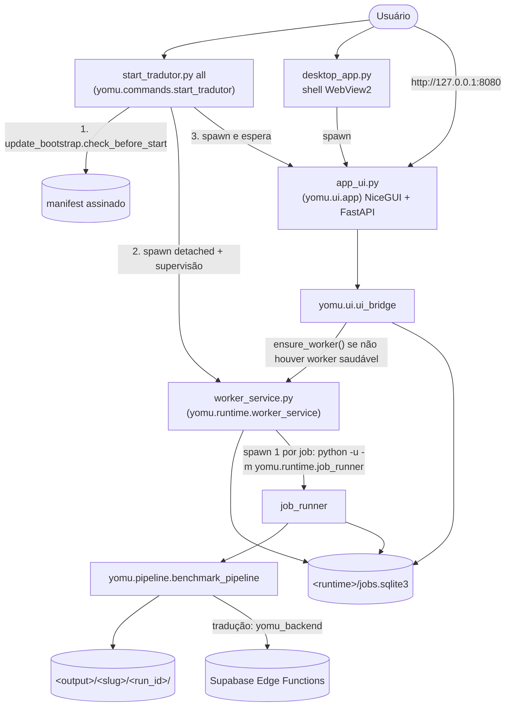

`<runtime>` e `<output>` são resolvidos por `yomu/runtime/runtime_paths.py` (§10): por padrão
`%LOCALAPPDATA%\TradutorIA
untime` e `%LOCALAPPDATA%\TradutorIA\output`.

Pontos de contrato:

- **A UI nunca executa o pipeline.** Ela cria linhas no banco; o worker as consome. Fechar
  o navegador ou reiniciar `app_ui.py` não interrompe um capítulo. Se não houver worker
  saudável, `UiBridge.ensure_worker()` inicia um (via `start_worker`) — esse worker **não** é
  supervisionado; só o worker criado por `start_tradutor.py all` tem supervisor.
- **O worker é destacado do launcher** (`DETACHED_PROCESS` + `CREATE_NEW_PROCESS_GROUP` +
  `CREATE_NO_WINDOW` no Windows; `start_new_session` no POSIX).
- **Concorrência de jobs = 1.** O worker reivindica um job por vez com claim atômico.
- **Banco é a única fonte de verdade** do estado dos jobs e do lease do worker.
- **Comunicação entre processos é sempre pelo banco**, nunca por sinais de console — é
  isso que permite parar um worker destacado sem console compartilhado.

## 5. Ciclo de vida do launcher e supervisão do worker

`start_tradutor.py` (implementação em `yomu/commands/start_tradutor.py`) aceita estes
comandos posicionais — não há `--help`; um comando desconhecido imprime `unknown command` e sai
com código `2`:

| Comando | Efeito |
| --- | --- |
| `all` (padrão) | Checa update assinado (`update_bootstrap.check_before_start`); se houver release nova ativada, faz handoff; senão inicia o worker (se não houver um saudável), **supervisiona-o** e roda a UI como filho, esperando-a. Ao fechar a UI, para o worker que **ele** iniciou |
| `worker` | Inicia apenas o worker, destacado, e sai — **sem supervisão** (`--force` ignora o worker saudável existente) |
| `ui` | Inicia apenas a UI (filho com stdout/stderr em `<runtime>/ui.log`) |
| `status` | Imprime saúde do worker e da fila (`worker_service.py --status --db <runtime>/jobs.sqlite3`) |
| `stop` / `stop-worker` | Pede parada graciosa pelo banco; `--force` derruba a árvore validada |
| `selftest` | Importa UI, worker e job store sem iniciar nada (usado pelo updater após ativação) |

Em `all`, um update obrigatório que não pode ser aplicado faz o launcher sair com código `3`
(`update_required: <estado>`). Argumentos internos `--internal-child <papel>` e
`--internal-selftest <nome>` servem ao build congelado e não são interface de usuário.

Antes dos comandos públicos, o launcher carrega `<repo>/.env` (e `.env.local` como override)
via `local_environment.load_local_environment_for_entrypoint()`. Um `.env` malformado faz o
launcher sair com código `2` e mensagem `configuration_error:` **sem imprimir valores**.

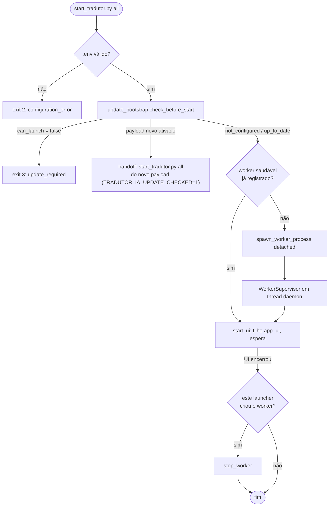

### Supervisão (`worker_supervisor.py`, TDD #53) — IMPLEMENTADO

A supervisão é deliberadamente estreita: seu único escopo é **disponibilidade do
processo**. Ela nunca marca job como interrompido, nunca retoma job, nunca reordena fila.

| Parâmetro | Valor no código |
| --- | --- |
| Backoff entre reinícios | `2s, 5s, 15s` (`BACKOFF_SECONDS`) |
| Máximo de reinícios do orçamento | `3` (`MAX_RESTARTS`) |
| Tempo de uptime que devolve o orçamento | `120s` (`STABILITY_SECONDS`) |
| Estados | `starting`, `running`, `backoff`, `stopping`, `degraded` |

Regras verificadas:

- O supervisor **bloqueia em `Popen.wait()`** — não há polling nem health probe.
- Ele só dirige o processo que **este launcher** criou. Um launcher que encontra um worker
  saudável pré-existente não o adota (`start_worker` retorna `None`).
- `request_stop()` marca a intenção **antes** de qualquer terminação. Exit code jamais é
  usado para inferir intenção: um worker pode sumir inesperadamente com código 0.
- Esgotado o orçamento, o estado vira `degraded` e **não há mais respawn** — o usuário vê
  um worker offline honesto em vez de uma tempestade de processos.
- Uptime `>= 120s` zera `restarts`, então um crash hoje e outro na semana que vem não
  esgotam ninguém.
- A thread do supervisor é **daemon**: a supervisão vive e morre com o launcher.

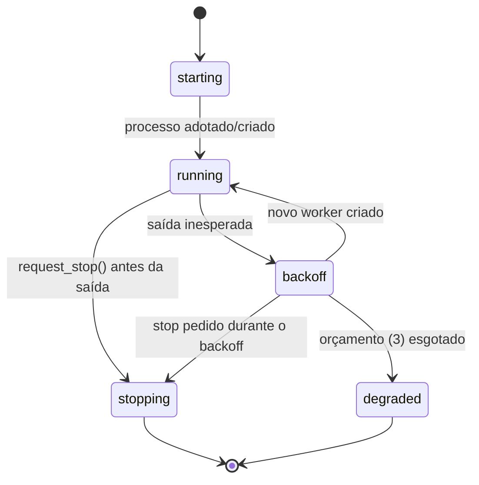

Eventos são emitidos como uma linha JSON em `stderr` (`worker_spawned`,
`worker_process_exited`, `worker_restart_scheduled`, `worker_restart_exhausted`,
`worker_expected_stop`, ...).

### Launcher supervisionado de execução única (`process_launcher.py`)

Componente separado e independente do anterior: executa **um** processo filho e persiste o
exit code real. No Windows o filho nasce suspenso, é associado a um Job Object com
`KILL_ON_JOB_CLOSE` e só então é retomado; no POSIX usa nova sessão e grupo de processos.
Grava `exit_code.txt`, `launcher_events.jsonl`, stdout e stderr no diretório de runtime
indicado. Destina-se a execuções CLI supervisionadas fora da UI; **não** é o launcher da
aplicação. Em `5f482ce1` nenhum módulo de produção o importa — só `tests/test_process_launcher.py`
o exercita.

## 6. Ciclo de vida da UI

`app_ui.py` (shim de `yomu/ui/app.py`) sobe um app FastAPI/NiceGUI:

- **Fila (`/api/ui/queue/add`)** passa pelo mesmo portão do formulário principal
  (`UiBridge._authorize_translation_start`: dispositivo comercial ou licença Beta), sela o
  contexto de tradução com o token da requisição e garante o worker. O payload da página
  (`queuePayload`) leva o `output_plan`, o provider e o `translation_enabled` do control plane,
  como o formulário. Antes, a fila pulava o portão (`commercial_device_id_missing`) e, sem
  `translation_enabled`, o job rodava sem traduzir. `/api/ui/queue/start` não exige mais
  `NVIDIA_API_KEY`.
- **Sessão Supabase repetida:** o SDK reanuncia `SIGNED_IN`/`TOKEN_REFRESHED` da mesma sessão
  sempre que a página volta a ficar visível. `renderSession` (`static/auth_ui.js`) trata o mesmo
  usuário já confirmado como "sem mudança" (só guarda o token novo); antes cada troca de aba
  refazia a sincronização com o backend, o bootstrap remoto (`beta-bootstrap`) e o bootstrap
  da UI, e num painel que alterna visibilidade virou um laço a cada 2 s, com rajadas de
  `control-plane-trace` respondidas com 429.
- **Fontes:** sem a ponte `pywebview` (UI aberta num navegador) o botão abre a URL fixa numa
  nova aba; na janela desktop continua indo pela ponte para o navegador do sistema.

- Porta: `TRADUTOR_UI_PORT` (padrão `8080`; lida em `yomu/ui/app.py` e `yomu/desktop/app.py`,
  ausente do `.env.example`); host: `community_auth.configured_bind_host()` (`TRADUTOR_UI_HOST`,
  padrão loopback).
- **Origem canônica: `http://127.0.0.1:8080`.** O frontend monta os redirects de auth
  (confirmação de cadastro, recuperação de senha, callback) a partir de `window.location.origin`
  (`static/supabase_auth.js`, `static/auth_ui.js`), e o projeto Supabase de auth só aceita a
  origem `http://127.0.0.1:8080` (configuração do projeto, fora do repositório). Abrir a UI por
  `localhost:8080`, outra porta ou outro host gera redirects que o Supabase recusa. O
  `.env.example` documenta `SUPABASE_SITE_URL=http://127.0.0.1:8080` e
  `SUPABASE_REDIRECT_URL=http://127.0.0.1:8080/auth/callback` como referência para configurar o
  projeto (nenhum módulo Python as lê). O shell desktop usa `127.0.0.1` e a porta 8080 por
  padrão e só aceita loopback (`--host`).
- Bind externo exige o opt-in explícito `TRADUTOR_ALLOW_EXTERNAL_BIND=1` **e** um provider
  de auth que declare `supports_external_bind`. O provider local nunca satisfaz isso.
- A porta é verificada antes do `ui.run` (`_assert_startup_port_available`).
- Página única em `/`, servindo `ui/ui_shell.html` + `static/`.
- `GET /auth/callback` serve uma página estática fixa (sem echo de query/hash → sem open
  redirect).

### Superfície HTTP

As rotas de aplicação estão sob `/api/ui/*`, `/api/community/*` e `/api/auth/*`; a
superfície de atualização usa `/api/update/*` (§23) e o login desktop usa
`/api/auth/desktop/handoff/*`, cada uma com contrato próprio. Exceções deliberadamente não
autenticadas da família `/api/ui`:

| Rota | Motivo |
| --- | --- |
| `GET /api/health` | Indicador de conexão do frontend; precisa funcionar antes do login. Não expõe estado de usuário. |
| `GET /api/ui/bootstrap` | Read-only; devolve payload vazio para credencial ausente/expirada em vez de quebrar o carregamento. |

Todo o resto passa por `_ui_principal()`, que exige principal autenticado
(`401 authentication_required`) e, para mutações, CSRF (`403 csrf_rejected`). Rotas
ligadas a um job usam `_owned_ui_job()`, que devolve `404 not_found` — deliberadamente
indistinguível de recurso inexistente — quando o job não pertence ao owner.

Famílias de rotas: estado/bootstrap, submissão e cancelamento, revisão de fonte, revisão
de qualidade, revisão de página, rerun de revisão, auditoria linguística, tradução humana
assistida, máscara humana, fila, perfil, histórico, comunidade.

**Exclusão de capítulo local (`POST /api/ui/history/delete`).** Um card do histórico local
não é necessariamente um job vivo do store — cards *descobertos* (`discovered-<slug>-<uuid>`)
e cards legados têm `page_count=0` e nenhuma linha de job. Por isso a rota autentica pelo
owner com `_ui_principal()` (auth + CSRF) e **não** exige job próprio (`_owned_ui_job`);
usar o guard de job aqui devolvia `404` e tornava esses cards indeléveis. A remoção do card
(`history_store._write` + `hide_record`, chaveada pela identidade canônica do registro) é
**incondicional** — nunca depende de `page_count` positivo nem de uma pasta confinável.
A exclusão de arquivos (`delete_files=True`) é separada, best-effort e *fail-closed*: só
apaga a pasta do run quando ela resolve com segurança sob `output/` (`_confined_output_folder`
rejeita `..`, caminho absoluto estranho, raiz de drive<LOCAL_HOME>/ `already_absent` /
`unsafe_path_preserved` / `delete_failed_preserved` / `preserved`).

### Início de tradução: camadas de proteção

Todos os pontos de entrada — o botão `#startBtn`, `Enter` no campo de URL, `Enter` no campo
de nome e o botão de repetir — chamam a mesma função `startTranslation()`. Não existe
caminho paralelo. As camadas, da mais superficial para a autoritativa:

| Camada | Onde | O que garante |
| --- | --- | --- |
| Rótulo/`disabled` do botão | `setRunControls`, `dataset.busy` | UX: o usuário vê que já clicou |
| Single-flight | `startInFlight` em `tradutor_ui.js` | uma rajada de cliques compartilha **uma** operação |
| Dedupe de fila | `_pending_duplicate()` em `ui_bridge.py` | resposta amigável `duplicate: true` para reenvio sequencial |
| Índice único parcial | `uq_jobs_active_owner_chapter` | **a garantia real**: o banco recusa a segunda linha |

`startTranslation()` é um wrapper síncrono sobre `runStartTranslation()`, no mesmo formato
já usado por `refreshBootstrap`/`bootstrapInFlight`: o lock é tomado **antes de qualquer
`await`**, então um segundo clique no mesmo tick reaproveita a promise em vez de abrir uma
nova cadeia de análise de fonte, checagem de licença e criação de job.

Desabilitar o botão é UX, não contrato de concorrência. `_pending_duplicate()` sozinho
também não bastava: ele lê a fila e só depois cria o job, sem nada segurando o intervalo —
duas submissões simultâneas viam "sem duplicata" e ambas criavam linha (`START-SPAM-001`).
Quem resolve uma submissão genuinamente simultânea é o banco.

O índice é parcial e tem como chave o **slug do capítulo** (lido de
`configuration_json.$.chapter_slug`, a mesma chave que o bridge usa), nunca `series_slug` —
uma série tem legitimamente vários capítulos e vários outputs de retry em voo ao mesmo
tempo. Status terminais ficam fora do predicado: isso barra submissão duplicada, jamais uma
retradução deliberada mais tarde.

### Tela de prontidão e painel Pipeline

O retorno bem-sucedido de `runStartTranslation` usa `activateTab('nova', {preservePipeline: true})`:
navegar até o job criado não pode reiniciar o formulário nem ativar `suppressHistoricalResult`.
O início usa o mesmo polling de análise do preflight isolado, encerrado em `finally`.
Os eventos canônicos `translation` e `rendering` mapeiam para `translate` e `render` na UI.
O ETA usa contadores canônicos da etapa e suspende a estimativa após 120 segundos sem evento;
heartbeat do runner não renova artificialmente a data de progresso.

`GET /api/ui/sources/preview/{source_key}` exige o principal da UI e aceita somente as três
chaves de `SUPPORTED_SOURCE_URLS`. `yomu.ui.source_previews` mantém cache local com TTL de
60 segundos, uma captura por chave em voo e um único navegador de captura por vez. Reutiliza
o browser runtime e o teardown limitado existentes, com perfil temporário sem autenticação.
A UI consulta somente enquanto Fontes estiver visível. Falhas preservam a captura anterior e
seu horário, sem divulgar detalhes internos. Bloqueios do site não são contornados.

`#loadingSurface` fica **dentro da coluna de "Nova tradução"**, logo acima do painel
Pipeline. `renderBootstrapSurface()` só desenha enquanto o boot está de fato acontecendo:
`closeBoot()` trava `bootHasClosed` e, a partir daí, nenhum `refreshBootstrap()` posterior
repinta a tela de prontidão.

Sem essa trava, qualquer `refreshBootstrap()` — que roda durante toda a vida do aplicativo —
re-percorria `setBootStage(1..7)` e, como `setBootStage` avança por catraca
(`bootHighestStage`), pintava direto o estado final ("Tradutor.IA pronto", "8 de 8 etapas")
sobre a aplicação em uso, deslocando o Pipeline real para fora da tela
(`PIPELINE-UI-REGRESSION-001`).

As verificações de startup (Sessão, Ambiente, Interface) continuam existindo; apenas a
superfície visual deixou de invadir a aplicação já iniciada. Uma falha real de startup
ainda chega a `setBootFailed()` e ao overlay `#boot`, com ação de recuperação.

O painel Pipeline em si é dirigido por estado real (`renderProgress`), com as etapas de
produção atuais — `source_analysis`, `awaiting_source_review`, `waiting_source_verification`, `download`, `validation`,
`ocr`, `translate`, `render`, `pdf`, `quality_review` — e nunca por animação sintética.

## 7. Ciclo de vida do worker e do runner

`worker_service.py` (`yomu/runtime/worker_service.py`) roda um laço:

| Constante | Valor |
| --- | --- |
| `POLL_SECONDS` | `1.5` |
| `WORKER_HEARTBEAT_SECONDS` | `3.0` |
| `STALE_SECONDS` | `30.0` |
| `STAGING_GRACE_SECONDS` | `5.0` |
| `COMMUNITY_RUNNER_MAX_ATTEMPTS` | `3` |
| `SOURCE_VALIDATION_TIMEOUT_SECONDS` | `180.0` |
| `SOURCE_ANALYSIS_REUSE_TTL_SECONDS` | `900` (15 min) |

Sequência por ciclo:

1. Registra/renova o próprio lease (`worker_id` UUID + PID + `create_time` do processo).
2. Reconcilia jobs deixados por um worker morto (`_reconcile_stale`) e publicações de
   comunidade interrompidas (`_recover_interrupted_community_publishes`).
3. Reivindica **um** job `queued` com UPDATE guardado por `status='queued'`.
4. Para fonte por URL, roda a fase de análise (`_prepare_source` →
   `source_analysis_phase`) enquanto segura o claim.
5. Cria o runner conforme o tipo do job (`translation` → `yomu.runtime.job_runner`,
   `community_publish`, `review_rerun`, `review_reexport` → seus runners):
   `python -u -m yomu.runtime.job_runner --job-id ... --db ... --worker-id ... --log ... --start-gate ...`
   (no build congelado: `YomuSekai.exe --internal-child job-runner ...`).
6. Acompanha o runner, honra cancelamento cooperativo e reconcilia a saída
   (`_reconcile_runner_exit`).

`job_runner.py` executa **um** capítulo: escreve o manifest inicial imediatamente (para que
uma execução interrompida ainda deixe registro), marca `running`, lança o comando do
pipeline com stdout redirecionado para `<runtime>/logs/<job_id>.log`, atualiza
progresso e heartbeat, e deriva o status terminal a partir dos artefatos produzidos. Um
crash no runner fica contido em um job — o worker continua.

Desde o TDD #68, a finalização também compara o `commit_hash` do job criado pela UI com o
`commit_hash` gravado pelo `run_manifest.json` físico do pipeline. Se ambos existem e
divergem, o job falha com `reason_code=pipeline_commit_mismatch` e registra
`runtime_commit_mismatch` no `job_manifest.json`. Esse guard é fail-closed: um PDF gerado
por runner/processo antigo pode continuar preservado como artifact, mas não pode mais ser
classificado como evidência de qualidade do commit atual.

Modos: `worker_service.py --once` processa no máximo um job e sai; `--status` imprime saúde
e sai; `--db` aponta para outro banco (usado por testes e manutenção — nesse caso os logs
vão para o diretório do banco, nunca para o runtime de produção); `--poll-interval` ajusta o
intervalo de polling.

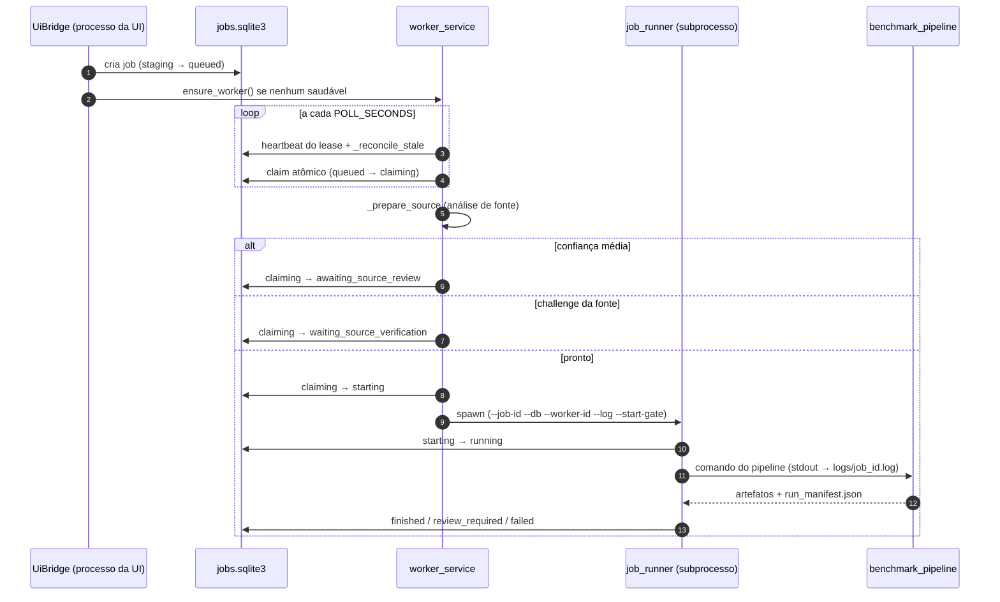

### Fluxo de um capítulo (visão geral)

Etapas na ordem em que `benchmark_pipeline.run_benchmark` as executa (nomes de estágio de
`resource_monitor.set_stage`); detalhes nas §11–§18. `--download-only` é tratado antes, em
`yomu/commands/run_webtoon.py`, e para depois da validação das imagens.

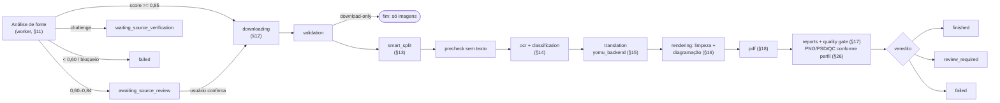

## 8. Máquina de estados do job

`yomu/runtime/job_store.py` — `JobStatus` define **15 estados**. Transições não listadas em
`ALLOWED_TRANSITIONS` são rejeitadas com `TransitionError` (fail-closed).

| Estado | Classe | Significado |
| --- | --- | --- |
| `staging` | preparação | Job sendo montado pela UI, antes de entrar na fila |
| `queued` | fila | Aguardando um worker |
| `claiming` | em voo | Worker reivindicou; pode estar analisando a fonte |
| `starting` | em voo | Runner sendo criado |
| `running` | em voo | Pipeline em execução |
| `cancelling` | em voo | Cancelamento pedido; runner derrubando a árvore |
| `awaiting_source_review` | pausa | Análise de confiança média: usuário precisa confirmar as páginas |
| `waiting_source_verification` | pausa | A fonte exige verificação no navegador (`reason_code=challenge_required`, gravado pelo worker); saídas permitidas: `queued`, `cancelled`, `failed` |
| `source_analysis_ready` | pausa | Fonte analisada; pendência de política de workspace |
| `interrupted` | recuperação | Execução perdida (crash/parada); artefatos preservados |
| `resumable` | recuperação | Interrompido e elegível para novo attempt |
| `cancelled` | **terminal** | Cancelamento explícito |
| `failed` | **terminal** | Falha técnica ou artefato essencial ausente |
| `finished` | **terminal** | Execução estruturalmente concluída, sem QC pendente conhecido |
| `review_required` | **terminal** | Sucesso estrutural com revisão humana recomendada; artifacts preservados |

`TERMINAL = {cancelled, failed, finished, review_required}`.
`IN_FLIGHT = {claiming, starting, running, cancelling}` — apenas estes exigem heartbeat.
`DEDUPE_ACTIVE` = `IN_FLIGHT` + `staging`, `queued`, `awaiting_source_review`,
`waiting_source_verification`, `source_analysis_ready` — os estados que bloqueiam submissão
duplicada do mesmo capítulo (§6, §10).

`review_required` mantém o enum persistido por compatibilidade, mas seu significado é
**sucesso estrutural com revisão recomendada**. O child termina com código `0`; erro
estrutural/artefato obrigatório inválido termina como `failed` com código não-zero. O runner
normaliza também o `exit_code` persistido para não perpetuar um retorno enganoso do child.

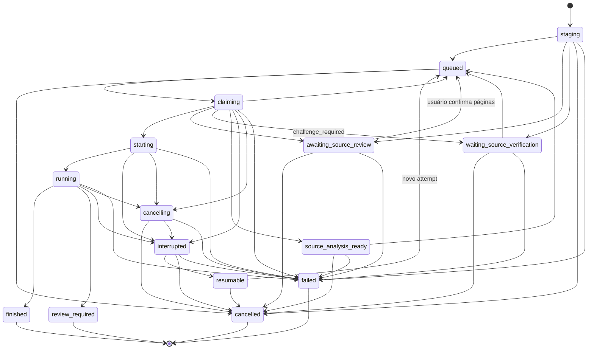

> **Distinção importante.** `awaiting_source_review` é uma revisão **de seleção de
> páginas, antes do OCR**. `review_required` é **terminal**, após uma execução que já
> gerou artifacts estruturalmente válidos. Ele recomenda QC, não indica falha: o processo
> sai com código `0`, enquanto falhas estruturais continuam em `failed`/`error` e usam
> código não-zero. Nunca confundir os dois em mensagens ao usuário.

## 9. Crash, reconciliação e recuperação

### Liveness que não mente (TDD #52)

Um worker que morre por `os._exit`, terminação forçada, crash nativo ou OOM **não roda seu
shutdown**: a linha de lease sobrevive com um heartbeat que estava fresco há um instante.
Frescor de heartbeat, portanto, não enxerga crash duro.

`job_store.worker_lease_process_alive()` usa a evidência que o resto do repositório já
confia para posse de processo: **PID + `create_time` do processo**. PID sozinho é inseguro
(PIDs são reutilizados); o `create_time` fixa a identidade daquela instância. Um lease sem
`create_time` registrado não carrega identidade verificável e mantém o contrato antigo de
heartbeat, em vez de declarar morto um worker possivelmente vivo.

### Fluxo de crash

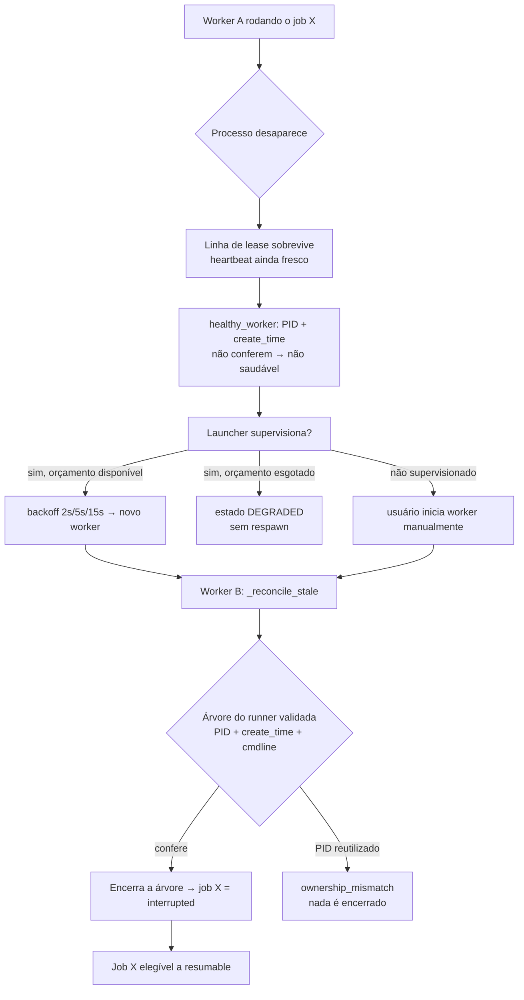

Garantias verificadas:

- Nenhum processo é encerrado **por nome**. Toda terminação valida PID + `create_time` +
  substring de linha de comando (`process_tree.matches`).
- PID reutilizado por outro processo nunca é encerrado; o job falha fechado como
  `ownership_mismatch`.
- Nunca há dois attempts ativos para o mesmo capítulo.
- O supervisor **não toca em estado de job**. Reconciliação é do `JobStore` + worker novo.

### Retomada — EXPOSTA NA UI

`POST /api/ui/resume` (`app_ui.api_resume` → `UiBridge.resume()`) cria um novo attempt
(`attempt+1`, com `previous_job_id`) reusando o mesmo diretório de saída e
`resume_from_stage`, reaproveitando checkpoints válidos. A linha original permanece como o
attempt anterior preservado e **nunca volta para a fila**.

**Autoridade de recuperabilidade.** `UiBridge.resume_block_reason(job)` é a única fonte de
verdade e é usada tanto pela operação quanto pela apresentação:

| Código | Significado |
| --- | --- |
| `job_not_found` | Job inexistente |
| `job_type_not_resumable` | Não é job de tradução (publicação de comunidade recupera no worker) |
| `status_not_resumable` | Status fora de `interrupted`/`resumable` |
| `no_recovery_state` | `recoverable=0` — interrupção sem estado continuável (ex.: filho que nunca cruzou o start gate) |
| `already_resumed` | Já existe attempt sucessor (`JobStore.retry_for_job`) |
| `previous_attempt_still_running` | Runner do attempt anterior ainda vivo (`_runner_still_alive`) |

`_job_record()` publica o resultado como a capability booleana **`can_resume`**, presente
em cada entrada de `runtime_state()["resumable"]`. `already_resumed` não é erro: `resume()`
devolve `{"ok": true, "job_id": <sucessor>, "already_resumed": true}` — a operação é
idempotente e um duplo clique nunca enfileira o capítulo duas vezes.

**Frontend.** `renderResumableJobs()` em `static/tradutor_ui.js` renderiza
`#interruptedJobsPanel` (`ui/ui_shell.html`) a partir de `runtime.resumable`, filtrando por
`can_resume === true` — nunca por comparação de status em JavaScript. Cada linha tem um
`<button>` real com `aria-label`, `dataset.jobId` com o identificador canônico vindo do
backend, e estado ocupado (`Retomando…`, `disabled`) via `appState.resumeBusyJobId`, que
garante **uma requisição por ativação**. `resumeInterruptedJob()` usa o helper autenticado
`api()` e, em sucesso ou falha, chama `pollState()` para reconciliar com o estado
autoritativo — nenhum estado é assumido otimisticamente. A UI não inicia worker algum: o
job volta à fila canônica e o supervisor do launcher continua responsável pelo worker.

Cobertura: `tests/test_interrupted_job_resume_ui.py` (capability, transição, checkpoint,
idempotência, reinício da aplicação) e `tests/test_interrupted_job_resume_ui.mjs` (DOM real,
clique real, duplo clique, rejeição do backend, exclusão mútua com **Cancelar**).

## 10. Job store (SQLite) e sistema de arquivos de runtime

`yomu/runtime/job_store.py` — `SCHEMA_VERSION = 17`, SQLite em modo WAL com `busy_timeout`.

Índices únicos parciais impõem, no próprio banco, invariantes que código de aplicação não
consegue garantir sob concorrência:

| Índice | Invariante |
| --- | --- |
| `uq_jobs_active_review_rerun_parent` | um rerun de revisão ativo por job pai |
| `uq_jobs_retry_parent` | um retry por job anterior |
| `uq_jobs_active_owner_chapter` | uma tradução ativa por owner e capítulo (v10) |
| `uq_jobs_active_idempotency_key` | uma tradução ativa por `configuration_json.$.idempotency_key` |

Tabelas: `jobs`, `workers`, `meta`, `quality_review_item_revisions` e
`quality_review_region_overrides`. Timestamps são epoch em segundos (`REAL`); `NULL` significa "ainda não".

**Review = QC linguístico (Missão 8).** A Revisão é uma ferramenta de QC **linguístico**: localizar
pendências, comparar fonte × tradução, editar a tradução e aprovar/resolver. O QC **visual/
tipográfico** avançado pertence ao PSD editável, não à Revisão. A edição de tradução persiste por
`POST /api/ui/quality-review/edit` → `UiBridge.quality_review_edit` →
`JobStore.record_review_item_revision` (tabela `quality_review_item_revisions`, com checagem
otimista de versão) — **fonte de verdade** das correções; o re-export (`review_reexport`) consome
esses valores efetivos, sem chamar provider. O módulo `review_item.py` normaliza um item do payload
`quality_review` num `ReviewItem` pequeno (page, region_id, semantic_type, source/translated,
warnings, confidence, status) e traduz os códigos de aviso para rótulos PT-BR (`WARNING_LABELS`),
desacoplando a UI do `quality_report` grande e preparando a Missão 10. O status de QC do item
(`pending`/`approved`/`resolved`) é **separado** do status terminal do job — a integração disso é a
Missão 9, não alterada aqui. O `review_manifest` foi implementado depois, na Missão 10 (§26.2).

A linha de job (89 colunas explícitas em `_JOB_COLUMNS`) agrupa, entre outras:

- **identidade**: `id`, `owner_id`, `run_id`, `operation_kind`, `parent_job_id`, `attempt`,
  `previous_job_id`, `commit_hash`, `branch`;
- **fonte**: `source_url`, `source_type`, `adapter_name`, `adapter_version`,
  `transport_name`, `source_score`, `candidate_count`, `snapshot_ref`,
  `input_root_fingerprint`, `source_analysis_json`, `source_selection_json`;
- **progresso**: `stage`, `progress_current`, `progress_total`, `progress_message`,
  `progress_counter_stage`, `stage_started_at` e o contrato de eventos de progresso
  (`progress_version`, `progress_last_event_seq`, `progress_event_id`, `progress_phase`, ...);
- **posse de processo**: `worker_id`, `worker_pid`, `worker_create_time`, `runner_pid`,
  `runner_create_time`, `exit_code`;
- **artefatos**: `manifest_path`, `progress_path`, `quality_report_path`, `pdf_path`,
  `log_path`;
- **erro**: `error_type`, `error_message`, `error_trace_path`, `reason_code`.

`reason_code` é validado por regex (`^[a-z][a-z0-9_]{0,79}$`) — nunca texto livre.

O registro **não deve** guardar URL completa de recurso, query string, cookie ou pixel de
canvas. Análise de fonte é sanitizada antes de persistir.

### Estrutura de runtime

Os caminhos vêm de `yomu/runtime/runtime_paths.py`. A raiz gravável por usuário é
`%LOCALAPPDATA%\TradutorIA` (fallback `XDG_STATE_HOME/TradutorIA` ou `~/.tradutoria`),
sobrescrevível por `TRADUTOR_USER_DATA_ROOT`; cada sub-raiz também tem override próprio
(`TRADUTOR_RUNTIME_ROOT`, `TRADUTOR_OUTPUT_ROOT`, `CACHE_ROOT`, `TEMP_FOLDER`, `TEMP_OUT`).
Um build instalado pode viver em local somente leitura, por isso nada mutável fica ao lado do
código.

```text
%LOCALAPPDATA%\TradutorIA├── runtime/                  # TRADUTOR_RUNTIME_ROOT
│   ├── jobs.sqlite3          # fila e leases (WAL)
│   ├── logs/<job_id>.log     # log por job
│   ├── ui.log                # stdout/stderr da UI
│   ├── ui_history.json       # histórico local da UI
│   └── diagnostics/          # trilhas JSONL (transições de job, rotas, app)
├── cache/                    # CACHE_ROOT — caches de pipeline
├── temp/input, temp/output   # TEMP_FOLDER / TEMP_OUT
└── output/<slug>/<run_id>/   # TRADUTOR_OUTPUT_ROOT
    ├── input/                # imagens de origem ativas
    ├── pages/                # páginas finais renderizadas
    ├── run_manifest.json     # manifest autodescritivo da execução
    ├── progress.json         # progresso + run_signature
    ├── downloaded_images.json
    ├── download_report.json|html
    ├── timing_report.json|txt
    ├── quality_report.json|html
    ├── artifact_manifest.json  # Artifact Contract V2 (§26.1)
    ├── resource_report.json|html # só com monitoramento habilitado
    └── <obra>_capitulo_<n>.pdf
```

Clones antigos podem ter `<repo>/.cache/runtime` e `<repo>/output`; o guard hermético continua
protegendo esses caminhos legados (§24), mas eles não são mais o padrão.

Novos jobs criados pela UI usam uma pasta endereçada por execução
(`output/<chapter_slug>/<run_id>/`). Isso preserva dois reprocessamentos do mesmo capítulo
como artefatos separados. Saídas legadas em `output/<slug>/` continuam leitura-compatíveis,
mas não são o destino de novos jobs da UI.

## 11. Análise de fonte e descoberta de páginas

`chapter_source.py` sempre tenta primeiro um **adapter específico**. Sem adapter
registrado, uma URL HTTP(S) pública pode passar pelo `UniversalChapterAdapter` — isso é
uma análise controlada, **não** uma declaração de suporte ao site.

Decisão por score, verificada em `docs/UNIVERSAL_CHAPTER_ADAPTER.md` e no código:

| Score | Resultado |
| --- | --- |
| `>= 0,85` | Seleção automática; segue para download |
| `0,60 – 0,84` | Job vai para `awaiting_source_review` — o usuário confirma as páginas |
| `< 0,60` | Falha fechada |

Falham fechados, antes de qualquer OCR: cobertura incompleta (`incomplete_download`),
autenticação exigida, challenge interativo, conteúdo protegido, leitor não observável,
mais de 400 páginas, paginação ambígua (`pagination_incomplete`).

Leitor do Webtoons (`yomu/download/webtoons_reader_bridge.py`): toda tag de página traz a URL
real em `data-url` e o tamanho em `width`/`height`; só o placeholder transparente do `src`
espera a rolagem. Com esses valores declarados o slot já é resolvido (`source:
"data-url-declared"`), sem rolar o leitor inteiro (~1 s por página: 87 s num episódio de 111
imagens); o portão de download continua baixando e validando cada imagem.

`source_analysis_phase.py` isola a decisão que segue à análise (cobertura incompleta,
revisão manual, resultado não suportado, ambiente ausente, pronto para rodar). Depende
apenas de um `JobStore` e de callables explícitos — não importa a UI nem framework web,
por isso o worker a alcança sem importar a camada de request.

### Leitores lazy (`lazy_slot_resolver.py`) — IMPLEMENTADO

Um leitor lazy entrega placeholders primeiro. Ler o DOM uma vez enxerga uma fração do
capítulo, e tratar o resto como rejeitado encolhe o capítulo silenciosamente.

O resolvedor revisita regiões pendentes, relê os mesmos índices do DOM e atualiza apenas os
slots pendentes, até nada estar pendente ou o orçamento acabar. Ele **nunca busca bytes de
imagem** — observa apenas estado de elemento. Toda operação de browser é injetada, então o
algoritmo é testável sem browser e sem rede.

Para Webtoons, `webtoons_reader_bridge.py` adapta o driver Selenium já aberto e rola apenas
dentro dos bounds do container do reader. Placeholders 1x1 permanecem pendentes, nunca
autorizam host de CDN e nunca entram no manifesto. Resolução incompleta termina a fase como
`incomplete_source_coverage`, sem iniciar runner.

**Otimização fechada (commit `5fce936`):** a parada da descoberta passou a usar evidência
convergente (manifesto canônico do leitor, altura do documento, progresso real de scroll)
com uma sonda final de exaustão, em vez de esgotar sempre as 90 rodadas. Medido no episódio
51: 90 rodadas / 92s de sleep → 10 rodadas / 11s, com as mesmas 171 páginas.

### Pasta local

`LocalFolderChapterAdapter` percorre uma fronteira separada: valida uma raiz permitida
(`LOCAL_INPUT_ROOTS`), arquivos diretos e bytes de imagem, cria snapshot interno com nomes
gerados e entrega ao job apenas uma referência opaca. Não usa browser, `file://` nem
downloader HTTP. Submissão de pasta local pela UI só é aceita quando o servidor está ligado
a loopback (`_local_folder_submit_allowed`).

## 12. Download de imagens

`yomu/download/down.py` usa Selenium com um navegador Chromium local resolvido por
`browser_runtime.BrowserRuntimeResolver` (configurado → gerenciado → do sistema, sem download
de driver salvo `TRADUTOR_ALLOW_DRIVER_DOWNLOAD=1`; headless por padrão,
`SOURCE_BROWSER_HEADLESS`). Fontes com leitor dinâmico (ex.: Comix) passam pelo resolver
isolado em `download/readers/` (§29, "Resolver dinâmico Comix"). O downloader deduplica URLs preservando a ordem
observada, valida os bytes das imagens (`image_validation.py`), compara o conjunto esperado
com o disponível, produz um **download gate** com motivos de falha e executa teardown
limitado do navegador registrando o mecanismo usado.

`download_transport.py` abstrai o transporte; todos compartilham limites por capítulo de
redirects, tamanho, quantidade, bytes e duração. A sessão com cookies do navegador é
temporária e opcional. Challenges, autenticação e canvas inacessível **não são
contornados**.

Detalhes em [`docs/DOWNLOAD_TRANSPORTS.md`](../DOWNLOAD_TRANSPORTS.md).

## 13. Smart Split e páginas lógicas

Webtoons entregam fatias muito altas ou com divisões inadequadas para OCR e PDF.
`yomu/export/pdf.py` implementa o **smart split** (com o agendamento incremental de
`yomu/ocr/splitting/smart_split_incremental.py` usado pelo pipeline), que reconstrói páginas lógicas com limites configuráveis
(`SMART_PDF_TARGET_HEIGHT`, `SMART_PDF_MIN_HEIGHT`, `SMART_PDF_MAX_HEIGHT`) e preserva um
relatório das fronteiras escolhidas. Ocorre **antes** do OCR quando
`SMART_WEBTOON_PDF_SPLIT=True` (padrão) e o relatório de download indica
`requires_smart_split`. Para pasta local (arquivos já são páginas lógicas
completas) o smart split faz passthrough.

O relatório `smart_split_report.json` preserva a soma das alturas de origem, a contagem de
páginas lógicas, a altura de cada corte e os motivos (`white_gutter`, corte semântico,
etc.). Uma página lógica visualmente vazia ou majoritariamente branca só é aceitável quando
mantém ancestry contínua de pixels da fonte; ela não pode ser removida por nome, número de
página ou aparência isolada.

**Otimização fechada (commit `2638844`):** a gravação de cada página lógica deixou de usar
`optimize=True` do Pillow (busca exaustiva de filtro/Huffman). Num capítulo real de 171
fatias isso custava ~32,2s dos ~52s do estágio para economizar ~1,3% de bytes. PNG é
lossless nos dois casos — as 100/100 páginas ficaram pixel-idênticas. Estágio 51,98s →
28,52s; encode 32,22s → 8,40s; saída +1,32% em bytes.

## 14. Pipeline de OCR

`ocr_engine.py` oferece interface comum para **RapidOCR** (ONNX Runtime), **PaddleOCR
completo**, **PaddleOCR Mobile** e o caminho opcional de Tesseract.

Modos `fast` e `quality`:

1. RapidOCR processa a página.
2. Reparos conservadores normalizam problemas estruturais **sem traduzir**.
3. Sinais de suspeita podem acionar fallback de página para Paddle Mobile.
4. Grupos individuais recebem score em `ocr_balloon.py` (`score_group_ocr_quality`).
5. Regiões suspeitas são recortadas e comparadas com Paddle Mobile.
6. Paddle completo só entra quando a comparação ainda não resolve o contrato.
7. Vence o candidato com melhor combinação de qualidade, confidence e coerência.

O modo `quality` não troca mais a engine primária para Paddle. Ele mantém RapidOCR como
primário e conserva as validações e escalonamentos mais caros; PaddleOCR é fallback opcional,
usado somente quando disponível e quando a política de fallback justificar. Ausência de Paddle
não é fatal se RapidOCR está disponível. Ausência do OCR primário configurado continua falhando
fechado antes do capítulo.

**Superfície da beta (TDD #84F8).** O usuário agora **vê** qual motor está ativo: a tela de
nova tradução mostra um campo informativo `Motor de OCR` com `RapidOCR · Ativo`, na mesma
linguagem visual de `Motor de tradução: DeepL (Qualidade)`, e as Configurações mostram uma
única linha `RapidOCR — Ativo`. Como a beta tem um motor só e nenhuma substituição em
silêncio, o campo é **informativo e não selecionável**: não há opção Paddle exposta, porque
Paddle não é exigido nem instalado nesta beta.

> **Estado em `5f482ce1`:** o campo `#ocrEngineField` da tela de nova tradução está marcado
> `hidden` em `ui/ui_shell.html` e nenhum script o reexibe; hoje o motor aparece apenas no
> painel **Motor de OCR** das Configurações (`RapidOCR` + selo `Ativo`). Os parágrafos de TDD
> abaixo descrevem o comportamento do campo quando visível.

**Controles da beta (TDD #84F10).** O campo do OCR perdeu a seta de dropdown
(`#ocrEngineSelect { appearance: none }`): uma seta em um campo de opção única promete
alternativas que não existem. O rótulo deixou de ser fixo — `applyOcrEngineStatus()` o
deriva de `settings.ocr_engine`, de modo que `RapidOCR · Ativo` só aparece quando RapidOCR
é de fato o engine configurado; qualquer outro id é reportado como ele é, em vez de a UI
afirmar um motor que o run não vai usar.

**Proveniência efetiva do OCR (TDD #84F19).** O processo da UI não lê mais
`config.OCR_ENGINE` como fonte de verdade para o painel de configuração: esse valor pode ser
apenas o default do processo e não o motor efetivo da beta. `ui_bridge` passa a reportar
`settings.ocr_engine` por `config.effective_ocr_engine()` (`config` = `yomu/config/settings.py`;
o default é `OCR_ENGINE=rapidocr`), o mesmo resolvedor usado antes de
iniciar um run. Com o default canônico da beta, a UI mostra `RapidOCR · Ativo`; um override
explícito e suportado continua sendo reportado pelo próprio id. O campo segue informativo:
sem opção Paddle/Tesseract exposta e sem seta de seletor.

No mesmo movimento, `Modo de processamento` deixou de ser uma grade de três cartões
grandes e virou um `<select id="modeSelect">` com a mesma largura e o mesmo alinhamento de
`Motor de tradução` e `Motor de OCR`, com uma linha de ajuda contextual (`#modeHint`) sob
o campo. **Os valores internos não mudaram** (`quality`, `fast`, `download_only`), o
contrato de start é o mesmo e `DEEPL_MODEL_TYPE=quality_optimized` segue sendo o modelo
canônico da beta; o padrão exibido e selecionado é **Qualidade**. `applyProcessingMode()`
é o único ponto que decide o modo, de modo que o select, um rascunho restaurado e um
replay de histórico não podem discordar sobre o valor que a execução vai carregar.

O fallback **solicita comparação**; ele não fabrica a leitura correta. Os metadados
registram engine original, engine final, confidences, motivos de fallback, reparos e
scores.

### Ciclo de vida e memória

As engines são nativas e backed por modelo: uma contagem de workers inofensiva para um
backend leve pode dobrar o resident set do runner. `ocr_memory_policy.py` mantém a política
de dimensionamento **pura e injetável**, para que os testes a exercitem sem depender da RAM
real do host. `ocr_parallel.py` coordena os workers; `adaptive_scheduler.py` pode ajustar
concorrência a partir de memória e CPU observadas (opt-in por `.env`).

### Agrupamento e classificação

`ocr_balloon.py` agrupa linhas visualmente relacionadas e classifica o grupo com evidências
textuais e de container. Classes: `speech`, `narration`, `sfx`, `decorative` e `unknown`
(evidência insuficiente para decisão segura). SFX são traduzidos por padrão
desde 2026-10-24 (`TRANSLATE_SFX=True`; `False` preserva). A classificação também informa a estratégia de máscara e redraw.

### Proveniência e recuperação de OCR

`ocr_line_provenance.py` copia a evidência sempre que uma fronteira é cruzada — o pipeline
reescreve objetos de linha in-place e substitui listas inteiras entre passes (re-OCR de
container de fala, recuperação de região do RapidOCR, fallbacks seletivos, fallback de
página inteira). Sem isso, um grupo que perdesse silenciosamente parte de uma linha de
origem não poderia ser reconstruído depois. O módulo **apenas observa**.

## 15. Tradução: abstração de provider

### Resolução do provider

**Caminho de produção — `yomu_backend` (IMPLEMENTADO).** Todo job com tradução habilitada usa
o provider interno autenticado `yomu_backend`, independentemente do rótulo pedido.
`benchmark_pipeline._resolve_translation_runtime()` constrói `YomuBackendTranslationProvider`
(`yomu/translation/providers/yomu_backend_provider.py`) e o injeta em `get_translator()`; os
rótulos `deepl`/`nemotron`/`riva` que chegam pela CLI ou pelo job viram apenas metadado. A
validação de proveniência (`normalize_translation_provider_provenance`) aceita `deepl → yomu_backend` (o "motor" exibido ao usuário é a
DeepL, executada do lado do servidor) e falha com `provider_mismatch` para qualquer outra
combinação. Jobs sem tradução (`download_only`, saída sem tradução) não constroem provider.

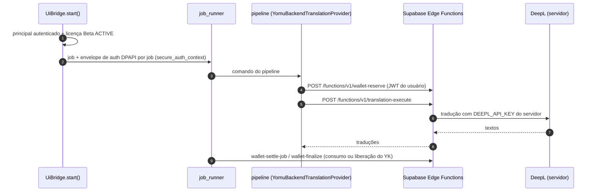

A URL base é `YOMU_BACKEND_URL` ou, na ausência dela, `SUPABASE_URL`. Em `YOMU_ENV=local|test`
o pipeline usa `MockBackendClient` (padrão `YOMU_TEST_BACKEND=mock`). O token do usuário nunca
entra em linha de comando, ambiente, log ou metadado de job: vai cifrado com DPAPI num
envelope por job. Falhas de reserva, auth, transporte ou settlement são
`SystemicTranslationFailure` (job inteiro), nunca achado por região.

**Fábrica legada — `translator_nllb.get_translator()` (DEPRECIADO para jobs).** Só é usada
sem provider injetado pelo pipeline da GUI legada (`main.py` → `yomu/pipeline/legacy_gui_pipeline.py`).
Dois eixos ortogonais:

- `TRANSLATION_MODE` (padrão `nvidia`) — eixo **antigo**, seleciona a família
  local/Google/NVIDIA.
- `ui_helpers.DEFAULT_TRANSLATION_PROVIDER` (**`deepl`**); `TRANSLATION_PROVIDERS =
  {"deepl", "nemotron", "riva"}` e `INTERNAL_TRANSLATION_PROVIDERS = {"yomu_backend"}`.

Regra: provider explícito vence; ausente **e** `TRANSLATION_MODE == "nvidia"` →
`DEFAULT_TRANSLATION_PROVIDER`; `deepl` é resolvido antes de `TRANSLATION_MODE`; pedir
`yomu_backend` sem instância injetada levanta `yomu_backend_provider_requires_injected_instance`.
Nunca há fallback silencioso entre providers.

### DeepL local (`translator_deepl.py`) — DEPRECIADO no cliente

O cliente HTTP DeepL local continua no código (contrato HTTP próprio, `translate_many` /
`translate` / `stats` / `model`, sem `translate_strict`, sem naturalizador, sem fallback) e
só é alcançável pela fábrica legada. A DeepL da Beta roda na Edge Function
`supabase/functions/translation-execute`, que lê `DEEPL_API_KEY`/`DEEPL_API_BASE_URL` do
ambiente **do servidor**. As variáveis `DEEPL_*` do `.env.example` só afetam o caminho legado.

### NVIDIA (`translator_nvidia.py`) — DEPRECIADO no cliente

Duas variantes: `nemotron` (API compatível com OpenAI) e `riva`. Opera em lotes, respeita
`NVIDIA_MAX_REQUESTS_PER_MINUTE`, usa retry/backoff e grava cache. Alcançável só pela fábrica
legada.

### Google / NLLB — DEPRECIADO

`translator_nllb.py` mantém caminhos Google Translate e NLLB local por compatibilidade. Não
são o fluxo da UI nem da CLI atuais.

### Contexto de capítulo

Com contexto habilitado, `session_context.py` mantém informações do capítulo em
`session_context.json` para manter nomes e termos consistentes entre balões. `--no-context`
desativa; `--delete-context-after` remove o arquivo somente após a geração bem-sucedida do
PDF.

### Proveniência de provider

`provider_execution.py` e `provider_transport.py` registram qual provider realmente
executou. Os rótulos genéricos de estágio e timing **não nomeiam mais NVIDIA** — o provider
efetivo é registrado, não presumido.

### Validação, retries e liquidação (fluxo atual)

Ordem real em `yomu/pipeline/benchmark_pipeline.py` (função principal do pipeline) e
`yomu/ocr/ocr_balloon.py`. As chamadas ao provider só acontecem **antes** da liquidação; a
renderização final recebe `translator=None`.

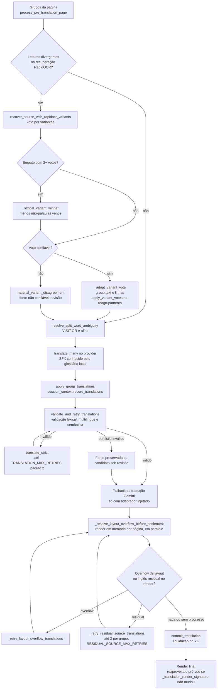

As chamadas ao provider dentro do pré-voo são serializadas por uma trava; só as renderizações
das páginas se sobrepõem. O laço do pré-voo para quando nenhum grupo foi reenviado com sucesso
ou depois de `TRANSLATION_MAX_RETRIES` rodadas.

## 16. Limpeza, inpainting e renderização


Fluxo da limpeza (estado em 2026-10-24; detalhes nas passadas abaixo e em [`clean_strategy.md`](../architecture/clean_strategy.md)):

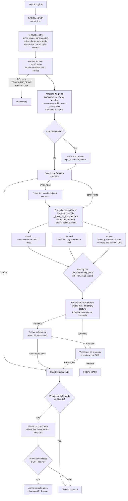

Diagramação da tradução:

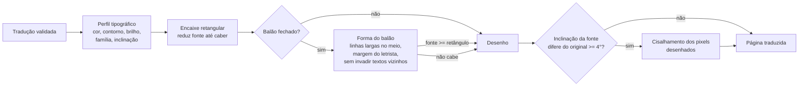


Antes do redraw, o texto traduzido passa por validação lexical e multilíngue (resíduo em
inglês/espanhol, fragmento parcialmente traduzido, mistura de idiomas). Candidatos
inválidos recebem retries controlados; persistindo inválidos, o **texto-fonte é preservado**
e o grupo é marcado para revisão. O validator nunca reescreve a resposta do modelo.

A reconstrução usa:

- **máscara restrita** (`TEXT_MASK_PADDING`, `MAX_MASK_EXPANSION`, `STRICT_MASK_BOUNDS`,
  `MASK_COMPONENT_BASED`);
- **análise de background** — balão branco liso, envelope branco, envelope estilizado e
  arte texturizada têm limiares separados;
- **inpainting** (`art_text_inpainting.py`, `multiscale_patch_synthesis.py`,
  `reference_guided_reconstruction.py`) ou preenchimento compatível;
- **tipografia** com quebra de linha automática e redução de fonte
  (`MIN_FONT_SIZE`, `MAX_FONT_SIZE`, `AUTO_LINE_WRAP`, `AUTO_FONT_SHRINK`,
  `font_fidelity.py`).

`preview_gates.py` é medição, não julgamento por inspeção: um rascunho só é aprovado por
números que um humano pode conferir. As mesmas funções servem a qualquer rascunho — não
dependem de página, região, frase ou capítulo.

### Segurança de preenchimento plano (TDD #81)

Remoção do texto-fonte e reconstrução da arte são **dois veredictos independentes**: o
glifo de origem pode ter sumido e a arte mesmo assim estar destruída.

A classificação coarse de background mede apenas textura de alta frequência. Um degradê
suave — fumaça, sombreado, queda de luz em tecido — não é *ruidoso*, então era lido como
`uniform_light` e autorizava preenchimento de cor única. `_local_background_flatness()`
acrescenta a evidência que faltava: o **spread de luminância (percentis 5–95) do anel
limpo em volta da máscara** (`FLAT_FILL_RING_RADIUS`, `MIN_FLAT_FILL_RING_PIXELS`). Balões
e caixas de narração reais medem até ~24; fumaça, tecido e ilustração aberta começam em
~43. O limite é `MAX_FLAT_FILL_RING_SPREAD` (padrão 30).

Consequências no caminho de produção:

- `_apply_cleanup_mask()` só usa preenchimento de cor única (claro ou escuro) quando o anel
  local prova que o fundo é de fato um tom só; caso contrário reconstrói por inpainting;
- `_uniform_light_line_text_mask()` / `_uniform_dark_line_text_mask()` só podem usar o
  **quadrilátero da linha OCR** como máscara sobre fundo comprovadamente plano. Um
  retângulo não é estratégia de máscara sobre ilustração;
- o fallback `source_scoped` mede cobertura contra os **glifos** de origem
  (`_uncovered_source_text_evidence`), não contra a área do polígono. Medir contra a área
  fazia o fallback disparar em toda região texturizada e substituir a arte pelo próprio
  quadrilátero;
- `_glyph_footprint_padding()` e o raio de suporte do halo escalam com a altura da linha:
  legenda pequena carrega uma borda de anti-aliasing, lettering de destaque carrega
  contorno e brilho de vários pixels. O halo é limitado por `line_limit` e pelo suporte de
  um componente de glifo aceito — crescimento local guiado por evidência, não dilatação
  arbitrária.

### Detector de patch plano

`_flat_patch_artifact_metrics()` reprova uma reconstrução que virou bloco sintético, com
reason `flat_reconstruction_patch_on_textured_background`. Ele compara a energia
Laplaciana **do interior** da máscara (erodido, para a borda não mascarar um preenchimento
perfeitamente uniforme) com a do anel de contexto.

A razão sozinha não decide. O anel ainda contém o lettering de origem, que infla a textura
de referência, e inpainting nunca reproduz grão por pixel: reconstruções legítimas de arte
escura granulada medem ~2,8–3,8 de energia interna. Por isso a reprovação exige também
near-uniformidade **absoluta** (`MAX_FLAT_PATCH_ABSOLUTE_TEXTURE`, padrão 1,0 — os
preenchimentos planos que o gate existe para pegar medem 0,0) e um componente sólido
grande (`MIN_FLAT_PATCH_COMPONENT_AREA`). Mais liso que o original é reconstrução; um tom
chapado é bloco sintético. Um balão branco genuíno passa porque o anel dele também é
plano — a comparação é sempre contra o contexto local, nunca contra uma regra absoluta de
“branco é suspeito”.

A validade da **página final reconstruída** é relativa à fonte aceita, não a um piso
absoluto. O downloader já validou a página de origem, então `_reconstructed_page_is_valid`
(em `benchmark_pipeline.py`, usado nos guards de render e no filtro de inclusão no PDF) não
descarta uma página por ser curta (algumas páginas do reader são tiras de 800x32) nem por
ser fielmente em branco (algumas páginas de origem são realmente vazias). Só reprova uma
falha real de render: saída ilegível/corrompida, dimensão zero, ou uma página cuja origem
tinha conteúdo mas cujo render saiu em branco (conteúdo perdido) — sem mascarar com
placeholder. Assim nenhuma página lógica aceita pelo download desaparece silenciosamente do
PDF (cobertura lógica 208/208 no capítulo de referência), substituindo o piso antigo de
`valid_image` (≥100×100 e variância>5) que eliminava tiras curtas e páginas vazias.

### Detector de costura (ART-SEAM-DETECTOR-001)

O detector de patch plano responde “o interior virou bloco sintético?”.
`_reconstruction_seam_metrics()` responde outra pergunta, fechada em **TDD #84**: mesmo
com os glifos de origem removidos, sem retângulo chapado e com resíduo de OCR zero, a
limpeza deixou uma **borda visível** onde a arte não tinha nenhuma? A reprovação usa o
reason `visible_reconstruction_seam_at_mask_boundary`.

Toda evidência é **relativa à reconstrução**, medida numa banda estreita em torno da
máscara. É isso que separa uma costura do contorno de um balão, da borda de um quadro ou
do contorno de um personagem que cruza a máscara:

| Sinal | O que mede | Limite |
| --- | --- | --- |
| `seam_luminance_step` | salto de luminância através da borda **menos** o quanto a luminância já se move na mesma distância na arte intocada ao lado (`seam_natural_luminance_step`) | `MAX_SEAM_LUMINANCE_STEP` (12,0) |
| `seam_texture_ratio` | energia de textura logo dentro da borda contra o contexto intocado | `MIN_SEAM_TEXTURE_RATIO` (0,35) |
| `seam_boundary_halo_delta` | anel que acompanha o contorno e não pertence a **nenhum** dos dois lados | `MAX_SEAM_BOUNDARY_HALO_DELTA` (18,0) |

O sinal de textura é suprimido quando o contexto é comprovadamente plano
(`MAX_FLAT_FILL_RING_SPREAD`): um balão genuíno tem variância ~0 dos dois lados e não pode
ser condenado por isso. O sinal de halo exige divergência dos **dois** lados — um contorno
de origem diverge de apenas um.

**Nenhum limite mágico único.** #81 já provou que uma razão de textura ingênua produz
falsos positivos, então um sinal raspando o limite não retém a reconstrução. A evidência
só é alta confiança quando um segundo sinal corrobora, ou quando um sinal isolado atinge
o dobro do próprio limite (`SEAM_HIGH_CONFIDENCE_SCORE`). Calibração medida: o retângulo
destrutivo real da página 25 marca 1,0; um bloco chapado dentro de um gradiente 1,0; um
halo de inpaint 3,49 — enquanto uma legenda plana de dois tons, cujo preenchimento difere
levemente do vizinho, marca 0,26 e **continua aceita**.

Uma máscara com largura de traço não tem interior para comparar: o resultado é
`mask_too_thin_for_seam_evidence`, registrado como tal em vez de virar veredicto
inventado. O trabalho é recortado para a vizinhança da máscara, nunca para a página
inteira, e roda sobre o resultado da limpeza — o português renderizado ainda não existe,
então lettering novo nunca pode ser confundido com evidência de reconstrução.

O resultado é estruturado (`seam_score`, `seam_suspected`, `seam_reason`, `seam_signals` e
as métricas de borda), nunca um `visual_bad = true` opaco.

### Fallback estruturado

Quando a reconstrução não pode ser feita com segurança, o destino é **revisão
estruturada**, nunca um retângulo opaco. `art_reconstruction_verdict()` classifica o
resultado (`clean` / `review`) de forma independente da cobertura de texto, preservando o
reason específico quando ele pertence a `ART_RECONSTRUCTION_REVIEW_REASONS` e caindo em
`REVIEW_REQUIRED_ART_RECONSTRUCTION` caso contrário. O veredicto viaja em
`TextGroup.art_reconstruction_status` / `.art_reconstruction_reason` e é contabilizado
separadamente no relatório de qualidade.

### Gate espacial do preenchimento constante e correções de 2026-10-23

Estado: **IMPLEMENTADO** (working tree sobre `c994426f`, OpenCV 5.0.0). Detalhes e números
em [`clean_strategy.md`](../architecture/clean_strategy.md#current-behaviour-2026-10-23-supersedes-the-sprint-03c03d-notes-below).

- `CLEAN_HARMONIC_FILL` passou a ser `True` por padrão (`CLEAN_HARMONIC_FILL=0` restaura o
  comportamento anterior). Em região `solid_*`, o preenchimento pela mediana do anel só é
  usado com classe espacial `PROVEN_UNIFORM` ou `INSUFFICIENT_EVIDENCE`; em
  `SMOOTH_NONUNIFORM`, `_apply_cleanup_mask` usa o candidato de `harmonic_boundary_fill`
  quando o solver o aceita; nos demais casos a região fica em revisão
  (`spatial_gate_candidate_diagnostic_only`). Motivo: preenchimento constante sobre fundo
  não uniforme desenha a silhueta das letras.
- `HoughLinesP` no OpenCV 5 retorna `(N, 4)`; o detector de fronteira e o solver harmônico
  indexavam `(N, 1, 4)` e lançavam `IndexError`, derrubando a página. Corrigido com
  `glyph_art_boundary_review.hough_segments`.
- `source_lettering_footprint` só aceita pixels de polaridade oposta (contorno branco em
  texto escuro e vice-versa) quando o componente abraça o núcleo do glifo; arte clara ao
  lado do texto não entra mais na máscara.
- Máscara e verificador de remoção em fundo de tom médio usam kernel de hat proporcional à
  altura da linha e só o hat da polaridade do letreiro; linhas de tom médio passam a ser
  medidas em vez de `NOT_VERIFIED`.
- `_estimated_white_region_fill_color` não força mais (245,245,245) em entorno não branco;
  `_restore_lost_local_texture` só injeta grão quando a mediana do |Laplaciano| do anel
  passa de 1,0.
- Cada tentativa CLEAN registra `in_mask_residual` (modo sombra, `decision_impact: none`).

Segunda passada (mesma data, **IMPLEMENTADO**; detalhes e números em `clean_strategy.md`,
seção "Mask, boundary and validation fixes"):

- `CLEAN_FRINGE_EVIDENCE` (padrão `True`, lido em `yomu/config/settings.py`; como as demais
  flags de ajuste do Clean, não está no `.env.example`): `_antialias_fringe_mask` acrescenta à
  máscara a franja antialiasada e o contorno de polaridade oposta medidos por alfa, sem
  dilatação global; `_telea_source_without_fringe` impede o Telea de espalhar sobras do anel.
- Polaridade do texto vem da faixa fora da caixa quando a caixa é dominada pela tinta
  (`_line_polarity_level`); o filtro de componentes não descarta mais "!", "?!" nem palavras
  com letras unidas (`_component_is_background_shaped`); a regra de máscara em fundo
  texturizado compara com a evidência de glifo (`_textured_overmask_evidence`).
- Detector de fronteira (`glyph_art_boundary_review.py`): teste de traço fino fora da máscara,
  segmento contido só conta com ≥ 1,5× a altura da linha, diagonais de canto/pontas
  consideradas, contorno do próprio glifo e rede de retícula excluídos.
- Validação: o verificador ignora componentes que saem ≥ 30 % da caixa; o detector de costura
  dá veredito em máscara fina (`seam_evidence_mode`); novo portão
  `textured_fill_level_mismatch` (`_textured_fill_shift_metrics`).
- `ui_helpers.classify_quality_validation`: inglês residual (`source_language_residual`,
  `physical_source_residual`, `translation_source_language_residual`) gera
  `outcome = "review_required_source_residual"` com `review_mandatory: true` em vez de
  `success_review_recommended`. O status do job continua `review_required` (nenhum estado
  novo em `job_store.py`, nenhum rótulo de UI alterado).
- Falhas silenciosas: o tiling de páginas altas (`OCREngine.detect_lines`) publica no topo
  dos metadados `ocr_sufficiency` (pior tile) e `engine_unavailable`;
  `source_completeness.check` compara por token (inteiro, partido em vários ou fundido),
  não por substring; o re-OCR seletivo grava `engine_errors` e os motivos
  `selective_reocr_engine_unavailable` / `selective_reocr_engine_failed` em vez de
  `except: continue` silencioso.
- Limite conhecido: em hachura/retícula densa o Telea ainda gera mancha lisa no formato da
  palavra; esses casos saem com `art_fidelity_uncertain` (revisão), não como limpos.

Terceira passada (páginas de fronteira, mesma data, **IMPLEMENTADO**; detalhes em
`clean_strategy.md`, seção "Boundary-candidate pages"):

- Classe espacial: anel sem nenhuma borda Canny é `SMOOTH_NONUNIFORM` (preenchimento
  harmônico), não `STRUCTURED_OR_TEXTURED` — caixas de narração translúcidas.
- Taxonomia: prosa sem pontuação com conectivo interno ("BY THE NIGHTMARE SPELL") deixa de
  ser `weak_unknown_text` sobre arte texturizada; as regras de SFX de palavra única respeitam
  essa evidência. Palavra única ("INCREDIBLE...") continua SFX: sem dicionário não se distingue
  de onomatopeia romanizada ("PAEHYEOK...").
- `apply_speech_container_reocr` ganha o gatilho `lettering_continuation_uncovered_text`
  (`_lettering_continuation_boxes`): linhas curtas não lidas abaixo/acima de uma linha confiante,
  com a mesma assinatura de letreiro, são relidas; o recorte de re-OCR recebe margem replicada.
- `CLEAN_STRUCTURE_CONTINUATION` (padrão `True`, `yomu/config/settings.py`, fora do
  `.env.example` como as demais flags de ajuste do Clean): conflito de fronteira formado só por
  segmentos retos protege a linha e a redesenha entre os pontos onde ela é vista, em vez de
  recusar a região; curvas continuam em revisão.

Reconstrução com textura (item 5, **IMPLEMENTADO**):

- `CLEAN_LEARNED_TEXTURE_FILL` (padrão `True`): em fundo `textured_art` /
  `STRUCTURED_OR_TEXTURED`, `_apply_cleanup_mask` usa o modelo LaMa local já existente
  (`yomu/clean/inpainting/advanced_art_inpainting.py`, arquivo externo verificado por SHA-256
  em `ADVANCED_ART_INPAINT_MODEL_PATH`) em vez do Telea; sem o modelo, cai no preenchimento
  clássico e registra `group.learned_texture_fill`. Os portões existentes continuam valendo.
  Custo ~1 s por região texturizada em CPU. O cache guarda só os pixels reconstruídos dentro
  da máscara. A suíte roda com `CLEAN_LEARNED_TEXTURE_FILL=0` (definido no `conftest.py` da raiz)
  e nunca carrega o modelo real; os testes dessa função usam um inpainter falso.
- `CLEAN_SPLIT_MERGED_GLYPHS` (padrão `True`): letras fundidas com arte da mesma cor deixam
  de ser descartadas junto com a arte; `_glyph_strokes_in_network` separa os traços de letra.
- `residual_source_lettering_metrics` mede só a borda da limpeza (`max(3, 0.15h)` px).

Quarta passada (evidência em vez de limiar, **IMPLEMENTADO**):

- `CLEAN_RESIDUAL_OCR_CHECK` (padrão `True`; `0` no `conftest.py` da raiz): recusa por resíduo
  de pixel é confirmada relendo o recorte limpo com o RapidOCR; só é retirada se nenhuma
  palavra do texto original for legível. Sem motor de OCR, a recusa vale (falha fechada).
- Dicionário inglês em `assets/lexicon/english_words.txt.gz` (dwyl/english-words, Unlicense),
  incluído no spec do PyInstaller e no `THIRD_PARTY_NOTICES.txt`;
  `region_taxonomy.is_english_word`. Palavra única do dicionário com reticências/vírgula passa
  a ser fala; onomatopeia romanizada continua SFX.
- Polaridade em fundo de tom médio decidida pelo lado para onde a tinta se afasta do fundo.
- Portão de mancha escura conta só ilhas (não o fundo escuro voltando sob letra clara).
- `CLEAN_CLIP_TO_ENCLOSURE` (padrão `True`): texto dentro de balão/caixa clara tem a máscara
  recortada ao interior fechado do balão (`_light_enclosure_interior`); a borda não é mais
  apagada nem tratada como arte, e branco dentro do balão não conta como "white patch".
- O portão de "mancha lisa" considera liso o anel cujo p75 do |Laplaciano| é < 1 (a borda do
  balão não é textura).
- Com o interior do balão conhecido, os portões de mancha lisa e de costura e o detector de
  conflito com arte comparam só com o interior (borda e arte de fora não contam).
- `CLEAN_SCREENTONE_DETECTION` (padrão `True`): retícula periódica medida em volta do texto
  (`_screentone_lattice`) manda a região para o preenchimento aprendido mesmo quando o fundo é
  classificado como "sólido claro".
- `OCR_MASKED_REDISCOVERY` (padrão `True`; `0` no `conftest.py`): ao fim de
  `apply_speech_container_reocr`, as linhas já lidas são pintadas com a cor do entorno e o
  detector roda de novo na página; linhas novas aceitas pela regra de recuperação entram na
  análise (achado real: faixa de notícia nunca detectada na página original). Custo: uma detecção
  extra de página inteira (~1–3 s).

Quinta passada (escolha da reconstrução e fantasmas, **IMPLEMENTADO**; detalhes em
`clean_strategy.md`, seção "Choosing the reconstruction and closing the ghosts"):

- `CLEAN_COMPARE_FILLS` (padrão `True`; sem efeito na suíte porque o preenchimento aprendido
  está desligado no `conftest.py`): fora de balão branco de verdade, o preenchimento clássico e
  o LaMa são construídos e comparados com o anel intacto em volta da máscara
  (`_fill_consistency_parts`: tom local multiescala por mediana, ilhas desconectadas do anel,
  energia de textura). O LaMa só é trocado pelo clássico quando este pontua < 0,8× o aprendido.
  Os termos ficam em `group.fill_choice`.
- Os portões de reconstrução foram extraídos para `_reconstruction_gate_failure`; quando o
  candidato escolhido é recusado, o alternativo é testado antes de recusar a estratégia
  (`fill_switched_by_gate`). A recusa do portão espacial do preenchimento harmônico
  (`spatial_harmonic_gate_rejected`) vale só para o candidato clássico.
- O LaMa recebe a máscara dilatada em 2 px (elipse 5×5), sem invadir estrutura protegida nem
  sair do interior do balão: a máscara colada às letras fazia o modelo redesenhar a forma das
  letras como fantasma. O resultado do LaMa recebe ainda um deslocamento de tom por canal
  (mediana logo fora da máscara menos mediana logo dentro; o modelo devolve a área ~3–5 níveis
  mais escura), registrado em `learned_texture_fill.tone_offset_bgr`.
- `_fill_enclosed_glyph_holes`: buraco totalmente cercado pela máscara do texto (≤ altura da
  linha²) entra na máscara — miolo preto de letra com contorno branco ou contraforma.
- `_group_stroke_band` mede o contorno pelo espaço até o extremo da faixa de tons (não mais
  pelo espalhamento do fundo) e segue os pixels de contorno conectados até a largura máxima
  (contorno mais grosso embaixo da linha), sem entrar em área de arte da mesma cor.
- `_component_continues_beyond_line` segue o componente no nível da própria tinta: linha de
  arte cinza encostando em letra branca não transforma a letra em arte.
- `OCR_SPLIT_AT_CROSSING_BORDERS` e `OCR_EXTEND_CLIPPED_EDGE_GLYPHS` (padrão `True`,
  `yomu/config/settings.py`): linha que atravessa borda de painel/balão é dividida e relida;
  glifo cortado na ponta da linha estende a caixa quando a releitura confirma.
- `CLEAN_LEARNED_LAST_RESORT` (padrão `True`; `0` no `conftest.py`): depois de todas as
  estratégias recusarem, prosa de fala/narração/pensamento é reconstruída pelo LaMa e aceita só
  com remoção verificada ou texto ilegível ao OCR; sai sempre com `art_fidelity_uncertain`
  (revisão), nunca como limpa.
- Rodada nos cinco capítulos reais inteiros (546 páginas): a releitura por OCR virou portão de
  aceitação (`source_text_still_legible_after_cleanup`), com dois recortes e só leituras sobre as
  linhas do grupo; linhas do mesmo grupo que se tocam não são mais "arte"; novo portão
  `lettering_contour_ghost` (degrau na borda das letras contra o degrau natural do fundo); o
  deslocamento de tom do LaMa usa diferenças locais na borda; o último recurso compartilha
  `_learned_inpaint`, vale para prosa `unknown` com autoridade de história, é acionado também por
  remoção incompleta e tenta primeiro as caixas das linhas. A releitura de linha de continuação
  que não lê nada sozinha tenta de novo com a linha vizinha no recorte (detector depende de
  contexto).
- Nenhum estado de job, rota HTTP, rótulo de UI ou variável do `.env.example` mudou.

Sexta passada (**IMPLEMENTADO**; detalhes em `clean_strategy.md`, "Five follow-ups"):

- Máscara pronta entregue a `_apply_cleanup_mask` tem as linhas retas de arte medidas e
  preservadas (`_measure_structure_continuations`); o teste de contrato que falhava passa.
- Velocidade: solver harmônico com `filter2D` em float32; contagens por `bincount`; distância
  de edição limitada com cache no reparo de palavras do OCR; margem de contexto do LaMa até 256 px.
- O último recurso passa pelos mesmos portões de reconstrução e só é marcado para revisão quando
  algum dispara; o contorno do letreiro é medido nas duas polaridades.
- Linha de OCR majoritariamente numérica com palavra do dicionário ("56,984 Won") não é descartada.
- `RENDER_FIT_BALLOON_SHAPE` (padrão `True`, `yomu/config/settings.py`): dentro de balão fechado a
  tradução é quebrada na forma do balão (linhas mais largas no meio), nunca com fonte menor que a do
  encaixe retangular, respeitando a margem do letrista e os outros textos da página.

Sétima passada (2026-10-24, **IMPLEMENTADO**):

- Marcação `art_fidelity_uncertain` pela textura típica (mediana) do entorno, com o anel começando
  3 px fora da máscara (`flat_patch_typical_ratio`); o portão de rejeição continua pela média.
- Termo de tom da escolha de preenchimento julgado só onde o entorno é uniforme.
- `TRANSLATE_SFX` passa a `True` por padrão (`yomu/config/settings.py`, `.env.example`; `0` no
  `conftest.py`). `yomu/translation/sfx_glossary.py` + `assets/lexicon/sfx_en_pt.json` dão a
  onomatopeia pt-BR; SFX fora do glossário mantém o texto original e não é enviado ao provider (`sfx_glossary_translations`).
- `RENDER_MATCH_SOURCE_SLANT` (padrão `True`): `_match_source_slant` inclina a tradução desenhada
  como o letreiro original quando a fonte escolhida é reta (diferença ≥ 4°), dentro da área segura.

Oitava passada (capítulos reais com DeepL, 2026-10-24, **IMPLEMENTADO**):

- Inclinação só para original itálico, medida por linha; caixas de tradução atualizadas após o
  cisalhamento.
- Eco do provider aceito para SFX e para texto curto sem palavra comum (interjeição, nome).
- Portão de mancha branca ignora luz da arte continuada através do letreiro.
- SFX conhecidos recebem o último recurso e são desenhados como letreiro de destaque.
- `_render_on_clean_rescue`: quando todas as estratégias de renderização recusam mas a limpeza
  removeu o texto, a tradução é desenhada sobre essa limpeza com os mesmos limites visuais e sai
  como `render_with_review` (`rendered_on_learned_clean_rescue`).

- Performance: o pré-voo de layout antes da liquidação (`_resolve_layout_overflow_before_settlement`)
  é uma renderização completa de cada página; o resultado (página, captura CLEAN e assinatura das
  traduções, `_translation_render_signature`) fica no estado da página e a renderização final
  (`process_post_translation_page` e o laço sequencial) o reaproveita quando as traduções não
  mudaram depois do pré-voo. Medido no cap. 58 (118 páginas): a limpeza deixa de rodar duas vezes
  (~400 s por capítulo a menos). O tempo do pré-voo continua contado na etapa de tradução.

Nona passada (cap. 33 de *A Wimp's Tower Strategy Guide* com DeepL, 2026-10-24, **IMPLEMENTADO**):

- Agrupamento: o veto de tamanho vale nos dois sentidos — um SFX alto desenhado acima do balão
  não vira semente do grupo e não engole a fala abaixo (`_line_belongs_to_group`).
- Quantidades: `semantic_fidelity._quantity_mismatches` tenta também a leitura com as confusões
  do OCR desfeitas (`5O`→`50`, `1` colado em palavra, numeral grudado); só libera, nunca bloqueia.
- Glossário de SFX como reserva quando o provider devolve intacta uma palavra de ação (NOD, GRIN).
- `_render_on_clean_rescue` não se aplica a SFX: o letreiro original fica.
- Leituras divergentes (`material_variant_disagreement`): o voto por variantes
  (`recover_source_with_rapidocr_variants`) roda antes de mandar a região para revisão; empate
  entre leituras com ≥ 2 votos é decidido pela que tem estritamente menos não-palavras
  (`_lexical_variant_winner`, reason `lexical_variant_agreement`). Leitura confiável substitui
  `group.text`/`canonical_source_text`.
- Reenvio por inglês residual: no pré-voo, um grupo cujo render ainda mostra tokens do original
  (`post_render_ocr.residual_source_tokens`) é reenviado uma vez ao provider nomeando os tokens
  (`_retry_residual_source_translations`, `retry_type=residual_source`); o candidato só é aceito
  se os tokens sumirem.

Fidelidade tipográfica (mesma data, **IMPLEMENTADO**):

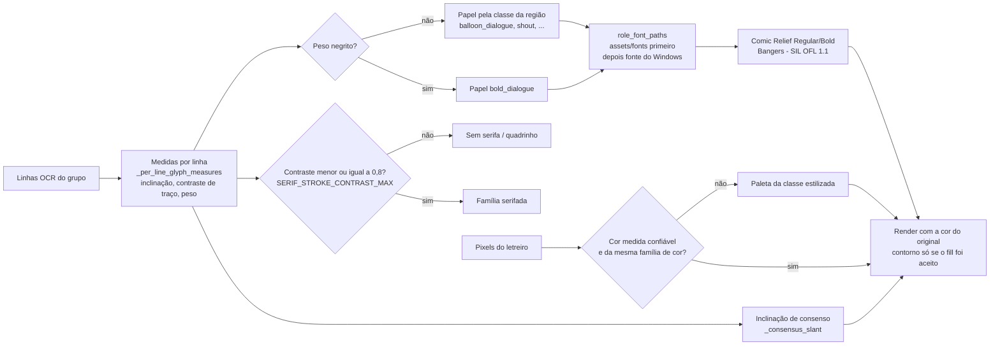

- `extract_glyph_style_profile` mede inclinação (`_consensus_slant`), contraste de traço
  (`SERIF_STROKE_CONTRAST_MAX = 0.8`) e peso **por linha** (`_per_line_glyph_measures`); antes o
  bloco inteiro era medido e texto reto saía itálico/serifado.
- Cor: a cor medida do original vence a paleta das classes estilizadas quando confiável e
  coerente com a família de cor; o contorno medido só acompanha um preenchimento aceito. Um
  "contorno" exige preenchimento com espessura interna (franja antialias não é fill).
- Hierarquia de tamanho entre linhas usa a altura da tinta (`_line_ink_height`), não a caixa OCR,
  com limiar 1,25.
- Fontes empacotadas em `assets/fonts/` (`font_fidelity.BUNDLED_FONTS_DIR`, incluídas na spec do
  PyInstaller): Comic Relief Regular/Bold (fala) e Bangers (grito/SFX), SIL OFL 1.1; têm
  prioridade sobre a fonte do Windows de mesmo papel.

Décima passada (mesmo capítulo, 2026-10-25, **IMPLEMENTADO**):

- O voto por variantes roda em toda divergência material (não só quando a releitura pontua
  melhor) e fica gravado nas linhas (`_adopt_variant_vote`); `apply_variant_votes` o reaplica
  quando a página é reagrupada depois de uma releitura aceita. O portão de qualidade aceita
  uma fonte votada confiável.
- Releitura ou voto com bem mais letras que a região (> 1,3× + 4) é descartado: o recorte
  pegou a linha do balão vizinho.
- Veto de tamanho do SFX em 2,5× e para grupos só de palavras curtas ("THUMP THUMP").
- Som conhecido que o pt-BR escreve igual (HUM, AH, HAHA…; `assets/lexicon/sfx_en_pt.json`) é
  aceito quando o provider o devolve igual (`_same_sound_in_target`).
- `_state_replaced_action` ignora `-ing` predicativo depois de sujeito impessoal
  ("IT'S AMAZING" → "É INCRÍVEL").
- Texto decorativo: palavras coladas são segmentadas antes da contagem semântica, e linhas
  inteiramente sobre branco (`visual_white_region_coverage` ≥ 0,95) não sofrem o veto de
  "decorativo sobre arte".
- `art_fidelity_uncertain` não se aplica a recipientes lisos (balão branco, caixa de narração,
  balão escuro).
- Snapshot de pasta local em `runtime_root()/local_sources` (antes `<repo>/.cache/runtime`).
- Medido nas 33 páginas problemáticas com DeepL: traduzidos 92 → 102, sem tradução 28 → 11,
  marcados para revisão 50 → 32.

Décima primeira passada (reconstrução e regiões restantes, 2026-10-25, **IMPLEMENTADO**):

- Terceiro candidato de preenchimento `surface` (`_surface_fill`, `CLEAN_SURFACE_FILL`, padrão
  `True`): um ajuste quadrático robusto do anel prova que o fundo é um degradê suave (resíduo
  ≤ 9, ≥ 93 % do anel no ajuste, nenhuma estrutura atravessando o anel até a máscara) e o
  preenchimento é difundido da borda (`cv2.INPAINT_NS`) com grão do nível do entorno; em fundo
  uniforme só é oferecido quando a máscara absorveu resíduo de contorno. Os candidatos
  (`classic`, `learned`, `surface`) são ordenados pela consistência com o anel e o portão de
  reconstrução tenta cada um (`group.fill_alternatives`) antes de recusar.
- Máscara de preenchimento compartilhada `_grown_fill_mask`: +2 px e a borda externa suave do
  contorno (`_outline_residue_mask`) dentro da caixa do grupo — remove o fantasma do contorno.
- `dark_blotch`: tom escuro preenchido que casa com um fundo liso logo fora da máscara, sem arte
  clara continuando para fora dela, é o fundo restaurado, não mancha.
- Reenvio por inglês residual: até 2 vezes (`RESIDUAL_SOURCE_MAX_RETRIES`).
- `source_ocr_suspicious`: palavra do dicionário não é lixo de OCR (IRONCLAD); um token que
  ≥ 2 releituras por variante leem igual é um nome real (HG FASHION).
- Créditos: rol de equipe colado em caixa mista ("ArtPlanA AdaptationPyoPyo") e "To be
  continued" são `credit_preserve`; nomes próprios nunca são traduzidos.
- Rótulo de som/ação sozinho que não pode ser desenhado (GRIN) mantém o letreiro
  (`sfx_original_lettering_kept`); "VISIT OR" e afins: texto curto cujas palavras vizinhas
  formam uma palavra do dicionário é decidido pelo voto por variantes
  (`resolve_split_word_ambiguity`).
- Som/nome preservado por eco (`source_echo_preserved_original`) não carrega marca de revisão
  de etapa anterior; token suspeito que são palavras coladas ("LEATHERTHIS") é separado pelo
  dicionário na fonte da nova tentativa.
- Medido nas 33 páginas com DeepL (antes destas duas últimas mudanças): traduzidos 102 → 104,
  não selecionados 1 → 0, revisão 10 → 6.
- Desempenho: o pré-voo de layout (`_resolve_layout_overflow_before_settlement`) roda as
  páginas em paralelo (`preflight-page`, um `ProvenanceRecorder` por página mesclado em ordem;
  chamadas ao provider serializadas por uma trava). `PIPELINE_PAGE_WORKERS` passou a `auto`
  (1–4 por núcleos e memória livre) e `_share_native_threads` divide os fios do OpenCV e do
  PyTorch (LaMa) entre os workers. 33 páginas com DeepL: 1237 s → 900 s com 4 workers, mesma
  qualidade.
- Desempenho (passo 2): os portões de reconstrução (`_lettering_contour_ghost_metrics`,
  `_white_patch_artifact_metrics`), a pontuação `_fill_consistency_parts` e o ajuste de tom do
  LaMa rodam num recorte em volta da máscara (`_mask_roi`, margem maior que o alcance de cada
  filtro), com resultado idêntico ao da página inteira (5–10× mais rápidos). O LaMa deixou de
  ser serializado: `_LAMA_INFERENCE_LOCK` admite uma inferência por worker (4), e o cache de
  preenchimentos aprendidos passou de 16 para 64 entradas, com trava. 33 páginas com DeepL:
  730 s → 629 s, mesmos contadores de qualidade (107 traduzidos).
- Tradução (passo 12): palavras que o OCR grudou ("WEPLANTO", "SOLIFELIKE", "WHENISAFRONT")
  são separadas antes da primeira tradução (`split_glued_source_words`, gravado em
  `canonical_source_text`, que o primeiro envio e todos os reenvios usam). A divisão
  (`region_taxonomy.segment_words`) é a mais provável pelas frequências do inglês
  (`assets/lexicon/english_freq.tsv.gz`, custo 8 − Zipf por palavra); cada pedaço precisa
  ser comum (Zipf ≥ 2,5; ≥ 3,5 com 3 letras; 1–2 letras só de uma lista de palavras curtas
  reais), no máximo um pedaço de uma letra, nada de letra triplicada ("AAAAAH"), e uma
  divisão terminada em palavrinha que é uma letra lida errado ("SUMMON OR") é recusada.
  Nomes detectados, palavras reais e tokens que não se dividem bem ficam como estão.
  Um nome logo após um tratamento abreviado (MR, MRS, MS, DR, PROF) é nome próprio mesmo
  sendo palavra inglesa ("MS. GO"; `honorific_addressed_names`, só no próprio grupo); o
  DeepL o recebe em `<x>` com `tag_handling=xml` e `ignore_tags=["x"]`
  (`yomu/translation/honorific_names.py`), e só os lotes com um nome assim mudam de formato.
  ep33, 33 páginas: 106 → 108 traduzidos, mesmas falhas visuais.
- Tradução (passo 13): `split_glued_source_words` passou a reparar também um nome do capítulo
  grudado no fim de um token ("GWANG-ILJEON" → GWANG-IL JEON, `chapter_names`) e uma letra lida
  errado (`_misread_correction`: "HIPES" → HIDES quando o capítulo escreve HIDES em outro balão,
  "PLRCHASED" → PURCHASED, "COLLDN'T" → COULDN'T; sem prova, só uma palavra comum dominante,
  Zipf ≥ 3 e um ponto acima da rival). Uma tradução válida com palavra que o português não
  tem ("ESTOVA", "CURTIRE"; `yomu/translation/portuguese_words.py`, tabela
  `assets/lexicon/portuguese_freq.tsv.gz`) ganha uma tentativa `translate_strict`
  (`_retry_unknown_target_words`), adotada só se for válida e tiver menos palavras desconhecidas;
  senão a região fica exatamente como estava. O piso da fonte por balão acompanha o letreiro
  da página (`min_font = max(8, min(MIN_FONT_SIZE, 0,42 × altura da linha OCR))`): mangá a
  ~960 px de largura letreira a ~15 px e o português não cabia nos balões estreitos a 12 px
  (Seitokai cap. 188: 38 → 50 traduzidos, 58 → 41 em revisão, 285 s → 196 s). Balões com
  frases em colunas lado a lado são lidos coluna por coluna (`_text_columns`), e texto feito só
  de sons do glossário fora de balão fechado vira efeito sonoro (`_promote_glossary_sounds`).
- Tradução e renderização (passo 14): **por que nenhum capítulo passava.** O portão de qualidade
  marcava `translation_policy_violation` sempre que `translate_sfx_disabled` era falso, isto é,
  com a tradução de efeitos sonoros ligada (o padrão): todo capítulo reprovava. A política agora
  é `TRANSLATE_SFX` (`sfx_policy_ok` em `benchmark_pipeline.py`; `ui_helpers.classify_quality_validation`
  só reprova com `sfx_policy_valid` falso). Último recurso de renderização
  (`_render_translation_label`, `TRANSLATION_LABEL_FALLBACK`, padrão ligado): quando todas as
  estratégias de limpeza recusam reconstruir a arte, a tradução válida (ou recusada só por não
  caber, `text_does_not_fit_region`) entra sem tocar na arte: efeito sonoro mantém o letreiro e
  ganha legenda em Bangers ao lado, numa posição livre de outros textos (`sfx_subtitle`); fala e
  narração vão numa caixa opaca arredondada sobre o texto original, clara ou escura conforme o
  entorno, crescida até caber (`caption_box`). Outros reparos: palavra quebrada por hífen na
  linha é juntada em `clean_ocr_text` quando vira palavra real e as duas metades têm a mesma
  caixa ("EMBAR- RASSING", não "UME- KUN"); apóstrofo que não é contração é lido como espaço
  ("OUTON'AWALKWITHNO" → OUT ON A WALK WITH NO); a nota de qualidade do OCR é calculada sobre o
  texto já reparado; linha curta não detectada logo acima/abaixo de uma linha lida
  (`_recover_adjacent_unread_rows`, `OCR_RECOVER_ADJACENT_ROWS`: "SO" sobre "COLD...") é lida
  só pelo reconhecedor e aceita apenas se todas as palavras forem inglês comum; os nomes do
  capítulo vão ao DeepL em `<x>` (exceto os que também são palavras comuns); um "contorno" cujo
  tom fica entre a tinta e o fundo é borda suavizada e não é desenhado. Seitokai cap. 188:
  38 → 68 traduzidos, 33 → 0 falhas visuais, falha estrutural → só revisão. GPU (item 6):
  otimizar o grafo do LaMa na CPU reduz 9.739 → 5.184 nós mas a inicialização DirectML só cai
  de 10,4 s para 9,4 s (o custo é a compilação das convoluções); não adotado.
- Revisão visual (passo 15): **texto fora do balão e inglês restante.** Agrupamento: duas
  linhas sobre fundo claro separadas por um traço escuro longo (borda de balão,
  `_balloon_border_mask`/`_border_separates`) não se juntam, e um grupo cujas linhas formam
  colunas (`_text_columns`) é dividido em um grupo por coluna (balão duplo com interior branco
  comum). Classificação: roda sobre o texto já reparado ("...AREONEUGLY" deixou de virar SFX);
  som do glossário dentro de balão continua fala; placa colorida com frase não é decorativa;
  contração sujeito+verbo ("I'M", "THAT'S"; `'S` só após pronome) conta como marca de oração em
  `weak_label_semantic_promotion_allowed`, e uma oração pontuada sobre fundo saturado é legenda
  da história (`_decorative_short_display_story_promotion_allowed`). Nomes: palavra em posição
  de vocativo (", SUNLESS!", "SUNLESS, ...") que é palavra do dicionário com Zipf < 3 é nome e
  vai ao DeepL em `<x>` (`honorific_names._vocative_name_spans`; "GUYS", "SIR" são comuns demais;
  token desconhecido, "ARSKAN" ou dano de OCR como "IPROMISE", não é reivindicado). Renderização: o último recurso também
  cobre `translation_box_outside_safe_area`; a caixa de legenda alarga até a palavra mais longa
  em vez de quebrá-la ("NECE/SSID/ADE") e prefere altura ≤ 2,2× a original; SFX também pode usar
  o resgate por reconstrução aprendida (`rendered_on_learned_clean_rescue`, revisão). UI:
  `control_plane_client.heartbeat` só chama `device-heartbeat` com dispositivo verificado e para
  em 401/403 (a aba do navegador repetia 403 a cada 2 min); o trace de Fontes não gera mais
  rejeição não tratada.
- Desempenho (passo 3, GPU): com `GPU_INFERENCE=auto` e `onnxruntime-directml`, o RapidOCR roda
  com `det/cls/rec_use_dml` e o LaMa por uma sessão ONNX DirectML (`yomu/clean/inpainting/lama_onnx.py`).
  O exportador não tem forma ONNX das FFTs reais 2-D das Fourier units, então `rfftn`/`irfftn`
  viram produtos por matrizes de DFT montadas no grafo para o tamanho real (mesma conta;
  diferença máxima de 0,002/255 contra o TorchScript). A exportação é derivada do `.pt`
  verificado e cacheada com sidecar de SHA-256; falha de exportação ou de sessão volta ao
  PyTorch na CPU. Todas as sessões DirectML rodam sob uma trava única (`yomu.core.gpu.DIRECTML_LOCK`):
  RapidOCR e LaMa ao mesmo tempo derrubam o processo com access violation. A trava cobre só o
  `session.run` (o pré e pós-processamento do RapidOCR seguem em paralelo), e com DirectML a
  trava de página `_RAPIDOCR_INFERENCE_LOCK` é dispensada (`_rapidocr_section`). Medidos e
  descartados: LaMa em fp16 (muito mais lento com as conversões), níveis de otimização do grafo
  (inicialização de ~10–17 s igual) e OCR numa cópia em CPU quando a GPU está ocupada (empate).
- Medição do capítulo completo (ep33, 158 imagens de origem, DeepL, RX 6600, máquina livre,
  `d91791e`): 287 s do início ao fim, contra 1784 s da execução original do mesmo capítulo;
  287 grupos, 198 traduzidos (antes 165), 36 em revisão (antes 63). As 16 falhas visuais são
  15 onomatopeias sobre arte (antes preservadas sem tentativa de limpeza, hoje traduzidas; o
  portão de reconstrução mantém o letreiro original quando a limpeza não é segura) e o
  "VISITOR" sobre arte. Medido (RX 6600):
  OCR 3,5× e LaMa ~19× por inferência; 33 páginas com DeepL 629 s → 223 s, mesmos contadores e
  as 33 páginas limpas idênticas às da CPU.
- Limpeza: máscara larga sobre arte não é vetada quando o preenchimento escolhido foi o
  aprendido ou o de superfície e passou nos portões de reconstrução (`_broad_mask_reconstructed`)
  — o LaMa refaz batentes e molduras que o carimbo quebrava. Altura de linha para hierarquia
  medida pela faixa densa de tinta (`_line_ink_height`).
- Modos verificados com DeepL em 4 páginas: Tradução pronta (PDF), Apenas Clean
  (`images/clean/NNN.png`), Apenas tradução (`translation/translation.json`), Tradução + Clean,
  Completo (PDF + PSD).

Escolha entre os três candidatos de preenchimento (`_apply_cleanup_mask`, `_remove_text_for_group`
e `_enforce_visual_bounds` em `yomu/ocr/ocr_balloon.py`). O `learned` só existe com
`CLEAN_LEARNED_TEXTURE_FILL` e modelo local disponível; o `surface` só com `CLEAN_SURFACE_FILL`
(padrão `True`), fora da estratégia `lama_large`, e quando o anel prova um fundo suave. A pontuação
soma os termos de `_fill_consistency_parts` exceto o degrau de borda (`step`), que só é reportado.

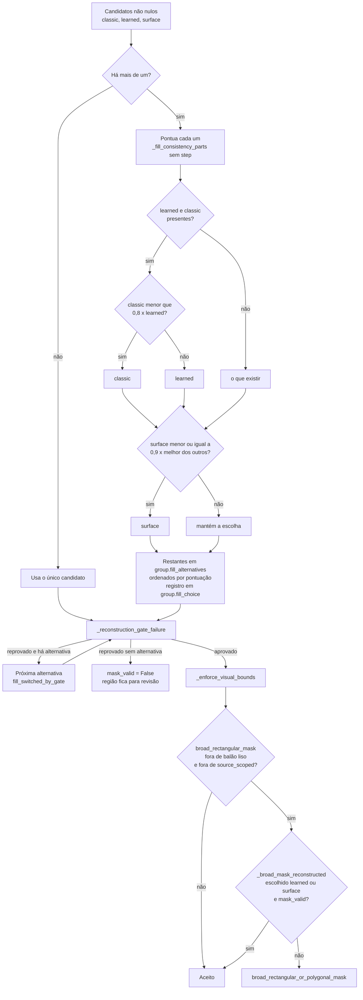

## 17. Qualidade, validação física e proveniência

O sistema separa **sucesso técnico** de **aprovação de qualidade**. Um PDF pode existir e a
execução terminar como `review_required`.

Gates independentes: download, OCR, tradução, reconstrução e PDF.

### Validação de resíduo físico

`source_glyph_envelope.py` produz envelopes visuais determinísticos e fail-closed para
glifos rasterizados de origem. O modelo é **agnóstico de página**: uma semente de texto
confirmada autoriza uma busca local, mas nunca autoriza um pixel por si só. Evidência de
camada, conectividade, geometria de traço observada e evidência de arte protegida decidem;
discordâncias permanecem incertas.

`residual_analysis_artifacts.py` armazena os pixels residuais exatos e cada entrada do
detector que afeta identidade, de forma endereçada por conteúdo. Não conhece capítulos,
números de página, frases, coordenadas, usuários nem ordinais históricos de componente.

### Completude de origem

`source_completeness.py` implementa o contrato: **conteúdo de origem atribuído a um grupo
não pode desaparecer silenciosamente.** Ele deriva, para um grupo, a evidência lexical que
a própria proveniência diz que o grupo possui, e verifica se a representação downstream
(texto do grupo, entrada de render, geometria de render) ainda dá conta dela.

### Validação visual

`VISUAL_DIFF_VALIDATION` mede alteração fora da máscara
(`MAX_OUTSIDE_CHANGE_RATIO`, `MAX_OUTSIDE_COMPONENT_AREA`), dano de borda de balão
(`REJECT_BALLOON_BORDER_DAMAGE`), overflow de texto (`REJECT_TEXT_OVERFLOW`,
`MAX_TEXT_OVERFLOW_RATIO`), manchas escuras novas em arte texturizada e patch branco fora
do balão.

Desde o TDD #59, texto claro aberto sobre arte/fumaça não herda automaticamente a limpeza de
“balão branco” só por uma pista fraca de container. Quando o contexto ao redor não prova uma
superfície branca uniforme, a região é tratada como overlay/arte texturizada e deve usar
remoção baseada em glyph/inpainting ou falhar para revisão. A limpeza source-scoped deixou
de ser presa ao rótulo visual legado `speech`: a autorização agora vem do contrato de
story text da taxonomia semântica. Isso permite limpar narração, texto de sistema e
`unknown` semântico quando há tradução válida, completude de origem e proveniência de linha,
mas continua excluindo SFX, logos, decorative preservado, entidades preservadas e OCR
ininteligível. A validação física também anexa resíduos OCR não atribuídos que estejam
geometricamente grudados a uma região story já traduzida; mesmo quando o OCR lê o resíduo
como dígitos/pontuação, isso vira `review_required` em vez de desaparecer do relatório
físico.

### Auditoria linguística e taxonomia semântica

`region_taxonomy.py`, `linguistic_audit.py`, `linguistic_triage.py` e `semantic_fidelity.py`
implementam a taxonomia semântica de regiões e a auditoria linguística offline. Nenhuma
delas modifica PDFs, páginas finais, revisões ou publicações, e nenhuma chama provider de
tradução. `audit_registry.py` resolve artefatos por **identidade** (diretório de saída +
`revision_id`), nunca por glob, mtime, título ou heurística de "mais recente"; o hash do
relatório carregado é verificado contra o registro, então arquivo velho ou trocado falha
fechado. Detalhes em [`SEMANTIC_CLASSIFICATION_AUDIT.md`](../architecture/SEMANTIC_CLASSIFICATION_AUDIT.md).

O denominador de qualidade segue a taxonomia semântica, não apenas o rótulo visual legado.
`speech`, `narration`, `unknown` e `decorative` podem ser story text quando o conteúdo é
fala, narração ou texto de sistema da história; scan credits, promos, URLs, logos e SFX
continuam excluídos por política explícita. Assim, uma frase story em fonte estilizada não
escapa por ter sido classificada como decorativa, e uma página de crédito/promo não passa a
ser traduzida só por conter inglês.

Em regiões rotuladas `speech`, `dialogue`, `thought` ou `narration`, palavras comuns de
diálogo (`thanks`, `team`, `staff`, `edit`, `clean`, `sub`) não bastam para classificar como
crédito: é preciso termo exclusivo de produção (scan, translat*, typeset, redraw, cleaner,
proofread, uploader, producer, credits), atribuição (`<termo> by` / `<termo>:`) ou os sinais
de promo/lista já existentes (`region_taxonomy.looks_like_strong_credit`). A mesma regra
decide se um resíduo físico é `RESIDUAL_CREDIT_LOGO`; um "THANK YOU" esquecido na página
conta como resíduo de história.

Nomes próprios declarados pela própria fala — por exemplo padrões equivalentes a “people
call me …” ou “that’s a strange name” — viram autoridade de preservação de entidade. O
validator rejeita literalização do nome declarado, fragmentos OCR soltos injetados na frase
traduzida e construções PT-BR estruturalmente inválidas como `VOCÊ + infinitivo` em contexto
que exige modo verbal natural.

O TDD #62 adiciona reparos locais estreitos antes da validação final: restaura nomes
declarados que foram literalizados pelo provider, remove fragmentos OCR de uma letra presos
à pontuação quando o source não os contém e corrige o caso gramatical limitado
`você fazer` → `você fizer` em frases equivalentes a “what you do”. Esses reparos não
traduzem regiões novas, não chamam provider e não rebaixam os validadores; se a correção
estreita não tornar o candidate válido, o grupo continua fail-closed/manual review.

O TDD #64 estende essa camada offline sem chamar provider: nomes declarados com casing de
OCR corrompido (`SuNLEsS`) são normalizados apenas quando a sintaxe da fala já provou que
o span é nome próprio; frases longas de story text com OCR suspeito e pontuação podem ser
roteadas ao tradutor em vez de ficarem retidas cruas, mas carregam evidência
`ocr_source_suspicious` e continuam sujeitas ao validator, fidelidade e render gate. Tokens
curtos uninteligíveis continuam fora da tradução.

O TDD #82 separa em `semantic_fidelity.py` três perguntas que antes eram uma só. **Confiança
na fonte**: um token que a língua de origem não escreve (sem vogal ou com três consoantes
seguidas — a mesma forma que o score de OCR já testa) e que sobrevive literalmente para o
português é defeito de OCR, não do provedor; ele vira `source_ocr_suspicious`, complemento
— não duplicata — da evidência `ocr_source_suspicious` que o roteador de OCR já grava.
Tokens colados (`TAKEAFEWHOURS`) deliberadamente não são sinal: 126 de 542 regiões reais
persistidas carregam um e o provedor recupera quase todos. **Fidelidade de significado**:
além de negação, quantidade numérica, entidades e papéis, o gate passa a cobrir quantidade
por extenso (`three days` → `dois dias`) e relação temporal — só a forma subordinante conta
no alvo, porque `depois` sozinho é o advérbio "later". **Naturalidade**: duas formas
inequívocas apenas (infinitivo cru depois de pronome, palavra funcional duplicada).

Severidade nova `review`: nem erro provado nem confiável. O candidato **renderiza**, porque
segurá-lo devolveria inglês à página, mas nunca é contado como limpo — o motivo exato fica
em `semantic_review_reason` no grupo e em `semantic_review*` no `fidelity_stats`.
Modalidade (`might`/`could`) fica fora do validador local: as regras testadas produziram só
falsos positivos e o caso pertence ao adjudicador.

**Sentido lexical contextual (TDD #84F15).** Última regra da camada local, e a única que lê
algo fora da região: `word_sense_conflicts()`. A origem pode estar perfeita, o português bem
formado e todos os invariantes acima satisfeitos, e a palavra ainda significar outra coisa —
`PRECINCT 7` → `7º DISTRITO ELEITORAL` numa página que também diz `EMERGENCY CONTAINMENT
VAULT`. A evidência tem três partes e todas são obrigatórias: (1) a origem escreve um termo
que `AMBIGUOUS_WORD_SENSES` conhece como ambíguo; (2) o candidato **se compromete** com um
sentido, carregando um marcador em PT-BR exclusivo dele; (3) o contexto limitado — a região
mais as demais regiões da mesma página, nunca o capítulo — não sustenta esse sentido. Um
candidato neutro (`DISTRITO 7`) não é marcado, e um termo fora da tabela nunca é olhado: o
código não cita termo nenhum, a tabela é o dado. O achado é `word_sense_context_mismatch`,
`review` de severidade e `review_unusable` de usabilidade, porque o leitor não tem como
recuperar o sentido certo nem perceber que está errado. Sobre todas as regiões persistidas
do run real de #84F9 a regra marca exatamente uma (`p046:BALAO_1`) — medido, não afirmado.

**Recuperação de review inutilizável (TDD #84F17, `SEMANTIC-RECOVERY-001`).** Detectar não
basta. `_fidelity_reason_for()` passa a **devolver** o motivo quando
`semantic_fidelity.is_review_unusable()` é verdadeiro, o que faz a região gastar o retry
seletivo que ela já tinha — `review_renderable` continua não gastando nada.

Antes do retry, `_canonical_retry_source()` tenta reparar a origem, e só para a classe em que
a origem é o defeito. `unique_source_repair()` corrige um token quando o vocabulário da cena —
`source_repair_vocabulary()`, o léxico de diálogo do pipeline (SFX excluídos por construção)
mais os tokens **plausíveis** do contexto limitado — contém **exatamente uma** palavra a uma
edição de distância. Zero candidatas ou duas significam nenhum reparo: um palpite que reescreve
um nome próprio, um termo de fantasia ou uma onomatopeia é defeito pior do que o que tenta
corrigir. `group.text` nunca é sobrescrito; a forma canônica e sua evidência (`raw_source`,
`canonical_source`, `repair_reason`, `repair_confidence`, `repair_evidence`) vivem em
`canonical_source_text` / `source_repairs`, e só o retry as vê — o detector continua lendo o
OCR bruto, então o reparo não pode silenciá-lo.

O retry leva ainda `source_context`: as linhas de origem vizinhas da cena, limitadas por
`semantic_fidelity.scene_context()` (6 linhas / 600 caracteres). No DeepL entram no campo
`context` documentado — lido para desambiguar, nunca traduzido; no NVIDIA, como
`contexto_da_cena` no payload. Evidência descritiva, nunca instrução nomeando a resposta.

Se o segundo candidato não passar a validação inteira, a região volta ao veredito da detecção:
o primeiro candidato renderiza, `semantic_review_reason` é restaurado, e o motivo de review
**não** é gravado em `translation_validation_reason` — esse é o canal de rejeição, e a
contabilidade contaria a região como `semantic_rejected`, que é um veredito diferente e falso.
Máximo real por região: 2 chamadas de tradução (1 inicial + 1 retry), teto de capítulo
`ceil(N/8)` inalterado.

**`SEMANTIC-RUNTIME-001` (TDD #84F1, fechado).** O E2E real de #84 provou que essa
severidade parava no validador: três regiões (`SLLM` p43, `COLLD` p42, `VALLT` p46) saíram
`translated / valid / quality_impact none`, contadas entre as traduzidas limpas, com o
`semantic_review_reason` gravado e inerte. O validador estava certo; a fiação depois dele,
não. A correção é de fiação, em pontos por onde todo desfecho passa:

- `ocr_balloon._set_translation_terminal_state()` — único escritor de
  `translation_quality_impact` — passa a derivar o impacto do veredito semântico junto com
  o estado terminal: `semantic_review_reason` não vazio ⇒ `review_required` e
  `manual_review_required = True`, em qualquer estado terminal. Por construção nenhum grupo
  termina com motivo semântico e impacto `none`.
- A política de render é explícita: **`REVIEW` + `RENDER_WITH_REVIEW`**. O português é
  desenhado (segurá-lo devolveria inglês à página), mas a região é item de revisão
  estruturada, nunca render limpo. `REJECT` (`BLOCKED`) continua fora do render, como em
  #82 — o controle P068 segue rejeitado.
- `benchmark_pipeline._translation_quality_accounting()` ganha os baldes canônicos
  `semantic_checked` / `semantic_clean` / `semantic_review` / `semantic_rejected`,
  exclusivos entre si e derivados do mesmo veredito, e inclui review e reject em
  `requires_review`, de modo que o capítulo termina `review_required`.
- `benchmark_pipeline._render_plan_accounting()` roteia a região com motivo semântico para
  `structured_review_ids` (e para o subconjunto diagnóstico `semantic_review_ids`) em vez
  de `rendered_clean_ids`, mantendo `unaccounted = 0` e `skipped_without_reason = 0`.
- Correção correlata: o retry de terminologia e a naturalização consultam o gate com um
  candidato especulativo; o veredito desse candidato descartado não sobrevive mais à região
  que manteve a tradução anterior.

Contratos permanentes em `tests/test_semantic_runtime_acceptance.py`: replay dos três sentinelas
persistidos de #84, exaustão de retry (nunca reaceita o candidato original), candidato bom
na segunda tentativa e controle de região limpa (capítulo sem achado semântico continua
podendo passar).

O TDD #66 acrescenta contabilidade explícita de plano de render no `quality_report.json`.
`render_plan_accounting` separa story text esperado, candidatos válidos, itens escolhidos
para render, itens pulados com razão estruturada, regiões renderizadas limpas, regiões
renderizadas com resíduo físico, revisão estruturada, preservação de nomes próprios e
qualquer story text sem desfecho. O contrato de qualidade é fail-closed: story text com
candidato válido não pode simplesmente sumir do plano de render; se não for renderizado,
precisa de razão estruturada ou aparece em `unaccounted`/`skipped_without_reason`.

**`ART-RECON-001` (TDD #84F2, fechado localmente / pendente E2E real).** O pipeline passa a
tratar lettering de origem como uma evidência física própria, distinta de tradução e de
costura visual. `ocr_balloon.source_lettering_footprint()` constrói uma máscara local e
limitada à evidência OCR da região, cobrindo corpo do glyph, outline/stroke,
halo/antialias e sombra pertencente ao lettering sem usar dilatação gigante nem exceção por
página/região. `ocr_balloon.residual_source_lettering_metrics()` mede residual antes do
português ser desenhado; se houver residual físico, `art_reconstruction_verdict()` não pode
retornar `clean`. A decisão final fica explícita em `render_disposition()`: tradução
limpa/review, source removido/não removido e arte clean/review/fail produzem
`render_clean`, `render_with_review` ou `do_not_render`. O guard
`large_white_patch_on_nonwhite_background` e o detector de seam continuam independentes e
não foram desabilitados. A validação real P5/P6 ainda depende de novo E2E.

**Por que o guard de patch branco disparava (raiz, não sintoma).** O lettering das regiões
P5/P6 é glifo escuro com contorno branco grosso. A máscara cobria o corpo e só parte do
contorno; o contorno branco sobrevivente ficava na borda da máscara e servia de **fonte**
para o `cv2.inpaint` Telea, que repintava o interior das letras com a cor do contorno. O
guard `large_white_patch_on_nonwhite_background` estava certo — o que ele via era uma
silhueta branca das letras. O mesmo footprint incompleto produzia o ghost da página 6:
`source_owned_geometry_coverage` era medido contra o corpo do glifo (0.993), o contorno não
entrava no denominador e o OCR pós-render não lê contorno sem corpo, então a região saía
`clean` com o lettering original visível. Corrigir o footprint fecha os dois de uma vez;
nenhum guard foi relaxado e não existe exceção por página ou por região.

**Fidelidade vs. segurança.** `_remove_text_for_group()` marca `art_fidelity_uncertain`
quando `flat_patch_texture_ratio < config.MIN_ART_FIDELITY_TEXTURE_RATIO` (0.55) — a mesma
razão de textura já calculada pelo detector de patch chapado, sem medição nova. É um
*finding*, nunca um veredito de segurança: não invalida a máscara e não retém o render. O
finding viaja junto da tentativa que efetivamente foi renderizada (`visual_summary`), e
`art_reconstruction_verdict()` só considera findings de tentativas que passaram — uma
tentativa recusada não condena a reconstrução que o leitor recebeu. Quando
`render_disposition()` devolve `render_with_review`, `_render_analyzed_image()` força
`translation_quality_impact = "review_required"` e `manual_review_required`, de modo que
render com revisão nunca é contabilizado como limpo.

**`P068-RECOVERY-001` (TDD #84F5, fechado offline / pendente E2E real).** No E2E real de
#84F3 a página 68 saiu com o inglês comum visível. A perícia sobre os artefatos persistidos
(`00cc718e-…/progress.json`, `quality_report.json`) mostrou **três** defeitos distintos, e o
primeiro deles nunca chegou ao validador semântico:

1. **Fallback de página destrutivo (raiz do #84F3).** `ocr_metadata` da página 68 registra
   `fallback_reason = "incomplete_group_after_selective_fallback"` e `final_engine =
   "paddle"`. O Paddle devolveu **zero** linhas (`detected_line_count = 0` nas duas
   tentativas) e o resultado foi aceito literalmente: `group_count` foi de 2 para 0,
   `inpainting` e `redraw` ficaram em `0.0` e a página original entrou no PDF intacta. O
   escalonamento existe para ler *uma* região mal lida melhor, nunca para apagar a página.
   `benchmark_pipeline._fallback_discards_source_text()` recusa a substituição quando o
   resultado do fallback traz menos de 60 % das letras que substituiria; nesse caso as
   linhas correntes ficam, nada é gravado no cache de OCR e `ocr_metadata` recebe
   `fallback_used = False` com `fallback_rejected_reason`. Regra genérica, sem exceção por
   página.
2. **Fronteira de termo colada pelo OCR.** O texto que o RapidOCR leu,
   `TAKEAFEWHOURS FORTHENEAREST AWAKENEDTO GET HERE.`, gruda o substantivo de classe do
   próprio capítulo na palavra funcional seguinte — a forma que vira "depois que acordar".
   `ocr_balloon.recover_protected_term_boundaries()` desfaz esse tipo de junção usando como
   âncora um termo que o **próprio capítulo** escreve isolado em pelo menos dois grupos (ou
   um termo que o ledger de terminologia já garante, via `extra_anchors`), e só quando o
   pedaço restante é um token que o pipeline já conhece (`ENGLISH_FUNCTION_TOKENS`,
   `OCR_LEXICAL_REFERENCE_WORDS`). Não há dicionário novo, não há dependência nova e não há
   regra por frase. Se existir **mais de uma** decomposição possível, ou se o resto não for
   confiável (`KNOWNTERMXYZ`), ou se o token for desconhecido (`FOOBARBAZ`), nada é
   reescrito: a região continua visível para os caminhos de suspeição/revisão semântica.
3. **Fonte crua vs. fonte canônica.** A reparação reescreve `group.text` — a representação
   canônica de onde a requisição de tradução é construída — enquanto `group.original_text`
   preserva a leitura crua para perícia. A proveniência sai em `text_repairs` com
   `repair_reason = "protected_term_boundary"`, `protected_term`, `joined_piece`,
   `anchor_group_count` e `confidence` derivada da contagem de evidência. A confiança do
   OCR da região **não** é promovida: uma fronteira reparada diz que aquele token passou a
   ser legível, nunca que o OCR da região era bom.
4. **DeepL não tinha retry nenhum.** `validate_and_retry_translations()` condiciona todo
   retry a `hasattr(translator, "translate_strict")`, e o `DeepLTranslator` — provider
   efetivo do #84F3 (`run_manifest.provider_effective = "deepl"`) — não expunha o método.
   Sob DeepL, portanto, uma rejeição semântica não tinha segunda tentativa: segurança sem
   recuperação. `DeepLTranslator.translate_strict()` passa a existir com o único par de
   alavancas que a DeepL oferece — a fonte canônica (já com a fronteira reparada) e o campo
   `context` documentado da API, alimentado por `set_session_context()` com a terminologia
   do capítulo, que o primeiro passe em lote nunca envia. A DeepL não aceita instrução, então
   o motivo de rejeição não é interpolado em prompt algum; um candidato idêntico ao já
   rejeitado é contado em `strict_retry_duplicate_candidates` e reoferecido a ninguém — o
   validador o rejeita de novo. O orçamento continua de **uma** chamada extra por região,
   tanto em `ocr_balloon` quanto em `provider_execution`.

O retry informado em si já existia e não foi enfraquecido: `translate_strict` recebe
`validation_reason`, e `semantic_fidelity.retry_constraint()` traduz o código de motivo em
uma restrição controlada (`preserve_protected_entity`, `preserve_temporal_relation`, …). Se
todos os candidatos continuarem semanticamente ruins, a região permanece em revisão/rejeição
e o candidato 1 nunca é restaurado.

**`SOURCE-ANALYSIS-OBSERVABILITY-001` e política OCR `quality` (TDD #84F6R, fechado offline /
pendente E2E real).** Depois de #84F5, a tentativa real seguinte parou antes da criação do job:
a análise da fonte falhou e nenhum run/PDF foi produzido. O contrato fechado offline garante que
falhas pré-job sejam visíveis e recuperáveis para o usuário, com log sanitizado (`stage =
source_analysis`, host seguro, classe `source_timeout`/`source_network_error`/parse/internal),
sem traceback ou secrets, e com liberação do lock do Start. A UI mantém o shell normal de "Nova
tradução" e não reintroduz a superfície azul de processamento nesse estado.

O mesmo bloco fixa a fronteira de adapters: VortexScans é selecionado pelo host literal
`vortexscans.org` e não chama `canonicalize_webtoons_url`; Webtoons continua dono do seu
canonicalizer e do lazy reader. Um timeout simulado de Webtoons não bloqueia uma fixture Vortex,
e domínio desconhecido continua no fluxo unsupported/fallback controlado.

Por fim, `quality`/`quality_optimized` é RapidOCR-primário. PaddleOCR é fallback opcional, não
requisito de ambiente para o Beta. Quando Paddle está ausente, o fallback é pulado e a leitura
RapidOCR permanece; quando RapidOCR está ausente como primário, a execução falha fechado. O guard
`_fallback_discards_source_text()` continua no caminho de produção e rejeita fallback vazio que
apagaria texto útil. Não houve job real, rede externa nem provider nesse fechamento.

Contratos permanentes em `tests/test_p068_semantic_recovery.py`: fallback destrutivo recusado,
recuperação genérica de fronteira nas duas direções, token desconhecido e decomposição
ambígua intocados, fonte canônica na requisição, retry estrito da DeepL com contexto e
dedup, e o replay bad-first/good-second pelo caminho de produção. O candidato bom da segunda
tentativa é **fixture de teste**, não um candidato DeepL persistido — a prova real depende
do próximo E2E.

Também desde o TDD #66, linhas OCR curtas e corrompidas que não têm palavra lexical — por
exemplo um filho lido como dígitos/pontuação — podem ser associadas apenas como
`cleanup_lines` de um grupo story pai quando a geometria prova que estão dentro do mesmo
container fechado e o grupo pai tem autoridade de tradução. Elas continuam fora do texto
enviado ao provider e não são anexadas a SFX/open art. A validação física reconhece
`cleanup_line_boxes` renderizadas como cobertura legítima desses filhos, fechando o caminho
local do resíduo de linha órfã sem criar regra por página ou frase.

Estado de qualidade: as correções offline até o #66 fecham contabilidade, razão estruturada
e ownership local de linha órfã observados nos artefatos #60/#63/#65, mas não reclassificam
PDFs históricos como limpos. A perícia #68 mostrou que o artifact #67 foi produzido
fisicamente por `c7795dd`, isto é, por runner/processo anterior ao caminho pós-#66.
Portanto o #67 é evidência de `OFFLINE-PRODUCTION-PARITY-001` (runtime stale), não prova
válida contra a qualidade pós-#66.

O #69 é a primeira prova real pós-guard com `CURRENT_HEAD == job.commit_hash ==
run_manifest.commit_hash`. Ele fecha runtime provenance e binding de artifact no caminho
de produção, mas não fecha qualidade: o PDF final continuou `review_required` com
`physical_gate_passed=false`, 13 regiões story retidas para revisão, 14 resíduos físicos
reportados e story text comum visivelmente restante em páginas sentinela como p002, p005,
p006, p025, p030, p044, p062 e p068.

No TDD #70, a trilha P68 foi reforçada offline sem novo job/provider: linhas OCR curtas e
corrompidas podem entrar em `cleanup_lines` também quando pertencem a uma narração aberta
(`narration_box`) com evidência visual de container, não apenas a balões fechados. A prova
física também passou a expor `source_owned_geometry_coverage` e a reprovar quando a máscara
não cobre um componente de glyph fonte em escala de linha, mesmo que o OCR pós-render leia
o resto como ruído (`77,!!`) ou não reconheça a palavra original. OCR continua sinal
secundário; a cobertura de geometria/máscara fonte é parte do contrato fail-closed.

O mesmo TDD #70 também fechou dois subcasos locais derivados do ledger #69: `JUST... →
SÓ...` não pode virar revisão só porque o OCR pós-render perdeu o acento e leu `SO.`, desde
que a provenance fonte não contenha `SO` e o observado corresponda exatamente à tradução
esperada; e uma frase story longa dentro de balão, com `main_text_score` alto, não fica
retida apenas por `improbable_apostrophe_pattern` quando o defeito é compactação de OCR
(`IFYOURECEIVEANASPECT`, `DON'TDESPAIR`). Promo/crédito/SFX/garbage curto continuam
fail-closed. Para p025-like, uma região clara comprovada por `strict_uniform_light` +
`dominant_white_enclosure`/`stylized_white_enclosure` também não é rejeitada como
`large_white_patch_on_nonwhite_background` só porque o tipo coarse ficou `textured_art`;
sem essa prova positiva, o guard de patch branco permanece ativo. A mesma prova positiva
também permite cobrir a geometria completa das linhas OCR owned em fundo claro comprovado,
evitando que uma máscara por componentes remova apenas o miolo das letras e deixe bordas
grossas de fonte original.

Ainda no caminho `source_scoped`, o limite `MAX_SOURCE_SCOPED_PAGE_AREA_RATIO` mede a área
da máscara efetivamente escrita (`source_scoped_mask_to_page_ratio`), não a área da
evidência/box fonte inteira. A evidência grande continua persistida para auditoria e para
o gate físico; o risco visual que decide se a tentativa pode prosseguir é a área real que
será alterada. Isso fecha o blocker p002-like em que a caixa fonte era grande, mas a máscara
owned era menor e ainda fail-closed pelo gate físico se deixar glyph fonte descoberto.
O mesmo caso p002-like também provou que fundos extremamente escuros e uniformes podem ter
saturação alta sem serem artefato de blotch: o guard agora aceita somente a combinação
estreita de brilho muito baixo, alta razão de pixels escuros e interior uniforme; arte
escura não-uniforme continua reprovada como `dark_blotch_created_on_textured_art`.

Para p044-like, o gate de fidelidade semântica não roteia mais passiva preservada como
`state_action_changed`: `being chosen` pode ser fielmente traduzido como `ser escolhido`.
O caso severo original — uma decisão/ação progressiva virando atributo estático — continua
roteado para adjudicação.

Para p030-like, o agrupamento separa uma linha curta visual/SFX usada como seed quando ela
fica destacada de um bloco story coeso. A linha destacada permanece preservada/revisável
como grupo ignorado explícito (`detached_story_outlier_line`); o bloco narrativo principal
mantém o `BALAO_N` estável, recupera sua caixa real e pode usar o caminho normal de
limpeza/redesenho. Isso impede que um efeito como `ATa` contamine a caixa de
`NATIONALMILITARIES WEREQLICKLY OVERWHELMED.` e gere falso `speed_lines`/white-patch.

Ainda nesse ledger, texto story aberto com forte autoridade visual e pontuação normal pode
prosseguir mesmo se o OCR produzir defeitos recuperáveis como `long_consonant_run` e
`short_improbable_caps_token` (`NOT TH ECHEAP SYNTHETIC STUFF...`), desde que
`main_text_score >= 0.58` e os validadores estruturais continuem satisfeitos. A exceção não
promove promo/crédito/SFX nem garbage sem autoridade story. No sentido oposto, palavra única
sobre falsa região clara, com caixa pequena, baixa confiança textual e textura/traço escuro
compatível com lettering de efeito, é preservada como SFX por
`single_word_effect_over_false_light_enclosure`; isso mantém `STAGGER` fora da tradução como
`TAK`, `TUR` e `TRNDGE`, sem afetar palavras comuns de diálogo nem nomes detectados.
Para P006-like, uma região `decorative` sobre `textured_art` não é automaticamente
preservada se o texto for uma frase comum forte, pontuada, de alta confiança e sem avisos
de OCR: a mesma exceção precisa vencer tanto a política de classificação quanto
`_should_translate_group()` e o gate `source_scoped`. O veto de textura continua ativo
para labels curtos, SFX, créditos/promos, nomes e OCR danificado.
O mesmo perfil de caption claro aberto também é reconhecido quando o fundo é claro,
pouco saturado, quase sem textura/arestas e não forma balão branco puro; nesse caso o
`source_scoped` pode restaurar o fundo claro sem cair no falso
`large_white_patch_on_nonwhite_background`. Para lettering com contorno claro sobre arte, a
máscara source-owned inclui o halo claro dentro da geometria OCR da linha quando necessário,
mas não aplica fallback retangular em fundo escuro uniforme comprovado, preservando o caso
p002-like de máscara pequena sobre evidência grande.

O fechamento forense #71 usa o artifact #69 somente como evidência read-only. A matriz de
produção/paridade roda a análise atual sobre a provenance persistida: P002, P015, P025,
P030, P044, P063 e P068 chegam a `translated` com cobertura física de fonte `1.0`, enquanto
P005, P006_2 e P062 só podem usar saída sintética para provar seleção/cleanup/render porque
o #69 não contém candidato real para essas regiões. Esse é o limite técnico entre defeito
local fechado e dependência de provider: synthetic downstream proof nunca é tratado como
qualidade de tradução real. A prova P68 continua geométrica: máscara parcial sobre
`LINE_004` fica bloqueada mesmo quando OCR degrada `IT'LL` para ruído; máscara completa no
child geometry permite residual zero.

O #72 substitui o #69 como evidência real canônica de qualidade do código corrente:
`CURRENT_HEAD == job.commit_hash == run_manifest.commit_hash` em
`0b40ca23f0d734a345b8a559bf5934f80c01123e`, DeepL `quality_optimized`, RapidOCR,
35 source items e 72 páginas. A execução continuou `review_required`, mas reduziu o ledger
para 104 regiões físicas esperadas, 99 traduzidas/renderizadas, 5 regiões retidas para
revisão e 6 resíduos físicos. P005, P006 e P062 passaram no caminho real; os blockers de
história comum restantes ficaram concentrados em `p063:BALAO_1` e `p068:LINE_004`.

O TDD #73 fecha esses dois roots sem provider/job real. Em P063, o candidato DeepL
persistido `AFINAL DE CONTA, O FEITIÇO PROVOCA PROVAS, NÃO EXECUÇÕES.` preserva a oposição
semântica `TRIALS` versus `EXECUTIONS`; a rejeição era um falso positivo do detector
`repeated_translation_fragment`, que tratava qualquer prefixo longo como duplicação
malformada. O detector agora exige sinal genérico de token danificado antes de bloquear,
mantendo casos como `PROVDE -> PROVINCIA` em review sem rejeitar pares portugueses válidos
como `PROVOCA`/`PROVAS`.

Em P068, a primeira perda de ownership acontecia antes da classificação/background final:
`LINE_004` e o bloco `BALAO_2` compartilhavam a mesma região visual branca aberta, mas o
attachment antigo dependia de sinais de `narration_box` que ainda não existiam naquele ponto.
A associação de cleanup agora aceita, de forma geométrica e sem mesclar texto ao provider,
linhas ignoradas que compartilham `visual_white_region_id` aberto com cobertura suficiente e
um parent com autoridade story. A máscara real passa a consumir a box filha
`[346, 1771, 134, 58]`; a prova continua estrutural, não baseada em OCR pós-render.

O relatório físico também expõe o subgate `ordinary_story_physical_residual_count` e
`ordinary_story_physical_residual_ids`. O contador global `physical_source_residual_count`
continua fail-closed e inclui SFX/OCR ambíguo, mas o subgate separa o que bloqueia qualidade
Beta de história comum do que permanece como revisão legítima não-story.

O TDD #84F10 corrige um falso positivo dessa conta: até então, uma região que enviou sob
`render_with_review` continuava listada em `ordinary_story_physical_residual_ids` apenas por
manter um estado terminal de revisão — mesmo com o PT-BR desenhado e o inglês fisicamente
ausente. O **estado final renderizado** passa a ser a autoridade: `render_disposition` em
`{render_clean, render_with_review}` com `redrawn` significa que a remoção da fonte foi
aprovada por construção (`render_disposition()` devolve `do_not_render` quando a fonte
sobrevive), e a região sai do ledger de resíduo para o contador próprio
`physical_regions_rendered_with_review`, sem deixar de ser revisão estruturada em todos os
outros eixos. Resíduo real continua contando: `do_not_render`, região não redesenhada e as
razões de arte `residual_source_text_after_cleanup` /
`residual_source_lettering_after_cleanup` — em que o inglês está mesmo visível — não são
filtradas.

O mesmo TDD acrescenta a reconciliação de páginas de origem
(`PAGE-ANALYSIS-FAILURE-GATE-001`) e o registro estruturado de erro de página
(`PAGE-ERROR-OBSERVABILITY-001`); ambos estão detalhados em
[Qualidade e validação](../QUALITY_AND_VALIDATION.md#quality-gate-final).

O #74, executado já em `da3bd1033609973fc55659f6e59fffbdfce7dd38`, provou que P063 estava
fechado no runtime real, mas deixou `p068:BALAO_2` como único residual ordinário:
`physical_source_residual_count=5` e `ordinary_story_physical_residual_count=1`. A perícia
#75 identificou o primeiro gate errado: `BALAO_2` tinha classe `narration`, contêiner
`narration_box`, `main_text_score=1.0` e parent text legível
`TAKEAFEWHOURS FORTHENEAREST AWAKENEDTO GET HERE.`, mas a geometria cleanup-only da linha
corrompida `LINE_004` adicionava `ignored_line_inside_text_region` ao score OCR. Como esse
motivo não era recuperável, o gate RapidOCR rejeitava a segunda leitura, deixava o parent fora
do provider e congelava `translation_not_selected`.

O contrato agora distingue completude textual de completude geométrica. Uma child line
corrompida pode continuar fora do texto enviado ao provider, mas sua geometria não pode
tornar inelegível um parent story forte. `ignored_line_inside_text_region` entra no caminho
de warning recuperável somente sob as travas já existentes de `ocr_suspicious_but_translatable`:
classe/autoridade story, pontuação, ausência de dígitos embutidos e pelo menos duas palavras
ordinárias reconhecíveis. SFX/open art e OCR ambíguo curto continuam fail-closed. Como #74
não persistiu candidato DeepL para P068, o #75 provava apenas routing/render/cleanup offline
com candidato sintético.

O TDD #76 executou exatamente um E2E real pós-#75 pela UI visível e validou o contrato de
produto: commit corrente, `jobs.commit_hash` e `run_manifest.commit_hash` bateram em
`594f7f0139f27d7d4e274c46d9a006af352bd31a`; o provider efetivo foi DeepL
`quality_optimized`, OCR RapidOCR, `force=true` e `use_cache=false`. P068 `BALAO_2` foi
roteado ao provider real, recebeu candidato PT-BR, foi validado, renderizado e limpou a
geometria child `LINE_004` sem enviar a child separadamente. O relatório final ficou
`story_expected=104`, `valid_candidate=100`, `render_selected=100`, `rendered_clean=100`,
`render_skipped=4`, `structured_review=4`, `unaccounted=0` e
`ordinary_story_physical_residual_count=0`. Os quatro resíduos físicos restantes
(`p011:BALAO_1`, `p011:BALAO_2`, `p013:BALAO_3`, `p015:BALAO_8`) são revisão preservada de
SFX/OCR ambíguo não-story, então o job pode continuar `review_required` sem reabrir o gate
Beta de história comum.

O TDD #84F19 endurece a auditoria semântica sem criar correção por literal. Quando a
fonte OCR ainda contém uma palavra corrida que pode ser segmentada apenas por palavras
funcionais inglesas comuns, a saída fica marcada como `source_segmentation_incomplete` e a
região permanece em `REVIEW_UNUSABLE`; um retry corretivo pode ser alcançado pelo orçamento
normal, mas não transforma uma fonte ambígua em candidato limpo. Em fontes segmentadas
normalmente, o mesmo caminho ainda permite trocar uma primeira tradução malformada por uma
segunda tradução fiel. O detector PT-BR também passa a bloquear formas gramaticais
malformadas como `passo a ser` em contexto de terceira pessoa, preservando casos ambíguos
ou raros sem evidência local suficiente.

O TDD #84F23 fecha `REVIEW-UNUSABLE-RENDER-001` no limite físico do render: a decisão
semântica de renderização agora precede limpeza, reconstrução e tipografia. Candidatos
`clean` e `review_renderable` continuam podendo desenhar a tradução, mas
`review_unusable` e `reject` param antes do inpaint e preservam os pixels originais da
região. Isso impede que o sistema de fidelidade visual do #84F22 transforme uma tradução
inutilizável em lettering bonito no PDF.

O mesmo TDD registra `P65-SOURCE-RECOVERY-001`: a recuperação de fonte para
`source_segmentation_incomplete` é local, limitada e baseada apenas no crop real lido por
RapidOCR. Pequenas variantes determinísticas do crop podem propor uma fonte canônica
somente quando há concordância independente, confiança suficiente e consistência de
fronteiras de palavras; a tradução alvo nunca é usada como evidência de fonte. Se as
leituras forem ambíguas, o comportamento correto é preservar a fonte original, manter
`REVIEW_UNUSABLE` e bloquear a saída final.

O TDD #84F25 fecha `P65-PRODUCTION-RECOVERY-PARITY-001`: o mesmo recovery local acima agora
é chamado no caminho canônico de validação/retry de produção antes do retry final de
tradução. A fonte OCR bruta continua preservada para auditoria, mas uma recuperação
confiável preenche `canonical_source_text`/`source_recovery`, alimenta o retry e também a
validação semântica downstream. A proveniência persistida separa fonte bruta, fonte
canônica, engine RapidOCR, variantes, concordância, confiança e `target_used_as_source =
false`.

O mesmo TDD registra `OCR-FALLBACK-POLICY-001`: no padrão Beta, RapidOCR é o engine
primário e a recuperação regional/local também é RapidOCR. Paddle deixa de ser fallback
automático do fluxo `quality_optimized`; só pode ser alcançado por opt-in legacy explícito
(`OCR_LEGACY_PADDLE_FALLBACK`). Se RapidOCR não produzir evidência suficiente, o caminho
correto é revisão/fail-closed, não spam de Paddle.

### Manifest autodescritivo

`output_manifest.py` define e valida o `run_manifest.json`. `load_verified_run_manifest()`
é o caminho verificado — o histórico da UI classifica registros por
`manifest_verified` > `e2e_evidence` > `legacy_unverified`.

Para execuções iniciadas pela UI, a identidade canônica da saída é
`output/<chapter_slug>/<run_id>`. O rebuild de comando após source selection preserva essa
forma, e o runner exporta o `run_id` do job para que o `run_manifest.json` não gere um
identificador paralelo. Assim `output_dir`, `command_json`, `job_manifest.json`,
`run_manifest.json`, `pdf_path` e histórico apontam para o mesmo artifact.

Contrato completo em [`docs/QUALITY_AND_VALIDATION.md`](../QUALITY_AND_VALIDATION.md).

## 18. PDF e histórico

`pdf.py` reúne as páginas finais válidas e escreve o PDF, que permanece o **artefato de
qualidade canônico** do run: PNG e PSD, quando solicitados, são derivados das mesmas páginas
finais já renderizadas, então o quality gate valida o PDF mesmo quando o formato de saída é
PNG ou PSD.

### Página lógica vs página física de PDF (tiras longas)

Uma **logical source page** é uma página de conteúdo — um PNG de saída, uma página do
capítulo. Uma **physical PDF page** é uma página dentro do arquivo PDF. Em tiras longas as
duas deixam de ser a mesma unidade.

Pillow grava PDF a 72 dpi (um pixel de origem é um ponto de PDF) e o formato limita cada
página a `MAX_LOGICAL_PAGE_HEIGHT = 14400` pontos. Uma página **mais alta que 14.400 px
continua sendo uma única logical page** — o PNG/origem não é cortado —, mas o PDF a
**representa em múltiplas physical pages**, fatiando apenas a representação PDF.

`pdf._physical_page_offsets(height)` é a **fonte canônica** dessa segmentação: retorna os
offsets de topo de cada physical page (`[0]` até 14.400 px; `range(0, height, 14400)` acima
disso). O loop de crop de `generate_pdf` e a contagem esperada leem a **mesma** função, logo
a regra vive em um único lugar — não há `ceil(altura / 14400)` duplicado em outro módulo, nem
contagem por altura hardcodada.

`pdf.pdf_page_manifest(image_paths)` expõe o contrato:

| Campo | Significado |
| --- | --- |
| `logical_source_pages` | uma por página de saída/PNG |
| `pdf_physical_page_count` | total de physical pages no PDF depois de segmentar as tiras altas |
| `pdf_pages_per_source` | quantas physical pages cada logical page vira, em ordem |

**O quality gate compara physical esperado vs physical real:** o esperado vem de
`pdf_physical_page_count` (a regra canônica aplicada às páginas lógicas) e o real de
`_count_pdf_pages` (parse do PDF gravado); o gate passa somente na igualdade exata. O
`quality_validation` publica `logical_page_count`, `pdf_physical_page_count` e
`pdf_pages_per_source`, além de `pdf_pages`/`expected_pdf_pages` (ambos agora **físicos**).
Antes, o gate comparava a contagem física real contra a contagem **lógica**
(`len(completed_states)`): uma página de 30.000 px produzia 3 physical pages mas o esperado
era 1, e toda tira longa correta caía em `review_required` sem defeito real. A correção é um
ajuste de **unidade** apenas — não relaxa o gate nem faz bypass: uma contagem física errada
continua reprovando.

Exemplos (uma logical page):

| Altura da logical page | logical | physical PDF |
| --- | --- | --- |
| 15000 px | 1 | 2 |
| 20000 px | 1 | 2 |
| 30000 px | 1 | 3 |

Multi-page (20.000 px + 5.000 px): `logical_source_pages = 2`,
`pdf_pages_per_source = [2, 1]`, `pdf_physical_page_count = 3`.

**O tiling de OCR não muda a identidade da página.** O OCR de tiras altas processa a página
em tiles internos (`TALL_IMAGE_TILE_MAX_HEIGHT = 4096` px, `TALL_IMAGE_TILE_OVERLAP = 256`
px, com a altura efetiva adaptada à largura por um orçamento de pixels) e remapeia as
coordenadas de volta ao sistema global antes de deduplicar sobreposições. Esse tiling é uma
estratégia interna do detector e **não altera a identidade da logical page**: ela continua
sendo uma só. O fatiamento em physical pages é **exclusivamente preocupação do exporter**
(`pdf.py`), independente do tiling de OCR e da contagem lógica.

> **PSD profissional de tiras longas (resolvido — Professional PSD P4).** O export PSD passou
> a usar o exporter profissional em camadas (`professional_psd.py`), e o pico de memória do
> export de uma página de 30.000 px caiu de ~3,7 GB de delta (~4 GB absoluto) para **~502 MB de
> delta (~920 MB absoluto)** no probe — redução de ~87%. A causa era o `PSDImage.save()` do
> psd-tools compondo (`composite(force=True)`) todas as camadas full-page para o preview
> mesclado; como o exporter já possui a página achatada, ele define o `image_data` mesclado
> direto e pula a recomposição (com fallback seguro). `PSD_RUNTIME_MEMORY_RISK=LOW`. Detalhes
> em [§18 (Professional PSD)](#18-pdf-e-histórico) abaixo e no bloco de Professional PSD.

`pdf_naming.py` é a **única** fonte do nome:

```text
<obra>_capitulo_<numero>.pdf
```

A obra vem do título da série quando o pipeline o conhece e, senão, do slug da série na
URL — o segmento do episódio nunca vira nome de obra. O número vem da metadata do capítulo,
depois da URL, e só recorre ao identificador da execução quando o capítulo não tem número.
O nome é sanitizado para Windows: minúsculas, sem acentos, sem caracteres inválidos, sem
travessia de caminho, sem nomes reservados e com tamanho limitado.

A execução registra `pdf_path` e `pdf_filename` no `run_manifest.json`; a UI abre o arquivo
por esse caminho em vez de remontar o nome. Saídas antigas continuam funcionando (nome
genérico, descoberto pelo caminho persistido ou pelo PDF presente na pasta). **Nenhum PDF
existente é renomeado.**

Dentro de uma pasta de run, o PDF final é promovido de um arquivo temporário por uma etapa
imutável: se o destino não existe, ele é criado; se já existe com os mesmos bytes, a operação
é idempotente; se já existe com bytes diferentes, o pipeline falha fechado e não sobrescreve
o artefato anterior. Isso evita que um run concluído ou em `review_required` perca evidência
física por replay acidental.

`ui_history.py` (`UIHistoryStore`) mantém o histórico local em `.cache/ui_history.json` e
descobre tanto saídas novas em `output/<slug>/<run_id>/` quanto saídas antigas em
`output/<slug>/` que não têm registro no banco. Nada é migrado automaticamente.

### Contrato de atualização do Histórico

O histórico de um usuário autenticado vem do banco
(`_history_payload_for_owner` → `list_jobs_for_owner` com status terminais), **não** da
varredura do sistema de arquivos. A descoberta por diretório permanece apenas como
superfície de recuperação de artefatos legados.

O navegador só refaz o bootstrap — e portanto só redesenha o Histórico — quando o
`history_revision` publicado muda entre dois polls. Esse número é a soma de duas parcelas:

| Parcela | Origem | Cobre |
| --- | --- | --- |
| `UiBridge.history_revision` | contador em memória do processo da UI | mutações feitas pela própria UI (cancelar, confirmar revisão, apagar) |
| `JobStore.terminal_revision(owner_id)` | `COUNT(*) + MAX(updated_at)` sobre jobs terminais | a transição terminal escrita pelo **worker**, em outro processo |

A segunda parcela existe porque a primeira é cega ao worker: a finalização de um capítulo
é gravada direto no SQLite por outro processo, então o contador em memória nunca se movia e
o capítulo pronto ficava fora do Histórico até que alguma ação não relacionada da UI
incrementasse o contador. Era essa a demora de vários minutos observada no Chapter 2
(`HISTORY-REVISION-CROSS-PROCESS-001`).

Ambas as parcelas são monotônicas — a contagem só cresce e `MAX(updated_at)` só avança —
logo a soma nunca retorna a um valor já visto e a comparação `!==` no cliente não pode
perder uma atualização.

**Ordem de finalização.** A perícia do Chapter 2 confirmou que os artefatos são publicados
*antes* do estado terminal no banco: PDF em 20:04:25.68, `run_manifest.json` em 20:04:29.84,
linha do job terminal em 20:04:31.077, com `pdf_path` e `manifest_path` já vinculados. Não
houve corrida de finalização; `review_required` é um estado **com** artefato completo, nunca
"sem PDF".

### Leitor de capítulos embutido (TDD #83)

Ler um capítulo traduzido não exige mais sair do Tradutor IA. O card do Histórico
tem **LER** como ação primária; `ABRIR EXTERNAMENTE` continua existindo como ação
secundária sobre o mesmo `/api/ui/open` de sempre.

**Motor de renderização.** Nenhuma dependência nova foi adicionada. `pdf.py` grava
todo capítulo com Pillow: uma imagem de página inteira por página, `/DCTDecode`
(JPEG baseline), sem operadores de texto, sem criptografia, com tabela xref
clássica. `pdf_reader.py` lê exatamente essa forma — percorre a árvore de páginas,
localiza o único XObject de imagem de cada página e devolve o **JPEG que já está
dentro do artefato**, sem recodificar. Um PDF fora dessa forma levanta
`UnsupportedPdf` e o leitor cai para o visualizador nativo do navegador
(`mode: "embed"`), sem fingir paridade de recursos.

**Vínculo com a execução.** O navegador nunca nomeia um arquivo. Ele envia o
`job_id` opaco que já possui; `_owned_ui_job` prova a posse em SQL primeiro e
`UiBridge.reader_pdf_for_owner` resolve **apenas** o campo `pdf_path` daquela
execução. Duas execuções do mesmo capítulo abrem PDFs distintos porque cada card
carrega o próprio `job_id`.

**Segurança do serviço de PDF.**

| Vetor | Resultado |
| --- | --- |
| Caminho arbitrário do cliente | impossível — nenhum caminho vem do cliente |
| `../`, `..\`, travessia codificada em `job_id` | 404 (`job_id` é chave opaca, não caminho) |
| `pdf_path` gravado apontando para fora de `output/` | recusado (`artifact_not_found`) |
| Outro artefato (`run_manifest.json`, `quality_report.html`) | recusado — só `pdf_path` é resolvido, e o arquivo precisa começar com `%PDF-` |
| Execução de outro dono | 404, indistinguível de inexistente |

Rotas (todas `GET`, todas donas-escopadas):
`/api/ui/reader/{job_id}` (metadados), `.../page/{n}` e `.../thumb/{n}`
(`image/jpeg`, `X-Content-Type-Options: nosniff`) e `.../pdf`
(`application/pdf` via `FileResponse`, que responde `Range`/`206` para o fallback
nativo).

**Transporte autenticado (TDD #84F8).** As rotas do leitor são donas-escopadas como
qualquer outra, e sob o provider real da beta a sessão é um **Bearer em cabeçalho**.
Um ``/`<iframe src>` não consegue enviar cabeçalho, então todo byte que o
leitor mostra é **buscado** por `fetch` com o mesmo token canônico do resto do app
(`window.__tradutorGetCanonicalAccessToken`, via `readerRequestInit`) e entregue ao
elemento como object URL, revogada ao trocar de página ou fechar. `credentials:
'same-origin'` continua enviado, de modo que os providers baseados em cookie
funcionam sem caminho alternativo. **O token nunca aparece em URL**, não existe
credencial exclusiva do leitor e nenhuma verificação de dono foi relaxada. Um `401`
é reportado como sessão expirada, não como PDF ilegível.

**Ciclo de render.** Só a página atual existe no DOM, como um `` com largura
em CSS — não há canvas, worker nem pool a vazar. Miniaturas são geradas por Pillow
com `draft()` (decodificação já reduzida) e só são buscadas quando entram na
viewport (`IntersectionObserver`). Caches são `lru_cache` limitados: 16 documentos
parseados e 256 miniaturas, ambos chaveados por `(caminho, mtime, tamanho)`.

**Estado e corridas.** `createReaderState` (`static/chapter_reader.js`) é puro e
testado em node (`tests/test_chapter_reader.mjs`). Cada abertura incrementa um token;
um resultado que chega com token antigo é descartado, então abrir A e imediatamente
B nunca pinta uma página de A. O `renderToken` combina token + página + escala, de
modo que nem um render de página obsoleta nem um render de zoom obsoleto podem
sobrescrever o atual.

**Zoom e ajuste.** Passos fixos de 25 % a 400 % (sem deriva de ponto flutuante),
`100 %`, `Largura` e `Página`. O modo padrão é ajuste à largura, que é como páginas
verticais de manga se leem; o ajuste é recalculado por página, então páginas de
tamanhos diferentes no mesmo capítulo cabem cada uma. Redimensionar a janela move um
modo de ajuste e **não** desfaz um zoom manual.

**Teclado.** `←`/`PageUp`, `→`/`PageDown`, `Home`, `End`, `+`/`=`, `-`, `W`
(largura), `P` (página). Nenhum atalho dispara com o cursor dentro de um campo de
texto nem fora da aba do leitor.

**Tela cheia.** `requestFullscreen` sobre o contêiner do leitor. Indisponível ou
negado, o leitor segue funcionando normalmente e apenas avisa.

**Somente leitura.** Abrir um capítulo não reescreve o PDF, não toca no manifest,
no relatório de qualidade, nas imagens originais, no status do job nem no hash do
artefato. O arquivo é aberto em modo binário de leitura e lido por offset.

## 19. Autenticação e autorização

`community_auth.build_auth_provider()` (`yomu/community/community_auth.py`) — **o default é
`supabase`**. O nome vem de `AUTH_PROVIDER` (alias com precedência, ausente do `.env.example`)
ou `COMMUNITY_AUTH_PROVIDER`. Providers suportados:

| Valor de `COMMUNITY_AUTH_PROVIDER` | Descrição |
| --- | --- |
| `supabase` (**padrão**) | JWT de usuário verificado criptograficamente contra o JWKS do projeto |
| `local` | Sessão de operador em loopback, sem dependência de rede |
| `better_auth` | **PARCIAL / nunca ativado** — `BetterAuthProvider` e o serviço em `apps/auth-service/` existem (origem padrão `http://127.0.0.1:8080`), mas nenhum ambiente usa esse provider; não há `BETTER_AUTH_*` no `.env.example` |
| `local_test` | Provider exclusivo de teste (`test_support/local_test_auth.py`) |

Configuração incompleta **falha fechada**: nunca há queda silenciosa para o provider local.

Trocar de provider não altera nenhuma regra de autorização — o boundary em
`community_authorization.py` continua decidindo acesso a partir de um `RequestPrincipal`.

### Fluxo de login e autorização de um job

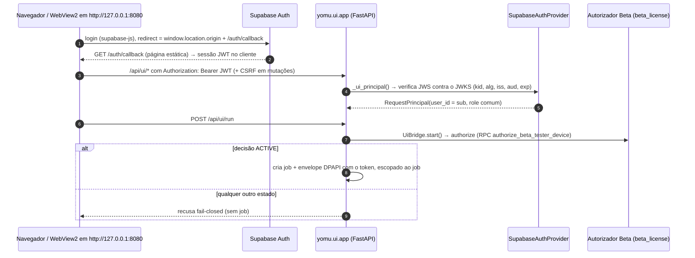

No shell desktop o login usa ainda as rotas `/api/auth/desktop/handoff/*` para entregar o
resultado do callback à janela WebView2. A origem do navegador **precisa** ser
`http://127.0.0.1:8080` (ver §6).

### Verificação do token Supabase (`supabase_auth.py`)

1. Parsing estrito do header (um único Bearer, JWS compacto, tamanho limitado).
2. `alg` na allow-list (`ES256`/`RS256`) e `kid` obrigatório.
3. Chave pública selecionada **apenas por `kid`** no JWKS do projeto — `jku`/`x5u` do token
   são ignorados.
4. Assinatura, `iss`, `aud`, `exp`, `nbf` (com tolerância pequena de relógio) e `sub`.
5. Só então cria `RequestPrincipal(authenticated=True, auth_source="supabase")` com
   `user_id = sub` e **role comum** — nunca admin/moderator vindos de metadata editável.

O JWKS é buscado sob demanda (nunca no import), com timeout, cache com TTL, limite de
tamanho e no máximo um refresh por rotação de `kid`. Qualquer falha de JWKS **falha
fechado**.

A **secret key nunca** é lida por esse provider: verificação de token precisa apenas do
documento público JWKS.

### Login é obrigatório

`_ui_principal()` protege todas as rotas de aplicação. Sem sessão válida não é possível
criar tradução, ver histórico ou acessar a comunidade.

### Licenciamento Scan Beta (`beta_license.py`)

O TDD #77 adicionou a fundação local/offline do licenciamento de tester. O TDD #78 conectou
essa fundação ao Supabase remoto configurado. Autenticação e
autorização são conceitos separados: um usuário autenticado pelo Supabase não recebe acesso
Beta implicitamente. O contrato canônico usa `BetaAccessDecision`, com `allowed`, estado,
motivo, `user_id`, hash de dispositivo, expiração, horário verificado, origem da decisão e
flag `retryable`. Tokens, refresh tokens, senhas e service-role nunca entram nesse metadado.

Estados suportados: `ACTIVE`, `EXPIRED`, `REVOKED`, `DEVICE_LIMIT_REACHED`,
`DEVICE_REVOKED`, `NOT_ENTITLED`, `LICENSE_UNAVAILABLE`, `MALFORMED_LICENSE`,
`NOT_STARTED`, `AUTH_REQUIRED` e `AUTH_INVALID`. Qualquer ausência, expiração, revogação,
limite, resposta malformada ou indisponibilidade da autoridade de licença falha fechado para
operações protegidas.

Política inicial do Beta: **check online no início da sessão/operação protegida e antes de
novo job de tradução; sem graça offline ilimitada**. O cache local, quando existir, é apenas
informativo e não converte falha de validação em acesso. A semântica de expiração é UTC e
exclusiva: `now < expires_at` permite; `now >= expires_at` expira. O relógio local do
cliente não é autoridade única.

Identidade de dispositivo é minimizada: `stable_install_fingerprint_hash()` deriva um hash
irreversível de um identificador de instalação e, opcionalmente, um sinal limitado. O modelo
não coleta serial de disco, MAC address, chave do Windows ou inventário amplo de hardware. Na
política atual, reinstalar pode consumir novo slot se a identidade de instalação mudar.

O gate autoritativo local fica antes da criação/retomada de jobs em `UiBridge.start()` e
`UiBridge.resume()`. O autorizador é composto por `_build_ui_beta_access_authorizer`
(`yomu/ui/ui_bridge.py`): checkout de desenvolvimento sem `BETA_LICENSE_PROVIDER` usa o
autorizador local de desenvolvimento; build congelado ou `TRADUTOR_RUNTIME_MODE=desktop` sem
provider força `production` e falha fechado se a configuração faltar (nunca rebaixa em
silêncio); os demais modos recebem fingerprint estável de instalação. A UI é apenas camada de experiência; segurança não depende de botão
desabilitado. O runner tem defesa em profundidade:
`job_runner._assert_beta_authorization_metadata()` recusa jobs protegidos cujo metadado de
autorização não seja `ACTIVE` e completo, sem fazer lookup privilegiado nem ler segredo.

O contrato remoto está nas migrations:

- `20260824120000_beta_tester_licensing_foundation.sql`
- `20260824130000_beta_tester_authorization_rpc.sql`
- `20260824140000_beta_tester_grants_hardening.sql`

No Supabase remoto `Tradutor IA Community` (`mimrsxnhqbqkffsekxuw` — hoje o projeto legado
mantido como rollback, ver §26; o registro abaixo não foi revalidado no backend ativo), o
conector registrou:

- `20260824192515 beta_tester_licensing_foundation`
- `20260824192601 beta_tester_authorization_rpc`
- `20260824192729 beta_tester_grants_hardening`

Tabelas: `beta_tester_entitlements`, `beta_tester_devices` e
`beta_tester_license_events`, todas com RLS ligada. O cliente autenticado tem somente
`SELECT` protegido por RLS; `anon` não executa a RPC nem acessa tabelas brutas. A RPC
`public.authorize_beta_tester_device(text,text)` é `SECURITY DEFINER`, fixa
`search_path = pg_catalog, public`, deriva usuário exclusivamente de `auth.uid()`, valida hash
SHA-256 hex de 64 caracteres, usa `timezone('utc', now())` como autoridade de tempo e bloqueia
a linha de entitlement `FOR UPDATE` antes de contar/inserir devices. Assim, o contrato remoto
tem serialização por linha de entitlement para o último slot de dispositivo.

O smoke remoto sem auth retorna `AUTH_REQUIRED`; o smoke remoto com contexto JWT simulado no
banco e sem entitlement retorna `NOT_ENTITLED`, `allowed=false`, sem criar entitlement,
device ou evento. Um smoke via sessão autenticada real do produto ainda deve preceder o
primeiro grant.
Mutação administrativa continua fora do cliente. O primeiro grant real de tester é fase
posterior e ainda não foi criado.

### Fluxo de fonte pós-TDD #79

A UX normal de nova tradução é `colar URL → Iniciar tradução`. O botão separado
“Validar origem” foi removido do happy path. No clique em Iniciar, o frontend chama a análise
segura de fonte, persiste um resultado sanitizado e só então submete o start com
`source_validation_required=true` e o `source_analysis_result_id` recém-gerado. O backend
continua recusando start de URL sem análise compatível; validação interna, política de fonte
e licença Beta seguem fail-closed antes de um job protegido.

Estados de erro são separados para UI e auditoria:

- URL malformada: “Informe um link válido.”
- fonte não compatível: oferece envio consentido ao desenvolvedor;
- página não encontrada: informa que a página não foi encontrada;
- indisponibilidade temporária/timeout/rate-limit: pede nova tentativa;
- extração falhou: não cria job e não inicia runner.

`source_support_report.py` define `SourceSupportReporter`, `InMemorySourceSupportReporter`
e `LocalOutboxSourceSupportReporter`. O relatório contém apenas URL normalizada, domínio,
adapter detectado, razão, versão do app, timestamp e nota opcional sanitizada. Não inclui
cookies, JWT, refresh token, Authorization header, storage do navegador, páginas baixadas ou
imagens do capítulo.

## 20. Comunidade e armazenamento

**PARCIAL.** O backend está **implementado** e montado de forma fail-closed, mas a
**UI está desligada no cliente**: `static/social_community.js` define `COMMUNITY_ENABLED = false`
e a aba renderiza apenas o estado de desenvolvimento (selo "EM BREVE" no menu e
"EM DESENVOLVIMENTO" na tela). Nenhum fluxo social é alcançável pela interface atual; o texto
abaixo descreve o backend.

Backend: se `build_social_repository()` levantar
`SocialConfigError`, o router social simplesmente não é montado e `_SOCIAL_STATUS` reporta
um `reason_code` de um conjunto fechado — nunca a `SUPABASE_URL`, chave ou exceção crua.

Princípio central: **todo conteúdo do tradutor permanece somente local por padrão.** Nada é
publicado ao concluir tradução, exportar, salvar ou reiniciar. O único caminho para um
arquivo sair da máquina é a ação explícita e autenticada "Publicar na comunidade".

Camadas:

- `social_repository.py` / `supabase_social.py` — o navegador **nunca** fala com a Supabase
  Data API diretamente; chama endpoints do backend, que encaminham o **JWT do próprio
  usuário** ao PostgREST, onde a **RLS** revalida cada linha.
- `community_service.py` — o navegador nunca envia caminho de arquivo; envia
  identificadores, e o backend resolve o PDF server-side no diretório de saída autorizado e
  valida antes de subir. A publicação cria um job `community_publish` que o worker executa;
  o post só fica visível **após o upload ser verificado**.
- `community_storage.py` — providers: `fake`, `memory`, `filesystem`, `local_test`,
  `google_drive` (padrão de fábrica: `fake`, quando nada é configurado).
- Google Drive (`google_drive_*.py`, `COMMUNITY_STORAGE_PROVIDER=google_drive`): segredos
  vêm do ambiente/arquivo de token, **nunca** do config persistido junto ao job.
- `social_asset_retention.py` — um PDF que deixa de ser o arquivo ativo não é apagado:
  vira asset retido com prazo, restaurável pelo owner. Só depois disso uma varredura manual
  pode movê-lo para a lixeira do Drive. Nada nessa fase apaga permanentemente.

Migrations do banco social em `supabase/migrations/` (puramente aditivas, sem
`DROP`/`TRUNCATE`) e testes em `supabase/tests/database/`.

Docs específicas: [`COMMUNITY_AUTHORIZATION.md`](../COMMUNITY_AUTHORIZATION.md),
[`COMMUNITY_STORAGE.md`](../COMMUNITY_STORAGE.md),
[`SUPABASE_SOCIAL_BACKEND.md`](../SUPABASE_SOCIAL_BACKEND.md),
[`SUPABASE_SOCIAL_SCHEMA.md`](../SUPABASE_SOCIAL_SCHEMA.md),
[`SOCIAL_COMMUNITY_UI.md`](../SOCIAL_COMMUNITY_UI.md),
[`EXPLICIT_SOCIAL_PDF_PUBLISHING.md`](../EXPLICIT_SOCIAL_PDF_PUBLISHING.md),
[`SOCIAL_ASSET_RETENTION_RECONCILIATION.md`](../SOCIAL_ASSET_RETENTION_RECONCILIATION.md).

## 21. Caches

`pipeline_cache.py` separa caches de **download**, **precheck sem texto**, **OCR**,
**tradução** e **página renderizada**. As chaves incorporam hash de imagem, engine,
configuração relevante e versões internas do formato — mudar configuração relevante
invalida a entrada, não a reaproveita erradamente.

Flags: `ENABLE_DOWNLOAD_CACHE`, `ENABLE_OCR_CACHE`, `ENABLE_TRANSLATION_CACHE`,
`ENABLE_IMAGE_PROCESS_CACHE`.

Os JSONs críticos usam **escrita atômica**. O `run_signature` em `progress.json` permite
reutilizar páginas concluídas só quando a execução é compatível. `--force` ignora os caches
de download, OCR, tradução e renderização; **não apaga** o cache global.

## 22. Configuração e variáveis de ambiente

`.env` (não versionado) na raiz do repositório; `.env.local` (também ignorado) refina toggles
de desenvolvimento local. `yomu/runtime/local_environment.py` carrega ambos de forma
determinística e a configuração tipada vive em `yomu/config/settings.py`:

- O `.env` base é conservador e **nunca substitui** valores já presentes no processo.
- O `.env.local` pode sobrescrever, mas valores que existiam antes do loader rodar
  permanecem autoritativos.
- Arquivo malformado **falha fechado**, com erro que nunca inclui conteúdo nem caminho
  absoluto.
- `TRADUTOR_IA_HERMETIC_TEST_ENV=1` impede o carregamento — usado pelo runtime de testes.

`.env.example` documenta ~160 variáveis. Algumas variáveis lidas pelo código **não** estão
no `.env.example`: `TRADUTOR_UI_PORT`, `AUTH_PROVIDER`, `NVIDIA_TRANSLATION_PROVIDER`,
`LOCAL_INPUT_ROOTS`, `YOMU_BACKEND_URL`, `YOMU_ENV`, `YOMU_TEST_BACKEND`,
`TRADUTOR_IA_UPDATE_MANIFEST_URL`, `TRADUTOR_IA_INSTALL_ROOT`. As categorias principais:

| Grupo | Exemplos | Obrigatório? |
| --- | --- | --- |
| Backend de tradução | `YOMU_BACKEND_URL` (fallback `SUPABASE_URL`), `YOMU_ENV`, `YOMU_TEST_BACKEND` | A URL do Supabase basta no caminho padrão |
| Tradução DeepL local (legado) | `DEEPL_API_KEY`, `DEEPL_API_BASE_URL`, `DEEPL_MODEL_TYPE` | **Não** no fluxo atual — a DeepL roda na Edge Function com a chave do servidor (§15) |
| Tradução NVIDIA (legado) | `NVIDIA_API_KEY`, `NVIDIA_BASE_URL`, `NVIDIA_TRANSLATION_MODEL`, `NVIDIA_TRANSLATION_BATCH_SIZE`, `NVIDIA_MAX_REQUESTS_PER_MINUTE`, `NVIDIA_TRANSLATION_PROVIDER` | Só no pipeline legado |
| OCR NVIDIA | `NVIDIA_OCR_*` | Opcional, desligado por padrão |
| Modo de tradução | `TRANSLATION_MODE`, `TRANSLATE_SFX`, `PRIORITIZE_ENCLOSED_TEXT` | Opcional |
| OCR | `OCR_ENGINE`, `OCR_FALLBACK_ENGINE`, `OCR_HYBRID_FALLBACK`, `RAPIDOCR_*`, `FAST_OCR_*`, `OCR_TEXT_REPAIR*`, `OCR_QUALITY_CONTROL`, `OCR_GROUP_*` | Opcional |
| Máscara / render | `TEXT_MASK_PADDING`, `MAX_MASK_EXPANSION`, `STRICT_MASK_BOUNDS`, `MIN_FONT_SIZE`, `MAX_FONT_SIZE`, `AUTO_LINE_WRAP`, `AUTO_FONT_SHRINK` | Opcional |
| Validação visual | `VISUAL_DIFF_VALIDATION`, `VISUAL_QA_STRICT`, `MAX_OUTSIDE_CHANGE_RATIO`, `REJECT_*`, `WHITE_*` | Opcional |
| Caches | `ENABLE_*_CACHE`, `FULL_FAST_MODE` | Opcional |
| Recursos | `OCR_PARALLEL`, `OCR_WORKERS`, `ADAPTIVE_PARALLELISM`, `RESOURCE_MONITORING`, `MIN/MAX_OCR_WORKERS`, `MEMORY_*`, `CPU_PRESSURE_HIGH_PERCENT` | Opcional |
| PDF | `SMART_WEBTOON_PDF_SPLIT`, `SMART_PDF_TARGET_HEIGHT`, `SMART_PDF_MIN_HEIGHT`, `SMART_PDF_MAX_HEIGHT` | Opcional |
| Licença Beta | `BETA_LICENSE_PROVIDER` | Ver §19 |
| Auth | `COMMUNITY_AUTH_PROVIDER`, `SUPABASE_URL`, `SUPABASE_PUBLISHABLE_KEY`, `SUPABASE_SECRET_KEY`, `SUPABASE_JWKS_URL`, `SUPABASE_EXPECTED_ISSUER`, `SUPABASE_EXPECTED_AUDIENCE`, `SUPABASE_SITE_URL`, `SUPABASE_REDIRECT_URL` | Obrigatório para login (`SUPABASE_SITE_URL`/`SUPABASE_REDIRECT_URL` são referência para o projeto Supabase — origem `http://127.0.0.1:8080` —, não lidas pelo Python) |
| Comunidade | `COMMUNITY_SOCIAL_PROVIDER`, `COMMUNITY_STORAGE_PROVIDER`, `COMMUNITY_DRIVE_ROOT_FOLDER_ID`, `COMMUNITY_LOCAL_*` | Só para comunidade |
| Google Drive | `GOOGLE_OAUTH_CLIENT_ID`, `GOOGLE_OAUTH_CLIENT_SECRET`, `GOOGLE_OAUTH_TOKEN_PATH`, `GOOGLE_OAUTH_SCOPES` | Só com storage Drive |
| Rede / UI | `TRADUTOR_UI_HOST`, `TRADUTOR_UI_PORT`, `TRADUTOR_ALLOW_EXTERNAL_BIND` | Opcional (mudar host/porta quebra o login: §6) |
| Caminhos | `TRADUTOR_USER_DATA_ROOT`, `TRADUTOR_RUNTIME_ROOT`, `TRADUTOR_OUTPUT_ROOT`, `CACHE_ROOT`, `TEMP_FOLDER`, `TEMP_OUT` | Opcional (§10) |
| Navegador | `SOURCE_BROWSER_ENGINE`, `SOURCE_BROWSER_EXECUTABLE`, `SOURCE_BROWSER_HEADLESS`, `SOURCE_BROWSER_STARTUP_TIMEOUT`, `SOURCE_BROWSER_NAVIGATION_TIMEOUT`, `SOURCE_BROWSER_PROFILE_MODE`, `TRADUTOR_ALLOW_DRIVER_DOWNLOAD` | Opcional |
| Selenium | `SELENIUM_QUIT_TIMEOUT_SECONDS`, `SELENIUM_CLEANUP_TIMEOUT_SECONDS` | Opcional |
| Debug | `DEBUG_VISUAL`, `SAVE_FULL_DEBUG`, `SAVE_COMPARE_SAMPLES`, `SAVE_DEBUG_ONLY_ERRORS`, `CLASSIFICATION_PROFILING`, `POST_RENDER_OCR_VALIDATION` | Opcional |

Formato seguro para exemplos em documentação:

```dotenv
SUPABASE_URL=<url-do-seu-projeto-supabase>
SUPABASE_PUBLISHABLE_KEY=<sua-publishable-key>
```

> **Nunca** registrar valor real de chave, token, senha, service-role key ou conteúdo de
> token do Drive em documentação, commit, log, issue ou screenshot.

Referência completa por variável: [`docs/CONFIGURATION.md`](../CONFIGURATION.md).

## 23. Modelo de segurança

Fronteiras implementadas — e o que elas **não** garantem
([`docs/SECURITY.md`](../SECURITY.md)).

### Segredos

- Nenhuma **service-role / secret key** chega ao frontend, é retornada por endpoint,
  autoriza um PDF ou fabrica um `RequestPrincipal`. A `SUPABASE_SECRET_KEY` serve apenas a
  operações administrativas locais server-side; recomenda-se removê-la do `.env` após o
  uso.
- `SUPABASE_URL` e `SUPABASE_PUBLISHABLE_KEY` são públicas por design e expostas em
  `GET /api/community/auth/config` só para o browser construir o cliente do SDK.
- A chave DeepL de produção vive só no ambiente da Edge Function `translation-execute`; o
  cliente nunca a recebe. Chaves dos providers legados (`DEEPL_API_KEY`, `NVIDIA_API_KEY`),
  quando presentes no `.env`, são lidas em processo e **mascaradas antes de qualquer log chegar
  à interface** (`ui_helpers.sanitize_diagnostic_text`).
- O token do usuário usado pelo runner viaja num envelope DPAPI por job
  (`yomu/auth/secure_auth_context.py`), nunca em argv, ambiente, log ou banco.
- Token OAuth do Drive fica no caminho indicado por `GOOGLE_OAUTH_TOKEN_PATH`, fora do Git.
  Nunca é enviado ao browser nem persistido no banco de jobs.
- Diagnósticos persistidos em `jobs.sqlite3` são sanitizados: sem URL completa, query
  string, cookie ou pixel de canvas.

### Rede

- O servidor liga em loopback por padrão. Bind externo exige `TRADUTOR_ALLOW_EXTERNAL_BIND=1`
  **e** um provider de auth que suporte, e é validado no startup (`validate_bind_security`).
- Submissão de pasta local pela UI só é aceita em servidor loopback.
- A validação protege a navegação e as imagens selecionadas, mas **não é um sandbox** de
  todos os subrecursos que o navegador pode carregar, nem fixa o IP final de `requests`.
  Para URLs não confiáveis, um deploy precisaria de política de egress adicional.

### Processos

- Nenhuma terminação por nome de processo. Sempre PID + `create_time` + linha de comando.
- Job Object com `KILL_ON_JOB_CLOSE` no `process_launcher.py` (Windows) impede descendentes
  órfãos nas execuções que usam esse launcher (§5).

### Updater assinado — PARCIAL (TDD #57/#58 + superfície de UI)

**O que existe:** o núcleo de confiança e instalação (`tests/test_signed_update.py`) e a
integração remota de startup (`tests/test_remote_update.py`): versão canônica do produto
(`yomu/runtime/version.py`: `PRODUCT_VERSION = "0.9.0"`, `BUILD_VERSION = "0.9.1-beta.18"`),
transporte HTTPS delimitado, fetch de manifest, download de pacote, verificação por
assinatura/SHA, staging, ativação atômica, health-check do payload, rollback e handoff pelo
launcher antes de worker/UI. Desde então também existem:

- **Raiz de confiança populada**: `update_manifest.TRUSTED_PUBLIC_KEYS` contém a chave pública
  `beta-2026-10` (a privada fica fora do repositório).
- **Canal padrão configurado**: `update_bootstrap.DEFAULT_MANIFEST_URL` aponta para o manifest
  beta em um repositório GitHub de releases (`.../YomuSekai-Releases/main/updates/beta/latest.json`);
  `TRADUTOR_IA_UPDATE_MANIFEST_URL` sobrescreve.
- **Dois tipos de artefato** no manifest: `zip` (payload versionado, aplicado pelo bootstrap
  do launcher) e `windows-installer` (Setup `*-Setup-x64.exe`, aplicado por
  `yomu/runtime/installer_update.py`).
- **Superfície de UI**: aba **Atualizações** (`ui/ui_shell.html`: "Verificar atualizações",
  "Baixar e instalar", selo "↑ Atualizar"), servida pelas rotas `GET /api/update/manifest`,
  `POST /api/update/download`, `GET /api/update/download/status`,
  `POST /api/update/download/cancel` e `POST /api/update/install` em `yomu/ui/app.py`. A
  instalação só executa o instalador previamente baixado e verificado (token de handoff), depois
  que os processos do app saem.

**O que não foi verificado nesta revisão:** a publicação de um manifest assinado válido no canal
e uma atualização ponta a ponta numa instalação real. Até lá, o status permanece **PARCIAL**.

#### Fronteira de confiança

A chave privada de assinatura **nunca** entra no cliente: nem no repositório, nem no `.env`,
nem no instalador, nem no pacote distribuído. O cliente carrega apenas material **público**.
Um segredo compartilhado (HMAC, token de API, service-role key) seria inútil aqui: qualquer
tester poderia extraí-lo do programa e assinar uma atualização maliciosa. Daí a escolha de
assinatura **assimétrica**.

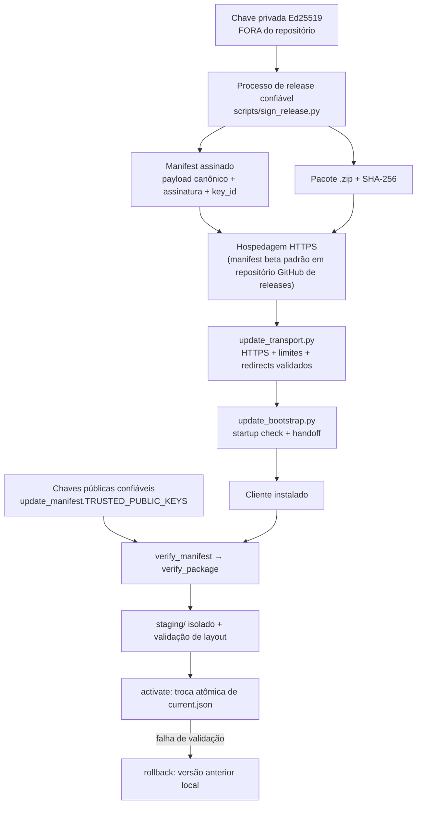

#### Algoritmo

**Ed25519**, via `cryptography` (`cryptography>=42,<50`), dependência **já existente** usada
pela fronteira de autenticação. Nenhuma dependência nova foi adicionada e nenhuma
criptografia caseira foi escrita. Chave pública de 32 bytes e assinatura de 64 bytes cabem
confortavelmente num manifest JSON.

#### Schema do manifest (`schema_version: 1`)

A assinatura fica **fora** do payload assinado, para que os bytes assinados sejam bem
definidos e o formato não seja circular:

```json
{
  "payload": {
    "schema_version": 1,
    "app_id": "tradutor-ia",
    "version": "1.1.0",
    "minimum_version": "1.0.0",
    "published_at": "2026-08-20T12:00:00+00:00",
    "package": {
      "filename": "tradutor-ia-1.1.0.zip",
      "url": "https://<host>/tradutor-ia-1.1.0.zip",
      "sha256": "<64 hex minúsculos>",
      "size": 41234567
    }
  },
  "key_id": "beta-2026",
  "signature": "<base64 da assinatura Ed25519>"
}
```

Não há campo de canal: a Beta tem exatamente um canal (Scan Beta). Adicionar `channel` antes
de existir um segundo canal seria complexidade sem uso.

#### Bytes assinados (canonicalização)

`canonical_payload_bytes` serializa o payload com `sort_keys=True` e sem espaços
(`separators=(",",":")`, `ensure_ascii=True`). O mesmo manifest semântico produz sempre os
mesmos bytes, independentemente da ordem de inserção do dicionário ou de como o JSON foi
formatado em trânsito. Valores `float` são recusados: é o único tipo JSON cuja forma textual
não faz round-trip previsível. Campos desconhecidos dentro do payload **entram** nos bytes
assinados — logo, não podem ser injetados sem invalidar a assinatura.

#### Ordem de verificação (fail-closed)

1. envelope (`payload` objeto, `key_id` bem formado, assinatura base64 de 64 bytes);
2. raiz de confiança presente (senão `UpdateTrustNotConfigured`);
3. `key_id` conhecido e **assinatura válida** sobre os bytes canônicos;
4. `schema_version` suportado (desconhecido ⇒ recusa, nunca interpretação por adivinhação);
5. `app_id` igual a `tradutor-ia`;
6. versões válidas e `minimum_version <= version`;
7. `published_at` ISO-8601 válido; `package.url` HTTPS; `sha256` com 64 hex; `size > 0`;
8. só então a política de versão e, depois, o pacote.

**SHA-256 sozinho não é autenticidade.** Quem controla a hospedagem pode trocar o pacote *e* o
hash publicado ao lado dele. O hash só vale porque chega dentro de um payload assinado offline.
Por isso a assinatura é verificada **antes** de qualquer byte de pacote ser considerado, e
`update_installer.stage_release` só aceita um `UpdateManifest` já verificado.

A URL usada é **a URL assinada**. Nenhuma URL recebida fora do payload assinado é seguida.
HTTPS é obrigatório no transporte de produção, mas HTTPS não substitui a assinatura. Os testes
usam um transporte local injetado para loopback; não existe flag de produção para aceitar HTTP
ou desabilitar verificação TLS.

#### Política de versão

Formato: `MAJOR.MINOR.PATCH` estrito, convertido para tupla de inteiros — `1.10.0 > 1.9.0`
(comparação de string diria o contrário). `decide_update(current, manifest)` retorna:

| Situação | Estado | Instala? |
| --- | --- | --- |
| `version < current` | `downgrade_rejected` | não |
| `version == current` | `up_to_date` | não (sem loop de reinstalação) |
| `version > current` e `current >= minimum_version` | `update_available` | sim |
| `version > current` e `current < minimum_version` | `mandatory_update` | sim, obrigatório |

Downgrade remoto ≠ rollback local: o rollback opera sobre uma release **já instalada e já
verificada** localmente, nunca sobre uma versão antiga rebaixada.

A versão autoritativa do produto é `yomu/runtime/version.py` (`PRODUCT_VERSION`, `MAJOR.MINOR.PATCH`);
a superfície de UI compara o manifest com `BUILD_VERSION` (linha beta ordenada).
Constantes `*_SCHEMA_VERSION` continuam sendo versões de formatos de dados, não do produto.
O campo opcional assinado `minimum_bootstrap_version` permite que uma release recuse launchers
antigos sem tentar uma auto-substituição insegura.

#### Integridade e segurança do pacote

`verify_package` confere o tamanho exato (barato, pega download truncado) e então calcula o
SHA-256 **uma única vez**. Formato do pacote: ZIP (stdlib `zipfile`). `extract_package` valida
**todas** as entradas antes de escrever qualquer byte e recusa: caminho absoluto POSIX,
caminho com letra de unidade (`<LOCAL_C_DRIVE>/...`), UNC (`//servidor/...`), `..` em qualquer posição,
barra invertida como travessia e entradas de link/reparse. Cada destino resolvido é ainda
comparado com a raiz de staging como defesa em profundidade.

#### Layout de instalação, ativação atômica e rollback

```
<install_root>/
    versions/1.0.0/     # imutável
    versions/1.1.0/
    staging/            # descartável
    current.json        # ponteiro atômico
    data/               # dados do usuário: jobs DB, histórico, config, logs, saída
```

No Windows não se pode sobrescrever os arquivos de um aplicativo em execução. Por isso
**nenhuma** ativação sobrescreve arquivos: diretórios de versão são imutáveis e ativar troca
apenas algumas dezenas de bytes de `current.json` via `os.replace` (atômico em NTFS), com
`fsync` antes. Não se usa symlink — permissões e empacotamento no Windows não garantem isso
sem prova.

- `stage_release` — verifica o pacote, extrai para `staging/`, valida o layout (metadados
  `release.json` com `app_id`/`version` batendo com o manifest + entrypoint
  `start_tradutor.py`) e só então promove para `versions/<versão>`. Um ZIP vazio com hash
  correto **não** vira versão ativa. Qualquer falha remove a árvore de staging e deixa a
  instalação ativa intocada.
- `activate` — `current` passa a ser a nova versão e `previous` guarda a anterior.
- `rollback` — volta para `previous` (que continua no disco) e zera `previous`, para que uma
  versão quebrada não possa ser reativada por uma segunda falha.
- `read_install_state` — falha fechado quando o ponteiro está corrompido ou aponta para uma
  versão ausente. **Nunca** varre diretórios procurando algo plausível para executar. Resíduo
  de crash (`current.json.*.tmp`, árvore de `staging/` sobrando) é ignorado, não interpretado:
  a instalação continua resolvendo exatamente uma versão corrente.
- `data/` está fora de `versions/` por construção: atualização, rollback e limpeza de staging
  não alcançam banco de jobs, histórico, configuração nem saída do usuário.

#### Transporte e bootstrap de startup (TDD #58)

`update_transport.UpdateTransport` move bytes e nada mais: exige HTTPS em produção, desliga
proxies/CA herdados do ambiente (`trust_env=False`), valida cada redirect contra downgrade,
aplica timeouts de conexão/leitura, orçamento de redirects, teto de manifest e retry limitado
somente para falha transitória de rede. O pacote é escrito em arquivo `.part` no diretório de
destino e só é promovido por `os.replace` depois de tamanho e SHA-256 baterem com o manifest
assinado. Corpo curto, corpo maior que o declarado, hash errado, HTTP não-200, host offline e
redirect inseguro falham sem deixar pacote parcial promovido.

`start_tradutor.py all` chama `update_bootstrap.check_before_start()` antes de iniciar worker
ou UI. Em clone de desenvolvimento ou sem canal configurado, o check retorna
`not_configured` e o launcher segue; em instalação real (`<root>/versions/<version>` +
`current.json`), um manifest assinado pode instalar uma release nova antes da sessão começar.
Após ativação, o bootstrap executa `start_tradutor.py selftest` dentro do payload novo para
provar que a release importa o runtime básico sem iniciar worker, UI, jobs ou banco real. Se o
selftest falhar, faz rollback para a versão anterior. Se passar, o launcher antigo faz handoff
para o `start_tradutor.py` da nova versão com `TRADUTOR_IA_UPDATE_CHECKED=1`, evitando loop e
mantendo exatamente um dono da supervisão do worker.

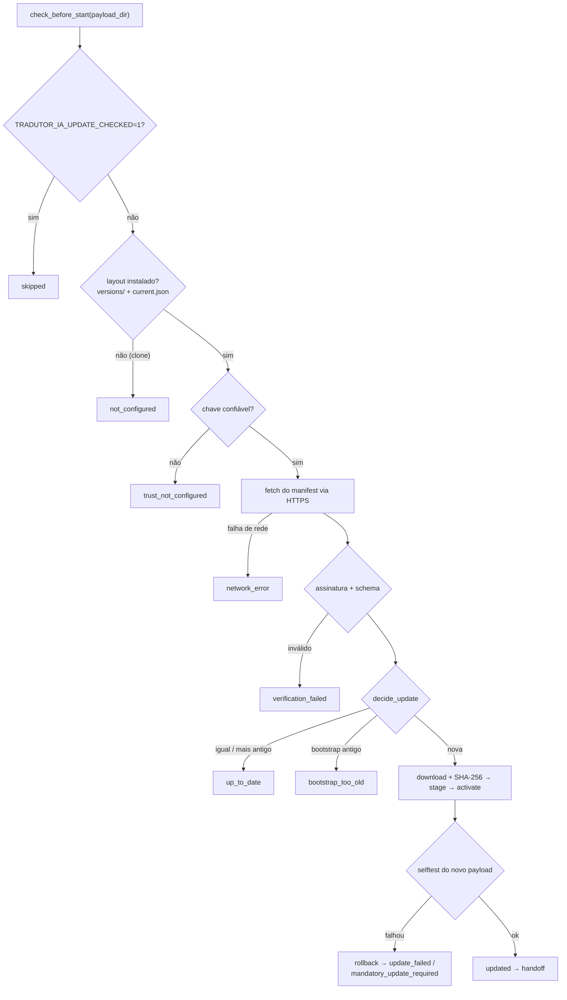

O launcher em execução **não** se sobrescreve. Auto-substituição do bootstrap/binário está
adiada para a fase de Setup; até lá, o updater atualiza payloads versionados e bloqueia
releases que exigem um bootstrap mais novo (`bootstrap_too_old`).

#### Rotação de chave

`key_id` diz **qual** chave pública embutida verifica aquele manifest. O cliente confia num
conjunto pequeno e explícito de chaves públicas locais. Uma chave nova nunca é aceita vinda do
mesmo canal remoto não assinado — a confiança tem raiz local, e uma rotação chega por uma
release já assinada com a chave antiga. Se a chave privada vazar, a confiança do updater está
comprometida: a resposta é operacional (revogar, rotacionar via release ainda assinada pela
chave antiga, e no pior caso reinstalação manual), não criptográfica.

#### Modelo de ameaça

| Ameaça | Resposta |
| --- | --- |
| Manifest adulterado | Assinatura não verifica ⇒ `SignatureInvalid` |
| Pacote adulterado | SHA-256 assinado não bate ⇒ `PackageHashMismatch` |
| Pacote errado / de outra release | `sha256` + `release.json` conferidos ⇒ recusa |
| Update de outro aplicativo | `app_id` ⇒ `WrongApplication` |
| Downgrade remoto | política de versão ⇒ `downgrade_rejected` |
| Travessia de caminho no ZIP | validação de entradas ⇒ `UnsafeArchive` |
| Download parcial | tamanho exato ⇒ `PackageSizeMismatch` |
| Ativação interrompida | `os.replace` atômico + resíduo ignorado |
| **Hospedagem comprometida, chave privada intacta** | **o atacante não consegue produzir uma atualização aceita** — é a propriedade central deste desenho |
| Chave privada roubada | confiança comprometida; resposta operacional (rotação), não criptográfica |
| Estado local corrompido | `InstallStateCorrupt`, falha fechado |

#### Sem bypass

Não existe flag, variável de ambiente ou modo de desenvolvimento que pule a verificação de
assinatura. `update_manifest.py` e `update_installer.py` não leem `os.environ` (há teste que
prova isso). A URL do manifest pode ser trocada por ambiente, mas a assinatura continua
exigida. Os testes injetam uma chave efêmera explícita via parâmetro `trusted_keys`, em
vez de enfraquecer o gate de produção.

#### O que ainda falta

- **Prova ponta a ponta**: chave e URL já estão configuradas, mas a atualização real a partir
  do canal não foi verificada nesta revisão. Sem chave, `load_trusted_keys()` continuaria
  falhando fechado (`UpdateTrustNotConfigured`).
- **Empacotamento/Setup**: o layout de instalação final, permissões e bootstrap estável
  dependem do instalador. O código atual não finge auto-substituição do launcher em execução.
- **Diretório de instalação final e permissões**: depende do instalador. O updater não exige
  privilégios de administrador desde que o local escolhido não exija.
- **Espaço em disco e limite de tamanho de pacote**: adiados de propósito — sem o tamanho real
  do bundle de runtime, qualquer limite seria arbitrário.
- **UI de atualização**: a aba **Atualizações** existe (ver acima); o mapeamento completo das
  classes de erro para mensagens ao usuário não foi reauditado nesta revisão.

Eventos estruturados já emitidos (nunca com chave, token ou URL com segredo):
`update_manifest_fetched`, `update_manifest_verified`, `update_available`,
`update_package_downloaded`, `update_package_verified`, `update_staged`,
`update_activation_started`, `update_activation_succeeded`, `update_activation_failed`,
`update_startup_unhealthy`, `update_rollback_succeeded`, `update_applied`.

## 24. Arquitetura de testes

419 arquivos `test_*.py` versionados em `tests/` (mais dois em `experiments/`, também em
`testpaths`) + 18 arquivos `test_*.mjs` de frontend (testes Node) + testes SQL em
`supabase/tests/` + a suíte TypeScript de `apps/auth-service/`. Última execução completa
registrada da suíte hermética: **~6160 passed / 0 failed / 141 skipped**.

`pytest.ini`:

```ini
[pytest]
addopts = -m "not network and not manual"
testpaths = tests experiments
norecursedirs = output .cache .git .venv tmp node_modules __pycache__ .local-audit
markers =
    unit / integration / network / manual / slow
```

Testes de rede e smokes manuais são **excluídos por padrão** e exigem opt-in explícito.

### Isolamento hermético (TDD #51, ampliado no TDD #55, `hermetic_runtime.py`)

O estado real do projeto vive em `%LOCALAPPDATA%\TradutorIA` (e, em clones antigos, em
`<repo>/.cache/runtime`). Antes do guard, código de teste que construísse um componente de
runtime sem raiz explícita caía exatamente nesse diretório — um `python -m unittest discover` podia abrir a fila real, mutar linhas de job
reais e lançar o worker real.

O guard dá ao processo de teste **uma raiz temporária única por processo** e transforma
todo caminho restante para a raiz real em falha imediata (`RealRuntimeAccess`), **antes** do
efeito colateral. Ele intercepta `sqlite3.connect`, `open`, `mkdir`, `unlink`, `rename`,
`scandir`/`listdir` e spawn de processo.

**Escopo protegido:**

| Alvo real | Verbos bloqueados | Constante |
| --- | --- | --- |
| `<repo>/.cache/runtime/**` (fila, leases, logs) | `sqlite3.connect`, `open`, `mkdir`, `unlink`, `rename`, spawn | `REAL_RUNTIME_ROOT` |
| `<repo>/output/**` (capítulos traduzidos do usuário) | `open`, `mkdir`, `unlink`, `rename`, `scandir`/`listdir` | `REAL_OUTPUT_ROOT` |
| `<repo>/.cache/ui_history.json`, `ui_hidden_history.json` | `open`, `unlink`, `rename` | `REAL_UI_HISTORY_PATHS` |
| `%LOCALAPPDATA%\TradutorIA` (dados do Beta instalado) | idem | `REAL_BETA_USER_ROOT` |

**Normalização de caminho.** A comparação é canônica: caminhos relativos, separadores
mistos, maiúsculas/minúsculas de volume Windows e junções normalizam para a mesma forma.
Desde o TDD #55 a normalização cobre também **URIs SQLite** (`sqlite_uri_path`): um
`sqlite3.connect("file:.../jobs.sqlite3?mode=ro", uri=True)` é reduzido ao caminho de
sistema de arquivos que nomeia — parâmetros de query (`mode`, `cache`, `vfs`, `immutable`),
autoridade `file://localhost/`, forma `file:///<LOCAL_C_DRIVE>/…` e percent-encoding não escapam mais do
guard. `:memory:` e `file::memory:?cache=shared` continuam permitidos, assim como qualquer
URI apontando a um banco temporário isolado.

**Isolamento do histórico da UI.** `UIHistoryStore(path, hidden_path, output_root=…)`
resolve `ui_helpers.OUTPUT_ROOT` por default (produção inalterada) e recebe a raiz isolada
do `UiBridge` quando `TRADUTOR_TEST_RUNTIME_ROOT` está definido, de modo que
`discover_outputs()` nunca enumera o `output/` real dentro da suíte. A coleta do pytest
também não desce em `output/` nem `.cache/` (`norecursedirs` em `pytest.ini`).

Nada disso roda em produção: o guard é instalado apenas por `_test_bootstrap`, `conftest` e
o branch de entrypoint de teste do `sitecustomize`.

### Guard de rede (`offline_test_guard.py`)

Bloqueia conexões de socket antes de qualquer request. O padrão da suíte é **offline**;
usa-se fakes e artefatos temporários.

### Contrato dos testes

Um teste **não pode**:

- tocar o banco de jobs de produção (`<runtime>/jobs.sqlite3`);
- lançar o worker de produção;
- chamar provider de tradução real;
- alcançar Drive ou Supabase remoto de forma inesperada.

Testes de crash duro (`tests/test_worker_process_loss.py`, `tests/test_worker_supervision.py`) usam
**processos reais**, nunca booleanos mockados: um filho registra o lease com sua identidade
real, faz heartbeat e sai por `os._exit`, exatamente como um segfault, um OOM kill ou uma
terminação forçada parecem para o banco.

> **Cuidado de ambiente.** Esses testes comparam `Popen.pid` com o PID que o filho reporta.
> Um interpretador cujo `python.exe` seja um *trampoline* que re-executa o interpretador
> real (observado em alguns venvs gerados por ferramentas de terceiros) faz esses testes
> falharem por artefato de ambiente, não por regressão. Use o Python 3.11 do venv do
> projeto.

### CI (`.github/workflows/tests.yml`)

`windows-latest`, Python 3.11 + Node 24, timeout de 60 min. Etapas: instalar
`requirements/requirements-beta.txt` (que inclui `requirements.txt` e o perfil RapidOCR) +
`requirements/requirements-dev.txt`, `scripts/check_runtime_profile.py` (perfil de runtime
Beta, ex.: conflito de OpenCV), **confirmar que os opt-ins de smoke de rede estão desligados**
(`ALLOW_NETWORK_TESTS`, `ALLOW_WEBTOON_SMOKE`, `ALLOW_NVIDIA_SMOKE`), coletar e rodar pytest
(JUnit enviado como artifact), `node --check` nos JS principais e de i18n, typecheck/test/build
do serviço Better Auth, e `python -m compileall` sobre `yomu`, `test_support` e os shims da
raiz. As suítes `.mjs` não rodam na CI.

Detalhes em [`docs/TESTING.md`](../TESTING.md).

## 25. Performance

Referência de engenharia, não diário de benchmark.

Otimizações fechadas e verificáveis no repositório:

| Item | Commit | Medição registrada |
| --- | --- | --- |
| Parada da descoberta de leitor lazy em completude estável | `5fce936` | Episódio 51: 90 rodadas / 92s de sleep → 10 rodadas / 11s, mesmas 171 páginas |
| Remoção do `optimize=True` do PNG no Smart Split | `2638844` | Estágio 51,98s → 28,52s; encode 32,22s → 8,40s; saída +1,32% bytes; 100/100 páginas pixel-idênticas |

Classe **Full** ponta a ponta, conforme as missões de performance que precederam este
commit: **~405,82s (~6min46s)** contra a classe histórica de **~489,73s** — melhoria de
**~17,1%**.

> Estes dois números de classe Full não são reproduzíveis a partir do repositório (dependem
> de capítulo real, rede e provider). Estão registrados como referência histórica de
> engenharia, não como contrato verificável.

Achado dominante restante: a inferência nativa do OCR domina o tempo. Ganhos futuros
relevantes tendem a vir daí, não da orquestração Python.

### Paralelismo por página (estado atual)

`PIPELINE_PAGE_WORKERS` (`yomu/config/settings.py`, padrão `auto`) decide quantas páginas rodam
ao mesmo tempo. `auto` usa `_auto_page_workers`: um terço dos núcleos lógicos e uma página por
~3 GB de memória livre, entre 1 e 4 (`MAX_PIPELINE_PAGE_WORKERS`); valor explícito fora de 1–4
falha com `ValueError`.

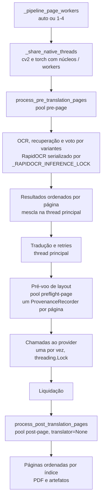

Com `workers == 1` os três estágios usam o caminho sequencial direto (sem pool).

## 26. Logs, saúde e diagnóstico

| Superfície | Local |
| --- | --- |
| Log por job | `<runtime>/logs/<job_id>.log` |
| Log da UI | `<runtime>/ui.log` |
| Trilha de transições de job | `<runtime>/diagnostics/job_<hash>.jsonl` (evento `JOB_STATE_TRANSITION`) |
| Eventos do supervisor | linha JSON em `stderr` do launcher |
| Eventos do `process_launcher` | `<runtime>/launcher_events.jsonl` + `exit_code.txt` |
| Saúde do worker/fila | `python start_tradutor.py status` |
| Liveness da UI | `GET /api/health` |
| Diagnóstico na UI | `GET /api/ui/diagnostics`, aba **Logs** |
| Fluxos de diagnóstico da UI | `<runtime>/diagnostics/{app,routes}_current.jsonl` |
| Relatórios por execução | `output/<slug>/<run_id>/*_report.json|html` para novos jobs; `output/<slug>/*_report.json|html` em legados |

Todo texto que chega à interface passa por `sanitize_diagnostic_text`. `request_observability.py`
e `job_failure_diagnostic.py` normalizam diagnóstico de falha em códigos fechados.

Os fluxos `*_current.jsonl` são append-only e agora têm rotação por tamanho
(`_append_diagnostic_log` em `yomu/ui/app.py`): ao passar de 16 MiB o arquivo vira
`<nome>.previous.jsonl` e um novo `current` continua a escrita — teto de 16 MiB por
fluxo mais uma cópia anterior, espelhando a rotação de `runtime.log`. A falha de rotação
é best-effort e nunca interrompe a gravação do diagnóstico (antes eram ilimitados: uma
sessão chegou a ~297 MB em `app_current.jsonl`).

O legado local de mídia social foi removido: não há rota/backend handler, método de bridge,
cache local, upload nem fetcher de avatar/banner. No Supabase ativo `ybxwjiycujminbwbdtlb`,
`profile-media` está ausente, as 25 Edge Functions ativas auditadas não a referenciam e a
consulta read-only de logs não encontrou chamadas nas últimas 24h. O source órfão foi
removido do repositório. Os campos de avatar/banner e migrations históricas permanecem como
schema legado inerte; perfis textuais da Comunidade e identidade da conta continuam
preservados. Caches/arquivos locais antigos não são apagados automaticamente.

`REMOTE_PROFILE_MEDIA_DECOMMISSION: COMPLETE_FOR_ACTIVE_BACKEND`. O Supabase legado
`mimrsxnhqbqkffsekxuw` e sua Edge Function/secrets permanecem intactos como rollback
temporário; aposentadoria destrutiva do rollback requer missão e autorização separadas.

### 26.1 Artifact Contract V2 (ativo, com compatibilidade legada)

`artifact_contract.py` (`ARTIFACT_CONTRACT_VERSION = 2`) é consumido pelo pipeline, pelos
exporters canônicos e pelo writer do Review Manifest. Define tipos, perfis, caminhos canônicos
e cobertura real de artefatos. A migração dos writers foi aditiva: alguns outputs legados
continuam presentes e são descritos em [Saídas e artefatos](../OUTPUT_ARTIFACTS.md); manifests e
paths persistidos identificam o que foi efetivamente escrito. Não presumir que todo arquivo
legado foi movido para o resolver V2.

**Perfis de saída.** `AUTOMATIC` = `final_pdf` + `translated_image` (resultado pronto para
consumo). `PROFESSIONAL_QC` = `final_pdf` + `translated_image` + `clean_image` +
`editable_psd` + `quality_report` + `review_manifest` (preparado para revisão humana). O
Yomu não substitui Photoshop/Photopea.

**Capacidades (estado REAL, verificado em 2026-09-28), não aspiração:**

| Tipo | Capacidade | Observação |
| --- | --- | --- |
| `final_pdf` | SUPPORTED | PDF final atual |
| `translated_image` | SUPPORTED | páginas renderizadas com texto traduzido |
| `clean_image` | SUPPORTED | materializado em `images/clean/NNN.png` na Missão 4 (perfil `PROFESSIONAL_QC`); o `*_cleaned.png` legado por página segue existindo |
| `editable_psd` | **SUPPORTED** (Missão 6) | PSD com Type Layers nativas do Photoshop (`editable_psd_writer`), perfil `PROFESSIONAL_QC`; **não** confundir com o raster legado |
| `legacy_raster_psd` | SUPPORTED | export raster existente, tipo distinto de `editable_psd` |
| `quality_report` | SUPPORTED | `quality_report.json` |
| `review_manifest` | **SUPPORTED** (Missão 10) | Índice QC V1 em `qc/review_manifest.json`, somente `PROFESSIONAL_QC` |

A partir da Missão 10, `PROFESSIONAL_QC` também produz `review_manifest`; AUTOMATIC não o solicita.
O PSD raster legado jamais é declarado `editable_psd`.

### 26.2 Review Manifest V1 (Missão 10)

`review_manifest.py` escreve atomicamente `qc/review_manifest.json` (UTF-8) depois do Quality
Report e dos PSDs. O documento declara `review_manifest_version=1` e
`artifact_contract_version=2`, cobre cada página lógica (inclusive páginas sem findings) e
mantém contagens separadas de itens pendentes/aprovados/resolvidos e do terminal do job
(`finished`/`review_required`). A severidade de finding reaproveita o contrato M9: avisos são
`INFO`/`REVIEW`; falha na produção/validação deste artefato profissional obrigatório é falha
estrutural do artifact, não uma mudança de quality gate.

Quality Report continua como diagnóstico detalhado. O writer seleciona as mesmas coleções e
condições usadas pelo `UiBridge.quality_review`, normaliza cada item por
`review_item.from_quality_review_item`, e grava somente o índice necessário: textos fonte,
tradução disponível, texto efetivo, warning codes, bbox, estado humano e provenance curta.
Não copia o relatório integral, não armazena revisões e não adiciona timestamp volátil.

`region_id` é a ligação canônica item→PSD. Os nomes de camada vêm exclusivamente do retorno
real do `editable_psd_writer`; uma camada só é citada se sua provenance tiver o mesmo
`region_id`. Para legado sem ID, o índice usa ID opaco derivado de página/ordem/bbox e tenta
ligação somente por bbox+tipo em correspondência única; nunca inventa um `region_id` canônico.
`typography_sources` contém apenas os nomes de origem leves (renderer/fallback), sem TySh ou
EngineData. Texto efetivo editado e status são sobrepostos a partir do snapshot persistido de
Review no re-export; provider translation só é preenchido quando distinguível no dado original.

Paths são POSIX relativos ao output/generation root. Absolutos, traversal, UNC, paths Windows e
artefatos inexistentes são rejeitados. O payload é validado antes e depois da gravação temporária
e publicado por `os.replace`; o Artifact Contract V2 só marca `PRODUCED` depois disso. O worker
de re-export valida novamente o schema/coverage antes de publicar a geração. A integração não
chama provider, OCR ou wallet: re-export mantém provider calls=0 e YK adicional=0.

### 26.3 PSD Profissional editável v2 — Type Layers nativas (Missão 6)

`editable_psd_writer.py` (`write_editable_psd(...)`) emite **um PSD por página lógica** em
`psd/<page>.psd` (resolver do contrato), **somente no perfil `PROFESSIONAL_QC`**. AUTOMATIC e
download-only não geram PSD. A capacidade `editable_psd` é `SUPPORTED` (verificada fisicamente
no Adobe Photoshop no spike da Missão 5, cujo mecanismo é reutilizado verbatim).

**Estrutura:** grupos `ORIGINAL` (oculto por padrão, `ORIGINAL_ART` raster = fonte),
`CLEAN` (visível, `CLEAN_ARTWORK` = o `clean_image` canônico da Missão 4, base visual) e
`TEXT` (visível). O texto traduzido vive em **Type Layers nativas** (bloco `TySh`
`TypeToolObjectSetting` com EngineData Adobe) — nunca rasterizado. Desligar `TEXT` revela o
CLEAN; ligar `ORIGINAL` mostra a fonte.

**Regiões (§14).** Cada região detectada com conteúdo vira uma Type Layer: tradução desenhada →
camada traduzida; região com texto-fonte mas sem tradução → camada `*_REVIEW` com o texto de
origem (o QC encontra o conteúdo para corrigir). Região sem texto não gera camada. Nomes
determinísticos por classificação: `BALAO_NNN`, `NARRACAO_NNN`, `CAPTION_NNN`, `FOOTNOTE_NNN`,
`TITLE_NNN`, `SFX_NNN`, senão `TEXT_NNN`; `region_id` preservado no manifest.

**Modo de texto:** POINT text (o modo comprovadamente editável no Photoshop). **Fonte:** família
referenciada (`ArialMT`/fallback); a fonte não é distribuída e é substituível se ausente, sem
rasterizar. **Perfil de cor:** sRGB IEC61966-2.1 embutido (evita o aviso "Perfil Ausente" do
protótipo). **Limitações cosméticas** (editabilidade > fidelidade): outline/stroke, rotação e
bold/italic sintéticos não são aplicados; a Type Layer permanece editável.

**Tipografia: o renderer é a fonte de verdade (Missão 7).** O writer **não** roda um segundo
passo de layout/ajuste de fonte. Quando o item de render expõe os valores reais, a Type Layer os
reutiliza exatamente: `font_size` (real do renderer), linhas finais quebradas
(`rendered_lines`), posição refinada (`translation_box`/`draw_box`) e cor (`text_color`). Cada
região registra em `typography_sources` a origem de cada propriedade — `RENDERER` ou o fallback
correspondente (`BBOX_FALLBACK` p/ tamanho/posição, `RAW_TEXT_FALLBACK` p/ quebra,
`BLACK_DEFAULT` p/ cor, `SEMANTIC_DEFAULT` p/ alinhamento). Os fallbacks mantêm runs legados sem
metadados de tipografia exportáveis, sem falhar o PSD por propriedade cosmética ausente.

**Páginas sem texto / brancas / curtas** geram PSD válido com `TEXT` vazio, no tamanho real do
canvas (sem piso de altura) — inclui as calhas 118/143/207 e as páginas curtas 48/208.

**Escrita atômica + validação (§33/§35):** temp → validação estrutural (grupos, rasters,
contagem/nomes de Type Layers, texto legível) → `os.replace`; só então `PRODUCED`. Falha real
de página é `FAILED`, nunca mascarada. O `artifact_manifest.json` registra `editable_psd` em
`produced`/`coverage` (produced/missing/failed) e `byte_totals`. Fluxo memory-bounded: uma
página construída, escrita, validada e liberada por vez.

**Legado:** `legacy_raster_psd` (o export raster de `professional_psd.py`, acionado por
`--output-format psd`) permanece intacto e é um tipo distinto — não removido, não renomeado.

**Estrutura canônica alvo** (contrato, ainda não materializada por padrão): `final/`,
`images/translated/`, `images/clean/`, `psd/`, `qc/`, `diagnostics/`.

**Resolver e nomeação.** `artifact_relative_path(...)`/`artifact_path(output_root, ...)`
resolvem caminhos determinísticos (retry/re-export sobrescreve no mesmo lugar, sem lixo
incremental), com nome lógico por página de largura dinâmica (`001`…`208`…`1000`) e guardas
de segurança (slug de capítulo sanitizado — Unicode preservado, sem `..`/separadores, nomes
reservados do Windows neutralizados, comprimento limitado; e verificação de que o caminho
resolvido nunca escapa do `output_root`).

**Manifest e compatibilidade.** `build_artifact_manifest(...)` grava `contract_version`,
`output_profile`, `requested/produced/unavailable_artifacts`, status por artefato,
capacidades e `logical_page_count`. Runs antigos sem `contract_version` são lidos como
**V1 (legado)** sem erro — nada histórico é migrado, invalidado ou apagado nesta missão.

### 26.4 Persistência canônica de CLEAN / TRANSLATED por página (Missão 4)

`benchmark_pipeline.run_benchmark` integra o resolver do contrato ao pipeline real: depois
que `completed_states` é fechado (mesmas páginas lógicas que alimentam o PDF), uma passada
aditiva — `_persist_canonical_artifacts(output_folder, completed_states, len(image_paths),
profile)` — copia os buffers **já renderizados** para os caminhos canônicos via
`artifact_path(...)` (nenhum segundo resolver, nenhuma string de caminho espalhada):

- **`TRANSLATED_IMAGE` → `images/translated/NNN.png`**: cópia do `state["output_path"]`, o
  **mesmo** buffer usado para montar o PDF (sem re-render). Persistido em `AUTOMATIC` e
  `PROFESSIONAL_QC`.
- **`CLEAN_IMAGE` → `images/clean/NNN.png`** (somente `PROFESSIONAL_QC`): usa
  `state["cleaned_path"]` (arte após remoção do texto de origem, **antes** dos glifos
  traduzidos — captura em `render_analyzed_image`); quando ausente, cai para
  `state["image_path"]` (a página de origem aceita **é** a arte limpa de uma página sem
  texto — §3 caso B).

**Por que o CLEAN antes era 203/208.** Páginas aceitas por `no_text_precheck`
(`config.SKIP_NO_TEXT_IMAGES`) são copiadas origem→saída sem passar por
`render_analyzed_image`, então `cleaned_capture` nunca é populado e nenhum `*_cleaned.png`
é escrito; o mesmo vale para páginas restauradas de cache. A contagem de `*_cleaned.png`
era, portanto, `total − páginas_sem_render`. O fallback para a origem fecha a lacuna: toda
página lógica concluída passa a ter CLEAN em `PROFESSIONAL_QC` (208/208 no capítulo Comix,
incluindo as calhas em branco 118/143/207).

**Perfil de saída (Missão 11).** O grupo de radios acessível da Nova tradução envia o enum
canônico `automatic` ou `professional_qc`; `UiBridge` valida e persiste `output_profile` na
configuração do job. O `job_runner` passa o valor validado ao processo do pipeline por
`YOMU_OUTPUT_PROFILE`, e `_resolve_output_profile(args)` conserva a precedência programática
`args.output_profile` → env → `AUTOMATIC`. Request legado sem perfil usa `AUTOMATIC`; uma
seleção PSD explícita de cliente legado sem o novo campo é mapeada a `PROFESSIONAL_QC`.
`download_only` força `AUTOMATIC` e não executa artifacts de tradução/QC. Reexecução herda o
perfil conhecido e usa `AUTOMATIC` quando o registro histórico não o possui. Re-export não
reescreve o perfil do job de origem.

O preset `AUTOMATIC` solicita ao Artifact Contract V2 somente `FINAL_PDF` e
`TRANSLATED_IMAGE`. `PROFESSIONAL_QC` solicita esses dois mais `CLEAN_IMAGE`, `EDITABLE_PSD`,
`QUALITY_REPORT` e `REVIEW_MANIFEST`. O quality report de diagnóstico continua sendo escrito
internamente pelo pipeline para validação e diagnóstico interno, mesmo quando não é um artifact
solicitado/exposto pelo preset Automático; isso não habilita PSD, clean ou manifest nesse
perfil. A troca de preset é configuração local, sem provider/DeepL ou consumo YK adicional.

**Escrita atômica e validação (§20/§21).** Cada cópia usa `atomic_copy` (temp →
`os.replace`); o artefato **produzido** é então validado (decodificável, dims > 0) — sem
piso absoluto de altura ou variância, para não descartar páginas curtas/em branco legítimas.
Falha real de origem (ilegível/ausente) é registrada como `failed`, nunca mascarada com
placeholder.

**Identidade lógica (§12).** O nome do arquivo vem do índice lógico da página
(`state["index"]`), nunca de `os.listdir`/`glob`/mtime.

**Gate de cobertura + manifest (§13/§14).** `output_folder/artifact_manifest.json`
(`contract_version = 2`) registra `output_profile`, `logical_page_count`,
`produced/unavailable_artifacts`, e um bloco `coverage` com as listas de páginas lógicas
`produced` / `missing` / `failed` por tipo, além de `byte_totals`
(`translated`/`clean`) e `io_seconds`. Na Missão 4, `editable_psd` ficava `requested +
unavailable`; desde a Missão 6 o PSD editável é produzido em `PROFESSIONAL_QC` (§26.3).

**Compatibilidade legada (estratégia A — aditiva).** Os artefatos legados
(`pages/page_NNN.png` traduzido e `*_cleaned.png`) permanecem intactos; os canônicos são
cópias adicionais. Histórico, retry, re-export, PDF, PSD raster legado, fixtures e
"abrir pasta" não mudam. PDF e saída visual não se alteram nesta missão.

**Overhead de I/O (medido, 208 páginas sintéticas).** `AUTOMATIC` ≈ 2,4 s (208 cópias +
1 decode de validação cada); `PROFESSIONAL_QC` ≈ 4,7 s (416 cópias) — pequeno frente a
OCR + tradução + render (minutos).

### 26.5 Resumo de conclusão do job (Missão 12)

`UiBridge._job_record()` anexa `completion_summary`, produzido por
`job_completion.build_job_completion_summary(record, output_root)`. O DTO concentra estado
terminal, perfil, `logical_pages`, contagem pendente da Review e disponibilidade real dos
artefatos. Para Contract V2, a disponibilidade exige `artifact_status == produced` no
`artifact_manifest.json` e os arquivos/páginas canônicos presentes; o PDF legado continua
abrível pelo caminho já registrado e confinado. Saídas fora de `output_root` não produzem
ações de abertura.

A tela em `#jobCompletionPanel` consome esse DTO e distingue `finished`, `review_required`,
`failed`, `cancelled` e `download_only`. `review_required` continua sendo sucesso estrutural
com recomendação de QC, nunca texto de falha. Os botões PDF/pasta/Review/PSDs/QC são
condicionados a `completion_summary.actions`, não apenas ao perfil. A Review usa o job atual
e seu endpoint existente; abrir qualquer resultado não inicia provider, job ou cobrança.

`POST /api/ui/open` recebe somente `job_id` e identificador allowlisted (`pdf`, `folder`,
`psd_folder`, `qc_folder`, além das ações históricas existentes). O backend faz lookup
owner-scoped, deriva subpastas canônicas e `_open_artifact_path` valida existência e
confinamento em `output_root` antes de abrir. A UI nunca envia caminho do filesystem. Jobs
legados sem Manifest V2 toleram ausência de perfil/manifest e preservam a ação PDF quando o
arquivo registrado ainda existe.

## 27. Ambiente de desenvolvimento e comandos

Os comandos abaixo foram validados contra `5f482ce1` (CLIs com `--help`; o launcher não tem
`--help` e foi conferido no código).

### Pré-requisitos

- Windows 64 bits
- Python 3.11
- Git
- Navegador Chromium local (Google Chrome/Edge) para fontes por URL
- WebView2 (shell desktop) — `pywebview` já está em `requirements.txt`
- Conta no projeto Supabase de auth com licença Beta ativa (a tradução usa o backend Yomu;
  nenhuma chave DeepL local é necessária)

### Instalação

```powershell
git clone https://github.com/HenriquePvAr/Tradutor.Ia.git
cd Tradutor.Ia

py -3.11 -m venv .venv
.\.venv\Scripts\Activate.ps1
python -m pip install --upgrade pip
pip install -r requirements/requirements-beta.txt   # inclui requirements.txt + RapidOCR + scrapling + psd-tools
pip install -r requirements/requirements-dev.txt    # para rodar testes

Copy-Item .env.example .env
```

Depois edite `.env` e preencha, no mínimo, as variáveis do Supabase (`SUPABASE_URL`,
`SUPABASE_PUBLISHABLE_KEY` e afins) com placeholders substituídos pelos valores do projeto.

Arquivos de dependências:

| Arquivo | Conteúdo |
| --- | --- |
| `requirements.txt` | Núcleo: numpy, Pillow, opencv-python (pinados), selenium, webdriver-manager, torch/transformers, psutil, nicegui, pywebview, psycopg, PyJWT, cryptography, google-auth. **Sem** PaddleOCR |
| `requirements/requirements-beta.txt` | `-r ../requirements.txt`, `-r requirements-rapidocr.txt`, `scrapling[fetchers]==0.4.15`, `psd-tools==1.10.9` — perfil usado pela CI e pelo build |
| `requirements/requirements-rapidocr.txt` | `rapidocr-onnxruntime==1.4.4`, `onnxruntime==1.27.0` |
| `requirements/requirements-ui.txt` | `nicegui==3.15.0` |
| `requirements/requirements-dev.txt` | `pytest>=9,<10`, `fastapi`, `httpx` |
| `requirements/requirements-optional.txt` | `cloudscraper`, `scrapling[fetchers]`, `psd-tools` |
| `requirements/requirements-paddle.txt` | `paddlepaddle`, `paddleocr` — fallback legado opcional, separado por conflito de OpenCV |
| `requirements/requirements-gemini-vps.txt` | dependências do worker remoto de pesquisa (VPS), não do app |

### Executar a aplicação

```powershell
python start_tradutor.py            # worker (com supervisão) + UI  ← canônico
python start_tradutor.py worker     # só o worker, destacado, sem supervisão
python start_tradutor.py ui         # só a UI
python start_tradutor.py status     # saúde do worker e da fila
python start_tradutor.py stop       # parada graciosa do worker
python start_tradutor.py stop --force
python start_tradutor.py selftest   # prova que o payload importa, sem iniciar nada
python desktop_app.py               # shell WebView2 (sobe a UI e abre a janela)
```

No Windows há também `start_tradutor.bat`, que prefere `.venv\Scripts\python.exe`.

A UI escuta em `http://127.0.0.1:8080` por padrão e **deve ser acessada exatamente por essa
origem**: o projeto Supabase de auth só aceita `http://127.0.0.1:8080` nos redirects
(`localhost:8080` ou outra porta quebram o login — §6).

### CLI direta

```powershell
python run_webtoon.py "<URL_DO_CAPITULO>" --mode fast
python run_webtoon.py "<URL_DO_CAPITULO>" --mode quality --output "meu_capitulo"
python run_webtoon.py "<URL_DO_CAPITULO>" --download-only
python run_webtoon.py --local-folder "<PASTA_PERMITIDA>" --mode fast
python run_webtoon.py --help
```

Flags reais (`--help`): `--local-folder`, `--mode {fast,quality}`, `--cache | --force`,
`--output`, `--output-format {pdf,png,psd,translation}`, `--typesetting-mode {on,off}`,
`--no-context`, `--keep-context`, `--delete-context-after`, `--open-output`, `--max-images`,
`--download-only`, `--source-candidate-id`,
`--translation-provider {deepl,nemotron,riva,yomu_backend}`. Com tradução habilitada, a execução
usa sempre `yomu_backend` (§15), portanto exige sessão/licença válidas.
`run_local_folder.py --snapshot-ref <ref> --output <pasta>` processa um snapshot local já criado
pelo aplicativo (uso interno).

### Worker direto

```powershell
python worker_service.py            # roda até ser parado
python worker_service.py --once     # processa no máximo um job e sai
python worker_service.py --status   # imprime saúde e sai
python worker_service.py --db <caminho>
python worker_service.py --poll-interval <segundos>
```

### Testes

```powershell
python -m pytest -q                       # suíte hermética completa
python -m pytest --collect-only -q        # apenas coleta
python -m pytest -q tests/test_worker_supervision.py tests/test_launcher.py
python -m pytest -q tests/test_deepl_translation_provider.py
node --check static/tradutor_ui.js
```

```powershell
# serviço Better Auth
cd apps\auth-service
npm ci
npm run typecheck; npm test; npm run build
```

> `pytest` é o caminho usado pela CI; `python -m unittest discover` não foi revalidado nesta
> revisão.

## 28. Troubleshooting técnico

| Sintoma | Causa provável | Diagnóstico não destrutivo |
| --- | --- | --- |
| UI abre, job fica em `queued` | Nenhum worker saudável | `python start_tradutor.py status`; depois `worker` |
| `configuration_error:` na saída do launcher | `.env` malformado | Validar a sintaxe do `.env` — o erro nunca imprime conteúdo |
| Worker some repetidamente e para de voltar | Supervisor em `degraded` (3 reinícios gastos) | Ler os eventos JSON no `stderr` do launcher; investigar a causa antes de reiniciar |
| Job preso em `awaiting_source_review` | Análise de confiança média | Confirmar as páginas na UI; o OCR ainda não começou |
| Job em `interrupted` | Crash/parada do worker ou runner | Artefatos preservados; botão **Retomar** na UI quando `can_resume` é verdadeiro |
| `ownership_mismatch` | PID reutilizado por outro processo | Comportamento fail-closed correto; nada foi encerrado |
| Porta 8080 ocupada | Outra UI rodando | `_assert_startup_port_available` falha no startup |
| Banco bloqueado | Operação concorrente momentânea | WAL + `busy_timeout` resolvem; **não apagar o banco** |
| Processo órfão após crash | Runner sobreviveu ao worker | Iniciar um worker; ele reconcilia e encerra a árvore validada |
| Falha em `test_worker_process_loss` | Interpretador *trampoline* | Usar o Python do venv do projeto (ver §24) |
| `ModuleNotFoundError` (ex.: `psycopg`, `scrapling`) na coleta | Venv sem o perfil Beta completo | `pip install -r requirements/requirements-beta.txt` |
| Login redireciona para página inválida / Supabase recusa o redirect | UI aberta por origem diferente de `http://127.0.0.1:8080` (ex.: `localhost`, outra porta) | Abrir exatamente `http://127.0.0.1:8080`; não mudar `TRADUTOR_UI_HOST`/`TRADUTOR_UI_PORT` |
| Job em `waiting_source_verification` | A fonte exige verificação humana no navegador (`challenge_required`) | Concluir a verificação indicada pela UI; não há solver automático |

Guia mais amplo: [`docs/TROUBLESHOOTING.md`](../TROUBLESHOOTING.md).

### 28.1 Snapshot histórico das frentes — 2026-09-27 (superado)

Registro do estado verificado em 2026-09-27, antes da conclusão das missões M16/M17. É mantido
para contexto histórico; estados de PSD, Auth, YK, artifacts e gates abaixo não descrevem o
produto presente quando conflitarem com seções posteriores ou com [M15 — compatibilidade PSD](../PSD_COMPATIBILITY_MATRIX.md),
[M17 — performance PSD](../PSD_PERFORMANCE_REPORT.md) e [Saídas e artefatos](../OUTPUT_ARTIFACTS.md).
Não usar este snapshot como status atual.

#### Quality Review (R1–R4) — IMPLEMENTADO

- **R1**: DTO da Review com identidade de página (`index` sobre `sequence_index`), `bounding_box`
  no item, ordenação física canônica (`page_index → bbox.y → bbox.x → region_id`) e preview de
  página com estados explícitos. `ui_bridge.py`, `app_ui.py`, `static/tradutor_ui.js`.
- **R2**: edição persistente de source (OCR) e target (tradução) como camada de override,
  versionada (conflito otimista), originais preservados. Coluna `source_text` em
  `quality_review_item_revisions` (schema v13). Sem provider.
- **R3**: controles de região — `translate/ignore/auto`, tipo de região, bbox override e
  regiões manuais (missed balloon / outside balloon), persistidos em
  `quality_review_region_overrides`.
- **R4**: geração assíncrona a partir de um **snapshot congelado** da Review, via worker
  subprocess, com recovery e lineage. **Zero OCR/provider/YK adicionais** no re-export
  (`review_reexport.py`, `review_reexport_runner.py`). `PHYSICAL_REVIEW_UI` = gate do executável.

#### Professional PSD (P1–P4) — registro histórico supersedido por M15/M17

- As afirmações abaixo registram a implementação P1–P4 daquele snapshot; não são o contrato
  atual de `EDITABLE_PSD`.
- O writer atual de `EDITABLE_PSD` é `editable_psd_writer.py`, com grupos ORIGINAL/CLEAN/TEXT e
  Type Layers nativas. `professional_psd.py` é um caminho legado separado. Consulte a matriz
  M15 e o relatório de performance M17.
- **P4 memória**: causa do pico era `PSDImage.save()` recompondo (`composite(force=True)`) as
  camadas full-page para o preview mesclado. Como já temos a página achatada, o exporter define
  o `image_data` mesclado direto e pula a recomposição (com fallback seguro, pin `psd-tools==1.10.9`).
  Probe 30k ON: ~502 MB de delta (~920 MB absoluto), redução ~87%. `PSD_RUNTIME_MEMORY_RISK=LOW`.
  Os números do probe **não** são garantia universal de RAM em toda máquina.

#### Webtoon — progresso/cancel (source analysis)

- Registry de progresso vivo + endpoint de poll durante `/api/ui/source/analyze`, com estágios
  reais e contador de tempo (`source_analysis_progress.py`), e **cancelamento cooperativo** da
  análise (o `discover_chapter_source` já honra `cancel_check`). A **performance real** de
  descoberta/download **não** foi acelerada: o transporte de navegador permanece serial por
  design (não é thread-safe) e a segunda descoberta permanece por freshness/privacidade
  (o snapshot é um gate de IDs opacos, sem URLs). Webtoon **live** = gate do executável/RC.

#### Comix — validado ao vivo

- Descoberta atual: HTTP preflight → `source_access_denied` → resolver dinâmico (navegador via
  scrapling/patchright) → PASS. Sem 522/CAPTCHA/challenge/`no_reader_images`. Download-only real
  3/3 com `downloaded_images.json` consistente; a classe "finished mas sem output" **não**
  reproduz. **Requisito**: `scrapling[fetchers]==0.4.15` (declarado em requirements-beta e
  empacotado). Sem essa dependência, falha fechado com `capability_unavailable` (correto). Não
  fixar contagens de página (105/51) como regra permanente — são observações do smoke.

#### Auth

- Watchdog de ~12 s **antes** do boot do módulo (`PRE_MODULE_SPINNER_GAP` fechado); depois do
  boot, os timeouts internos de callback continuam sendo a autoridade. Código: 353/353 testes
  PASS. Teste físico de magic-link fresco (`FRESH_MAGIC_LINK_PHYSICAL_TEST`) = gate do executável.

#### YK — local PASS, Postgres PENDENTE

- Comportamento local (reserva → consumo no sucesso do provider com recovery → settlement)
  passa em 70/70 unit/mock; auditoria estática forte. Mas **`POSTGRES_RUNTIME_VALIDATION=PENDING`**
  (Docker indisponível) e **`REMOTE_DEPLOY=PENDING`** — **não** declarar production-ready. Migration
  e functions existem localmente e **não** foram aplicadas remotamente.

#### Quality diagnostics

- Harness de regressão de diagnóstico com fixtures **sintéticas** versionadas e um caso real
  negativo (SFX `SLURP` preservado; a imagem/crop real **não** é versionada). Casos I→1, missed
  balloon e outside-balloon **não** têm correção automática implementada — dependem de reprodução
  real segura futura.

#### Portões deliberadamente adiados para o executável novo (RC)

`PHYSICAL_REVIEW_UI` · `PHYSICAL_AUTH_MAGIC_LINK` · `PHYSICAL_SCROLL_BUG` (permanece **OPEN**;
não declarar corrigido) · `WEBTOON_LIVE_RC` · `COMIX_FULL_QUALITY_WORKER_RC` · instalação
limpa/updater · `YK_POSTGRES_VALIDATION`.

<a id="29-dívida-técnica-conhecida"></a>

## 29. Snapshot histórico de dívida técnica (não revalidado na M18)

> **Superado em `5f482ce1` (verificado no código):** `UPDATE-TRUST-ROOT-EMPTY` (a chave
> `beta-2026-10` está em `TRUSTED_PUBLIC_KEYS`); a parte "canal" e "UI" de
> `UPDATER-RELEASE-CHANNEL-PENDING` (URL de manifest padrão e aba **Atualizações** existem —
> §23); `UI-COPY-NAMES-NVIDIA` e `PROVIDER-HTTP-TELEMETRY-GAP` não foram reconferidos. A
> evidência `config.py` dos itens abaixo corresponde hoje a `yomu/config/settings.py`; os
> demais módulos citados vivem sob `yomu/` (§3).

Esta lista foi auditada contra um commit anterior às missões M16/M17. Ela é mantida para
histórico, não constitui inventário atual de blockers. Em especial, status de Auth/licença,
updater, installer e validação Postgres não devem ser inferidos daqui. A M18 atualizou texto e
documentação de produto, mas não executou auditoria de release nem nova regressão.

| ID | Severidade | Descrição | Evidência | Encaminhamento sugerido |
| --- | --- | --- | --- | --- |
| `UI-COPY-NAMES-NVIDIA` | Baixa | A mensagem `environment_not_configured` no frontend diz "Configure o arquivo .env e a `NVIDIA_API_KEY`", mas o provider padrão é DeepL. Copy desatualizada visível ao usuário. | `static/tradutor_ui.js` (`reasonMessages`) | TDD futuro: mensagem neutra de provider |
| `PROVIDER-HTTP-TELEMETRY-GAP` | Baixa | Não há telemetria HTTP unificada entre providers (latência, taxa de erro, retries) — cada provider mantém suas próprias `stats`. | `translator_deepl.py`, `translator_nvidia.py` | TDD futuro, se a Beta exigir observabilidade de provider |
| `INSTALLER-FINAL-PENDING` | Alta (bloqueia Beta externa) | Spec PyInstaller, perfil de produção e plumbing do Inno Setup existem; installer final assinado e validado ainda não foram gerados. | `packaging/`, specs e `tools/build_installer.py` | Finalizar signing, installer e E2E em VM limpa |
| `UPDATER-RELEASE-CHANNEL-PENDING` | Alta (bloqueia Beta externa) | Transporte HTTPS, verificação remota e seam do launcher existem, mas ainda não há hospedagem/canal de release, chave pública de produção embutida nem UI. | `update_transport.py`, `update_bootstrap.py`, `start_tradutor.py`, `update_manifest.py` | Definir junto com Setup/release operacional |
| `LAUNCHER-SELF-UPDATE-DEFERRED` | Média | Um launcher em execução não se sobrescreve; o update atual faz handoff entre payloads versionados e bloqueia payload que exige bootstrap mais novo. Self-update do bootstrap depende do formato do Setup. | `update_bootstrap.py`, `start_tradutor.py` | Resolver na missão de Setup/bootstrapper |
| `UPDATE-TRUST-ROOT-EMPTY` | Média | `update_manifest.TRUSTED_PUBLIC_KEYS` está vazio de propósito (não existe chave de release de produção); o updater falha fechado. | `update_manifest.py` | Preencher quando a chave de release existir, fora do repositório |
| `FIRST-TESTER-GRANT-PENDING` | Alta (bloqueia Beta externa) | Schema/RLS/RPC remotos e correção local existem; nenhum LIC-001 remoto foi concluído. | `beta_license.py`, migrations `2026082412/13/14`, `tests/test_beta_tester_licensing.py`, `999231d` | Executar LIC-001 com uma única conta controlada |
| `BETA-AUTHORIZER-REMOTE-PENDING` | Alta (bloqueia Beta externa) | O authorizer local foi corrigido para resolver o entitlement ativo; deploy remoto e validação autenticada ainda não foram executados. | `ui_bridge.py`, `beta_license.py`, `999231d` | Repetir diagnóstico de Auth e executar LIC-001 após autorização |
| `CLEAN-VM-VALIDATION-PENDING` | Alta (bloqueia Beta externa) | Nenhuma evidência de validação em VM Windows limpa. | — | Executar após o empacotamento existir |
| `TESTER-CONFIG-PROVISIONING-PENDING` | Alta (bloqueia Beta externa) | Não há caminho de provisionamento de configuração: um tester precisa criar `.env` manualmente com `DEEPL_API_KEY`, `SUPABASE_URL` e `SUPABASE_PUBLISHABLE_KEY` para a aplicação funcionar. | `.env.example`, `config.py`, `docs/DEVELOPMENT.md#variáveis-de-ambiente` | Definir junto com o Setup: config pública embutida, provisionamento pelo login ou entrega controlada pelo owner |
| `YK-ADS-MIGRATION-NOT-APPLIED` | Alta (bloqueia Beta comercial) | A fundação de YK+ads (expiração simétrica do diário, alvo por plano, preferência de anúncios, hardening de privilégios) existe apenas como migration local; o remoto ainda roda `claim_daily_yk` com literal `5`, `finalize_translation_job` com débito diário eterno e `finalize_yk_reservation` acessível por `authenticated`. | `supabase/migrations/20260915140000_yk_ads_foundation.sql`, §31 | Owner revisar e aplicar; até lá o bucket diário remoto continua contaminável |
| `PASSIVE-ADS-UI-PLACEHOLDER` | Média | `#passiveAdsSettings` é um placeholder "Em breve"; o backend já tem `set_passive_ads_enabled`, mas nenhuma tela liga/desliga a preferência. | `ui/ui_shell.html`, §31 | TDD de UI após a migration ser aplicada |
| `ADS-INVENTORY-BLOCKER` | Alta (bloqueia monetização por anúncios) | Pesquisa concluída: nenhum provider entrega anúncio passivo verificável neste runtime (Win32 + WebView local, sem domínio). AdSense/Ad Manager proíbem desktop apps por política; Microsoft e AdDuplex estão mortos; Pubfinity/PubMatic são UWP; AdsJumbo é .NET sem rewarded nem SSV. Único viável: offerwall web com postback HMAC — produto diferente de "assistir anúncio". | `docs/technical/ADS_PROVIDER_RESEARCH.md`, §31 | Decisão comercial do owner: offerwall, beta sem anúncios passivos, ou monetização fora do escopo da beta |
| `CI-JS-SUITES-NOT-RUN` | Média | A CI roda apenas `node --check` sobre `static/*.js`; as 14 suítes `.mjs` (que exigem `--experimental-vm-modules`) não são executadas em nenhum job. Regressão de frontend só é detectada localmente. | `.github/workflows/tests.yml`, `docs/DEVELOPMENT.md#ci` | Adicionar um step que itere `test_*.mjs` com a flag; barato e sem impacto no comportamento de produção |
| `YK-POSTGRES-RUNTIME-VALIDATION` | Alta (bloqueia deploy YK) | O comportamento local de YK (reserva/settlement/recovery) passa em 70/70 unit/mock e a auditoria estática é forte (transação, advisory lock, row locks, estado terminal, idempotency key parcial única, chave de settlement determinística), mas **não houve prova em PostgreSQL real** (Docker indisponível). Sem validação de concorrência/atomicidade no runtime Postgres. | `yk_reservation.py`, `yomu_backend_provider.py`, `supabase/functions/wallet-settle-job/`, migration `20260926175232` | Validar em Postgres quando Docker estiver disponível; **não** deployar migration/functions remotas antes disso e sem autorização explícita |
| `COMIX-DYNAMIC-DEP-PROVISIONING` | Média | A descoberta dinâmica do Comix exige `scrapling[fetchers]==0.4.15` (declarado em `requirements/requirements-beta.txt` e empacotado pelo spec). Um venv/ambiente que **não** instale as requirements-beta faz o Comix falhar fechado com `capability_unavailable` (fail-closed correto, sem output falso). | `scrapling_reader_resolver.py`, `requirements/requirements-beta.txt`, `packaging/tradutor_ia.spec` | Garantir que qualquer ambiente/venv de execução instale `requirements/requirements-beta.txt`; coberto por `tests/test_beta_packaging_requirements.py` |

### Limitações conhecidas do produto

- Idioma-fonte suportado no pipeline atual: **inglês** (`get_translator("3")`). Japonês e
  coreano existem no código, mas não são o caminho validado.
- Windows é o único sistema com contrato validado ponta a ponta.
- SFX com tipografia complexa, texto decorativo, fontes incomuns e páginas visualmente
  densas continuam exigindo revisão humana.
- Um site sem adapter específico pode passar pela análise universal, mas isso **não**
  significa que ele é suportado.

### Consolidação de runtime e resolver Comix (2026-09-25)

**Sessão desktop persistente.** O WebView2 do desktop usa agora um perfil **persistente por
usuário** em `%LOCALAPPDATA%\YomuSekai\webview-profile` (`desktop_app._persistent_webview_profile_dir`,
passado via `storage_path`/`private_mode=False` em `webview.start`). A sessão Supabase
sobrevive a reinícios do app — não há novo login manual a cada abertura (validado
fisicamente: reabrir o mesmo build reautenticou sem digitar credenciais, bootstrap `200`,
wallet `ready`).

**Host canônico de anúncios.** Os criativos de anúncio passivo usam o host canônico
`yomusekai.com.br` (placements `home`/`queue`/`translated-chapters`), com
`game-deals-alpha.vercel.app` para `new-translation`/`rewards`. `ad_url_policy.py` centraliza
a política: HTTPS obrigatório, caminho `/ad/`, sem traversal/credencial/porta, allow-list
`{yomusekai.com.br, henriquepvar.github.io (legado), game-deals-alpha.vercel.app}`;
`canonical_ad_url` reescreve **apenas** o legado GitHub Pages para o canônico e
`is_allowed_ad_navigation` aceita só same-origin ou o redirect legado→canônico. A CSP
`frame-src` (SecurityHeadersMiddleware) allow-lista exatamente esses hosts (sem wildcard).
A superfície nativa (`NativeAdSurface`) renderiza fora da CSP; o iframe web é o fallback.

**Resolver dinâmico Comix (bounded).** Fluxo: preflight HTTP → challenge/anti-bot
(`CHALLENGE_REQUIRED`) → `down.discover_chapter_source` encaminha o comix ao **resolver
dinâmico** (navegador normal do produto; **sem** bypass de CAPTCHA/proxy/stealth). O resolver
roda **isolado em subprocesso** (`resolve` → `_resolve_in_child_process` →
`dynamic_resolver_process.py`, reaproveitado como child role em `start_tradutor`) sob um
**deadline global de 180 s** (`DYNAMIC_RESOLVER_DEADLINE_SECONDS`) com reserva de cleanup.
Contrato de retry/progresso (`_materialization_retry_decision`): `no_progress` só quando uma
**retentativa** não reduz o pending (uma 1ª passada intermitente ainda tem direito ao retry
bounded); `budget_insufficient` quando não cabe outra passada com a margem de cleanup;
`failed` ao esgotar tentativas. Captura de `response.body()` filtrada por metadata barata
(`_should_read_response_body`: dedup por URL, `content-type`/`content-length`), reduzindo
leituras redundantes **sem perder cobertura** (só descarta o que a promoção rejeitaria).

**Clearance Cloudflare — owner-assisted, sem solver automático.** Quando o Comix mantém um
challenge visível, o processo UI pode abrir Chrome real com perfil dedicado e o owner pode
concluir a verificação. A captura CDP salva apenas localmente, fora do Git, o
`cf_clearance` e o User-Agent em `%LOCALAPPDATA%\YomuSekai\comix_cf_cookie.json`; o valor nunca
vai para logs, reports ou Discord. Em tentativas posteriores, o resolver pode reutilizar esse
clearance através do `StealthyFetcher` com `solve_cloudflare=False`. Não há solver automático,
spoofing de fingerprint ou bypass de CAPTCHA. `YOMU_COMIX_CF_AUTOCAPTURE=1` é habilitado apenas
no processo UI; `YOMU_DISABLE_COMIX_CF_PROFILE=1` desabilita a reutilização. Expiração retorna ao
estado recuperável `waiting_source_verification`.

**Gate de isolamento no retry automático.** `discover_chapter_source` dispara a captura
automática somente quando `SourceError.code == "dynamic_source_unavailable"` **e**
`SourceError.detail` não é um código de falha de infraestrutura local
(`dynamic_resolver_isolation_unavailable`, `dynamic_resolver_child_cleanup_failed`). Falhas
de isolamento — subprocesso não inicia, job object falha — não são corrigíveis por clearance
CF e não devem disparar a captura.

**Causa raiz histórica — `NotADirectoryError` / WinError 267.** Em builds PyInstaller onedir
(`COLLECT`), os módulos Python do bundle são empacotados em `_internal/base_library.zip`.
O `__file__` de `scrapling_reader_resolver.py` no EXE congelado apontava para dentro desse
zip (e.g. `…\_internal\base_library.zip\yomu\download\readers\scrapling_reader_resolver.py`).
O `subprocess.Popen` usava `cwd=str(Path(__file__).resolve().parent)`, que passava pelo
arquivo zip como se fosse um diretório — Windows retornava `ERROR_DIRECTORY` (WinError 267),
levantando `NotADirectoryError` → `dynamic_resolver_isolation_unavailable`. Corrigido
removendo o argumento `cwd` (todos os caminhos passados ao filho são absolutos).

**Limitação conhecida — capítulos Comix grandes.** Um capítulo com muitas páginas (ex.: ~147
slots) **não** materializa por completo dentro dos 180 s: a materialização por canvas é
serial e lenta. O resultado é um **erro terminal seguro e específico**
(`canonical_materialization_retry_budget_insufficient` / `dynamic_source_unavailable`), nunca
um NameError, hang, loop ou `source_analysis_failed` genérico. **Não é bypass de CAPTCHA** (o
navegador normal ultrapassa o challenge e materializa páginas parciais). Paralelizar a
materialização (K≥2) exigiria Playwright async/multiprocesso fora da abstração sync da
Scrapling e fica como trabalho futuro.

## 30. Empacotamento, updater e prontidão para Beta

### Snapshot de empacotamento/updater/tester — histórico anterior à Beta 17

Os estados abaixo registram uma avaliação antiga. O owner confirmou a distribuição da Beta 17
pelo updater e usou conta/licença no E2E M16; os itens de release continuam fora do escopo M18 e
precisam de verificação própria antes de qualquer decisão operacional.

### Empacotamento — PARCIAL

O plumbing existe: `packaging/tradutor_ia.spec` (PyInstaller onedir, executável `YomuSekai`
a partir de `desktop_app.py`), perfis `packaging/runtime_profile_*.py`, script Inno Setup
`packaging/TradutorIA.iss` (instala por usuário em `{localappdata}\Programs\YomuSekai`, saída
`YomuSekai-<versão>-Setup-x64`) e `tools/build_installer.py`. Nenhum instalador validado em VM
limpa nem artefato publicado consta do repositório; para desenvolvimento a distribuição continua
sendo clone + venv + `.env`.

### Updater — PARCIAL

O núcleo de confiança está fechado e documentado em
[§23 › Updater assinado](#updater-assinado--parcial-tdd-5758--superfície-de-ui): manifest assinado, verificação
Ed25519, SHA-256 do pacote, política de versão/versão mínima, versão canônica do produto,
transporte HTTPS, extração segura, staging, ativação atômica, selftest, handoff pelo launcher e
rollback — hermético e testado.

Estado em `5f482ce1`: chave pública `beta-2026-10`, URL de manifest padrão e a aba
**Atualizações** existem (§23). Falta prova ponta a ponta de atualização a partir do canal e um
Setup final validado. O Guia do Usuário não deve prometer atualização automática além do que
for verificado.

**Bloqueador de empacotamento:** um launcher em execução não pode se sobrescrever com segurança
no Windows. A auto-atualização do próprio launcher exige bootstrapper estável ou helper externo
e só pode ser decidida junto com o formato do Setup.

### Licenciamento de tester — PARCIAL

Implementado no cliente e no schema remoto (§19: `beta_license.py`, gate em
`UiBridge.start()`/`resume()`, reforço no runner, RPC `authorize_beta_tester_device`). A
concessão real de entitlements a testers é operação administrativa fora do cliente e não foi
verificada nesta revisão. Nenhum segredo administrativo em nenhum documento.

### Checklist de release da Beta externa

| Item | Estado |
| --- | --- |
| Pipeline ponta a ponta estável | ✅ |
| Fase de qualidade | ⚠️ correções offline/forenses fechadas até TDD #66; #68 provou runtime antigo em #67; #69 rodou pós-guard com provenance válido, mas qualidade segue aberta |
| Fase de performance | ✅ fechada |
| Isolamento de runtime de testes | ✅ fechado |
| Detecção de crash duro do worker | ✅ fechada |
| Supervisão do launcher | ✅ fechada |
| Documentação técnica + guia do usuário | ✅ (este documento) |
| Instalador para usuário final | 🟨 plumbing de build existe; instalador validado pendente |
| Updater assinado — núcleo de confiança (manifest, assinatura, SHA, staging, ativação, rollback) | ✅ fechado (TDD #57) |
| Updater assinado — transporte remoto + seam do launcher | ✅ fechado (TDD #58) |
| Updater assinado — chave, URL de canal e aba Atualizações | 🟨 configurados; prova ponta a ponta pendente |
| Licenciamento de tester | 🟨 parcial (§19) |
| Validação em VM Windows limpa | ⬜ pendente |
| Screenshots reais no guia do usuário | ⬜ pendente |

## 31. Economia de YK e anúncios — PARCIAL

> **Estado:** a migration `supabase/migrations/20260915140000_yk_ads_foundation.sql`
> existe localmente e **não foi aplicada remotamente**. O remoto está em
> `20260915013128_chapter_level_translation_finalization`. Nada nesta seção descreve
> comportamento em produção até o owner revisar e aplicar a migration.

### Regra de produto

| Bucket | Expira | Usável com anúncios passivos OFF | Origem |
| --- | --- | --- | --- |
| `daily` | Sim, no fim do ciclo | **Não** — fica armazenado e bloqueado | Complemento diário |
| `subscription` | Conforme o plano | Sim | Plano pago |
| `permanent` | **Não** | Sim | Rewarded ads (futuro), concessões |

O YK diário é um **complemento até `plans.daily_yk_target`**, não `permanente + 5`:
com `target = 5`, um usuário com 3 permanentes recebe 2 diários. A concessão acontece
no máximo uma vez por ciclo (`yk_daily_claims`, PK `user_id + claim_day`) e **não é
recompletada** depois que o usuário gasta. Um plano com `daily_yk_target = 0` — os
planos Pro — não recebe nada.

Ordem de consumo: `daily` → `subscription` → `permanent`. O diário vai primeiro
porque é o único que expira.

### Expiração simétrica

O crédito diário nasce com `expires_at = claim_day + 1`. O débito correspondente
**herda essa mesma expiração**, capturada em `yk_reservations.daily_expires_at` no
momento da reserva. Sem isso, o crédito expirava e o débito permanecia para sempre,
contaminando o bucket diário de todos os ciclos seguintes. Nenhuma linha do ledger é
apagada ou zerada: crédito e débito simplesmente deixam de casar com o filtro
`expires_at is null or expires_at > now()` ao mesmo tempo.

### Anúncios passivos

`public.user_ad_preferences.passive_ads_enabled`, **default `false`** (closed beta:
o usuário precisa optar). O backend é a autoridade — `reserve_translation_yk` lê a
preferência do banco e nunca de um campo do payload. Com a preferência desligada,
`available_daily = 0`; o ledger diário continua intacto e volta a ser utilizável se o
usuário reativar antes de expirar. O permanente nunca depende dessa preferência.

`wallet_summary()` devolve `daily_stored`, `daily_usable`, `subscription`,
`permanent`, `reserved`, `passive_ads_enabled` e `usable_total`, para que a UI não
precise reconstruir a regra financeira.

### Fronteira de escrita de moeda

| Função | Quem pode executar | Papel |
| --- | --- | --- |
| `reserve_translation_yk(text,uuid)` | `authenticated` | Reserva 1 capítulo = 1 YK |
| `release_yk_reservation(uuid)` | `authenticated` | Abandona reserva cujo provider **nunca** começou |
| `finalize_translation_job(text,uuid)` | `service_role` | **Finalizador canônico** — debita |
| `finalize_yk_reservation(uuid,boolean)` | `service_role` | Legado, sem superfície de cliente |
| `credit_rewarded_ad(...)` | `service_role` | Boundary do SSV rewarded (sem provider ainda) |

`ad_reward_events`, `yk_ledger`, `yk_reservations` e `yk_daily_claims` perdem
INSERT/UPDATE/DELETE/TRUNCATE direto de `anon` e `authenticated`. RLS não cobre
TRUNCATE, por isso o privilégio é revogado diretamente.

### Rewarded ads — BLOQUEADO POR FALTA DE INVENTÁRIO

Nenhum provider está integrado, e a pesquisa de 2026-09-15 concluiu que **não
existe provider de anúncios passivos compatível** com este runtime (Win32 +
WebView local, sem domínio). Ver
[Pesquisa de provider de anúncios](ADS_PROVIDER_RESEARCH.md) para a tabela de
candidatos, as citações de política e a única alternativa viável encontrada
(offerwall web com postback assinado). Consequência: a condição
`valid_passive_ad_activity` que gatearia a concessão do YK diário **não é
implementável** sem fabricar prova de anúncio, e por isso não foi implementada. `supabase/functions/rewarded-ad-session` e
`rewarded-ad-callback` continuam stubs retornando `rewarded_ads_disabled` (503).
`credit_rewarded_ad` exige **as duas** chaves ligadas (`beta_feature_flags.rewarded_ads_enabled`
global e `plans.rewarded_ads_enabled` do plano), respeita `plans.rewarded_daily_cap`
(default 5/dia) e usa `ad_reward_events.provider_event_id UNIQUE` como autoridade
anti-replay. Um cliente nunca pode afirmar "assisti" e receber moeda.

O modelo executável dessas regras vive em `commercial_foundation.YKWallet` e é
verificado por `tests/test_yk_ads_foundation.py`.

## 32. Glossário

| Termo | Significado |
| --- | --- |
| **Job / Trabalho** | Uma unidade de trabalho persistida no banco: um capítulo (ou uma publicação de comunidade) do início ao estado terminal |
| **Worker** | Processo independente que drena a fila; um por instalação, concorrência 1 |
| **Runner** | Subprocesso criado pelo worker para executar exatamente um job |
| **Launcher** | `start_tradutor.py` (`yomu.commands.start_tradutor`); checa update, inicia worker + UI e supervisiona o worker que criou |
| **Supervisor** | `worker_supervisor.WorkerSupervisor`; reinicia o worker sob política limitada |
| **Lease** | Linha em `workers` com `worker_id`, PID e `create_time`, provando posse do processo |
| **Attempt** | Nova tentativa de um job interrompido, reusando o mesmo diretório de saída |
| **Stage / Etapa** | Fase corrente do pipeline reportada ao usuário |
| **Reason code** | Código fechado (`^[a-z][a-z0-9_]{0,79}$`) que explica um estado ou falha |
| **Quality gate** | Conjunto de verificações que decide entre `finished` e `review_required` |
| **`review_required`** | Terminal: PDF existe, mas há itens pendentes de revisão |
| **`awaiting_source_review`** | Pausa antes do OCR: usuário confirma as páginas encontradas |
| **`waiting_source_verification`** | Pausa antes do download: a fonte exige verificação humana no navegador |
| **`yomu_backend`** | Provider interno autenticado que leva toda tradução às Edge Functions do Supabase (§15) |
| **Shim** | Arquivo `*.py` da raiz que apenas reexporta o módulo real em `yomu/` |
| **Smart Split** | Reconstrução de páginas lógicas a partir das fatias do webtoon |
| **Proveniência** | Cadeia de evidência que liga o pixel de origem ao texto final renderizado |
| **Fail-closed** | Diante de evidência insuficiente, recusar em vez de prosseguir |
| **Hermético** | Teste isolado do runtime real, sem rede e com raiz temporária própria |
| **Adapter** | Componente que sabe analisar um leitor específico de capítulo |
| **Adapter universal** | Fallback controlado para URL pública sem adapter específico |

---

## Ver também

- [Guia do Usuário](../user/GUIA_DO_USUARIO.md) — como usar o Tradutor IA
- [Política de Documentação](../DOCUMENTATION_POLICY.md) — quando e como atualizar estes documentos
- [Auditoria de Documentação](../DOCUMENTATION_AUDIT.md) — o que foi verificado e o que ficou em aberto
- [Índice completo da documentação](../README.md)
