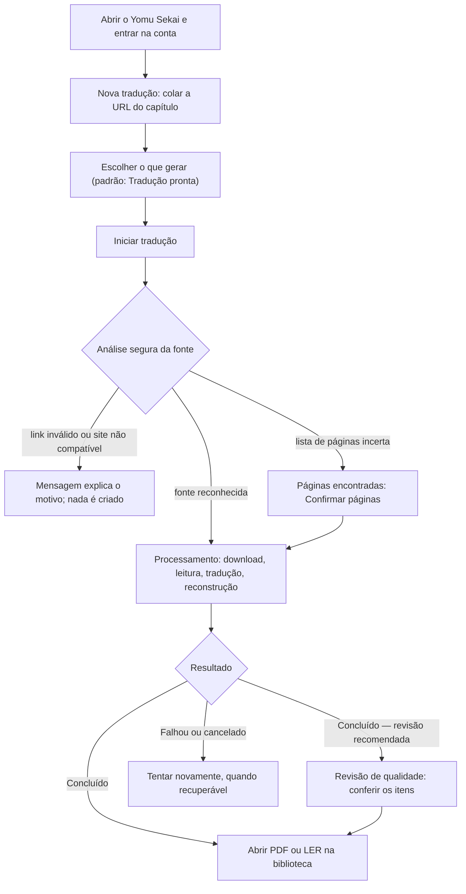
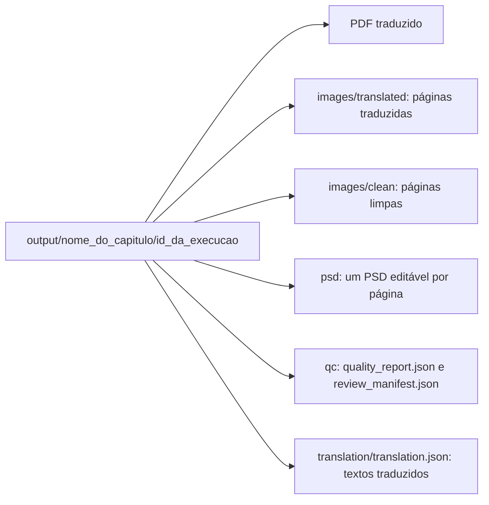

# Yomu Sekai — Guia do Usuário

> **Base verificada:** `5f482ce1` · **Revisado em:** 2026-10-24
> **Para quem é:** Scans, tradutores, editores e testadores da Beta. Nenhum conhecimento
> técnico é necessário.

O produto é chamado **Yomu Sekai**; alguns títulos e nomes de arquivos antigos ainda dizem
“Tradutor IA”.

---

## Sumário

1. [O que o Tradutor IA faz](#1-o-que-o-tradutor-ia-faz)
2. [O que a Beta atual já permite](#2-o-que-a-beta-atual-já-permite)
3. [O que você precisa no computador](#3-o-que-você-precisa-no-computador)
4. [Como instalar hoje](#4-como-instalar-hoje)
5. [Abrindo o programa pela primeira vez](#5-abrindo-o-programa-pela-primeira-vez)
6. [Entrando na sua conta](#6-entrando-na-sua-conta)
7. [Conhecendo as telas](#7-conhecendo-as-telas)
8. [Traduzindo um capítulo, passo a passo](#8-traduzindo-um-capítulo-passo-a-passo)
9. [Escolhendo o modo e o escopo](#9-escolhendo-o-modo-e-o-escopo)
10. [Acompanhando o progresso](#10-acompanhando-o-progresso)
11. [Revisão das páginas encontradas](#11-revisão-das-páginas-encontradas)
12. [Cancelar uma tradução](#12-cancelar-uma-tradução)
13. [Se o programa fechar ou travar no meio](#13-se-o-programa-fechar-ou-travar-no-meio)
14. ["Revisão necessária": o que significa](#14-revisão-necessária-o-que-significa)
15. [Onde ficam o PDF e os arquivos](#15-onde-ficam-o-pdf-e-os-arquivos)
16. [Biblioteca: capítulos traduzidos](#16-biblioteca-capítulos-traduzidos)
17. [Traduzir vários capítulos de uma vez](#17-traduzir-vários-capítulos-de-uma-vez)
18. [Comunidade](#18-comunidade)
19. [Configurações](#19-configurações)
20. [Mensagens de erro e o que fazer](#20-mensagens-de-erro-e-o-que-fazer)
21. [Como reiniciar com segurança](#21-como-reiniciar-com-segurança)
22. [Privacidade e segurança](#22-privacidade-e-segurança)
23. [Limitações desta versão](#23-limitações-desta-versão)
24. [Perguntas frequentes](#24-perguntas-frequentes)
25. [Precisa de mais ajuda?](#25-precisa-de-mais-ajuda)

---

## 1. O que o Tradutor IA faz

Você informa o endereço de um capítulo. O Tradutor IA então:

1. **Analisa o capítulo** e descobre quais são as páginas de verdade;
2. **Baixa as imagens** e confere se todas chegaram inteiras;
3. **Encontra os balões** e lê o texto dentro deles;
4. **Traduz** o texto para português do Brasil;
5. **Redesenha as páginas**, apagando o texto original e escrevendo a tradução por cima,
   preservando a arte;
6. **Monta um PDF** do capítulo traduzido;
7. **Marca o que merece sua atenção**, em vez de fingir que ficou tudo perfeito.

O Yomu coordena a leitura e salva os outputs no seu computador. A tradução usa o provider
configurado pela conta; autenticação, autorização e a contabilização da execução também usam o
backend do produto. Os artefatos locais só são publicados na Comunidade se você escolher essa
ação explicitamente.

> 💡 O programa foi feito para ser honesto. Quando ele não tem certeza de alguma coisa, ele
> avisa em vez de inventar.

## 2. O que a Beta atual já permite

| Recurso | Disponível? |
| --- | --- |
| Traduzir um capítulo a partir de um endereço da internet | ✅ Sim |
| Traduzir imagens que já estão no seu computador (pasta do capítulo ou imagens avulsas) | ✅ Sim, no aplicativo desktop |
| Fila com vários capítulos em sequência | ✅ Sim |
| Continuar processando com a janela do Yomu fechada | ✅ Sim, o worker é independente da interface |
| Biblioteca com os capítulos já traduzidos | ✅ Sim |
| PDF do capítulo | ✅ Sim |
| Escolher o que gerar (Tradução pronta, Apenas Clean, Completo e outras opções) | ✅ Sim |
| Pacote Completo com imagens limpas, PSD editável, relatório e índice de revisão | ✅ Sim |
| Tela de revisão de qualidade | ✅ Sim |
| Efeitos sonoros (SFX) traduzidos para onomatopeias em português | ✅ Sim, por padrão (ver [seção 14](#14-revisão-necessária-o-que-significa)) |
| Comunidade (descobrir e publicar traduções) | ⚠️ Parcial — a aba mostra **EM DESENVOLVIMENTO** |
| Scan Studio (ajuste manual de cada etapa) | ⏳ Planejado — a aba **Scans** mostra **EM DESENVOLVIMENTO** |
| Instalação para usuário final | ⚠️ Parcial — não há instalador público para baixar; use o pacote entregue por quem coordena a Beta ou a instalação pelo repositório |
| Atualização pelo aplicativo | ⚠️ Parcial — a tela **Atualizações** existe, mas só encontra algo quando há uma versão assinada publicada no canal Beta |
| Conta/licença de tester | ⚠️ Parcial — o programa verifica o acesso Beta ao iniciar uma tradução; a liberação de acesso depende de quem coordena a Beta |

## 3. O que você precisa no computador

- **Windows 64 bits** (é o único sistema testado de ponta a ponta);
- **Google Chrome** pode ser necessário para caminhos de descoberta/download que usam fallback de navegador; algumas fontes usam HTTP direto;
- **Conexão com a internet** durante a tradução;
- Espaço livre em disco — um capítulo completo com imagens, páginas redesenhadas e PDF
  pode ocupar algumas centenas de megabytes;
- Uma **conta** para entrar no programa;
- Uma **chave do serviço de tradução** (fornecida junto com o acesso à Beta).

## 4. Como instalar hoje

Ainda **não existe um instalador público** (`Setup.exe`) para baixar. Há dois caminhos:

- se quem coordena a Beta te entregou um pacote/atalho do Yomu Sekai já preparado, use-o — você
  não precisa clonar o repositório nem preparar Python;
- caso contrário, a instalação é feita a partir do repositório, seguindo o procedimento técnico
  em [Instalação](../INSTALLATION.md).

A instalação limpa em um Windows novo ainda não foi comprovada de ponta a ponta.

Se você recebeu um computador ou uma pasta já preparada, pule direto para a
[seção 5](#5-abrindo-o-programa-pela-primeira-vez).

Se você mesmo vai preparar a instalação, o passo a passo técnico está em
[Instalação (documentação técnica)](../INSTALLATION.md) e em
[Ambiente de desenvolvimento](../technical/DOCUMENTACAO_TECNICA.md#27-ambiente-de-desenvolvimento-e-comandos).
Em resumo, esse caminho envolve instalar o Python, baixar o projeto, instalar as
dependências e preencher um arquivo de configuração com a sua chave de tradução e os dados
da sua conta.

> 💡 **Você não precisa fazer isso sozinho.** Se você é testador Scan e não trabalha com
> programação, peça a instalação preparada a quem coordena a Beta. Este guia assume que o
> programa já está instalado.

## 5. Abrindo o programa pela primeira vez

Abra o atalho do Yomu Sekai fornecido com o pacote. Na versão desktop, a interface aparece em
uma janela nativa do aplicativo.

O que acontece:

1. O runtime local inicia os serviços de interface e processamento;
2. A janela desktop do Yomu Sekai mostra a interface.

`http://127.0.0.1:8080` é o endereço local usado pelo runtime, não um substituto para abrir o
aplicativo desktop. Para uma execução a partir do repositório, consulte o launcher e o ambiente
descritos na documentação técnica.

> 💡 O serviço de processamento continua funcionando mesmo se você fechar a janela do
> aplicativo. Um capítulo que já começou não é perdido apenas por fechar a interface.

> ⚠️ Encerre o Yomu pelo próprio aplicativo quando não houver processamento em andamento.

## 6. Entrando na sua conta

O Tradutor IA pede **login**. Sem entrar na conta você não consegue criar traduções nem ver
a biblioteca.

Na tela de acesso você verá:

- campos **E-mail** e **Senha**;
- a opção **Lembrar de mim** e o link **Esqueci minha senha**;
- o botão **Entrar**;
- um indicador de conexão: *verificando serviço…*, *serviço conectado* ou
  *sem conexão com o serviço*.

Se você ainda não tem conta, use **Criar conta** e confirme o endereço pelo e-mail. A
confirmação não faz login automaticamente: depois da mensagem de confirmação, volte ao Yomu
e entre com seu e-mail e senha.

O callback de autenticação usado pelo aplicativo é local:
`http://127.0.0.1:8080/auth/callback`. Abra a mensagem no mesmo computador em que o Yomu está
rodando. Em celular ou outro dispositivo, `127.0.0.1` aponta para esse próprio dispositivo,
não para o computador com o Yomu; a confirmação pode concluir, mas o callback local não estará
disponível ali. Recuperação e troca de senha estão disponíveis pelo fluxo do aplicativo; o
retorno PKCE é usado quando necessário.

## 7. Conhecendo as telas

Na lateral existe um menu com as áreas do programa:

| Área | Para que serve |
| --- | --- |
| **Início** | Resumo: séries em andamento, atividade recente e atalhos rápidos |
| **Nova tradução** | Onde você começa a tradução de um capítulo |
| **Fontes** | Atalhos para Webtoon, Comix e Vortex Scans. Também é possível escolher uma pasta local na tela Nova tradução. |
| **Fila** | Vários capítulos enfileirados para processar em sequência |
| **Capítulos traduzidos** | Sua biblioteca local: ler, abrir pasta e ver relatórios |
| **Leitor** | Lê o capítulo escolhido dentro do próprio programa |
| **Recompensas** | Acompanha seus Yomu Keys e seu progresso (rank e XP) |
| **Scans** | Scan Studio — ainda **em desenvolvimento**; a aba só apresenta o que está planejado |
| **Comunidade** | Ainda **em desenvolvimento**: a aba avisa que "A comunidade ainda não está disponível nesta versão." |
| **Atualizações** | Mostra sua versão e permite **Verificar atualizações** (ver [seção 19](#19-configurações)) |
| **Configurações** | Preferências do programa |

No topo da janela aparecem também seu saldo de **YK** (Yomu Keys), seu rank e, quando houver uma
atualização disponível, o selo **↑ Atualizar**.

> 💡 Atalhos: as teclas numéricas trocam de aba na ordem do menu, e **Enter** inicia a análise
> da URL na tela de nova tradução.

A aba **Fontes** é só um atalho: ela mostra os sites com atalho integrado — **Webtoon**
(https://www.webtoons.com/en/), **Comix** (https://comix.to/browse?genres_in=101137) e
**Vortex Scans** (https://vortexscans.org/). Ao clicar em "Abrir …", o site abre no seu
**navegador padrão** (o Yomu continua aberto). Lá você encontra o capítulo, **copia a URL**
e volta ao Yomu para colar na aba **Nova tradução** — o processamento continua no fluxo
normal. A aba Fontes não baixa nem processa nada por conta própria e não consulta os sites
ao ser aberta.

## 8. Traduzindo um capítulo, passo a passo

O caminho normal é este:



Detalhando:

**1. Abra a aba "Nova tradução".**

**2. Escolha a origem do capítulo.** Há três cartões:

- **URL pública** — você cola o endereço do capítulo no campo **URL do capítulo**;
- **Pasta do capítulo** — clique em **Selecionar pasta do capítulo** e escolha uma pasta que
  já contém as imagens. O Yomu carrega as imagens PNG/JPG/JPEG que estão diretamente nessa
  pasta (subpastas não entram);
- **Imagens** — clique em **Adicionar imagens** e escolha uma ou várias páginas (PNG ou JPG);
  **Limpar** esvazia a seleção.

Nas duas opções locais aparece a lista **Páginas do capítulo**, com prévia e **Ampliar**, para
conferir a ordem antes de iniciar. O seletor de pasta e de imagens só funciona dentro do
aplicativo desktop do Yomu. Com origem local, o escopo fica sempre em **completo** e o modo
**Download-only** não está disponível.

**3. Confira os campos automáticos.** O **Nome do capítulo** e a **Pasta de saída** são
sugeridos sozinhos; você pode ajustá-los.

**4. Escolha o que você quer gerar** (veja a [seção 9](#9-escolhendo-o-modo-e-o-escopo)). O
padrão é **Tradução pronta**. A escolha fica lembrada neste computador.

**5. Clique em "Iniciar tradução".** O programa analisa a fonte automaticamente antes de
criar o processamento. Se o link for inválido, a página não existir, a fonte estiver
temporariamente indisponível ou o site ainda não for compatível, nenhum processamento é
criado e a mensagem explica o motivo.

Quando um site ainda não é compatível, o Tradutor IA pergunta se você quer enviar o link ao
desenvolvedor. Esse envio exige clique explícito e registra apenas metadados sanitizados
como URL, domínio, motivo e versão do app; não envia cookies, senhas, tokens ou imagens do
capítulo.

> ⚠️ Use apenas conteúdo que você tem autorização para processar.

## 9. Escolhendo o modo e o escopo

### Modo de processamento

Uma lista suspensa, logo abaixo de **Idioma original** (fixo em inglês). O padrão é
**Qualidade**. Abaixo dela, uma linha curta descreve o modo selecionado.

| Modo | Quando usar |
| --- | --- |
| **Qualidade** (padrão) | Processa o capítulo para tradução, com validação; use para gerar os arquivos finais. |
| **Download-only** | Só coleta e valida as páginas. Não executa OCR nem tradução, não chama provider e não consome YK. Útil para conferir a coleta. |

`Rápido` não é oferecido como escolha na interface atual. A CLI ainda aceita `fast` para uso
técnico/compatibilidade.

### O que você quer gerar?

Os cartões se adaptam à largura da tela. A seleção fica destacada e o resultado entregue
aparece no rodapé de cada cartão. O painel Pipeline acompanha o job sem limpar o progresso
ao voltar à aba. O tempo restante é uma estimativa **da etapa atual**, calculada após haver
progresso suficiente; se os eventos pararem, o painel informa que aguarda atualização.

Em **Fontes**, as miniaturas são capturas novas dos sites públicos, atualizadas a cada minuto
enquanto a aba está aberta e visível. O horário identifica a captura. Em caso de falha, a última
prévia permanece com aviso; ela não é apresentada como atual. A primeira captura pode demorar
alguns segundos. Nenhuma conta dos sites é usada nas capturas.

A escolha do resultado é separada do modo. Três cartões aparecem primeiro; **Mais opções**
mostra os outros três:

| Cartão | O que você recebe |
| --- | --- |
| **Tradução pronta** (Recomendado, padrão) | Traduz, remove o texto original e aplica a tradução: **PDF pronto para ler**. |
| **Apenas Clean** | Remove os textos e entrega as **imagens limpas**, sem traduzir (não chama o serviço de tradução nem consome YK). |
| **Completo** | **Todos os arquivos**: PDF, imagens limpas, PSD editável (Photoshop/Photopea) e revisão. Gera arquivos adicionais e usa mais espaço em disco. |
| **Apenas tradução** (Mais opções) | **Só os textos traduzidos**, sem modificar as imagens. Ao terminar, use **Ver tradução**. |
| **Tradução + Clean** (Mais opções) | Traduz e gera as imagens limpas **sem aplicar a tradução** — para diagramar depois. |
| **Personalizado** (Mais opções) | Você marca as etapas: **Traduzir textos**, **Gerar imagens limpas**, **Aplicar texto traduzido**, **Gerar PDF**, **Gerar PSD profissional**, **Gerar relatório/revisão QC**. Etapas necessárias são acrescentadas e explicadas automaticamente. |

Download-only ignora essa escolha e salva somente o conteúdo original. Para localizar cada
arquivo, veja [Onde ficam o PDF e os arquivos](#15-onde-ficam-o-pdf-e-os-arquivos).

O serviço de tradução usado é o configurado para a sua instalação (padrão: DeepL); não há
escolha de motor de tradução nem de OCR na tela, e o programa **nunca** troca de serviço por
conta própria.

Uma tradução nova em **Qualidade** consome 1 YK por capítulo somente depois de o provider
concluir e a tradução válida ficar persistida. Falha antes desse ponto consome 0; uma falha posterior ao
salvar a tradução ou gerar os arquivos não devolve automaticamente o YK. Retry/re-export
reutiliza a tradução salva, sem outra chamada ao provider nem outro YK.

### Escopo

Quantas páginas processar: **completo**, **3**, **5**, **20**, **50** ou um número que você
escolher.

> 💡 Para testar um capítulo novo, comece com **3 ou 5 páginas**. Se o resultado agradar,
> refaça no escopo completo.

### Opções

| Opção | O que faz |
| --- | --- |
| **Usar cache** | Reaproveita download, OCR e tradução já validados. |
| **Forçar reprocessamento** | Ignora o cache de OCR, tradução e renderização e refaz tudo. Mais lento. |
| **Contexto temporário do capítulo** | Mantém nomes e termos consistentes entre os balões. |
| **Abrir pasta ao terminar** | Mostra os arquivos assim que o capítulo ficar pronto. |

Ao abrir uma tradução nova, o formulário começa com **Forçar reprocessamento** ligado e
**Usar cache** desligado, para processar a fonte de novo. Inverta as duas opções se quiser
reaproveitar o que já foi validado antes.

## 10. Acompanhando o progresso

O painel **Pipeline** mostra as etapas na ordem. Em linguagem simples:

| Etapa na tela | O que está acontecendo |
| --- | --- |
| **Análise segura da fonte** | O programa está descobrindo quais são as páginas do capítulo |
| **Revisão das páginas** | Ele encontrou as páginas, mas quer que você confirme antes de continuar |
| **Download das páginas** | Está baixando as imagens e conferindo se chegaram inteiras |
| **Identificando regiões** | Está localizando os balões e as áreas que podem conter texto |
| **Lendo textos** | Está lendo o que está escrito nas imagens |
| **Tradução** | Está traduzindo os textos para português |
| **Reconstruindo páginas** | Está apagando o texto original e escrevendo a tradução, preservando a arte |
| **Preparando documento** | Está montando o arquivo final |
| **Verificando resultado** | Está conferindo o resultado e separando o que merece sua atenção |

Só aparecem as etapas que o resultado escolhido realmente usa: **Apenas tradução** não mostra
*Reconstruindo páginas* nem *Preparando documento*, e **Apenas Clean** não mostra *Tradução*.

Você também verá mensagens curtas como *"Na fila..."*, *"Iniciando o worker..."*,
*"Obtendo as páginas..."*, *"Lendo textos..."*, *"Traduzindo o capítulo..."* e
*"Reconstruindo a arte..."*, além de uma estimativa de tempo. Em algumas fontes pode aparecer
*"Aguardando verificação da fonte no navegador..."*: o site pediu uma verificação e o programa
espera que ela seja concluída no navegador antes de seguir.

> 💡 **"Worker"** é o nome do serviço que faz o processamento em segundo plano. Quando uma
> mensagem fala em worker, ela está falando dessa parte do programa.

O status geral aparece com nomes simples: *na fila · aguardando*, *processando*,
*confirme as páginas*, *fonte analisada*, *concluído*, *concluído — revisão recomendada*,
*revisão concluída*, *cancelado*, *falhou*.

## 11. Revisão das páginas encontradas

Às vezes o programa encontra as páginas, mas **não tem certeza suficiente** de que a lista
está completa e na ordem certa. Em vez de arriscar, ele para e mostra o painel
**Páginas encontradas**.

Você pode:

- **Confirmar páginas** — segue para o download e o restante do processo;
- **Tentar nova análise** — refaz a descoberta;
- **Cancelar** — descarta este capítulo.

> 💡 Nesse momento **nada foi baixado nem traduzido ainda**. Cancelar aqui não desperdiça
> trabalho.

## 12. Cancelar uma tradução

Use o botão **Cancelar processamento** no cartão de status.

O que acontece: o programa avisa o serviço de processamento, encerra o trabalho com
segurança e **preserva o que já tinha sido produzido**. Nada é apagado por trás.

Um capítulo cancelado aparece como **cancelado**. Quando ele é recuperável, o botão
**Tentar novamente** fica disponível: o programa pede **Confirmar nova tentativa** e, ao
confirmar em **CRIAR RETRY**, cria uma nova tentativa vinculada, preservando a execução
anterior e seus arquivos.

## 13. Se o programa fechar ou travar no meio

O Tradutor IA foi feito esperando que coisas ruins aconteçam.

**Se você fechar a janela do Yomu:** o worker independente continua o processamento. Abra
novamente o aplicativo para acompanhar o job; não é necessário abrir o endereço loopback
manualmente no navegador.

**Se o serviço de processamento cair sozinho:** quando você iniciou o programa pelo atalho
normal, ele **percebe a queda e liga um substituto automaticamente**, esperando alguns
segundos entre as tentativas. Se o serviço cair repetidamente (três vezes seguidas), o
programa **para de tentar** e passa a mostrar honestamente que está indisponível — é sinal
de que existe um problema real que precisa ser investigado, e não de que basta insistir.

**Se o computador desligar no meio:** o capítulo fica marcado como **interrompido** e os
arquivos já produzidos continuam na pasta de saída.

### Retomar um capítulo interrompido

Quando um capítulo é interrompido e o programa consegue confirmar que o estado salvo pode
continuar, aparece o aviso **"Processamento interrompido"** com o botão **Retomar**.

Ao clicar em **Retomar**:

- o programa continua o mesmo capítulo, **sem pedir o endereço de novo** e sem criar uma
  tradução duplicada;
- o Tradutor IA **reaproveita o progresso válido que estiver salvo** e continua a partir do
  ponto seguro de recuperação — não é uma promessa de retomar exatamente no último passo,
  e sim de não jogar fora o que já estava confirmado;
- o capítulo volta para a **fila normal** e começa quando chegar a vez dele. Se o serviço
  de processamento estiver fora do ar, ele fica aguardando; assim que o serviço voltar, o
  trabalho segue sozinho.

O botão só aparece quando o **programa** confirma que a retomada é segura — não basta o
capítulo estar marcado como interrompido. Um capítulo interrompido antes de o trabalho
realmente começar, por exemplo, não tem o que retomar e **não** mostra o botão. Nesse caso
inicie o capítulo novamente: os arquivos anteriores não são apagados e o reaproveitamento
de cache deixa a nova execução mais rápida.

Clicar duas vezes não cria dois trabalhos: enquanto o pedido está em andamento o botão fica
como **Retomando…** e desabilitado, e o programa recusa um segundo pedido para o mesmo
capítulo.

Se o capítulo já tiver mudado de estado (por exemplo, se ele já voltou a rodar), a
retomada é recusada com uma mensagem clara e a tela se atualiza sozinha com a situação
real. O botão continua disponível depois de um erro; nada é dado como retomado sem o
programa confirmar.

Um capítulo com estado **erro** ou **cancelado** que seja recuperável continua tendo o
botão **Tentar novamente**, que é outra coisa: ele começa uma nova tentativa em vez de
continuar de um ponto salvo.

## 14. "Revisão necessária": o que significa

Há três resultados distintos: **Concluído** (saída estruturalmente válida sem pendência
conhecida), **Concluído — revisão recomendada** (saída válida com pontos de QC humano) e
**Falhou** (não foi possível produzir uma saída estruturalmente confiável).

Quando um capítulo termina como **Concluído — revisão recomendada**, isso **não quer dizer
que a tradução falhou**. O pipeline terminou e os arquivos foram produzidos; há pontos que
merecem conferência humana:

> O resultado foi criado e está pronto para uso, mas alguns pontos não puderam ser provados como
> corretos automaticamente, e o programa prefere te mostrar a fingir que estava tudo certo.

Motivos comuns:

- um **logo** ou **título** desenhado, que não é texto comum;
- uma leitura **incerta** de uma palavra pequena, borrada ou estilizada;
- um **nome próprio** que o programa preferiu não alterar;
- um trecho de texto original que a verificação **não conseguiu provar** que foi tratado;
- uma região em que a **reconstrução da arte ficou incerta**: a tradução é desenhada mesmo
  assim — para a página não voltar com o texto em inglês — e o trecho entra na revisão para
  você conferir;
- um **efeito sonoro** que o programa não soube converter com segurança.

### Efeitos sonoros (SFX)

Por padrão, efeitos sonoros conhecidos **são traduzidos** para a onomatopeia usada em
português — por exemplo, "BANG" vira "BAM" e "\*bite\*" vira "\*morde\*". Letras esticadas,
maiúsculas e asteriscos do original são mantidos. Um som que o programa não conhece
**mantém o letreiro original**, em vez de receber uma tradução literal. Esse comportamento
não tem um botão na tela de configurações; se a sua instalação precisar manter todos os
efeitos sonoros em inglês, peça a quem preparou a instalação.

### Texto dentro dos balões

Dentro de balões fechados, a tradução é quebrada no formato do balão (linhas mais largas no
meio, mais estreitas nas pontas), sem diminuir a fonte em relação ao encaixe normal.

### A tela de revisão

Na tela de **Revisão de qualidade** você pode filtrar por **Pendentes**, **Todos**,
**Concluídos**, **Rejeitados**, **Aplicados**, **Revisão manual** e outros; marcar
**Selecionar todos do filtro atual**, **Desfazer última ação em massa**, **Reprocessar
pendências**, **Revisar capítulo inteiro**, **Confirmar revisão** ou gerar uma nova saída em
PNG, PDF ou PSD com **GERAR NOVAMENTE** (sem custo adicional de YK).

**A Revisão é um controle de qualidade linguístico.** Para cada pendência ela mostra o
**texto original** detectado, a **tradução** atual e um **aviso em português** explicando por
que o trecho merece atenção (por exemplo: *OCR com baixa confiança*, *Possível texto em
inglês*, *Tradução requer revisão*, *Texto original mantido*). Você pode **editar a tradução**
ali mesmo (com acentos e várias linhas), **aprovar** quando estiver boa e passar para a
próxima. Aprovar significa que a **tradução** está adequada — não é uma promessa de tipografia
perfeita.

> 🎨 Ajustes **visuais/tipográficos** avançados (fonte, tamanho fino, posição, efeitos) não são
> feitos na Revisão: eles pertencem ao **PSD editável** (perfil profissional), que você abre no
> Photoshop/Photopea. A Revisão cuida do texto; o PSD cuida do visual.

> 💡 Um capítulo **Concluído — revisão recomendada** já tem seus arquivos de saída. Você pode abri-los e usá-los enquanto
> decide o que revisar.

## 15. Onde ficam o PDF e os arquivos

### Após a tradução

Quando uma tradução termina, o resultado indica quantas páginas foram processadas e mostra
somente as ações correspondentes aos arquivos que existem. **Abrir PDF** abre o documento
no leitor padrão; **Abrir pasta** mostra a saída desta execução. Em **Apenas tradução** e
**Tradução + Clean** aparece **Ver tradução**, que mostra o texto original e a tradução de
cada página sem você precisar abrir arquivos técnicos. No resultado **Completo** também podem
aparecer **Abrir Review**, **Abrir PSDs** e **Abrir pasta de QC**, conforme os artefatos
produzidos. A lista mostra apenas o que foi gerado, com a marca "Pronto".

**Revisão recomendada não significa falha.** O resultado foi gerado normalmente; a Review
permite conferir os itens sinalizados sem refazer a tradução. Se o processamento falhar, a
tela informa a falha e oferece nova tentativa apenas quando ela é recuperável. Um
processamento cancelado é identificado separadamente. **Nova tradução** volta ao formulário
sem apagar os arquivos anteriores.

Tudo fica dentro da pasta de saída local, em `output/`. Jobs da interface mantêm execuções
separadas por capítulo/run; a organização exata pode variar para outputs legados e execuções
de CLI. Confie nos caminhos gravados nos manifests da execução, não em nomes montados à mão.

```text
output/<nome_do_capitulo>/<id_da_execucao>/
```

Visão simplificada do que pode existir dentro da pasta de uma execução (só aparece o que o
resultado escolhido gerou):



Isso permite repetir o mesmo capítulo sem apagar o PDF ou os relatórios da execução
anterior. Capítulos gerados por versões antigas podem continuar aparecendo diretamente em
`output/<nome_do_capitulo>/`.

| O que procura | Conteúdo |
| --- | --- |
| Resultado para leitura | PDF traduzido e imagens traduzidas. |
| Completo | Imagens limpas, um PSD por página, Quality Report e Review Manifest. |
| Apenas tradução | `translation/translation.json` (aberto pela ação **Ver tradução**). |
| Diagnóstico interno | Manifests de job/run, relatório de download e tempos, quando produzidos. |

O contrato V2 define os caminhos canônicos (`images/translated/`, `images/clean/`, `psd/`,
`qc/quality_report.json` e `qc/review_manifest.json`). Compatibilidade com execuções anteriores
e alguns writers ainda pode deixar aliases/relatórios na raiz do output; o
`artifact_manifest.json` e os caminhos do job identificam o que foi realmente produzido.
Veja [Saídas e artefatos](../OUTPUT_ARTIFACTS.md) para detalhes.

A forma mais fácil de chegar lá é pela aba **Capítulos traduzidos**, que abre o PDF ou a
pasta para você.

## 16. Biblioteca: capítulos traduzidos

A aba **Capítulos traduzidos** é sua biblioteca local. Ela tem busca por nome e mostra o
total de capítulos.

Cada item tem **LER** como ação principal e, conforme os arquivos que existem, botões como
**Abrir PDF**, **Imagens limpas**, **Ver tradução**, **PSDs editáveis**, **Relatório de QC**,
**Abrir pasta**, **Reprocessar** e **Excluir capítulo**. O botão **Selecionar** permite marcar
vários capítulos e excluí-los de uma vez (**Excluir selecionados**).

Capítulos traduzidos em versões antigas do programa também aparecem: eles são descobertos
pela pasta `output/`, mesmo sem registro interno.

### Lendo um capítulo dentro do programa

Clique em **LER** no capítulo desejado. Ele abre na aba **Leitor**, sem sair do Tradutor IA.

Na barra do leitor você tem:

| Controle | O que faz |
| --- | --- |
| ← (o primeiro, à esquerda) | volta para **Capítulos traduzidos** |
| Miniaturas | mostra ou esconde a coluna de páginas em miniatura |
| **Contínuo** / **Página única** | leitura contínua (rolagem) ou uma página por vez |
| ‹ e › | página anterior e próxima |
| Caixa de página | digite um número e pressione **Enter** para pular direto |
| − e + | diminui e aumenta o zoom |
| **100 %** | volta ao tamanho original |
| **Largura** | ajusta a página à largura da tela — o modo mais confortável para manga vertical |
| **Página** | mostra a página inteira de uma vez |
| Tela cheia | usa a tela toda |
| ↗ | abre o PDF no visualizador do seu computador |

Pelo teclado: **←** e **→** (ou **Page Up** / **Page Down**) trocam de página, **Home** e
**End** vão para a primeira e a última, **+** e **−** dão zoom, **W** ajusta à largura e
**P** ajusta à página. Enquanto você digita na caixa de página, os atalhos ficam desligados.

Clicar em uma miniatura leva direto àquela página, e a miniatura da página atual fica
sempre visível na coluna.

Um capítulo marcado como **Revisão necessária** também pode ser lido normalmente — o
leitor apenas mostra um aviso discreto no topo.

Se o arquivo de um capítulo antigo tiver sido movido ou apagado, o leitor avisa
("O PDF desta execução não está disponível.") em vez de ficar carregando para sempre.
E se a sua sessão tiver expirado, ele diz exatamente isso — "Sua sessão expirou. Entre
novamente para ler este capítulo." — em vez de sugerir que o PDF está quebrado.

> O leitor nunca altera nada. Ler um capítulo não modifica o PDF, as páginas nem os
> relatórios.

## 17. Traduzir vários capítulos de uma vez

A aba **Fila** serve para lotes — ideal para vários capítulos da mesma série.

1. Cole uma URL em **URL do capítulo** e clique em **Adicionar à fila** (ou pressione
   **Enter**);
2. Repita quantas vezes quiser;
3. Clique em **Iniciar fila**.

Os capítulos são processados **um por vez, em sequência**. Você pode **limpar** a fila ou
**cancelar** o processamento.

> 💡 Um de cada vez é proposital: leitura de imagem e tradução consomem bastante memória, e
> processar vários em paralelo tornaria tudo mais lento e menos confiável.

## 18. Comunidade

**Estado: PARCIAL.** Nesta versão a aba **Comunidade** mostra o selo **EM DESENVOLVIMENTO** e o
aviso "A comunidade ainda não está disponível nesta versão." — não há feed, favoritos nem
notificações para usar ali.

Na biblioteca (**Capítulos traduzidos**), um capítulo concluído com PDF pode exibir o botão
**Publicar na comunidade** (ou **Publicação indisponível** / **Revisão necessária** quando
ainda não pode ser publicado). Publicar depende do serviço da comunidade estar ativo para a sua
conta; se não estiver, isso é esperado e não é um erro do seu computador.

> 🔒 **Nada do seu computador vai para a comunidade sozinho.** Terminar uma tradução,
> exportar, salvar ou reiniciar o programa **não publica nada**. O único caminho para um
> arquivo sair da sua máquina é você abrir **Publicar na comunidade** e confirmar.

Na janela de publicação você informa título, descrição e tags, escolhe a **Visibilidade**
(**Comunidade** ou **Privado**), decide se quer **Permitir comentários nesta publicação** e
precisa marcar as duas confirmações (permissão para publicar e revisão do resultado) antes de
**Publicar**.

## 19. Configurações

Principais preferências disponíveis:

No topo há cartões de resumo (modo padrão, leitura de texto, processamento paralelo, contexto
de capítulo) e o indicador **Worker remoto de limpeza**, que mostra apenas a disponibilidade
técnica desse serviço; ele não inicia um job nem comprova login no Gemini.

- **Geral** — idioma da interface (Automático — sistema, Português do Brasil, English,
  Español, Français, 日本語, 한국어), tema, página inicial, abrir pasta ao terminar,
  notificações no dispositivo, confirmar ações destrutivas;
- **Processamento** — modo padrão, escopo padrão (capítulo inteiro ou amostra de teste), usar
  cache quando seguro, usar contexto temporário, concorrência segura;
- **Arquivos** — retenção de outputs, limite de cache, confirmar antes de apagar, limpeza
  manual de temporários;
- **Acessibilidade e privacidade** — reduzir animações, aumentar contraste, escala da
  interface, mostrar tooltips, atalhos de teclado, **limpar sessão**, **limpar dados deste
  dispositivo**;
- **Anúncios** — **Anúncios passivos**: com eles ligados, você pode usar YK diários; YK
  permanentes continuam disponíveis com os anúncios desligados;
- **Atualizações** — versão instalada e o botão **Verificar atualizações** (ver abaixo);
- **Sobre** — botões **Salvar configurações** e **Restaurar padrão**.

### Atualizações

**Estado: PARCIAL.** A verificação existe na aba **Atualizações** (botão **Verificar
atualizações**) e em **Configurações › Atualizações**. O programa também verifica sozinho
alguns segundos depois de abrir e, se houver novidade, mostra o selo **↑ Atualizar** no topo.

- *Você está na versão mais recente.* — nada a fazer;
- *Canal de atualização não configurado.* — sua instalação não recebe atualizações por aqui;
  fale com quem coordena a Beta;
- *Atualização disponível: …* — clique em **Baixar atualização** (ou **Baixar e instalar** na
  aba Atualizações). O download é verificado antes de ser usado; depois clique em **Instalar e
  reiniciar** (ou **Instalar agora**). O Yomu fecha para concluir a instalação;
- *Não foi possível verificar atualizações.* — confira a internet e tente de novo.

Só aparece uma versão quando existe uma atualização assinada publicada no canal Beta; este
guia não garante que haja uma versão mais recente disponível. O fluxo completo de atualização
ainda não foi comprovado em uma instalação limpa.

## 20. Mensagens de erro e o que fazer

As mensagens abaixo são as que o programa realmente mostra.

### Problemas com o serviço de processamento

| O que você vê | O que significa | O que fazer |
| --- | --- | --- |
| *Servico de processamento indisponivel.* | O serviço que faz o trabalho pesado não está ligado | Feche o Yomu e abra novamente pelo atalho do aplicativo. Se voltar a acontecer, veja a [seção 21](#21-como-reiniciar-com-segurança) |
| Capítulo parado em **na fila** e nada acontece | Não há serviço de processamento ativo | Mesmo procedimento acima |

### Problemas com a origem do capítulo

| O que você vê | O que significa | O que fazer |
| --- | --- | --- |
| *Não foi possível analisar a fonte.* | O programa não conseguiu entender aquela página | Confira o endereço; tente o link direto do capítulo |
| *Esta fonte ainda não é compatível com o Yomu Sekai.* | O site não é reconhecido | Use um site suportado (aba **Fontes**) ou baixe as imagens e use **Pasta do capítulo** / **Imagens** |
| *A página informada não foi encontrada.* | O endereço não leva a um capítulo | Confira o link |
| *Fontes externas estão bloqueadas até ativar a política.* | A política de fontes deste workspace não autoriza o download | Fale com quem coordena a Beta |
| *Essa fonte exige autenticação.* | O capítulo está atrás de login | Não é possível seguir por aqui |
| *A fonte exige uma verificação interativa.* | Há um desafio anti-robô na página | Não é possível seguir por aqui |
| *A fonte recusou o acesso público.* | O site bloqueou o acesso | Tente mais tarde ou use outra origem |
| *A fonte limitou temporariamente o acesso.* | Muitos acessos em pouco tempo | Espere alguns minutos |
| *A página da fonte não está disponível.* | O endereço não respondeu | Confira se o capítulo ainda existe |
| *Nenhuma página do capítulo foi encontrada.* | Nada reconhecível como página | Confira se é mesmo a página do capítulo |
| *Não foi possível carregar todas as páginas do leitor.* | O leitor não terminou de entregar as páginas | Tente novamente; conexões lentas atrapalham |
| *Algumas páginas não puderam ser baixadas.* | O capítulo ficaria incompleto | O programa prefere parar a entregar capítulo faltando página |

### Problemas com o navegador

| O que você vê | O que fazer |
| --- | --- |
| *Nenhum navegador compatível foi encontrado no computador.* | Instale o Google Chrome |
| *O navegador configurado não foi encontrado.* | Confirme se o Chrome continua instalado |
| *O navegador foi encontrado, mas seu driver não está disponível.* | Peça ajuda técnica — falta um componente do navegador |
| *A versão do driver não é compatível com o navegador instalado.* | O Chrome foi atualizado; o componente precisa ser atualizado junto |
| *O navegador ultrapassou o tempo limite de inicialização.* | Feche janelas do Chrome e tente de novo |
| *O navegador encerrou antes de concluir a análise.* | Tente novamente; se repetir, reinicie o computador |

### Problemas de conexão

| O que você vê | O que fazer |
| --- | --- |
| *O site demorou demais para responder.* | Verifique sua internet e tente de novo |
| *Nao foi possivel conectar ao site.* | Verifique sua internet |
| *Ocorreu um problema ao baixar as imagens.* | Tente novamente |
| *A página ultrapassou o tempo limite de navegação.* | Conexão lenta ou site sobrecarregado |

### Outros

| O que você vê | O que significa | O que fazer |
| --- | --- | --- |
| *Disco cheio ao gravar as páginas baixadas. Libere espaço e tente novamente.* | Sem espaço | Libere espaço e tente de novo |
| *O processamento foi cancelado.* | Você cancelou | Nada a fazer |
| *Tradução concluída. Há pontos que recomendamos revisar.* | Terminou com avisos | Veja a [seção 14](#14-revisão-necessária-o-que-significa) |
| *Yomu Keys insuficientes para iniciar esta tradução.* | Seu saldo de YK não cobre a tradução | Veja seu saldo no topo da janela ou na aba **Recompensas** |
| *Seu acesso à versão beta ainda não está ativo.* / *...ainda não começou.* | O acesso Beta da sua conta não foi liberado | Fale com quem coordena a Beta |
| *Seu acesso à versão beta expirou.* / *...foi revogado.* | O acesso Beta terminou | Fale com quem coordena a Beta para renovar |
| *Seu acesso atual não permite iniciar esta tradução.* | Sua conta não tem permissão para esta ação | Fale com quem coordena a Beta |
| *Este dispositivo não está autorizado para esta conta.* / *O limite de dispositivos autorizados foi atingido.* | O computador não está liberado para a sua conta | Fale com quem coordena a Beta |
| *Configure o arquivo .env e a NVIDIA_API_KEY antes de processar.* | Falta configurar a chave do serviço de tradução | Peça ajuda a quem preparou sua instalação. **Observação:** esta mensagem cita um serviço antigo; o serviço padrão hoje é o DeepL |

### Problemas com a leitura do texto ou a tradução

Falhas nessas etapas aparecem no cartão de status como **erro**, com a mensagem específica
do momento. Regra prática:

- Se o texto ficou lido errado em algumas partes → o capítulo termina em
  **revisão necessária**, e você corrige na tela de revisão;
- Se o serviço de tradução não respondeu ou a chave está faltando → o capítulo termina em
  **erro** e nenhuma tradução parcial é inventada. O programa **nunca** troca de serviço de
  tradução silenciosamente.

## 21. Como reiniciar com segurança

1. Feche a janela do Yomu;
2. Espere alguns segundos;
3. Abra novamente o atalho do aplicativo.

Isso é seguro. Traduções já concluídas continuam na biblioteca, e capítulos que estavam no
meio ficam marcados como interrompidos com os arquivos preservados.

> ⚠️ **Não apague** as pastas `.cache` ou `output` para "resolver" um problema. `output`
> contém suas traduções, e `.cache` contém a lista de trabalhos e o reaproveitamento que
> deixa tudo mais rápido.

## 22. Privacidade e segurança

O que a versão atual realmente faz:

- **Suas traduções ficam no seu computador.** Imagens, textos lidos, traduções e PDFs são
  gravados apenas em pastas locais.
- **Nada é publicado automaticamente.** Publicar exige uma ação sua, explícita e
  autenticada.
- **O programa escuta apenas na sua própria máquina** (`127.0.0.1`). Abri-lo para a rede
  exige uma configuração deliberada.
- **Sua senha não é guardada pelo programa.** O login é feito pelo serviço de
  autenticação, e o programa recebe apenas uma sessão temporária.
- **Chaves e senhas são ocultadas nos registros.** O registro técnico do processo passa por
  uma limpeza antes de ser mostrado ou gravado.
- **A pasta local que você indica não é registrada no histórico** nem copiada para a pasta
  de saída — o programa usa uma cópia temporária interna.

O que a versão atual **não** promete:

- não há garantia de tradução perfeita nem de revisão editorial;
- o programa não obtém direitos sobre o conteúdo que você processa — a responsabilidade
  pelo uso é sua;
- não há criptografia dos arquivos gravados no seu disco.

## 23. Limitações desta versão

- Somente **Windows** foi testado de ponta a ponta;
- Idioma de origem: **inglês**;
- Idioma de destino: **português do Brasil**;
- É necessária **internet** e uma chave válida do serviço de tradução;
- O **Google Chrome** pode ser necessário para capítulos vindos de um endereço (algumas fontes
  usam o navegador; outras, acesso direto);
- Um site que passa na análise **não é necessariamente um site suportado** — sem um
  adaptador específico, o programa pode pedir sua confirmação ou recusar;
- Sites com login, verificação anti-robô ou conteúdo protegido **não são contornados**;
- É possível enfileirar vários capítulos; o processamento segue a capacidade/ordem da fila;
- Efeitos sonoros conhecidos são traduzidos por padrão; os desconhecidos mantêm o letreiro
  original;
- A Comunidade e o Scan Studio ainda estão **em desenvolvimento**;
- Não há escolha de motor de tradução ou de OCR na tela;
- **Retomar** só aparece para capítulos interrompidos que o programa confirmou como
  recuperáveis (ver [seção 13](#13-se-o-programa-fechar-ou-travar-no-meio));
- A disponibilidade de atualização depende do canal Beta fornecido; esta lista não é um checklist de release.

## 24. Perguntas frequentes

**Posso fechar a janela do Yomu enquanto traduz?**
Pode. O worker continua o processamento. Abra novamente o aplicativo para acompanhar; não use o endereço local como substituto da janela desktop.

**Posso desligar o computador no meio?**
Pode, mas o capítulo ficará interrompido. Os arquivos produzidos até ali são preservados.
Ao reabrir o programa, se a retomada for possível o botão **Retomar** aparece para esse
capítulo — inclusive depois de atualizar a página, porque essa informação vem do programa,
e não da tela.

**Quanto tempo leva um capítulo?**
Depende do tamanho, da conexão e do computador. Um capítulo completo típico leva vários
minutos. A etapa de leitura do texto costuma ser a mais demorada.

**Por que meu capítulo terminou em "revisão necessária" se está bonito?**
Porque algum item não pôde ser **provado** correto automaticamente — quase sempre um logo,
uma palavra estilizada ou uma região cuja reconstrução da arte ficou incerta. O PDF está
pronto para uso.

**Posso traduzir imagens que já baixei?**
Pode. Escolha **Pasta do capítulo** ou **Imagens** na tela de nova tradução. O seletor só
funciona dentro do aplicativo desktop do Yomu.

**Por que um efeito sonoro continuou em inglês?**
Efeitos sonoros conhecidos viram onomatopeias em português ("BANG" → "BAM"). Quando o
programa não conhece o som, ele mantém o letreiro original em vez de arriscar uma tradução
literal.

**Posso mudar o serviço de tradução?**
Não pela tela. O serviço é o configurado para a sua instalação (padrão: **DeepL**), e o
programa nunca troca de serviço por conta própria.

**E o motor de leitura de texto (OCR)?**
Nesta beta há um só, **RapidOCR**; não há troca nesta versão. O cartão **Leitura de texto**
em **Configurações** mostra o estado dele.

**Como recebo uma atualização?**
Na aba **Atualizações**, clique em **Verificar atualizações** (veja a
[seção 19](#19-configurações)). O programa só oferece uma versão quando há uma atualização
assinada publicada no canal Beta.

**Minha tradução aparece para outras pessoas?**
Só se você publicar explicitamente na aba **Comunidade**.

**Onde está o PDF?**
Na pasta `output/`, dentro da subpasta do capítulo. A aba **Capítulos traduzidos** abre
para você.

**A tela ficou parada numa etapa. Travou?**
Nem sempre. Leitura de texto e redesenho podem levar minutos sem mudar o número. Se o
horário da última atualização parar de avançar por muito tempo, veja a
[seção 21](#21-como-reiniciar-com-segurança).

## 25. Precisa de mais ajuda?

1. Confira a tabela de [mensagens de erro](#20-mensagens-de-erro-e-o-que-fazer);
2. Abra o Quality Report e a lista de revisão apontados pela execução; os caminhos também
   aparecem no `artifact_manifest.json` e na Review;
3. Se o problema for técnico, o material para quem dá suporte está em
   [Troubleshooting](../TROUBLESHOOTING.md) e na
   [Documentação Técnica](../technical/DOCUMENTACAO_TECNICA.md#28-troubleshooting-técnico).

Ao pedir ajuda, informe: o que você estava fazendo, a mensagem exata que apareceu, e o
nome da pasta do capítulo em `output/`. **Nunca compartilhe sua senha nem sua chave do
serviço de tradução.**

---

### Nota sobre imagens

Este guia ainda **não contém capturas de tela**. Elas não foram incluídas porque as telas
reais só existem depois do login em um ambiente configurado, e capturá-las exigiria expor
dados de conta. Nenhuma imagem foi inventada ou simulada.

As capturas serão adicionadas em `docs/assets/user/` quando puderem ser feitas com uma
conta de demonstração segura. As telas previstas são: acesso, nova tradução (com "O que você
quer gerar?"), origem validada, progresso do pipeline, revisão de páginas, revisão de
qualidade, biblioteca, resultado final, atualizações e **capítulo interrompido com o botão
Retomar**.
